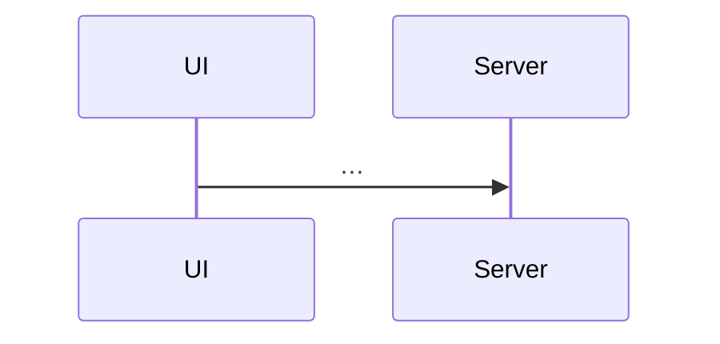

# Lesson XX – Tên lesson

> **Mục tiêu:** học xong lesson này bạn giải thích được … và tự cài được …
>
> **Cần biết trước:** lesson YY (…), khái niệm …

| File | Vai trò |
|---|---|
| `src/lessons/XX-…/…tsx` | … |
| `server/src/…` | … |

## 1. Tên khái niệm

### Trong bài viết
Diễn giải ý chính của mục tương ứng trong bài, bằng lời của mình, rồi dẫn link: [News Feed – mục …](https://www.greatfrontend.com/questions/system-design/news-feed-facebook?format=system-design).

### Code thật

```learn
duong/dan/tu/goc-repo.ts#ten-region
```

1. Dòng … làm …, vì …
2. …



### Vì sao làm vậy

| Cách | Ưu | Nhược | Khi nào chọn |
|---|---|---|---|
| Cách project dùng | … | … | … |
| Cách khác | … | … | … |

### Lỗi hay gặp
- **Lỗi …:** biểu hiện … → nguyên nhân … → project tránh bằng …

### Tự thử
1. Mở `#/lesson-XX`, tab Demo, …
2. Kết quả mong đợi: …

### Câu hỏi phỏng vấn
1. Câu hỏi …?
   > Đáp án gợi ý …

## Tóm tắt
- …
