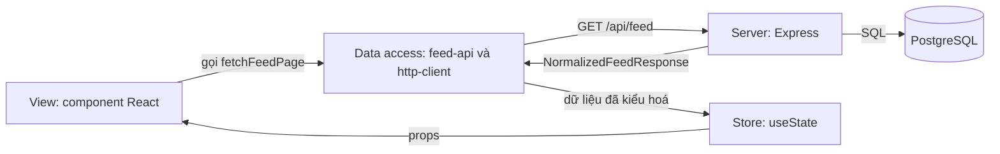

# Lesson 01 – Feed cơ bản và các layer kiến trúc

> **Mục tiêu:** học xong lesson này bạn vẽ được 4 layer của một news feed (Server, Data access, Store, View), giải thích vì sao View không được gọi `fetch` trực tiếp, và đọc hiểu được một component tải feed đúng cách: có `AbortController`, có xử lý lỗi, có tra entity theo id.
>
> **Cần biết trước:** React cơ bản (`useState`, `useEffect`), `fetch` và Promise, khái niệm REST/JSON. Chưa cần biết gì về pagination hay store.

Lesson này là điểm xuất phát. Nó cố ý làm **thô nhất có thể**: chỉ tải một trang, state là `useState`, loading chỉ là chữ "Đang tải…". Mỗi hạn chế ấy là một lý do để có lesson sau (02 cursor, 03 store, 04 infinite scroll + skeleton).

| File | Vai trò |
|---|---|
| `src/lessons/01-basic-feed/lesson-01-basic-feed.tsx` | Demo: tải 10 bài và render, có chú thích các layer |
| `src/shared/api/feed-api.ts` | Data access: hàm `fetchFeedPage`, nơi duy nhất biết URL và query string |
| `src/shared/api/http-client.ts` | Data access: `fetch` bọc thêm retry, backoff, gộp request trùng |
| `src/shared/ui/post-card-basic.tsx` | View: card bài viết đơn giản |
| `shared-contracts/feed-api-contracts.ts` | Hợp đồng kiểu dữ liệu dùng chung giữa client và server |
| `server/src/routes/feed-routes.ts` | Server: route `GET /api/feed` |
| `server/src/services/feed-query-service.ts` | Server: dựng response chuẩn hoá `{ feed, posts, users, media }` |
| `server/src/middleware/simulated-latency-and-failure-middleware.ts` | Server: giả lập độ trễ và lỗi để thử mạng xấu |

## 1. Bốn layer của một feed

### Trong bài viết
Bài GreatFrontEnd chia kiến trúc thành bốn khối: View (thứ người dùng tương tác), Store (nguồn sự thật của state phía client), Data access (lớp che giấu việc gọi API backend) và Server (các endpoint lấy feed, lấy một bài, tạo bài, upload ảnh...). Điểm cần nhớ là mỗi khối có một trách nhiệm, nhờ vậy đổi một khối không kéo đổ cả hệ thống. Bài cũng bàn **CSR hay SSR**: với feed đã đăng nhập, lợi ích chính của SSR là tốc độ hiển thị lần đầu chứ không phải SEO; vì feed cá nhân hoá, tương tác nhiều và cần giữ state sống trong trình duyệt nên CSR là lựa chọn mặc định. Xem mục *Architecture* trong [bài gốc](https://www.greatfrontend.com/questions/system-design/news-feed-facebook?format=system-design).

Trong project này, 4 layer ứng với:

| Layer | Vai trò | Code |
|---|---|---|
| Server | Nguồn sự thật, cá nhân hoá, validate | `server/src/` |
| Data access | Mọi HTTP, retry, cursor | `src/shared/api/` |
| Store | State client | lesson 01 chỉ là `useState` |
| View | Component React | `PostCardBasic`, `LessonLayout` |

### Code thật

Hàm duy nhất mà View được phép gọi để lấy feed (Data access):

```learn
src/shared/api/feed-api.ts#feed-api-fetch-page
```

1. `FetchFeedPageParams` là hợp đồng nhỏ giữa View và Data access: chỉ có `count`, `cursor`, `direction`, `signal` và callback `onRetry` (để UI biết đang thử lại). View không phải biết URL hay cách ghép query string.
2. Dòng `new URLSearchParams({ count: String(count), direction })` ghép query string an toàn, tự mã hoá ký tự đặc biệt. Cursor ở lesson 02 là base64url nên không có vấn đề, nhưng thói quen này tránh lỗi nối chuỗi tay.
3. `if (cursor) params.set('cursor', cursor)` chỉ gửi cursor khi có. Không có cursor nghĩa là "trang đầu" (xem lesson 02).
4. `request<NormalizedFeedResponse>(...)` là `fetch` đã bọc retry/backoff (concept 4). Kiểu trả về `NormalizedFeedResponse` chính là hợp đồng với server.

Hợp đồng dữ liệu mà hai phía cùng import:

```learn
shared-contracts/feed-api-contracts.ts#contract-feed-page
```

1. `FeedPageInfo` mô tả "trang này": danh sách `postIds`, hai cursor, hai cờ `hasOlder`/`hasNewer`, và `generation`.
2. Comment "opaque" nhắc rằng client không được tự parse cursor, chỉ gửi lại nguyên văn (chi tiết ở lesson 02).
3. `NormalizedFeedResponse` gồm `feed` (thứ tự) cộng ba bảng `posts`, `users`, `media` tra theo id. Server và client dùng chung đúng một file kiểu này, nên đổi field ở server mà quên sửa client sẽ lỗi biên dịch ngay.



### Vì sao làm vậy

| Cách | Ưu | Nhược | Khi nào chọn |
|---|---|---|---|
| Tách 4 layer, View gọi qua Data access | Gom retry, auth, base URL, cache vào một chỗ; test View bằng cách giả Data access | Nhiều file hơn cho app nhỏ | Mọi feed thật; app sẽ lớn lên |
| View gọi `fetch` trực tiếp | Ít file, nhanh để thử | Mỗi component tự xử lý lỗi, retry, header; đổi API phải sửa mọi nơi | Prototype dùng một lần |
| SSR cho feed | Nội dung đầu tiên hiện nhanh, tốt cho SEO | Cá nhân hoá khó cache; hydrate nặng | Trang public: permalink bài viết, feed chưa đăng nhập |
| CSR cho feed (project chọn) | Tương tác mượt, dễ cache từng phần ở client | Màn hình đầu phải chờ JS và API | Feed đã đăng nhập, nhiều tương tác |

### Lỗi hay gặp
- **Gọi `fetch` thẳng trong component:** mỗi chỗ tự quên xử lý 503, quên huỷ request. Project ép mọi thứ đi qua `feed-api.ts` và `http-client.ts`, nên retry/backoff chỉ viết một lần.
- **Tin vào dữ liệu client gửi để biết "ai đang xem":** server không nhận `userId` từ client mà lấy từ session cookie (`server/src/middleware/fake-session-middleware.ts`). Nếu tin client, ai cũng giả danh được.
- **Cache feed ở CDN:** feed đã cá nhân hoá (có `viewerReaction`). Route trả `Cache-Control: private, no-store` để chỉ trình duyệt của chính người đó được giữ bản sao.

### Tự thử
1. Chạy `npm run dev`, mở `http://localhost:5173/#/lesson-01`, tab **🧪 Demo**.
2. Mở DevTools, tab Network, lọc `feed`. Kết quả mong đợi: một request `GET /api/feed?count=10&direction=older`. Mở Response thấy bốn khoá `feed`, `posts`, `users`, `media`.
3. Hoặc dùng terminal: `curl -s "http://localhost:3001/api/feed?count=2"`. Kết quả mong đợi: JSON có `feed.postIds` gồm 2 id, `feed.olderCursor` là chuỗi base64url dài, `feed.hasOlder` là `true`.
4. Trong `curl`, thêm `-i` và tìm header `Cache-Control: private, no-store`.

### Câu hỏi phỏng vấn
1. Vì sao View không nên gọi `fetch` trực tiếp?
   > Để gom retry, cache, auth, đổi base URL và mock test vào một chỗ (data access layer). Component chỉ biết "cho tôi một trang feed", không biết HTTP.
2. Khi nào chọn SSR thay vì CSR cho feed?
   > Trang public cần SEO hoặc cần hiển thị nhanh lần đầu (permalink, logged-out). Feed đã đăng nhập thì cá nhân hoá và nhiều tương tác nên CSR hợp hơn. Có thể kết hợp: SSR khung và vài bài đầu, CSR phần còn lại.

## 2. State, effect và AbortController

### Trong bài viết
Bài viết nhấn mạnh feed phải **không bao giờ để người dùng nhìn màn hình trống** và phải tiết kiệm băng thông: đừng gửi request thừa, đừng để dữ liệu đến muộn ghi đè dữ liệu mới. Ở mức component, việc đầu tiên là huỷ request khi không cần nữa. Xem mục *Architecture* và phần bàn về hiệu năng trong [bài gốc](https://www.greatfrontend.com/questions/system-design/news-feed-facebook?format=system-design).

### Code thật

```learn
src/lessons/01-basic-feed/lesson-01-basic-feed.tsx#basic-feed-state-and-fetch
```

1. `useState<NormalizedFeedResponse | null>(null)` giữ nguyên response server trả về. `null` nghĩa là "chưa có gì": đây là cách phân biệt "đang tải" với "đã có dữ liệu".
2. `useState<string | null>(null)` cho lỗi. Hai state riêng (`page`, `error`) đủ cho lesson này; lesson 04 sẽ gộp thành `status`.
3. `new AbortController()` tạo công tắc huỷ. Mỗi lần effect chạy sinh một công tắc mới, nên huỷ lần trước không ảnh hưởng lần sau.
4. `fetchFeedPage({ count: 10, signal: controller.signal })` truyền `signal` xuống tận `fetch` (xem `http-client.ts`). Khi `abort()` được gọi, trình duyệt cắt kết nối.
5. `.then(setPage)` lưu kết quả. `.catch(...)` kiểm tra `controller.signal.aborted` trước khi `setError`: bị huỷ chủ động không phải lỗi, không được hiện lên màn hình.
6. `return () => controller.abort()` là cleanup. React gọi nó khi component bị gỡ **hoặc** khi effect chạy lại. Mảng deps `[]` nghĩa là chỉ chạy một lần khi mount.

### Vì sao làm vậy

| Cách | Ưu | Nhược | Khi nào chọn |
|---|---|---|---|
| `AbortController` trong cleanup (project dùng) | Cắt request thật sự, không ghi đè state muộn | Phải nhớ lọc lỗi do abort | Mặc định cho mọi fetch trong effect |
| Cờ `let cancelled = false` | Đơn giản, không phụ thuộc API | Request vẫn chạy hết, tốn băng thông | Thư viện cũ không nhận `signal` |
| Thư viện (React Query, SWR) | Cache, dedupe, retry có sẵn | Thêm dependency, ẩn bớt cơ chế | App thật có nhiều màn hình dùng chung dữ liệu |
| Không huỷ gì | Ít code nhất | Response cũ có thể ghi đè state mới; setState sau khi unmount | Không nên |

### Lỗi hay gặp
- **React StrictMode chạy effect hai lần ở dev:** nếu không có cleanup, bạn gửi hai request giống nhau và hai response cùng ghi state. Với `AbortController`, request thứ nhất bị huỷ ngay.
- **Hiện lỗi "The user aborted a request":** quên lọc `aborted`. Dòng `if (!controller.signal.aborted)` chính là chỗ chặn lỗi đó.
- **Không có `catch`:** Promise lỗi mà không ai bắt thì thành "unhandled rejection", người dùng chỉ thấy chữ "Đang tải…" mãi mãi. Lesson này có nhánh lỗi riêng với `toErrorMessage`.

### Tự thử
1. Mở `#/lesson-01`, tab Demo. Trong Network, bật "Preserve log", tải lại trang.
2. Kết quả mong đợi (ở chế độ dev vì StrictMode): thấy một request `feed` bị gạch đỏ/`canceled` và một request thành công ngay sau đó.
3. Kéo thanh **Độ trễ** ở panel "Mô phỏng mạng (backend)" lên 3000ms, tải lại trang rồi chuyển sang `#/lesson-02` trước khi 3 giây trôi qua. Kết quả mong đợi: request đang chờ chuyển sang trạng thái `canceled`, không có lỗi đỏ trong Console.

### Câu hỏi phỏng vấn
1. `AbortController` trong `useEffect` giải quyết vấn đề gì?
   > Huỷ request thừa khi rời trang hoặc khi effect chạy lại (StrictMode, đổi deps): tiết kiệm băng thông và không để response cũ ghi đè state mới (race condition).

## 3. Response chuẩn hoá và render theo id

### Trong bài viết
Bài viết gợi ý server trả danh sách bài kèm thông tin tác giả, ảnh... và bàn về việc không nên lặp lại cùng một user ở mọi bài (mục *Data model*). Lesson này chưa lưu chuẩn hoá ở client (lesson 03 làm), nhưng **response đã chuẩn hoá sẵn** ở server, nên ngay lúc render ta đã tra entity theo id. Xem [bài gốc](https://www.greatfrontend.com/questions/system-design/news-feed-facebook?format=system-design).

### Code thật

Phần View: đi theo `postIds` rồi tra từng bài, tác giả, ảnh trong các bảng:

```learn
src/lessons/01-basic-feed/lesson-01-basic-feed.tsx#basic-feed-render-by-id
```

1. `page.feed.postIds.map(...)` giữ **thứ tự** feed. Thứ tự nằm ở danh sách id, không nằm ở object `posts`.
2. `page.posts[postId]!` tra bài theo id, O(1). Dấu `!` hợp lệ vì server đảm bảo mọi id trong `postIds` đều có trong `posts`.
3. `page.users[post.authorId]` lấy tác giả. `Post` chỉ giữ `authorId`, không lồng object `User`, nên một user có 5 bài chỉ có 1 bản ghi.
4. `post.mediaIds.map((id) => page.media[id]).filter((item) => item !== undefined)` tra ảnh theo thứ tự và loại id không có (phòng thủ).
5. `key={postId}` là khoá ổn định để React không tạo lại card khi list đổi.

Phía server dựng ba bảng đó:

```learn
server/src/services/feed-query-service.ts#build-normalized-entities
```

1. Hai vòng `for` gom `userIds` và `mediaIds` vào `Set`, nên mỗi id chỉ xuất hiện một lần dù nhiều bài dùng chung.
2. Truy vấn theo **lô** (`getUsersByIds([...userIds])`, `getMediaByIds`) thay vì mỗi bài một truy vấn: số truy vấn không phụ thuộc số bài, tránh lỗi N+1.
3. Với pool, ba việc độc lập (số liệu reaction, users, media) chạy song song bằng `Promise.all`. Trong transaction chỉ có một kết nối nên chạy tuần tự.
4. `Object.fromEntries(...)` biến mảng thành bảng tra theo id đúng như hợp đồng `NormalizedFeedResponse`.

Cuối cùng là hình dạng của một bài:

```learn
shared-contracts/feed-api-contracts.ts#contract-post
```

1. `authorId` chỉ là id, comment ghi rõ "KHÔNG lồng object User".
2. `viewerReaction` do server tính từ session, nên cùng một bài hai người xem thấy hai giá trị khác nhau.
3. `createdAt` là chuỗi ISO; client tự format bằng `Intl` (lesson 07).

### Vì sao làm vậy

| Cách | Ưu | Nhược | Khi nào chọn |
|---|---|---|---|
| Server trả dạng chuẩn hoá `{feed, posts, users, media}` (project) | Payload nhỏ (không lặp user), client merge thẳng theo id | Client phải ghép lại để render | Feed có nhiều entity dùng chung |
| Server trả bài lồng sẵn tác giả | Render đơn giản, một vòng map | Lặp user ở mọi bài, đổi tên user phải sửa nhiều chỗ | API nhỏ, dữ liệu ít dùng chung |
| Client tự gọi `GET /users/:id` cho từng bài | Server đơn giản | N+1 request, chậm | Không nên với feed |

### Lỗi hay gặp
- **N+1 truy vấn:** lấy 10 bài rồi gọi 10 lần lấy user, 10 lần lấy media. `buildNormalizedEntities` gom id rồi truy vấn một lần mỗi loại.
- **Lồng object User vào Post:** khi một user đổi tên, mọi bài phải cập nhật. Chính vì vậy `Post` chỉ giữ `authorId` (xem lesson 03).
- **Quên xử lý id thiếu:** `page.media[id]` có thể `undefined`. Code lọc bằng `filter((item) => item !== undefined)` để không render `` rỗng.

### Tự thử
1. Mở `#/lesson-01`, tab Demo. Đếm số card trên màn hình: mong đợi 10 `article` (mỗi card là một bài).
2. Chạy `curl -s "http://localhost:3001/api/feed?count=10" | python3 -c "import sys,json; d=json.load(sys.stdin); print(len(d['feed']['postIds']), len(d['posts']), len(d['users']))"`. Kết quả mong đợi: `10 10 N`, trong đó `N` là số user **khác nhau** được tham chiếu (tác giả, người được mention, người react mẫu trong `sampleReactorIds`). `N` có thể lớn hơn 10, nhưng mỗi user chỉ có đúng một bản ghi dù xuất hiện ở nhiều bài.
3. Kết quả mong đợi ở cuối trang: dòng chữ "Hết. Lesson này chưa có "tải thêm"": không có nút tải thêm, đó là hạn chế cố ý.

### Câu hỏi phỏng vấn
1. Vì sao `Post` chỉ giữ `authorId` thay vì cả object `User`?
   > Một user xuất hiện ở nhiều bài. Lưu id giúp chỉ có một bản ghi user, payload nhỏ hơn và đổi tên một chỗ là mọi bài thấy. Lesson 03 khai thác điều này ở client.

## 4. Mạng chập chờn: retry và backoff

### Trong bài viết
Yêu cầu phi chức năng của bài gồm chịu được mạng chập chờn và có trải nghiệm tốt khi chậm. Việc đầu tiên ở tầng Data access là **thử lại có kiểm soát**: lỗi tạm thời thì retry, lỗi do request sai thì không. Xem phần *Requirements* và *Optimizations* trong [bài gốc](https://www.greatfrontend.com/questions/system-design/news-feed-facebook?format=system-design).

### Code thật

Chính sách: lỗi nào đáng thử lại, request nào an toàn để thử lại:

```learn
src/shared/api/http-client.ts#http-retry-policy
```

1. `isRetryableStatus` coi mã `0` (mất mạng), `408` (timeout), `429` (quá tải) và mọi `5xx` là lỗi tạm thời. `400`, `404`, `422` là lỗi của request nên không thử lại, vì thử lại vẫn lỗi.
2. `isSafeToRetry` chỉ cho phép retry `GET` (đọc, không đổi dữ liệu) hoặc request có `Idempotency-Key` (lesson 06). Retry một `POST` không có khoá có thể tạo bài hai lần.

Vòng lặp gửi và thử lại:

```learn
src/shared/api/http-client.ts#http-retry-loop
```

1. `maxAttempts` mặc định là 3 cho request an toàn, 1 cho request không an toàn.
2. Mỗi vòng gọi `fetch` với `signal`. Thành công (`response.ok`) thì trả JSON ngay; `204` trả `undefined`.
3. Lỗi mạng (`catch`) mà `signal` đã bị huỷ thì ném lại nguyên văn, không retry: người dùng đã rời trang.
4. Nhánh 401 `SESSION_EXPIRED` được xử lý riêng (lesson 12) và không tốn lượt retry.
5. `if (attempt >= maxAttempts || !isRetryableStatus(error.status)) throw error` kết thúc khi hết lượt hoặc lỗi không đáng thử lại.
6. Còn lượt thì `computeBackoffDelayMs` tính thời gian chờ, `onRetry` báo cho UI (lesson 04 dùng để hiện "thử lại lần N"), rồi `sleep` có thể bị huỷ.

Server giả lập mạng xấu để bạn thấy các cơ chế trên chạy:

```learn
server/src/middleware/simulated-latency-and-failure-middleware.ts#latency-and-failure
```

1. `latencyMs ± 20%` thêm độ trễ ngẫu nhiên (jitter) cho mỗi request `/api`, nên bạn thấy "Đang tải…" lâu hơn.
2. Với xác suất `failRate`, server trả `503` kèm `Retry-After: 1`. Client đọc header này và chờ đúng một giây thay vì tự tính.
3. Đây chỉ là công cụ học (cấu hình qua `/__mock/config`), không có trong hệ thống thật.

### Vì sao làm vậy

| Cách | Ưu | Nhược | Khi nào chọn |
|---|---|---|---|
| Backoff luỹ thừa + jitter + tôn trọng `Retry-After` (project) | Không dồn dập khi server đang quá tải; mỗi client chờ lệch nhau | Phức tạp hơn | Mọi client gọi API thật |
| Retry ngay lập tức | Đơn giản | Dễ tạo "thundering herd" làm server sập thêm | Không nên |
| Không retry | Dễ đoán | Một lỗi 503 thoáng qua là người dùng thấy lỗi | Request không idempotent và không có khoá |
| Retry mọi thứ | Tỉ lệ thành công cao | `POST` có thể tạo trùng dữ liệu | Không nên; luôn kèm idempotency |

### Lỗi hay gặp
- **Retry cả lỗi 4xx:** vô nghĩa và tốn tài nguyên. `isRetryableStatus` loại chúng.
- **Retry `POST` không có khoá:** tạo bài hai lần khi mạng chập chờn. `isSafeToRetry` ngăn điều này; lesson 06 giải quyết bằng `Idempotency-Key`.
- **Hiện lỗi trước khi hết lượt retry:** người dùng thấy lỗi dù lần thử sau sẽ thành công. Chỉ `throw` khi `attempt >= maxAttempts`.

### Tự thử
1. Mở `#/lesson-01`, kéo **Tỉ lệ lỗi** (thanh trượt trong panel "Mô phỏng mạng (backend)") lên 100%, rồi tải lại trang.
2. Kết quả mong đợi: Network cho thấy 3 request `feed` liên tiếp, đều trả `503`, rồi hiện dòng "Lỗi: …" màu đỏ. Terminal backend in 3 dòng `GET /api/feed`.
3. Hạ **Tỉ lệ lỗi** xuống 50% và tải lại vài lần: thỉnh thoảng thấy một request `503` rồi request thứ hai thành công, người dùng không hề thấy lỗi.
4. Kiểm tra bằng terminal: `curl -s -i "http://localhost:3001/api/feed?count=1"` khi `failRate` là 100% trả `503` và có header `Retry-After: 1`.
5. Đừng quên kéo **Tỉ lệ lỗi** về 0% sau khi thử.

### Câu hỏi phỏng vấn
1. Retry nào an toàn, retry nào nguy hiểm?
   > `GET` an toàn vì không đổi dữ liệu. `POST` không có idempotency key nguy hiểm vì có thể tạo trùng. Chỉ retry lỗi tạm thời (mất mạng, 408, 429, 5xx), không retry 4xx.
2. Vì sao backoff cần jitter?
   > Nếu mọi client cùng chờ đúng 1s, 2s, 4s thì chúng dội lại server cùng lúc. Jitter làm thời điểm retry lệch nhau.

## Tóm tắt
- Feed chia 4 layer: Server, Data access, Store, View. View không gọi `fetch` trực tiếp.
- Mọi HTTP, retry và backoff nằm ở `src/shared/api/`; View chỉ gọi `fetchFeedPage`.
- Effect tải dữ liệu luôn có `AbortController` và bỏ qua lỗi do chính mình huỷ.
- Response chuẩn hoá `{ feed, posts, users, media }` giữ thứ tự ở `postIds` và tra thực thể theo id.
- Chỉ retry lỗi tạm thời và request an toàn; thời gian chờ dùng backoff luỹ thừa cùng jitter.
