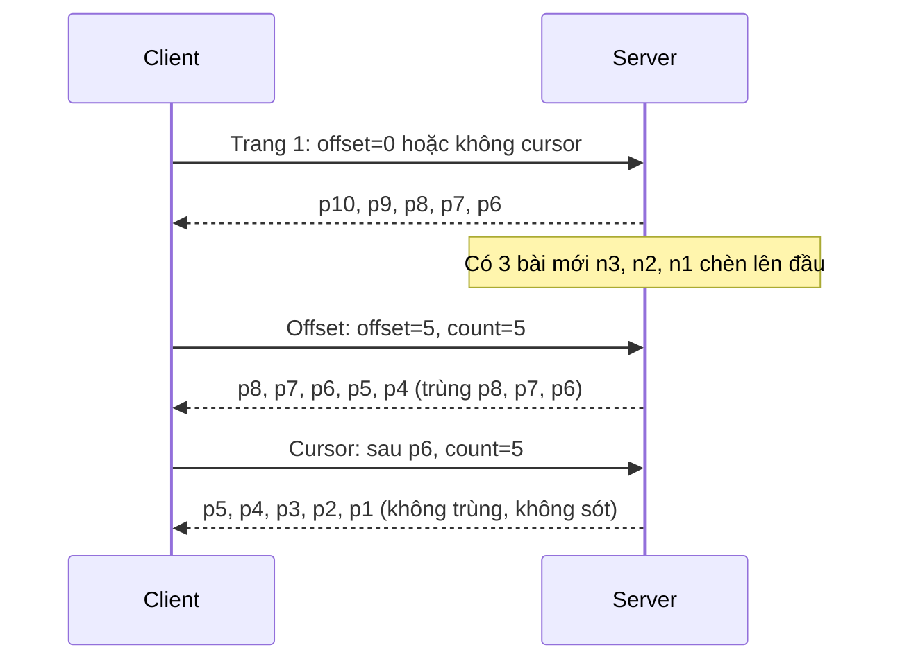

# Lesson 02 – Cursor vs offset pagination

> **Mục tiêu:** giải thích được vì sao feed dùng cursor chứ không dùng offset, đọc được câu SQL `(created_at, id) < (…)` cùng index đi kèm, hiểu cursor "mờ" được mã hoá và kiểm tra thế nào, và đọc được đoạn code client tải trang tiếp theo mà không bị trùng khi người dùng bấm đúp.
>
> **Cần biết trước:** lesson 01 (4 layer, `fetchFeedPage`, response chuẩn hoá). SQL cơ bản (`ORDER BY`, `LIMIT`, `WHERE`, index).

Demo của lesson có hai cột chạy song song: cột **Offset** gọi `GET /api/feed-offset?offset=N&count=5`, cột **Cursor** gọi `GET /api/feed?cursor=…&count=5`. Nút **Chèn 3 bài mới** giả lập bạn bè vừa đăng bài, để bạn thấy tận mắt offset sai ở đâu.

| File | Vai trò |
|---|---|
| `src/lessons/02-cursor-pagination/lesson-02-cursor-pagination.tsx` | Demo hai cột, request log, nút chèn bài mới |
| `src/lessons/02-cursor-pagination/find-duplicate-post-ids.ts` | Hàm thuần đếm id trùng để tô viền đỏ |
| `server/src/services/offset-feed-query-service.ts` | Endpoint offset (chỉ để so sánh) |
| `server/src/services/feed-query-service.ts` | Endpoint cursor: giải mã cursor, chọn hướng, dựng cursor mới |
| `server/src/services/feed-cursor-codec.ts` | Mã hoá và giải mã cursor |
| `server/src/data/feed-repository.ts` | Truy vấn Drizzle: `getPostsOlderThan`, `getPostsByOffset` |
| `server/src/data/database-schema.ts` | Index `posts_feed_order_idx` |
| `shared-contracts/feed-api-contracts.ts` | Kiểu `FeedPageInfo`, `OffsetFeedResponse` |

## 1. Vì sao offset làm feed lặp bài

### Trong bài viết
Bài GreatFrontEnd so sánh hai cách phân trang: **offset-based** ("bỏ qua N bài đầu") và **cursor-based** ("các bài sau bài X"). Offset dễ làm và nhảy được tới trang bất kỳ, nhưng bài chỉ ra nhược điểm với dữ liệu thay đổi liên tục: bài mới chèn lên đầu đẩy mọi bài xuống, nên trang sau lặp lại bài đã thấy. Xem mục *Pagination approaches* trong [bài gốc](https://www.greatfrontend.com/questions/system-design/news-feed-facebook?format=system-design).

### Code thật

Cột Offset nối trang mới vào cuối và **cố ý không khử trùng**:

```learn
src/lessons/02-cursor-pagination/lesson-02-cursor-pagination.tsx#offset-column-append-page
```

1. `postIds: [...column.postIds, ...page.postIds]` chỉ việc nối. Nếu server trả lại bài đã có, nó xuất hiện hai lần trong cột.
2. `posts` và `users` được gộp bằng spread (bản ghi sau đè bản ghi trước cùng id), nên chỉ danh sách `postIds` mới bị trùng.
3. Comment ghi rõ lý do: lesson muốn bạn **thấy** vấn đề của offset. Ở lesson 03 reducer sẽ khử trùng bằng `mergeUniqueIds`.

Cách cột Offset xin trang tiếp theo:

```learn
src/lessons/02-cursor-pagination/lesson-02-cursor-pagination.tsx#load-more-by-offset
```

1. `inFlightRef.current.offset` chặn lần gọi chồng (xem concept 4).
2. `fetchFeedPageByOffset(nextOffset, PAGE_SIZE)` gửi `offset` = số mục đã tải. Client tự suy ra vị trí, nên nó phụ thuộc vào việc "đã tải bao nhiêu" chứ không phải "đã tải bài nào".
3. `addLog(...)` ghi lại `offset=N → id1, id2...` ở panel Request log, để bạn đối chiếu id nào bị lặp.
4. Lỗi thì `setOffsetColumn(... loading: false)` để nút không kẹt "Đang tải…", và `finally` luôn mở khoá.

Server phía offset:

```learn
server/src/data/feed-repository.ts#offset-page
```

1. `.orderBy(...FEED_ORDER).offset(offset).limit(limit + 1)` sinh `ORDER BY … OFFSET N LIMIT n+1`.
2. Postgres phải đọc rồi vứt `N` dòng đầu. `OFFSET 100000` nghĩa là đọc 100000 dòng để bỏ đi, càng về sau càng chậm.
3. Comment đã ghi: hàm này chỉ có để so sánh, không dùng cho feed thật.

Hàm đếm trùng để tô viền đỏ:

```learn
src/lessons/02-cursor-pagination/find-duplicate-post-ids.ts#find-duplicate-post-ids
```

1. `seen` nhớ các id đã gặp; `duplicates` giữ id gặp lần thứ hai trở đi.
2. Duyệt đúng một lần, độ phức tạp O(n). `FeedColumn` dùng kết quả này để hiện "N bài bị trùng" và tô viền đỏ các card.

Phía API của endpoint offset, kèm kiểm tra tham số:

```learn
server/src/services/offset-feed-query-service.ts#offset-feed-query
```

1. `Number.isInteger(offset) && offset >= 0` kiểm tra đầu vào; sai thì `400 INVALID_OFFSET`.
2. `clampPageSize` giới hạn `count` trong khoảng cho phép, để client không xin 1 triệu bài một lần.
3. `nextOffset: offset + posts.length` trả sẵn vị trí tiếp theo. Dù trả sẵn, nó vẫn là **số thứ tự**, nên vẫn sai khi dữ liệu dịch chuyển.

Hình dạng response của endpoint offset, khai báo trong hợp đồng dùng chung:

```learn
shared-contracts/feed-api-contracts.ts#contract-offset-feed
```

1. `postIds` giữ thứ tự hiển thị; `posts`, `users`, `media` là các map đã chuẩn hoá theo id (lesson 03 dùng lại dạng này).
2. `nextOffset` là con số client gửi lại ở lần sau. So với `nextCursor` của feed thật, nó không mang thông tin "bài cuối cùng là bài nào", nên không chống được việc dữ liệu dịch chuyển.
3. `hasMore` cho client biết có nên hiện nút "Tải thêm" nữa không.

`clampPageSize` mà cả hai endpoint dùng chung:

```learn
server/src/services/feed-query-service.ts#clamp-page-size
```

1. `Number(raw ?? DEFAULT_PAGE_SIZE)`: client không gửi `count` thì dùng mặc định.
2. Giá trị không phải số (ví dụ `count=abc`) trả `400 INVALID_COUNT` thay vì lặng lẽ đoán.
3. `Math.floor` rồi kẹp trong `[1, MAX_PAGE_SIZE]`: số âm, số thập phân hay số quá lớn đều được đưa về khoảng an toàn, nên một request không thể bắt server đọc cả bảng.

Nút sinh bài mới trong demo gọi hàm này ở server để tạo đúng tình huống "bài mới chèn lên đầu":

```learn
server/src/data/feed-repository.ts#insert-new-posts-batch
```

1. Mỗi bài mới có `createdAt` là thời điểm hiện tại, nên đứng **trên cùng** theo thứ tự feed. Đây chính là thứ đẩy mọi bài cũ xuống và làm offset lệch.
2. Cả lô được chèn trong **một transaction**: client không bao giờ thấy trạng thái "mới chèn được một nửa".
3. Hàm trả về `generation` mới nhất. Cursor cũng mang theo `generation`, nhờ đó có thể nhận ra feed đã đổi kể từ lúc tạo cursor; hiện server mới chỉ ghi lại giá trị này chứ chưa dùng để từ chối (xem khái niệm 3).

Sơ đồ thời gian: cùng một sự kiện "có 3 bài mới" ảnh hưởng hai cách khác nhau (mỗi trang 5 bài, `p10` là bài mới nhất ban đầu):



### Vì sao làm vậy

| Cách | Ưu | Nhược | Khi nào chọn |
|---|---|---|---|
| Cursor (project dùng) | Không trùng hay sót khi dữ liệu đổi; mọi trang đều nhanh nhờ index | Không nhảy thẳng tới "trang 7"; phải có thứ tự ổn định | Feed, timeline, chat, dữ liệu đổi liên tục |
| Offset | Đơn giản, nhảy tới trang bất kỳ, dễ hiện "trang 3/20" | Trùng hoặc sót khi chèn/xoá; OFFSET lớn thì chậm | Bảng dữ liệu tĩnh, trang quản trị có số trang |
| Keyset trên một cột duy nhất | Đơn giản hơn cursor hai cột | Hai bài cùng thời điểm thì sót hoặc lặp | Dữ liệu có khoá tăng dần duy nhất |
| Trả toàn bộ feed một lần | Không cần phân trang | Payload khổng lồ, chậm lần đầu | Danh sách nhỏ cố định |

### Lỗi hay gặp
- **Tin rằng offset chỉ chậm chứ không sai:** offset còn trả dữ liệu sai (trùng khi có bài mới, sót khi có bài bị xoá). Đây chính là điều lesson chứng minh.
- **Demo tự phá bằng chính lỗi đua:** lần review đầu tiên của project phát hiện "cột cursor cũng hiện bài trùng". Nguyên nhân là nút "Tải thêm ở cả hai cột" không bị khoá, bấm hai lần nhanh thì cả hai lần dùng cùng `nextOffset`/`olderCursor` cũ. Cách sửa và lý do chi tiết nằm ở concept 4.
- **Không xử lý lỗi trong lúc tải:** failRate 100% khiến nút kẹt "Đang tải…" mãi. Cả hai hàm `loadMoreBy…` đều có `catch` reset `loading` và ghi log lỗi.

### Tự thử
1. Mở `#/lesson-02`, tab **🧪 Demo**. Bấm **Tải thêm ở cả hai cột** một lần. Kết quả mong đợi: mỗi cột có 5 bài, báo "0 bài bị trùng".
2. Bấm **Chèn 3 bài mới**. Panel Request log hiện dòng "Server chèn 3 bài mới lên đầu: …".
3. Bấm **Tải thêm ở cả hai cột** lần nữa. Kết quả mong đợi: cột **Offset** báo "3 bài bị trùng" (viền đỏ), cột **Cursor** báo "0 bài bị trùng". Cả hai cột đều "Đã tải 10 mục".
4. Dùng terminal để thấy khác biệt ở tầng API: `curl -s "http://localhost:3001/api/feed-offset?offset=0&count=3"`, lưu `postIds`; chèn bài bằng `curl -s -X POST "http://localhost:3001/__mock/insert-new-posts?n=3"`; gọi lại `offset=3&count=3`. Kết quả mong đợi: `postIds` bắt đầu bằng các bài đã thấy ở lần gọi đầu.
5. Cẩn thận: bước 4 và nút **Chèn 3 bài mới** thêm dữ liệu thật vào Postgres. Dùng nút **Reset dữ liệu** ở panel chỉ khi bạn chấp nhận xoá sạch rồi seed lại.

### Câu hỏi phỏng vấn
1. Vì sao offset pagination không hợp với feed?
   > Bài mới chèn lên đầu đẩy các bài cũ xuống, nên "bỏ qua N bài" trả lại các bài đã thấy (trùng). Khi có bài bị xoá thì ngược lại, bị sót bài. Ngoài ra `OFFSET` lớn buộc DB đọc rồi bỏ nhiều dòng nên chậm dần.

## 2. Cursor ở tầng database: row value comparison và index

### Trong bài viết
Bài viết khuyên feed dùng cursor, trong đó cursor là "dấu trang" trỏ tới một bài cụ thể, và server trả các bài đứng sau dấu trang trong một thứ tự ổn định. Bài cũng lưu ý cần một thứ tự tất định (nếu hai bài cùng thời điểm thì phải có luật hoà). Xem mục *Pagination approaches* trong [bài gốc](https://www.greatfrontend.com/questions/system-design/news-feed-facebook?format=system-design).

### Code thật

Thứ tự ổn định:

```learn
server/src/data/feed-repository.ts#feed-order
```

1. `desc(posts.createdAt)`: bài mới nhất trước.
2. `desc(posts.id)`: hai bài trùng `createdAt` thì so tiếp `id`. Không có luật hoà này, hai bài cùng mili giây có thể đổi chỗ giữa các lần truy vấn và cursor trượt sai.

Truy vấn "các bài cũ hơn anchor":

```learn
server/src/data/feed-repository.ts#cursor-older
```

1. `anchor` là `{ createdAt, id }` giải mã từ cursor; `null` nghĩa là trang đầu và không có điều kiện `WHERE`.
2. `(created_at, id) < (anchor.createdAt, anchor.id)` là **row value comparison**: so sánh cặp theo thứ tự từ điển (so `created_at` trước, hoà thì so `id`). Drizzle không có toán tử cho nó nên viết bằng `sql`, nhưng giá trị vẫn là tham số bind (`$1`, `$2`), an toàn khỏi SQL injection.
3. `::timestamptz` ép chuỗi ISO thành kiểu thời gian để so sánh đúng.
4. `.orderBy(...FEED_ORDER)` khớp đúng thứ tự index nên Postgres đi thẳng tới vị trí anchor (range scan), không đọc từ đầu bảng.
5. `.limit(limit + 1)` lấy dư 1 dòng; `toPage` dùng nó để biết còn trang sau hay không.

```learn
server/src/data/feed-repository.ts#limit-plus-one-page
```

1. `rows.slice(0, limit)` chỉ trả đúng `limit` bài cho client.
2. `hasMore: rows.length > limit`: nếu lấy được dòng thứ `limit + 1` thì còn trang sau. Không cần `COUNT(*)`, vốn đắt trên bảng lớn.

Index phục vụ truy vấn đó:

```learn
server/src/data/database-schema.ts#posts-table-feed-index
```

1. `index('posts_feed_order_idx').on(createdAt.desc(), id.desc())` tạo index đúng với `ORDER BY created_at DESC, id DESC`.
2. `.nullsFirst()` nhắc một chi tiết dễ sai: Postgres mặc định `DESC` đi kèm `NULLS FIRST`. Nếu index khai báo `DESC NULLS LAST` còn truy vấn dùng mặc định, thứ tự không khớp và planner không dùng được index. Khi review project đã kiểm tra điều này bằng `\d posts` và `EXPLAIN`.
3. Comment của schema nói rõ: "các bài cũ hơn cursor" là range scan nên nhanh bất kể ở trang thứ mấy.

### Vì sao làm vậy

| Cách | Ưu | Nhược | Khi nào chọn |
|---|---|---|---|
| `(created_at, id) < (a, b)` kèm index (project dùng) | Một điều kiện gọn, dùng được index, tất định | Cần Postgres/MySQL hỗ trợ so sánh bộ giá trị | Thứ tự theo nhiều cột |
| `created_at < a OR (created_at = a AND id < b)` | Chạy ở mọi DB | Dài, dễ sai, planner đôi khi không dùng được index | DB không có row value |
| `OFFSET` | Dễ viết | O(N) theo vị trí trang, sai khi dữ liệu đổi | Dữ liệu tĩnh nhỏ |
| Cursor chỉ bằng `id` tăng dần | Rất đơn giản | Chỉ đúng khi thứ tự feed chính là thứ tự id | Bảng log chỉ-ghi |

### Lỗi hay gặp
- **Quên khoá thứ tự bằng `id`:** hai bài cùng `createdAt` có thể bị sót hoặc lặp. Hai khoá trong `FEED_ORDER` ngăn điều này.
- **Index lệch với `ORDER BY` (ví dụ `DESC NULLS LAST` so với mặc định `NULLS FIRST`):** truy vấn vẫn đúng nhưng Postgres phải sort lại, chậm dần theo kích thước bảng. Kiểm tra bằng `EXPLAIN ANALYZE`.
- **Nối chuỗi SQL cho cursor:** cursor là dữ liệu client gửi lên, nên nếu nối chuỗi sẽ dính SQL injection. Dùng tham số bind (như `sql` template của Drizzle).
- **Cursor có `createdAt` không phải ngày giờ trả 500:** lỗi thật tìm thấy khi review chuyển sang Drizzle. Cursor đúng base64 nhưng `createdAt` là rác khiến Postgres báo lỗi 22007. Đã sửa ở concept 3, có test.

### Tự thử
1. Bật Postgres bằng Docker, mở `psql`: `npm run db:psql`.
2. Chạy `EXPLAIN ANALYZE SELECT id FROM posts WHERE (created_at, id) < (now(), 'zzz') ORDER BY created_at DESC, id DESC LIMIT 6;`. Kết quả mong đợi: plan có `Index Scan` hoặc `Index Only Scan` dùng `posts_feed_order_idx`, không có bước `Sort` riêng.
3. So sánh với `EXPLAIN ANALYZE SELECT id FROM posts ORDER BY created_at DESC, id DESC OFFSET 100 LIMIT 6;`. Kết quả mong đợi: thời gian tăng theo `OFFSET` khi bảng lớn.
4. Trong `psql`, chạy `\d posts` và tìm dòng `posts_feed_order_idx` để xem hướng sắp xếp của index.

### Câu hỏi phỏng vấn
1. Điều kiện để cursor hoạt động đúng?
   > Thứ tự sắp xếp phải ổn định và tất định, ví dụ `(createdAt, id)` trong đó `id` là luật hoà. Phải có index khớp với thứ tự đó thì mới nhanh.
2. Vì sao dùng `LIMIT n + 1`?
   > Lấy dư một dòng để biết còn trang sau hay không (`hasMore`) mà không cần chạy `COUNT(*)`, vốn quét cả bảng.

## 3. Cursor "mờ" do server tạo

### Trong bài viết
Bài viết mô tả cursor là một giá trị client chỉ giữ và gửi lại, còn server mới hiểu ý nghĩa của nó. Bài cũng nhắc cursor có thể gắn với "thế hệ" của feed để phát hiện client đang giữ feed quá cũ. Xem [bài gốc](https://www.greatfrontend.com/questions/system-design/news-feed-facebook?format=system-design).

### Code thật

```learn
server/src/services/feed-cursor-codec.ts#cursor-encode
```

1. Cursor là mảng JSON `[createdAt, id, generation]` (mảng thay vì object cho ngắn).
2. `Buffer.from(...).toString('base64url')` mã hoá thành chuỗi an toàn khi đặt trong URL (không có `+`, `/`, `=`).
3. Mã hoá **không phải bảo mật**: ai cũng giải được base64. "Mờ" nghĩa là client không nên dựa vào cấu trúc bên trong, chứ không phải bí mật.

```learn
server/src/services/feed-cursor-codec.ts#cursor-decode-validate
```

1. Cursor đến từ client nên là đầu vào không đáng tin: giải base64url rồi `JSON.parse` trong `try`.
2. Kiểm tra từng phần: là mảng 3 phần tử, `createdAt` là chuỗi và `Date.parse` ra ngày hợp lệ, `id` là chuỗi, `generation` là số.
3. Sai bất kỳ điều gì thì `throw HttpError(400, 'INVALID_CURSOR', …)`. Trả `400` thay vì `500` vì đó là lỗi của client, không phải lỗi của server.
4. Phép kiểm tra `Date.parse` là bản sửa của lỗi 500 đã tìm ra khi review (concept 2).

Chỗ ghép cursor vào luồng xử lý:

```learn
server/src/services/feed-query-service.ts#get-feed-page
```

1. `decodeCursor(query.cursor)` biến cursor thành `anchor`; không có cursor thì `anchor = null` (trang đầu).
2. `Promise.all([getFeedGeneration(), getPosts…])` đọc `generation` và trang bài **song song** vì hai truy vấn độc lập.
3. Chọn truy vấn theo `direction`: `older` dùng `getPostsOlderThan`, `newer` dùng `getPostsNewerThan` (lesson 04).
4. `olderCursor` được mã hoá từ **bài cuối** của trang, `newerCursor` từ **bài đầu**. Trang rỗng thì giữ nguyên cursor cũ (`fallbackCursor`) để client không mất vị trí.
5. `buildNormalizedEntities` đính kèm users/media (lesson 01).

Phía client chỉ gói và gửi lại cursor (xem concept 4 và lesson 01).

### Vì sao làm vậy

| Cách | Ưu | Nhược | Khi nào chọn |
|---|---|---|---|
| Cursor mờ do server tạo (project) | Đổi định dạng (thêm field, ký số) mà client không vỡ | Client không tự nhảy tới vị trí tuỳ ý | API công khai lâu dài |
| Cursor là id bài, client gửi `?after=post-1` | Dễ đọc, dễ debug | Lộ cấu trúc, mọi thay đổi định dạng là breaking change | Nội bộ, ít client |
| Offset | Client tự tính | Sai khi dữ liệu đổi (concept 1) | Dữ liệu tĩnh |
| Cursor ký số (HMAC) | Chống giả mạo cursor | Thêm bước ký/kiểm | Khi cursor chứa dữ liệu nhạy cảm |

### Lỗi hay gặp
- **Cursor lỗi trả 500:** ban đầu `decodeCursor` chỉ kiểm tra `typeof`, nên `["garbage","x",1]` lọt qua và nổ ở Postgres. Bản hiện tại validate cả ngày giờ và trả 400.
- **Client tự parse cursor:** cursor đổi định dạng là client hỏng. Hợp đồng ghi rõ "client không được tự parse".
- **Nghĩ base64 là mã hoá bảo mật:** đừng nhét dữ liệu bí mật vào cursor.
- **`generation` có trong cursor nhưng server chưa dùng nó để từ chối:** project giữ nó để quan sát và dành cho tính năng phát hiện feed cũ.

### Tự thử
1. Lấy cursor: `curl -s "http://localhost:3001/api/feed?count=2"`, đọc `feed.olderCursor`.
2. Giải mã: `node -e "console.log(Buffer.from('<cursor>','base64url').toString())"`. (`echo '<cursor>' | base64 -d` chỉ chạy khi cursor tình cờ không chứa `-`/`_` và đủ dấu `=`, vì base64url khác base64 thường ở hai điểm đó.) Kết quả mong đợi: một mảng như `["2026-10-27T15:46:24.604Z","post-user-e0ee8d31",6]`.
3. Gửi cursor hỏng: `curl -s -w "\n%{http_code}\n" "http://localhost:3001/api/feed?cursor=abc"`. Kết quả mong đợi: `{"error":{"code":"INVALID_CURSOR",…}}` và mã `400`.
4. Trong DevTools tab Network (demo lesson 02), bấm **Tải thêm ở cả hai cột** rồi xem query `cursor=` ở request thứ hai: là chuỗi base64url dài mà client không hề tự tạo.

### Câu hỏi phỏng vấn
1. Vì sao cursor phải "mờ" (opaque)?
   > Client không phụ thuộc vào format bên trong, nên server đổi cách mã hoá (thêm field, ký số) mà không làm hỏng client.

## 4. Client tải trang tiếp theo và chặn bấm đúp

### Trong bài viết
Ở phía client, bài viết nói feed giữ cursor của trang cuối rồi gửi lại khi cần trang kế tiếp. Điều bài không nói chi tiết, nhưng bạn sẽ gặp ngay, là hai lần tải chồng nhau dùng cùng một cursor. Xem mục *Pagination approaches* trong [bài gốc](https://www.greatfrontend.com/questions/system-design/news-feed-facebook?format=system-design).

### Code thật

```learn
src/lessons/02-cursor-pagination/lesson-02-cursor-pagination.tsx#in-flight-ref-guard
```

1. `busy` (dòng phía trên region) khoá nút khi một trong hai cột đang tải. Nhưng `disabled` chỉ có hiệu lực **sau** khi React render lại.
2. `useRef({ offset: false, cursor: false })` là cờ **đồng bộ**: sửa `ref.current` có hiệu lực ngay trong cùng một tick, không cần chờ render.
3. Có hai cờ riêng vì hai cột tải độc lập; một cờ chung sẽ làm cột này chặn nhầm cột kia.

```learn
src/lessons/02-cursor-pagination/lesson-02-cursor-pagination.tsx#load-more-by-cursor
```

1. `if (inFlightRef.current.cursor) return;` bỏ lần gọi thứ hai nếu lần đầu chưa xong. Không có dòng này, cả hai lần cùng gửi một cursor cũ và trang bị nhân đôi.
2. `inFlightRef.current.cursor = true` dựng cờ ngay lập tức, rồi `setCursorColumn(... loading: true)` cho UI hiện "Đang tải…".
3. `fetchFeedPage({ count: PAGE_SIZE, cursor: olderCursor, direction: 'older' })` gửi `olderCursor` hiện tại. Server trả các bài **cũ hơn** bài cuối client đã thấy.
4. `setOlderCursor(page.feed.olderCursor)` lưu cursor **mới** từ response. Client không tự tính cursor.
5. `appendPage(..., page.feed.hasOlder)` nối bài vào cột và cập nhật `hasMore`. Khi `hasOlder` là `false`, nút đổi thành "Hết".
6. `catch` ghi log và reset `loading`, `finally` luôn hạ cờ `inFlightRef` kể cả khi lỗi. Quên `finally` thì một lỗi mạng làm nút kẹt vĩnh viễn.

```learn
src/shared/api/feed-api.ts#feed-api-fetch-page
```

1. Đây là lớp Data access đã gặp ở lesson 01. Với `direction: 'older'` (mặc định) và `cursor`, nó gửi `GET /api/feed?count=5&direction=older&cursor=…`.
2. Thiếu `cursor` thì server hiểu là trang đầu.

### Vì sao làm vậy

| Cách | Ưu | Nhược | Khi nào chọn |
|---|---|---|---|
| Cờ `useRef` đồng bộ (project) | Chặn đúng trong cùng tick, không phụ thuộc render | Phải nhớ hạ cờ trong `finally` | Mọi nút "tải thêm" |
| Chỉ dùng `disabled` | Dễ làm, UI báo rõ | Hai click trong cùng tick vẫn lọt qua | Chỉ làm lớp phụ |
| State `loading` kiểm tra trong handler | Quen thuộc | Closure đọc giá trị cũ của state, cùng lỗi như trên | Không đủ tin cậy một mình |
| Huỷ request cũ bằng `AbortController` | Luôn lấy kết quả mới nhất | Mất dữ liệu đang tải dở, không hợp với "tải thêm" | Tìm kiếm gõ tới đâu gọi tới đó |
| Hàng đợi tuần tự | Không bỏ lần bấm nào | Phức tạp hơn | Thao tác ghi (lesson 05) |

### Lỗi hay gặp
- **Bấm đúp "Tải thêm":** lỗi thật của project. Lần review đầu ghi nhận "cột cursor cũng hiện bài trùng" vì hai click dùng cùng `olderCursor`. Sửa lần một bằng `disabled`, rồi nhận ra `disabled` chưa đủ vì nó chỉ có hiệu lực sau render, nên thêm `inFlightRef`.
- **Quên `finally`:** lỗi `503` làm cờ không bao giờ hạ, các lần sau bị bỏ qua mãi.
- **Đọc cursor từ state trong closure cũ:** hàm `loadMoreByCursor` chạy với `olderCursor` của lần render nó được tạo. Nếu chạy chồng, hai lần cùng thấy giá trị cũ. Chặn chồng bằng ref là giải pháp ngắn nhất; lesson 04 chuyển sang `olderCursorRef` luôn trỏ giá trị mới nhất.
- **Tải chồng làm cursor lùi:** cùng họ lỗi này, ở lesson 08 từng có "tải nhanh nhiều trang" chạy đua với sentinel (xem lesson 04 concept 2).

### Tự thử
1. Mở `#/lesson-02`, tab Demo. Mở DevTools tab Network, lọc `feed`.
2. Đặt **Độ trễ** (panel "Mô phỏng mạng (backend)") lên 2000ms để có thời gian bấm.
3. Bấm **Tải thêm ở cả hai cột** hai lần thật nhanh. Kết quả mong đợi: chỉ có **một** request `feed` và **một** `feed-offset` trong Network, vì lần bấm thứ hai bị cờ chặn (nút cũng đã `disabled`).
4. Chờ xong, kết quả mong đợi: mỗi cột 5 mục, "0 bài bị trùng".
5. Thử gây lỗi: **Tỉ lệ lỗi** 100%, bấm **Tải thêm ở cả hai cột**. Kết quả mong đợi: Request log hiện dòng bắt đầu bằng "❌ cursor lỗi" và nút trở lại bình thường, không kẹt "Đang tải…". Nhớ kéo **Tỉ lệ lỗi** về 0%.

### Câu hỏi phỏng vấn
1. Vì sao nút "Tải thêm" đã `disabled` mà vẫn phải thêm cờ `ref`?
   > Thuộc tính `disabled` chỉ cập nhật sau khi React render lại. Hai click trong cùng một tick vẫn gọi handler hai lần với cùng state cũ. `ref.current` đổi ngay lập tức nên chặn được lần hai.
2. Nếu hai request cùng dùng một cursor chạy song song thì hậu quả là gì?
   > Cả hai trả cùng một trang nên bị nối hai lần (trùng bài), hoặc trang về sau ghi đè cursor làm cursor lùi. Giải pháp: một cờ in-flight duy nhất cho mọi kiểu tải, hoặc khử trùng ở reducer.

## Tóm tắt
- Offset trả trùng hoặc sót bài khi feed thay đổi; cursor neo vào một bài cụ thể nên không bị ảnh hưởng.
- DB làm cursor bằng `(created_at, id) < (…)`, thứ tự `created_at DESC, id DESC`, kèm index cùng thứ tự và `LIMIT n + 1`.
- Cursor do server tạo và kiểm tra (base64url của `[createdAt, id, generation]`), client chỉ gửi lại; cursor hỏng trả 400.
- Client lưu `olderCursor` từ response và không tự tính.
- Chặn tải chồng bằng cờ `ref` đồng bộ, luôn hạ cờ trong `finally`.
