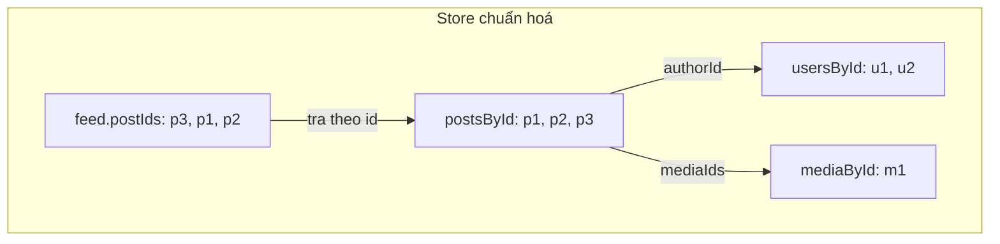
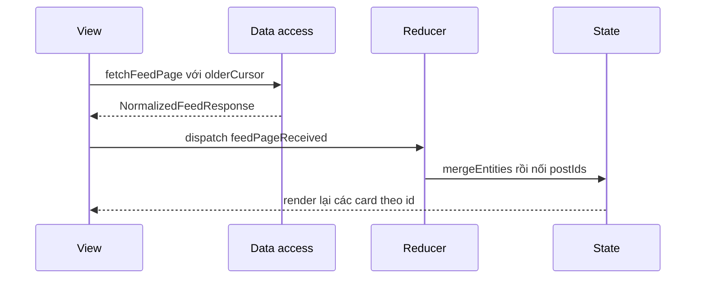

# Lesson 03 – Normalized store

> **Mục tiêu:** giải thích được vì sao store của feed lưu theo id (`postsById`, `usersById`, `mediaById` kèm danh sách `postIds`), đọc hiểu reducer xử lý 3 hướng tải trang (`initial`, `older`, `newer`) và các action cập nhật nhỏ, và biết cách component "chọn" dữ liệu của mình qua hook selector.
>
> **Cần biết trước:** lesson 01 (response chuẩn hoá `{ feed, posts, users, media }`), lesson 02 (cursor, `olderCursor`, `hasOlder`). React `useReducer` và Context.

Server đã trả sẵn dữ liệu chuẩn hoá. Việc của lesson này là **giữ nó chuẩn hoá ở client**: mỗi thực thể một bản ghi, danh sách chỉ là mảng id. Hai lesson sau (04 infinite scroll, 05 reaction) đều chạy trên store này, nên hiểu kỹ reducer là nền móng.

| File | Vai trò |
|---|---|
| `src/lessons/03-normalized-store/feed-store-reducer.ts` | Hình dạng state, các action, reducer thuần |
| `src/lessons/03-normalized-store/feed-store-reducer.test.ts` | Test reducer: initial/older/newer, merge, thay bài tạm |
| `src/lessons/03-normalized-store/feed-store-context.tsx` | `FeedStoreProvider` và các hook selector |
| `src/lessons/03-normalized-store/lesson-03-normalized-store.tsx` | Demo: tải trang, store inspector, đổi tên user |
| `server/src/services/feed-query-service.ts` | Server dựng response chuẩn hoá (đã học ở lesson 01) |
| `shared-contracts/feed-api-contracts.ts` | Kiểu `Post`, `User`, `Media`, `NormalizedFeedResponse` |

## 1. Hình dạng state chuẩn hoá

### Trong bài viết
Mục *Data model* của bài GreatFrontEnd khuyên không lưu một danh sách bài lồng sẵn tác giả; hãy lưu từng loại thực thể ở một nơi và liên kết bằng id, giống cách một database quan hệ làm. Lợi ích: một user xuất hiện trong 50 bài vẫn chỉ có một bản ghi, cập nhật một chỗ là đủ. Xem [bài gốc](https://www.greatfrontend.com/questions/system-design/news-feed-facebook?format=system-design).

### Code thật

```learn
src/lessons/03-normalized-store/feed-store-reducer.ts#store-state-shape
```

1. `FeedListState` chỉ chứa **thứ tự và trạng thái phân trang**: `postIds`, `olderCursor`, `newerCursor`, `hasOlder`, `hasNewer`, `generation`, `lastFetchedAt`. Không có nội dung bài viết ở đây.
2. `FeedState` có ba bảng `postsById`, `usersById`, `mediaById` kiểu `Record<string, …>`, nên tra theo id là O(1).
3. `INITIAL_FEED_STATE` bắt đầu rỗng với `hasOlder: true`, để UI biết "có thể tải" ngay lần đầu.
4. `Post` chỉ giữ `authorId` và `mediaIds` (xem hợp đồng ở lesson 01), nên các bảng liên kết nhau bằng id và không lồng nhau.

Server dựng ba bảng đó (đã gặp ở lesson 01, nhắc lại vì client dựa vào hợp đồng này):

```learn
server/src/services/feed-query-service.ts#build-normalized-entities
```

1. Gom `userIds`, `mediaIds` bằng `Set` nên mỗi id chỉ một lần dù nhiều bài dùng chung.
2. Truy vấn theo lô, không N+1.
3. Trả `posts`, `users`, `media` dưới dạng `Record` theo id, đúng hình dạng mà reducer merge được ngay.



### Vì sao làm vậy

| Cách | Ưu | Nhược | Khi nào chọn |
|---|---|---|---|
| Chuẩn hoá theo id (project) | Mỗi thực thể một bản sao; sửa một chỗ, mọi nơi đổi; tra O(1); nhiều màn hình dùng chung | Phải ghép lại khi render; reducer phức tạp hơn | Feed, profile, chi tiết bài dùng chung dữ liệu |
| Mảng bài lồng sẵn tác giả | Render đơn giản, dễ hiểu | Lặp user; đổi tên phải duyệt hết; cập nhật một bài là tìm trong mảng | Danh sách nhỏ, không dùng chung |
| Thư viện (normalizr, Apollo, Relay) | Chuẩn hoá và cache tự động | Thêm dependency, phải học | App lớn, GraphQL |
| Cache theo từng request (React Query) | Đơn giản, có sẵn invalidation | Cùng một thực thể có thể nằm trong nhiều cache, lệch nhau | App ít chia sẻ thực thể |

### Lỗi hay gặp
- **Lưu thứ tự bên trong object `postsById`:** thứ tự khoá của object không phải hợp đồng đáng tin. Thứ tự feed nằm ở mảng `feed.postIds`.
- **Lồng object `User` vào `Post` ở client:** quay lại vấn đề bản sao. Project giữ `authorId` để tránh.
- **Đọc cả `FeedState` trong mọi component:** mọi thay đổi làm render lại tất cả. Xem concept 4 về selector và giới hạn của Context.

### Tự thử
1. Mở `#/lesson-03`, tab **🧪 Demo**. Ở cột bên phải, panel **Store inspector** có 4 nút: `feed`, `postsById`, `usersById`, `mediaById`.
2. Bấm `feed`. Kết quả mong đợi: JSON chỉ có `postIds` (mảng id), `olderCursor`, `hasOlder`... không có nội dung bài viết.
3. Bấm `postsById`. Kết quả mong đợi: mỗi bài có `authorId` và `mediaIds`, không có object user lồng bên trong.
4. Bấm `usersById`. Kết quả mong đợi: mỗi user chỉ có **một** bản ghi dù là tác giả của nhiều bài. Ở trang đầu số user có thể nhiều hơn số bài, vì `users` còn gồm người được mention và người react mẫu (`sampleReactorIds`); tải thêm vài trang thì số user tăng chậm hơn hẳn số bài.

### Câu hỏi phỏng vấn
1. Lợi ích của việc chuẩn hoá theo id?
   > Mỗi entity chỉ có một bản sao; cập nhật một chỗ thì mọi nơi đổi theo; tìm theo id mất O(1); nhiều màn hình (feed, chi tiết bài, profile) dùng chung dữ liệu.
2. Thứ tự bài nên nằm ở đâu?
   > Ở một mảng id riêng (`feed.postIds`). Bảng theo id chỉ để tra, thứ tự khoá của object không đáng tin.

## 2. Reducer nhận một trang feed

### Trong bài viết
Bài viết nói client cần gộp trang mới vào feed hiện có (cuộn xuống thì nối vào cuối, có bài mới thì chèn lên đầu) mà không để lặp bài. Bài cũng bàn về "stale feed" và cách xử lý bài mới. Xem mục *Pagination approaches* và *Stale feed* trong [bài gốc](https://www.greatfrontend.com/questions/system-design/news-feed-facebook?format=system-design).

### Code thật

Hai hàm trợ giúp:

```learn
src/lessons/03-normalized-store/feed-store-reducer.ts#store-merge-helpers
```

1. `withoutKey` trả bản sao của object không có một khoá. Dùng destructuring `{ [key]: _removed, ...rest }` nên không đụng object gốc (bất biến).
2. `mergeUniqueIds` ghép hai mảng id rồi qua `new Set` để bỏ trùng, **giữ lần xuất hiện đầu**. Đây là hàng rào cuối cùng chống bài lặp, ngay cả khi server trả trùng.
3. `mergeEntities` gộp `posts`, `users`, `media` của response vào các bảng bằng spread: bản ghi mới đè bản ghi cũ cùng id, bản ghi chưa có thì thêm vào. Bảng nào response không có thì giữ nguyên tham chiếu cũ, nên React không thấy thay đổi giả.

Ba hướng tải trang:

```learn
src/lessons/03-normalized-store/feed-store-reducer.ts#store-feed-page-received
```

1. `mergeEntities(state, response)` luôn chạy trước, vì trang nào cũng mang theo thực thể.
2. **`initial`** thay toàn bộ `feed` bằng thông tin của trang mới (`...pageInfo`) và đặt `lastFetchedAt`. `mergeUniqueIds([], ids)` khử trùng cho chắc.
3. **`older`** giữ nguyên `state.feed`, chỉ nối `postIds` vào cuối (`mergeUniqueIds(state.feed.postIds, pageInfo.postIds)`) và cập nhật `olderCursor`, `hasOlder`. `generation` lấy `Math.max` để không bao giờ lùi.
4. **`newer`** đặt bài mới **lên đầu** (`mergeUniqueIds(pageInfo.postIds, state.feed.postIds)`). `newerCursor` chỉ dời khi trang có bài (`postIds.length > 0`), nếu không mất vị trí "mới nhất".
5. Mọi nhánh trả state **mới** (không sửa state cũ), điều kiện để React nhận ra sự thay đổi.

Chỗ demo gọi API rồi dispatch:

```learn
src/lessons/03-normalized-store/lesson-03-normalized-store.tsx#load-page-into-store
```

1. `fetchFeedPage({ count: 10, cursor: … })` với `direction === 'older'` thì gửi `state.feed.olderCursor`, còn `initial` thì `null`.
2. `dispatch({ type: 'feedPageReceived', direction, response, receivedAt: Date.now() })` đưa nguyên response vào reducer. Component không tự ghép dữ liệu.
3. `try/catch/finally` bảo đảm lỗi mạng hiện thành thông báo và nút không kẹt "Đang tải…". Đây là bản sửa của lỗi "không xử lý lỗi" phát hiện khi review.
4. `receivedAt` do caller truyền vào (không gọi `Date.now()` trong reducer) để reducer vẫn là hàm thuần, test được bằng giá trị cố định.



### Vì sao làm vậy

| Cách | Ưu | Nhược | Khi nào chọn |
|---|---|---|---|
| Reducer thuần + action có tên (project) | Dễ test, dễ theo dõi từng thay đổi, dùng lại ở lesson 04–09 | Thêm vài dòng cho mỗi action | Store có nhiều nguồn cập nhật |
| `setState` rải rác trong component | Ít code ban đầu | Logic trùng lặp, khó đảm bảo khử trùng | Trạng thái cục bộ nhỏ |
| Khử trùng ở reducer (`mergeUniqueIds`) | Một chỗ, mọi caller được lợi | Che giấu lỗi tải trùng nếu có | Luôn bật; lỗi trùng vẫn nên được điều tra ở nơi sinh ra nó |
| Khử trùng ở UI khi render | Không đụng store | Đếm sai số bài, key trùng | Không nên |
| Thay toàn bộ list bằng mỗi response | Đơn giản nhất | Mất các trang đã tải | Danh sách không phân trang |

### Lỗi hay gặp
- **Trang `older` về không đúng thứ tự:** lỗi thật từng ghi nhận khi review lesson 08: "tải nhanh nhiều trang" và sentinel cùng dùng một cursor, trang nào về sau ghi đè `olderCursor`, làm cursor **lùi** và tải lại trang đã có (`mergeUniqueIds` khử trùng nên che mất lỗi; "dedupe" trong project dành cho việc gộp GET trùng ở lesson 09). Sửa bằng cách dùng một cờ in-flight chung trong `useFeedLoader` (lesson 04) thay vì chỉ trông cậy reducer.
- **`newerCursor` bị xoá khi trang `newer` rỗng:** nếu gán thẳng `pageInfo.newerCursor` (có thể là `null`), polling lần sau mất điểm tựa. Reducer chỉ dời khi `postIds.length > 0`.
- **StrictMode gọi `loadPage('initial')` hai lần ở dev:** hai response cùng `initial` nên cái sau thay cái trước, không nhân đôi bài. Đây cũng là lý do `initial` là "thay toàn bộ".
- **Mutate state:** `state.feed.postIds.push(...)` làm React không thấy đổi. Reducer luôn tạo mảng/object mới.

### Tự thử
1. Mở `#/lesson-03`, tab Demo. Kết quả mong đợi: trang tự tải 10 bài; thanh trạng thái của Store inspector hiện `10 postIds · 10 posts · N users · M media`.
2. Bấm **Tải thêm (merge vào store)** ba lần. Kết quả mong đợi: `postIds` và `posts` tăng thêm 10 mỗi lần, còn `users` tăng chậm hơn; nút đổi thành "Đang tải…" trong lúc chờ.
3. Bấm nút `feed` trong inspector. Kết quả mong đợi: `olderCursor` đổi sau mỗi lần tải, `hasOlder` vẫn `true` đến khi hết bài.
4. Chạy test reducer: `npx vitest run src/lessons/03-normalized-store`. Kết quả mong đợi: các test `initial`, `older`, `newer`, `newer rỗng` đều pass.
5. Kéo **Tỉ lệ lỗi** lên 100% rồi bấm **Tải thêm**: kết quả mong đợi là dòng "Không tải được: …" xuất hiện và nút trở lại bình thường. Nhớ trả về 0%.

### Câu hỏi phỏng vấn
1. Reducer xử lý thế nào khi trang `older` chứa bài đã có?
   > Dùng `mergeUniqueIds` để giữ lần xuất hiện đầu và bỏ id trùng. Đó là lớp phòng thủ; vẫn cần chặn tải chồng ở nơi gọi để tránh sinh ra trùng.

## 3. Cập nhật một chỗ, mọi nơi đổi theo

### Trong bài viết
Bài viết nêu lợi ích thực tế của chuẩn hoá: khi một thực thể thay đổi (đổi tên, thêm reaction, xoá bài), bạn chỉ cập nhật một bản ghi. Điều này đặc biệt quan trọng khi các hành động đến từ nhiều nguồn: người dùng đăng bài, server báo bài mới, hoặc bài tạm được thay bằng bài thật. Xem mục *Data model* trong [bài gốc](https://www.greatfrontend.com/questions/system-design/news-feed-facebook?format=system-design).

### Code thật

```learn
src/lessons/03-normalized-store/feed-store-reducer.ts#store-action-types
```

1. `feedPageReceived` có `direction` để một action phục vụ cả ba kiểu tải trang.
2. `entitiesMerged` nhận `Partial<NormalizedEntities>`: chỉ cần gửi phần thay đổi (ví dụ chỉ `users`).
3. `postPrepended`, `postReplaced`, `postRemoved` phục vụ composer ở lesson 06: chèn bài vừa đăng, thay bài tạm bằng bài thật, và gỡ bài.
4. Kiểu union tự thân kiểm tra: gửi action sai tên hoặc thiếu field là lỗi biên dịch.

```learn
src/lessons/03-normalized-store/feed-store-reducer.ts#store-entity-actions
```

1. `entitiesMerged` chỉ gọi `mergeEntities`: bản ghi user mới đè bản ghi cũ cùng id. Mọi bài của user đó **không đổi tham chiếu**, nhưng khi render sẽ tra ra user mới.
2. `postPrepended` thêm bài vào `postsById` và chèn id lên đầu `postIds` (qua `mergeUniqueIds` để không lặp).
3. `postReplaced` xoá khoá tạm khỏi `postsById`, thêm bài thật. Trong `postIds` nó **đổi id tại chỗ** (`map`) để bài giữ đúng vị trí, rồi khử trùng: nếu bài thật đã có sẵn (ví dụ gửi lại cùng idempotency key) thì không hiện hai lần.
4. `postRemoved` bỏ bài khỏi cả bảng lẫn danh sách (`filter`).

Demo của lesson:

```learn
src/lessons/03-normalized-store/lesson-03-normalized-store.tsx#rename-user-demo
```

1. Vòng lặp đếm `authorId` trong `state.feed.postIds` rồi chọn tác giả có nhiều bài nhất, để hiệu ứng rõ nhất.
2. Panel viết "tác giả của N bài … chỉ có **1** bản ghi trong `usersById`". Đó là điều cần chứng minh.
3. Nút "Đổi tên …" dispatch `entitiesMerged` với `users: { [user.id]: { ...user, name: … ✏️ } }`. Chỉ **một** bản ghi bị thay.
4. `onRenamed(user.id)` báo lên component cha để tô viền các bài của người đó, cho bạn thấy mọi bài cùng đổi.

### Vì sao làm vậy

| Cách | Ưu | Nhược | Khi nào chọn |
|---|---|---|---|
| Action nhỏ, đúng ý nghĩa (`postReplaced`, `entitiesMerged`) | Mỗi action là một sự kiện dễ hiểu; reducer đơn giản | Nhiều loại action | Store có nhiều luồng cập nhật |
| Một action `setState` chung | Một loại duy nhất | Mất ý nghĩa, khó debug và khó test | Không nên |
| Đổi id tại chỗ khi thay bài tạm | Bài không nhảy vị trí | Phải khử trùng cẩn thận | Optimistic create (lesson 06) |
| Xoá bài tạm rồi thêm bài thật | Dễ viết | Bài nhảy vị trí, nháy giao diện | Không nên cho composer |

### Lỗi hay gặp
- **Cập nhật tên user trong từng bài:** nếu `Post` lồng `User`, bạn phải duyệt và sửa hết. Chuẩn hoá làm việc này thành một dòng.
- **`postReplaced` không khử trùng:** gửi lại cùng idempotency key làm cùng một bài xuất hiện hai lần. Dòng `mergeUniqueIds([], …map(...))` chặn lỗi đó.
- **`postPrepended` không dời `newerCursor`:** ghi chú từ review: nếu sau này ghép banner "bài mới" với composer thì bài của chính mình sẽ hiện thành "1 bài mới". Cần nhớ khi mở rộng.
- **Hiểu nhầm "Đổi tên" là gọi server:** nút chỉ đổi store cục bộ để minh hoạ; không có request nào, và tải lại trang sẽ trả về tên cũ.

### Tự thử
1. Mở `#/lesson-03`, tab Demo. Đọc panel "Demo: sửa 1 chỗ, cập nhật mọi nơi": tên tác giả cùng "là tác giả của N bài".
2. Bấm nút `usersById` trong Store inspector, ghi nhớ tên tác giả đó.
3. Bấm nút **Đổi tên …** (chữ sau "Đổi tên" là tên tác giả). Kết quả mong đợi: mọi bài của người đó (viền đỏ) đổi tên đồng thời và thêm "✏️"; trong `usersById` chỉ một bản ghi thay đổi, số user không đổi.
4. Mở tab Network: không có request mới nào khi bấm nút.
5. Chạy `npx vitest run src/lessons/03-normalized-store` và đọc các test `entitiesMerged: đổi tên user ở 1 chỗ` cùng `postReplaced: id tạm → id thật, giữ vị trí`.

### Câu hỏi phỏng vấn
1. Khi người dùng đăng bài, bài tạm cần được thay bằng bài thật từ server. Reducer làm thế nào để bài không nhảy vị trí và không bị trùng?
   > Đổi id tại chỗ trong `postIds` (`map`) rồi khử trùng bằng `mergeUniqueIds`. Giữ vị trí nên không nháy; khử trùng bảo đảm gửi lại cùng idempotency key không hiện hai lần.
2. Chuẩn hoá ở server hay ở client?
   > Server trả sẵn dạng chuẩn hoá (như project này) thì client đỡ việc. Nếu API trả dữ liệu lồng, lớp data access tự chuẩn hoá (normalizr, Apollo, Relay).

## 4. Provider và hook selector

### Trong bài viết
Bài viết tách store khỏi UI: component chỉ đọc dữ liệu nó cần từ store. Cách triển khai (Redux, Zustand, Relay...) do bạn chọn. Xem mục *Architecture* trong [bài gốc](https://www.greatfrontend.com/questions/system-design/news-feed-facebook?format=system-design).

### Code thật

```learn
src/lessons/03-normalized-store/feed-store-context.tsx#store-provider
```

1. `FeedStoreContext` mang `{ state, dispatch }`. Giá trị mặc định `null` giúp phát hiện quên bọc Provider.
2. `FeedStoreProvider` dùng `useReducer(reducer ?? feedStoreReducer, initialState ?? INITIAL_FEED_STATE)`. Lesson sau truyền reducer mở rộng (ví dụ lesson 05 thêm reaction) nhưng vẫn giữ hình dạng `FeedState`.
3. Hai tham số kiểu `S extends FeedState` và `A extends { type: string }` cho phép state/action mở rộng mà vẫn an toàn kiểu cho caller.
4. Phép ép kiểu `as unknown as Reducer<S, A>` là điểm đánh đổi: Context lưu `dispatch` theo kiểu rộng `{ type: string }`, hook `useFeedDispatch<A>()` ép lại kiểu hẹp cho từng lesson.

```learn
src/lessons/03-normalized-store/feed-store-context.tsx#store-selector-hooks
```

1. `useFeedState` và `useFeedDispatch` là hai cửa vào duy nhất. Dùng ngoài Provider thì ném lỗi rõ ràng: `Phải dùng bên trong <FeedStoreProvider>`.
2. `usePost(id)`, `useUser(id)`, `usePostMedia(ids)` đọc từng phần theo id.
3. `usePostView(postId)` gộp bộ ba mà một card cần (bài viết, tác giả, ảnh), mọi thứ tra từ store. Card chỉ nhận `postId`.
4. Comment đầu file nói thẳng: mọi consumer render lại khi state đổi. Production dùng store có selector (Redux, Zustand) để tránh việc này; demo chấp nhận vì lesson 08 giảm số component cần render.

```learn
src/lessons/03-normalized-store/lesson-03-normalized-store.tsx#connected-post-card
```

1. `ConnectedPostCard` chỉ nhận `postId` rồi tự lấy dữ liệu qua `usePostView`.
2. `if (!post) return null` bảo vệ trường hợp id còn trong danh sách nhưng bài đã bị gỡ khỏi store.
3. `highlight={post.authorId === highlightAuthorId}` là cách demo tô viền các bài cùng tác giả.

### Vì sao làm vậy

| Cách | Ưu | Nhược | Khi nào chọn |
|---|---|---|---|
| `useReducer` + Context (project) | Không thêm thư viện, dễ đọc | Mọi consumer render lại khi state đổi | Demo, app nhỏ |
| Redux/Zustand với selector | Chỉ component đọc phần đổi mới render lại | Thêm dependency | Feed lớn, nhiều cập nhật tần suất cao |
| Truyền props xuống nhiều tầng | Rõ ràng | Prop drilling | Cây component nông |
| Mỗi component tự `useState` + fetch | Không cần store chung | Dữ liệu lệch giữa các màn hình | Không nên cho feed |

### Lỗi hay gặp
- **Dùng hook ngoài Provider:** ném lỗi rõ ràng thay vì trả `undefined` âm thầm.
- **Mở rộng reducer làm hỏng hình dạng `FeedState`:** lesson 05 thêm field nhưng vẫn giữ các khoá của `FeedState`, nên mọi hook ở đây tiếp tục chạy.
- **Render lại cả danh sách vì Context:** bạn sẽ thấy khi bài rất nhiều. Đây là lý do project có virtualization (lesson 08): chỉ render các card đang nhìn thấy. `memo` một mình không đủ, vì nó chỉ chặn render do component cha, không chặn render do Context đổi.
- **Quên `key={postId}`:** React tái tạo cả card khi danh sách đổi.

### Tự thử
1. Mở `#/lesson-03`, tab Demo, mở React DevTools (nếu có). Kết quả mong đợi: mỗi `ConnectedPostCard` nhận đúng một prop `postId`, không phải object bài viết.
2. Thử ném lỗi có chủ đích: mở `src/lessons/03-normalized-store/lesson-03-normalized-store.tsx`, tạm bỏ `<FeedStoreProvider>` rồi lưu. Kết quả mong đợi: trang hiện lỗi `Phải dùng bên trong <FeedStoreProvider>`. Hoàn tác sau khi thử.
3. Quay lại ví dụ đổi tên ở concept 3 và quan sát: mọi card đổi tên vì chúng đều đọc cùng một bản ghi `usersById`.

### Câu hỏi phỏng vấn
1. Context có nhược điểm gì khi dùng làm store cho feed lớn?
   > Mọi consumer render lại khi bất cứ phần nào của state đổi, vì Context không có selector. Giải pháp: store có selector (Redux, Zustand), tách nhiều Context nhỏ, memo hoá card, hoặc giảm số component bằng virtualization.

## Tóm tắt
- Store chuẩn hoá có ba bảng `postsById`, `usersById`, `mediaById` cùng `feed.postIds` giữ thứ tự và phân trang.
- Reducer thuần xử lý `feedPageReceived` theo 3 hướng (`initial` thay, `older` nối cuối, `newer` chèn đầu) và luôn khử trùng bằng `mergeUniqueIds`.
- Các action nhỏ (`entitiesMerged`, `postPrepended`, `postReplaced`, `postRemoved`) cập nhật một chỗ để mọi nơi đổi theo.
- `FeedStoreProvider` bọc reducer; card chỉ nhận id và tự đọc dữ liệu bằng hook selector như `usePostView`.
- Context đơn giản nhưng render lại rộng; production dùng selector hoặc thư viện store, và hạn chế số component bằng virtualization.
