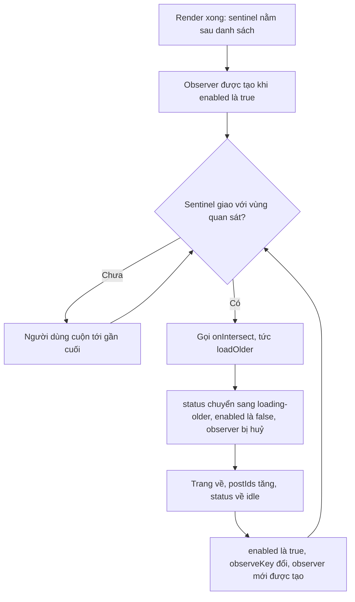

# Lesson 04 – Infinite scroll và bài mới

> **Mục tiêu:** giải thích được infinite scroll bằng `IntersectionObserver` (sentinel, `rootMargin`, lý do sentinel có thể bị kẹt), đọc được hook `useFeedLoader` (cờ in-flight, cursor luôn mới, số bài trang đầu theo màn hình), biết hiển thị skeleton và lỗi inline đúng cách, và cài được banner "Có N bài mới" thay vì tự chèn bài lên đầu feed.
>
> **Cần biết trước:** lesson 02 (cursor `older`/`newer`), lesson 03 (store chuẩn hoá và action `feedPageReceived`), React `useEffect`, `useRef`, `useCallback`.

Lesson này ghép mọi thứ trước đó thành một feed dùng được: store chuẩn hoá (03) + cursor (02) + Data access có retry (01) + một **sentinel** để biết khi nào cần tải thêm + một **banner** để báo có bài mới.

| File | Vai trò |
|---|---|
| `src/lessons/04-infinite-scroll/lesson-04-infinite-scroll.tsx` | Demo: danh sách, skeleton, lỗi, sentinel, tuỳ chỉnh `rootMargin` |
| `src/lessons/04-infinite-scroll/new-posts-banner.tsx` | Polling bài mới, banner, chèn khi người dùng bấm |
| `src/shared/hooks/use-intersection-sentinel.ts` | Hook bọc `IntersectionObserver` |
| `src/shared/hooks/use-feed-loader.ts` | Logic tải feed: trang đầu, cuộn, thử lại; tự quản sentinel |
| `src/lessons/03-normalized-store/feed-store-reducer.ts` | Reducer nhận trang `initial`/`older`/`newer` |
| `server/src/data/feed-repository.ts` | Truy vấn `getPostsNewerThan` cho hướng `newer` |
| `server/src/services/feed-query-service.ts` | Chọn hướng, dựng `hasOlder`/`hasNewer` |

## 1. Sentinel và IntersectionObserver

### Trong bài viết
Bài GreatFrontEnd dùng infinite scroll: người dùng cuộn tới gần cuối thì tải thêm. Bài khuyên dùng **IntersectionObserver** thay vì nghe sự kiện `scroll`, và chỉ ra rằng nên bắt đầu tải **trước** khi người dùng chạm đáy để họ hiếm khi phải chờ. Xem mục *Infinite scroll* và *Optimizations* trong [bài gốc](https://www.greatfrontend.com/questions/system-design/news-feed-facebook?format=system-design).

### Code thật

```learn
src/shared/hooks/use-intersection-sentinel.ts#intersection-sentinel
```

1. `rootMargin = '100% 0px'` mở rộng vùng quan sát thêm **một viewport** ở phía dưới. Sentinel được coi là "giao nhau" khi còn cách màn hình khoảng một màn hình nữa, nên bắt đầu tải sớm (prefetch).
2. `useState<Element | null>` cho phần tử, thay vì `useRef`. Hook trả về `setElement` để dùng như **ref callback**: `<div ref={sentinelRef} />`. Khi phần tử gắn vào hay bị gỡ (ví dụ chuyển giữa các chế độ hiển thị), state đổi và effect chạy lại. Với `useRef` bạn không có cơ chế báo "phần tử vừa đổi".
3. `callbackRef` luôn trỏ `onIntersect` mới nhất (gán ở mỗi lần render). Nhờ vậy observer không phải tạo lại chỉ vì callback đổi, và callback không bao giờ đọc state cũ.
4. Trong `useEffect`: nếu `enabled` là `false` hoặc chưa có phần tử thì thoát. Ngược lại tạo `IntersectionObserver`, và gọi `callbackRef.current()` nếu **có entry nào đang giao nhau** (`entries.some(entry => entry.isIntersecting)`).
5. `return () => observer.disconnect()` dọn observer khi effect chạy lại hoặc component bị gỡ, không để rò bộ nhớ.
6. `observeKey` nằm trong mảng deps của effect. Đổi nó thì effect chạy lại, tạo observer mới. Lý do ở concept 2.

Phần tử sentinel trong JSX:

```learn
src/lessons/04-infinite-scroll/lesson-04-infinite-scroll.tsx#infinite-feed-sentinel-element
```

1. `ref={sentinelRef}` gắn ref callback từ hook vào một `<div>` rỗng đặt **ngay sau** danh sách bài.
2. `aria-hidden="true"` để trình đọc màn hình bỏ qua; nó chỉ là công cụ kỹ thuật.
3. Class `sentinel--visible` và dòng chữ `sentinel (rootMargin: …)` chỉ hiện khi bật "Hiện sentinel", để bạn nhìn thấy nó trong demo.

Công tắc `rootMargin` của demo:

```learn
src/lessons/04-infinite-scroll/lesson-04-infinite-scroll.tsx#root-margin-switch
```

1. Hai lựa chọn: `100% 0px` (prefetch một viewport) và `0px` (chỉ khi chạm đáy).
2. Đổi `rootMargin` làm `useIntersectionSentinel` tạo lại observer vì nó nằm trong deps.

Vòng đời của sentinel:



### Vì sao làm vậy

| Cách | Ưu | Nhược | Khi nào chọn |
|---|---|---|---|
| `IntersectionObserver` + sentinel (project) | Chạy bất đồng bộ, không đọc layout trên main thread; ít code | Phải xử lý trường hợp sentinel đã nằm sẵn trong vùng quan sát (concept 2) | Hầu hết infinite scroll |
| Sự kiện `scroll` + `getBoundingClientRect` | Kiểm soát hoàn toàn | Bắn hàng chục lần mỗi giây; đọc layout gây forced layout nên giật; cần throttle | Trình duyệt rất cũ |
| Nút "Tải thêm" | Người dùng chủ động, dễ test, tốt cho a11y và footer | Thêm một thao tác | Trang có footer quan trọng, hoặc làm phương án dự phòng |
| `rootMargin: 100% 0px` | Hiếm khi thấy skeleton | Tải sớm có thể phí nếu người dùng không cuộn tiếp | Mặc định của feed |
| `rootMargin: 0px` | Không tải thừa | Người dùng chạm đáy rồi mới chờ, thấy skeleton nhiều | So sánh, mạng nhanh, dữ liệu đắt |

### Lỗi hay gặp
- **Nghe `scroll` và đọc `getBoundingClientRect()` trong handler:** gây forced layout và giật. Project dùng `IntersectionObserver`.
- **Không `disconnect` observer:** mỗi lần effect chạy lại để lại một observer cũ vẫn gọi callback. Cleanup luôn `disconnect()`.
- **Callback đọc state cũ:** truyền thẳng `onIntersect` vào deps buộc tạo lại observer liên tục. Giữ nó trong `callbackRef` để cả hai vấn đề cùng biến mất.
- **Đặt sentinel trong container có `overflow` riêng mà quên `root`:** observer mặc định theo viewport, không phải container. Ở project sentinel nằm trong luồng cuộn của trang nên mặc định là đúng.

### Tự thử
1. Mở `http://localhost:5173/#/lesson-04`, tab **🧪 Demo**. Mở DevTools → Network, lọc `feed`.
2. Cuộn xuống. Kết quả mong đợi: request mới `GET /api/feed?count=10&direction=older&cursor=…` được gửi khi sentinel còn khoảng một màn hình nữa mới tới (bạn chưa thấy đáy), nên hiếm khi thấy skeleton.
3. Ở panel "Tuỳ chỉnh" bên phải, chọn `rootMargin` là **0px (chỉ khi chạm đáy)** rồi cuộn lại. Kết quả mong đợi: chỉ tải khi bạn chạm đáy, và skeleton hiện nhiều hơn rõ rệt (nhất là khi tăng **Độ trễ** lên khoảng 1000ms).
4. Giữ "Hiện sentinel" được bật: thanh đánh dấu `sentinel (rootMargin: …)` cho bạn thấy nó nằm sát cuối danh sách.
5. Nhớ đặt `rootMargin` về `100% 0px` và **Độ trễ** về mức cũ sau khi thử.

### Câu hỏi phỏng vấn
1. Vì sao dùng IntersectionObserver thay vì sự kiện `scroll`?
   > Sự kiện scroll bắn rất dày; đọc layout trong handler gây giật (forced layout). IntersectionObserver chạy bất đồng bộ, do trình duyệt tính, nên rẻ hơn và không cần throttle thủ công.
2. `rootMargin: "100% 0px"` để làm gì?
   > Mở rộng vùng quan sát thêm một viewport phía dưới, nên bắt đầu tải trang tiếp khi người dùng còn cách cuối list khoảng một màn hình. Nhờ vậy hiếm khi thấy skeleton.

## 2. Hook tải feed: chặn tải chồng, cursor luôn mới và sentinel không bị kẹt

### Trong bài viết
Bài viết nói về phân trang theo cursor và infinite scroll, nhưng việc ghép chúng thành một vòng lặp "đúng" là phần bạn phải tự làm: không tải chồng, không dùng cursor cũ, và không bao giờ kẹt. Xem mục *Pagination approaches* và *Infinite scroll* trong [bài gốc](https://www.greatfrontend.com/questions/system-design/news-feed-facebook?format=system-design).

### Code thật

```learn
src/shared/hooks/use-feed-loader.ts#feed-loader-load-pages
```

1. `if (inFlightRef.current) return { kind: 'skipped' }` là **một cờ duy nhất cho mọi kiểu tải** (trang đầu, cuộn, tải nhanh nhiều trang). Lời gọi thứ hai khi đang bận bị bỏ, không gửi request.
2. Cờ được dựng ngay (`inFlightRef.current = true`) trước khi `setStatus`, nên không có khoảng hở giữa lúc kiểm tra và lúc khoá.
3. `cursor = direction === 'older' ? olderCursorRef.current : null`: lấy cursor từ **ref** luôn trỏ giá trị mới nhất, không từ closure cũ. Trang đầu (`initial`) dùng `null`.
4. Vòng `for` tải `pages` trang liên tiếp, mỗi trang tăng `requestCount` để UI hiển thị.
5. `fetchFeedPage({ count, cursor, onRetry })`: kích thước trang đầu tính theo màn hình (concept 3), các trang sau là `OLDER_PAGE_SIZE`. `onRetry` đổi thành thông báo "thử lại lần N" (concept 4).
6. `dispatch({ type: 'feedPageReceived', direction: page === 0 ? direction : 'older', … })`: trang đầu tiên theo hướng của caller, các trang tiếp theo luôn là `older`.
7. `cursor = response.feed.olderCursor`, và `if (!response.feed.hasOlder) break` dừng sớm khi hết bài.
8. `catch` đặt `status = 'error'` và trả `{ kind: 'error', message }`; `finally` xoá `retryMessage` và **luôn hạ cờ** `inFlightRef`.

```learn
src/shared/hooks/use-feed-loader.ts#feed-loader-load-older
```

1. `hasOlder` và `postCount` lấy từ store.
2. `loadOlder` chỉ tải khi `hasOlder && postCount > 0`: còn bài cũ và đã có trang đầu. Không có điều kiện `postCount > 0`, sentinel có thể kích hoạt "older" trước khi trang đầu về.
3. `useCallback` với deps đúng giúp callback ổn định nhưng vẫn phản ánh giá trị mới khi `hasOlder` hay `postCount` đổi.

```learn
src/shared/hooks/use-feed-loader.ts#feed-loader-sentinel
```

1. `enabled: hasOlder && status === 'idle'`: chỉ quan sát khi **rảnh và còn bài**. Khi đang tải (`loading-*`) hoặc lỗi, sentinel tắt, không gây tải chồng.
2. `observeKey: [postCount, observeKey].join('|')`: đổi mỗi khi số bài đổi, để observer được tạo lại. Đây là chỗ **chống kẹt** (xem Lỗi hay gặp).
3. `rootMargin` do caller truyền vào (demo cho đổi để so sánh).

Phía View chỉ cần gắn hook:

```learn
src/lessons/04-infinite-scroll/lesson-04-infinite-scroll.tsx#infinite-feed-loader-wiring
```

1. Component chỉ gọi `useFeedLoader({ rootMargin })` và nhận về `status`, `error`, `retryMessage`, `requestCount`, `retry`, `hasOlder`, `sentinelRef`.
2. Không có `fetch`, không có `useEffect`, không có cờ: mọi logic nằm ở hook. Đó là lợi ích của việc đứng giữa View và Data access.

### Vì sao làm vậy

| Cách | Ưu | Nhược | Khi nào chọn |
|---|---|---|---|
| Một cờ `inFlightRef` cho mọi kiểu tải (project) | Không bao giờ có hai request đọc cùng cursor | Lời gọi bị bỏ cần xử lý (`skipped`) | Mọi loader có nhiều đường kích hoạt |
| Chỉ dựa vào `status === 'loading'` | Quen thuộc | Closure đọc `status` cũ; hai lời gọi cùng tick lọt qua | Không đủ tin cậy một mình |
| Hàng đợi các lần tải | Không bỏ lần nào | Phức tạp; dễ tải thừa | Thao tác ghi |
| Khử trùng ở reducer | Che được bài trùng | Không sửa nguyên nhân (cursor lùi) | Chỉ là lớp phòng thủ thứ hai |
| Observe lại khi số bài đổi (`observeKey`) | Không kẹt khi trang ngắn hơn màn hình | Tạo observer mỗi lần tải | Mặc định với sentinel |

### Lỗi hay gặp
- **Sentinel bị kẹt (lỗi thật):** `IntersectionObserver` chỉ báo khi trạng thái giao nhau **thay đổi**. Nếu tải xong mà sentinel vẫn nằm trong vùng quan sát (trang ngắn hơn màn hình, hoặc `rootMargin` lớn) thì không có callback mới và feed đứng im. Project xử lý bằng `observeKey`: đổi nó thì observer mới được tạo và nhận callback ban đầu ngay lập tức. Việc tắt `enabled` trong lúc tải rồi bật lại khi rảnh cũng buộc observer tạo mới sau mỗi lần tải.
- **"Tải nhanh nhiều trang" chạy đua với sentinel (lỗi thật, lesson 08):** nút tải nhanh bỏ qua cờ in-flight nên sentinel cũng tải `older` từ cùng cursor; trang về sau ghi đè `olderCursor` làm cursor lùi và tải lại trang đã có. Sửa bằng cách đưa `loadMany` vào `useFeedLoader` để dùng chung cờ, thêm `try/finally` để không kẹt.
- **Bấm đúp / nhiều đường kích hoạt:** cùng họ lỗi ở lesson 02 (bấm đúp "Tải thêm").
- **Dựng request riêng ở ngoài loader:** `reload` được thiết kế để dùng chung cờ. Một request tự dựng không biết về `inFlight`, có thể chạy chồng với trang `older` rồi nối nhầm vào list mới (feed bị hổng giữa).
- **StrictMode chạy effect trang đầu hai lần ở dev:** cờ `inFlightRef` bỏ lời gọi thứ hai, nên chỉ có một request `initial`.

### Tự thử
1. Mở `#/lesson-04`, tab Demo. Dòng "Đã tải N bài qua M request · trạng thái: `idle`" hiện ở trên danh sách.
2. Cuộn xuống vài lần và nhìn dòng đó. Kết quả mong đợi: `N` tăng khoảng 10 mỗi lần, `M` tăng 1 mỗi lần, và trạng thái nhấp nháy `loading-older` rồi về `idle`.
3. Tăng **Độ trễ** lên 2000ms, cuộn xuống thật nhanh và lắc cuộn qua lại. Kết quả mong đợi: trong Network luôn chỉ có **một** request `older` tại một thời điểm.
4. Thử "trang ngắn": thu nhỏ mức zoom của trình duyệt (Cmd/Ctrl + `-`, ví dụ 33%) rồi tải lại, để vài trang đầu vẫn chưa lấp đầy màn hình. Kết quả mong đợi: feed vẫn tự tải tiếp cho đến khi lấp đầy, không bị đứng.
5. Nhớ đặt **Độ trễ** về mức cũ.

### Câu hỏi phỏng vấn
1. Lỗi kinh điển: tải xong mà sentinel vẫn nằm trong vùng quan sát thì sao?
   > IntersectionObserver không bắn lại vì trạng thái giao nhau không đổi, nên feed kẹt. Phải observe lại khi dữ liệu đổi (`observeKey` là số bài, hoặc `disconnect` rồi `observe` lại) để nhận callback ban đầu.

## 3. Số bài trang đầu theo chiều cao màn hình

### Trong bài viết
Bài viết gợi ý tính số bài của lần tải đầu từ kích thước viewport: màn hình cao cần nhiều bài hơn để lấp đầy, tránh tải quá ít (phải tải lại ngay) hay quá nhiều (phí và chậm). Xem mục *Optimizations* trong [bài gốc](https://www.greatfrontend.com/questions/system-design/news-feed-facebook?format=system-design).

### Code thật

```learn
src/shared/hooks/use-feed-loader.ts#feed-loader-initial-size
```

1. `ESTIMATED_POST_HEIGHT_PX = 320` là chiều cao ước lượng của một bài, một con số ước chừng chứ không đo thật.
2. `Math.ceil(viewportHeight / 320) + 1`: số bài vừa đủ phủ màn hình rồi cộng thêm một bài để chắc chắn có thể cuộn.
3. `Math.max(3, …)` đặt sàn 3 bài; `Math.min(20, …)` đặt trần 20 bài, chặn màn hình cực lớn xin quá nhiều.
4. Ví dụ: màn hình cao 900px cho `ceil(900 / 320) + 1 = 4` bài.
5. `OLDER_PAGE_SIZE = 10` cố định cho các trang sau, vì lúc đó người dùng đã đang cuộn.
6. `loadPages` gọi `computeInitialPageSize(window.innerHeight)` chỉ khi `direction === 'initial'`.

### Vì sao làm vậy

| Cách | Ưu | Nhược | Khi nào chọn |
|---|---|---|---|
| Suy ra từ viewport (project) | Lần tải đầu vừa đủ, nhanh nhất có thể | Chiều cao ước lượng có thể lệch | Mặc định |
| Số cố định (ví dụ 10) | Đơn giản | Màn hình lớn tải thiếu rồi tải thêm ngay; màn hình nhỏ tải thừa | Prototype |
| Tải rất ít bài đầu rồi tải ngay trang lớn | Thấy nội dung rất sớm | Hai request liên tiếp | Mạng chậm, tối ưu "thời gian tới nội dung đầu tiên" |
| Đo chiều cao bài thật | Chính xác | Phức tạp, phải chờ render | Feed có chiều cao cực không đều |

### Lỗi hay gặp
- **Số cố định quá ít trên màn hình cao:** sentinel vẫn nằm trong vùng quan sát sau lần tải đầu, và nếu không có `observeKey` thì feed kẹt (concept 2).
- **Không đặt trần:** màn hình 8K hoặc cửa sổ rất cao xin hàng chục bài, vượt `MAX_PAGE_SIZE` của server (50) hoặc chậm.
- **Dùng `window.innerHeight` ở SSR:** `window` không tồn tại ở server. Lesson này là CSR nên an toàn.

### Tự thử
1. Mở `#/lesson-04`, tab Demo. Mở DevTools → Network, tải lại trang.
2. Xem request đầu tiên, tham số `count=`. Kết quả mong đợi: với cửa sổ cao khoảng 900px thì `count=4`.
3. Mở DevTools ở chế độ dock cao hơn (hoặc phóng to cửa sổ) rồi tải lại. Kết quả mong đợi: `count` tăng theo chiều cao, tối đa 20.
4. Dùng terminal để so sánh với trang sau: `curl -s "http://localhost:3001/api/feed?count=10" | python3 -c "import sys,json; print(len(json.load(sys.stdin)['feed']['postIds']))"`. Kết quả mong đợi: `10`.

### Câu hỏi phỏng vấn
1. Vì sao tính số bài của trang đầu từ chiều cao viewport?
   > Để lần tải đầu vừa đủ lấp đầy màn hình: nhiều hơn thì phí băng thông và chậm, ít hơn thì người dùng phải chờ tải lại ngay. Cần kèm sàn và trần để an toàn.

## 4. Skeleton, lỗi inline và thử lại

### Trong bài viết
Bài viết yêu cầu trải nghiệm tốt khi mạng chậm hoặc lỗi: hiển thị khung chờ (skeleton) thay vì màn hình trống, và báo lỗi mà không phá cả trang. Xem phần *Requirements* và *Optimizations* trong [bài gốc](https://www.greatfrontend.com/questions/system-design/news-feed-facebook?format=system-design).

### Code thật

```learn
src/lessons/04-infinite-scroll/lesson-04-infinite-scroll.tsx#infinite-feed-skeleton-states
```

1. `status === 'loading-initial'` hiện 3 skeleton **thay cho** nội dung vì chưa có bài nào.
2. `state.feed.postIds.map(...)` render danh sách hiện có, luôn có mặt kể cả khi đang tải thêm.
3. `status === 'loading-older'` hiện 2 skeleton **ở cuối danh sách**, bài cũ vẫn thấy được. Người dùng không mất ngữ cảnh.
4. Mỗi `ConnectedPostCard` chỉ nhận `postId` (lesson 03).

```learn
src/lessons/04-infinite-scroll/lesson-04-infinite-scroll.tsx#infinite-feed-error-retry
```

1. `retryMessage` hiện "Lỗi tạm thời – thử lại lần N sau …ms…" khi Data access đang retry (concept 2, `onRetry`). Người dùng biết app không đứng.
2. Khi hết lượt retry, `status === 'error'` hiện một khung có `role="alert"` kèm thông báo và nút **Thử lại**. Trình đọc màn hình sẽ đọc thông báo ngay.
3. Lỗi là **inline**: chỉ thay một vùng, bài đã tải vẫn hiển thị.
4. `retry` gọi lại `loadPages` với `initial` (nếu chưa có bài) hoặc `older`.
5. `!hasOlder` hiện "Bạn đã xem hết bài viết." để người dùng biết đã tới cuối.

### Vì sao làm vậy

| Cách | Ưu | Nhược | Khi nào chọn |
|---|---|---|---|
| Skeleton (project) | Giữ bố cục, cảm giác nhanh, không nhảy layout | Phải làm khung giống thật | Nội dung có hình dạng ổn định |
| Spinner chữ (lesson 01) | Đơn giản | Layout nhảy, trông chậm | Prototype |
| Lỗi inline kèm nút thử lại | Không phá trang, người dùng giữ ngữ cảnh | Thêm trạng thái | Danh sách có nhiều trang |
| Lỗi toàn trang | Dễ làm | Mất những gì đã đọc | Lỗi nghiêm trọng, không thể phục hồi |
| Retry im lặng | Người dùng không thấy lỗi thoáng qua | Mạng chậm trông như đứng nếu không có thông báo | Kèm thông báo tiến độ như project |

### Lỗi hay gặp
- **Skeleton thay luôn danh sách đã có khi tải thêm:** người dùng mất vị trí. Project chỉ hiện skeleton ở cuối.
- **Lỗi phá cả trang:** một request `older` lỗi làm mất cả feed. Project giữ danh sách và hiện lỗi cục bộ.
- **Không có `role="alert"`:** người dùng trình đọc màn hình không biết có lỗi.
- **Nút thử lại không dùng chung cờ in-flight:** gây tải chồng. `retry` đi qua `loadPages`, nên vẫn được cờ bảo vệ.

### Tự thử
1. Mở `#/lesson-04`, tab Demo. Tăng **Độ trễ** lên 2000ms, tải lại trang. Kết quả mong đợi: 3 khung skeleton hiện thay cho nội dung, dòng trạng thái là `loading-initial`.
2. Khi đã có bài, cuộn xuống đáy. Kết quả mong đợi: 2 skeleton hiện ở **cuối** danh sách (`loading-older`), bài cũ vẫn thấy.
3. Kéo **Tỉ lệ lỗi** lên 100% rồi cuộn. Kết quả mong đợi: dòng "Lỗi tạm thời – thử lại lần 1…", rồi "lần 2…", sau lần thứ ba hiện khung "Không tải được bài viết: …" và nút **Thử lại**.
4. Hạ **Tỉ lệ lỗi** về 0% rồi bấm **Thử lại**. Kết quả mong đợi: tải bình thường và khung lỗi biến mất.
5. Dọn dẹp: nhớ đặt **Độ trễ** và **Tỉ lệ lỗi** về mức ban đầu sau khi thử.

### Câu hỏi phỏng vấn
1. Vì sao hiển thị lỗi "inline" thay vì thay cả trang bằng thông báo lỗi?
   > Danh sách đã tải vẫn dùng được; người dùng không mất ngữ cảnh và có thể thử lại đúng chỗ. Lỗi toàn trang chỉ hợp khi không còn gì để hiển thị.

## 5. Bài mới: polling, banner và không tự chèn

### Trong bài viết
Bài viết gọi vấn đề này là **stale feed**: feed đang đọc dần cũ đi vì có bài mới. Bài khuyên không tự chèn bài mới lên đầu khi người dùng đang đọc (nội dung nhảy, mất chỗ), mà hiện một thông báo để người dùng tự bấm. Về cách biết có bài mới, bài so sánh short polling, long polling, SSE và WebSocket. Xem mục *Stale feed* trong [bài gốc](https://www.greatfrontend.com/questions/system-design/news-feed-facebook?format=system-design).

### Code thật

Server trả "các bài mới hơn anchor":

```learn
server/src/data/feed-repository.ts#cursor-newer
```

1. `(created_at, id) > (anchor…)` lấy các bài **mới hơn** anchor (ngược chiều với `older`).
2. `orderBy(asc(...))` lấy các bài **gần anchor nhất trước**. Nếu có hơn `limit` bài mới, client lật tiếp mà không hở khoảng giữa.
3. `limit(limit + 1)` rồi `toPage`: biết còn bài mới nữa không (`hasMore`).
4. `page.posts.reverse()` đảo lại thành thứ tự feed (mới nhất trước) để client chèn lên đầu mà không phải đảo.

Client polling:

```learn
src/lessons/04-infinite-scroll/new-posts-banner.tsx#new-posts-polling-effect
```

1. `pending` giữ **response chưa áp dụng**, không đưa vào store: đó là cách "giữ kết quả mà không chèn".
2. `newerCursorRef` luôn trỏ `state.feed.newerCursor` mới nhất, nên `check` (được tạo một lần trong effect) không đọc cursor cũ.
3. `checking` là cờ cục bộ chống chồng request: mạng chậm hơn chu kỳ polling thì **bỏ lượt này** thay vì xếp hàng.
4. `check` bỏ qua khi tab ẩn (`document.visibilityState !== 'visible'`) hoặc chưa có cursor. Tiết kiệm pin và mạng.
5. `fetchFeedPage({ count: 20, cursor, direction: 'newer', signal })` hỏi các bài mới hơn bài mới nhất đã có.
6. Có bài thì `setPending(response)`. Lỗi thì bỏ qua: polling là việc nền, không làm phiền người dùng.
7. `setInterval` mỗi `NEW_POSTS_POLL_INTERVAL_MS` (10 giây), cộng với `visibilitychange`: quay lại tab thì kiểm tra ngay.
8. Cleanup `abort()`, `clearInterval`, `removeEventListener`: rời trang là dọn sạch, request đang bay bị huỷ.

Người dùng bấm thì mới chèn:

```learn
src/lessons/04-infinite-scroll/new-posts-banner.tsx#new-posts-apply-on-click
```

1. `aria-live="polite"` trong vùng chứa: trình đọc màn hình đọc thông báo khi rảnh, không ngắt ngang.
2. Khi bấm, `dispatch({ type: 'feedPageReceived', direction: 'newer', response: pending, … })` đưa bài vào store (reducer chèn lên đầu và dời `newerCursor`, xem lesson 03).
3. `setPending(null)` ẩn banner.
4. `window.scrollTo({ top: 0, behavior })` cuộn lên đầu; nếu hệ điều hành bật `prefers-reduced-motion: reduce` thì dùng `auto` thay `smooth`, tôn trọng người nhạy cảm với chuyển động.
5. Nhãn "↑ Có N bài mới" có thêm dấu `+` khi `hasNewer` là `true`: còn nhiều hơn số đang hiển thị.

Reducer xử lý hướng `newer` đã giải thích ở lesson 03 concept 2:

```learn
src/lessons/03-normalized-store/feed-store-reducer.ts#store-feed-page-received
```

1. Nhánh `newer` đặt bài mới lên đầu và chỉ dời `newerCursor` khi trang thật sự có bài.
2. `generation` lấy `Math.max`, nên không bao giờ lùi.

### Vì sao làm vậy

| Cách | Ưu | Nhược | Khi nào chọn |
|---|---|---|---|
| Polling + banner, người dùng bấm (project) | Đơn giản, không nhảy nội dung, dễ cài | Bài mới đến trễ tối đa một chu kỳ; tốn request | Feed nhỏ vừa, minh hoạ |
| Tự chèn bài mới lên đầu | Luôn cập nhật | Nội dung nhảy, người đọc mất chỗ | Không nên khi đang đọc |
| Long polling | Gần thời gian thực, dùng HTTP thường | Giữ kết nối, phức tạp phía server | Khi không dùng được WebSocket |
| SSE | Một chiều, tự nối lại, đơn giản | Một chiều; giới hạn kết nối trình duyệt | Đẩy bài mới, đếm reaction |
| WebSocket | Hai chiều, độ trễ thấp | Giữ kết nối, hạ tầng phức tạp | Quy mô lớn, thời gian thực |

### Lỗi hay gặp
- **Các lượt polling chồng nhau (lỗi thật):** lần review đầu ghi nhận: không abort khi unmount và nếu độ trễ lớn hơn 10 giây thì các lượt chồng lên nhau. Project đã thêm `AbortController` và cờ `checking`.
- **Tự chèn bài làm người đọc mất chỗ:** nguyên nhân dùng banner.
- **Poll khi tab ẩn:** lãng phí pin và dữ liệu. Có điều kiện `visibilityState`.
- **`postPrepended` (bài của chính mình) không dời `newerCursor`:** nếu ghép banner với composer thì bài vừa đăng có thể hiện thành "1 bài mới". Ghi chú từ review, cần nhớ khi mở rộng.
- **Đọc `newerCursor` từ closure cũ:** effect chỉ chạy một lần, nên phải đọc qua `newerCursorRef`.

### Tự thử
1. Mở `#/lesson-04`, tab Demo. Ở panel "Mô phỏng mạng (backend)" chọn **Tự sinh bài mới:** **Mỗi 5 giây**.
2. Chờ khoảng 10–15 giây (tối đa 5 giây để server sinh bài, cộng tối đa 10 giây tới lượt polling kế tiếp). Kết quả mong đợi: xuất hiện nút "↑ Có N bài mới" ở đầu feed; **feed không tự nhảy**. Dòng "Kiểm tra bài mới mỗi 10s · lần cuối …" cập nhật theo.
3. Quan sát Network: request `GET /api/feed?count=20&direction=newer&cursor=…` mỗi khoảng 10 giây.
4. Chuyển sang tab trình duyệt khác một lúc rồi quay lại. Kết quả mong đợi: ngay khi quay lại, một request `newer` được gửi.
5. Bấm nút "↑ Có N bài mới". Kết quả mong đợi: các bài mới hiện ở đầu feed, banner biến mất, trang cuộn lên đầu.
6. Hoặc chèn thủ công: `curl -s -X POST "http://localhost:3001/__mock/insert-new-posts?n=3"` rồi chờ banner. Bước này thêm dữ liệu thật vào Postgres.
7. Nhớ chọn lại **Tự sinh bài mới:** **Tắt** sau khi thử.

### Câu hỏi phỏng vấn
1. Vì sao không tự chèn bài mới lên đầu feed?
   > Nội dung bị nhảy và người dùng mất chỗ đang đọc. Hiện banner để người dùng tự bấm; tôn trọng cả `prefers-reduced-motion` khi cuộn lên. Về cách biết có bài mới: short polling đơn giản nhất (project dùng); SSE hợp khi chỉ đẩy một chiều; WebSocket hợp khi quy mô lớn và cần hai chiều. Ở quy mô lớn chỉ subscribe các bài đang hiển thị, bài quá "hot" thì chỉ đẩy số đếm có throttle.

## Tóm tắt
- Infinite scroll dùng `IntersectionObserver` với một sentinel cuối danh sách; `rootMargin: 100% 0px` giúp tải trước một màn hình.
- Observer chỉ báo khi trạng thái giao nhau đổi, nên hook phải observe lại mỗi khi số bài đổi (`observeKey`) để không bị kẹt.
- `useFeedLoader` dùng một cờ in-flight cho mọi kiểu tải, đọc cursor từ ref mới nhất, và tự bật/tắt sentinel theo trạng thái.
- Số bài trang đầu suy ra từ chiều cao viewport (có sàn và trần); skeleton và lỗi hiển thị inline cùng nút thử lại.
- Bài mới được polling theo hướng `newer`, giữ trong `pending` và chỉ chèn khi người dùng bấm banner, không tự nhảy nội dung.
