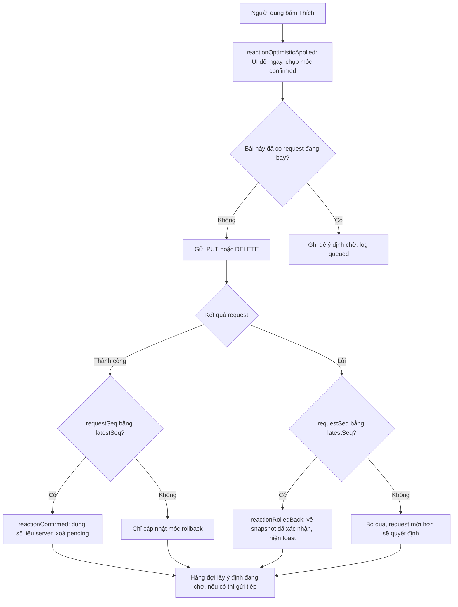
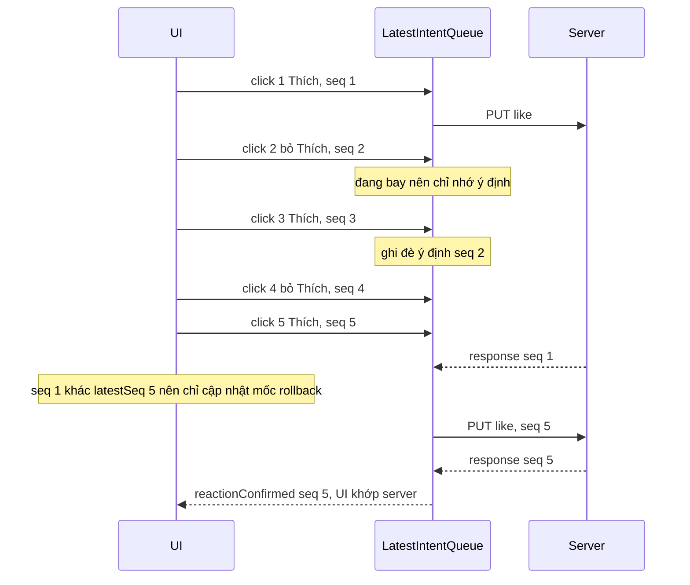

# Lesson 05 – Optimistic reaction

> **Mục tiêu:** học xong lesson này bạn giải thích được vì sao bấm "Thích" thấy số đổi ngay mà vẫn không bao giờ lệch với server, và tự cài được: (1) optimistic update có rollback, (2) hàng đợi gửi tuần tự theo từng bài để server ghi đúng thứ tự, (3) endpoint reaction idempotent trả về "sự thật" sau khi ghi, (4) nút reaction dùng được bằng bàn phím và screen reader.
>
> **Cần biết trước:** lesson 03 (store chuẩn hoá `postsById`, reducer), lesson 04 (`useFeedLoader`, infinite scroll). Biết cơ bản `useReducer`, `async/await`, và `PUT` khác `POST` ở điểm nào.

| File | Vai trò |
|---|---|
| `src/lessons/05-optimistic-reaction/lesson-05-optimistic-reaction.tsx` | Màn demo: feed + event log hiện từng bước `optimistic`, `queued`, `confirmed`, `rolledBack` |
| `src/lessons/05-optimistic-reaction/reaction-reducer-with-rollback.ts` | Reducer: áp dụng lạc quan, xác nhận theo `requestSeq`, rollback |
| `src/lessons/05-optimistic-reaction/use-toggle-reaction.ts` | Hook: dispatch optimistic, gọi API, đưa request vào hàng đợi theo bài |
| `src/shared/api/latest-intent-queue.ts` | Hàng đợi "ý định mới nhất" theo khoá, mỗi khoá một request đang bay |
| `src/lessons/05-optimistic-reaction/reaction-picker.tsx` | Nút Thích, nút ▾, bảng 6 cảm xúc (lazy) |
| `src/lessons/05-optimistic-reaction/reaction-menu.tsx` | Bảng 6 cảm xúc, tách thành chunk riêng |
| `src/shared/api/feed-api.ts` | `setReaction` / `removeReaction` (không tự retry) |
| `server/src/routes/reaction-routes.ts` | `PUT` / `DELETE /api/posts/:postId/reaction` |
| `server/src/data/feed-repository.ts` | UPSERT reaction, đếm reaction theo loại |
| `server/src/data/database-schema.ts` | Bảng `reactions`, khoá chính `(post_id, user_id)` |

## 1. Optimistic update và rollback

### Trong bài viết
Bài viết nói rằng các thao tác nhẹ và gần như luôn thành công (like, react) nên cập nhật giao diện **trước**, rồi mới gửi request. Nếu request lỗi thì hoàn tác và báo cho người dùng. Cảm giác "tức thì" đến từ việc không chờ mạng, còn tính đúng đắn đến từ việc server vẫn là nguồn sự thật. Xem phần về cập nhật lạc quan và reaction trong [bài gốc](https://www.greatfrontend.com/questions/system-design/news-feed-facebook?format=system-design).

### Code thật

Bước đầu tiên là reducer. Nó cần làm được ba việc: đổi UI ngay, nhớ trạng thái "đã xác nhận" để quay về, và tính lại số đếm.

```learn
src/lessons/05-optimistic-reaction/reaction-reducer-with-rollback.ts#optimistic-applied
```

1. `record?.confirmed ?? {...}`: nếu chưa có request nào đang chờ cho bài này, chụp lại `viewerReaction` và `engagementSummary` hiện tại làm **mốc rollback**. Nếu đã có request chờ, giữ mốc cũ, vì mốc phải là điều server đã xác nhận chứ không phải điều UI đang hiển thị.
2. `optimistic`: trạng thái mới mà người dùng muốn thấy. Số đếm được tính lại cục bộ bằng `applyReactionChangeToSummary`.
3. `patchPost` ghi trạng thái lạc quan vào `postsById`, nên mọi component đọc bài này render lại ngay.
4. `pendingReactions[postId]` lưu `latestSeq` (số thứ tự của lần bấm mới nhất) và mốc `confirmed`. Cờ này cũng điều khiển chữ "đang lưu…" trên nút.

```learn
src/lessons/05-optimistic-reaction/reaction-reducer-with-rollback.ts#summary-delta
```

1. Nếu `previous === next` thì không có gì đổi, trả lại object cũ (giữ nguyên tham chiếu để React khỏi render thừa).
2. Bỏ reaction cũ: trừ 1 ở loại cũ, trừ 1 ở tổng. `Math.max(0, …)` chặn số đếm âm nếu dữ liệu lệch.
3. Cộng reaction mới tương tự. Đổi từ "like" sang "love" nghĩa là trừ like, cộng love, tổng giữ nguyên.

```learn
src/lessons/05-optimistic-reaction/reaction-reducer-with-rollback.ts#rolled-back-latest-only
```

1. Không có `record` hoặc `requestSeq` không phải của lần bấm mới nhất thì **không làm gì**: lỗi của request cũ không được phá trạng thái mà lần bấm mới hơn đang hiển thị.
2. Ngược lại, `patchPost(..., record.confirmed)` trả UI về đúng trạng thái server đã xác nhận gần nhất, rồi xoá `pendingReactions` của bài.

Phần hook làm cầu nối giữa reducer và mạng:

```learn
src/lessons/05-optimistic-reaction/use-toggle-reaction.ts#send-intent-confirm-rollback
```

1. Gọi `setReaction` khi có `reaction`, gọi `removeReaction` khi `null` (bỏ reaction).
2. Request lỗi → dispatch `reactionRolledBack` rồi bắn sự kiện `rolledBack` cho event log. Màn demo hiện toast "Không lưu được cảm xúc. Đã hoàn tác."
3. Thành công → dispatch `reactionConfirmed` kèm response của server. UI dùng **số liệu server trả về** chứ không giữ số tự tính.
4. `publishReactionConfirmed` báo các tab khác (lesson 09 dùng; ở lesson 05 nó không làm gì).

```learn
src/shared/api/feed-api.ts#feed-api-set-reaction
```

1. `maxAttempts: 1` tắt retry tự động của `http-client`. Mục đích chỉ để lesson này thấy rõ rollback khi lỗi. Vì `PUT` idempotent nên thực tế có thể retry an toàn (xem khái niệm 3).
2. `encodeURIComponent(postId)` để id chứa ký tự lạ không phá URL.



### Vì sao làm vậy

| Cách | Ưu | Nhược | Khi nào chọn |
|---|---|---|---|
| Optimistic + mốc rollback (project dùng) | UI tức thì; lỗi thì hoàn tác chính xác về trạng thái server đã xác nhận | Phải quản lý thêm `pendingReactions`; có khoảng thời gian UI "nói dối" ngắn | Thao tác gần như luôn thành công, hoàn tác dễ: like, react, follow |
| Pessimistic (chờ response rồi mới đổi UI) | Đơn giản, không bao giờ hiển thị sai | Mạng chậm thì nút "đơ"; người dùng bấm lại vì tưởng chưa ăn | Thanh toán, xoá dữ liệu, thao tác không hoàn tác được |
| Optimistic nhưng không có mốc rollback (đoán ngược lại số đếm) | Ít state hơn | Dễ lệch khi nhiều lần bấm xen kẽ; bấm nhanh rồi lỗi thì không biết quay về đâu | Gần như không nên |
| Refetch cả feed sau mỗi lần bấm | Luôn đúng | Tốn băng thông, giật, mất chỗ đang đọc | Hiếm; chỉ khi không thể tự tính số đếm |

Đánh đổi chính: bạn đổi một chút phức tạp ở client (mốc rollback, cờ pending) lấy cảm giác tức thì. Vì vậy phải dùng số liệu server trả về sau khi confirmed: có thể người khác vừa react cùng bài, số đếm cục bộ chỉ là dự đoán.

### Lỗi hay gặp
- **Rollback về trạng thái "UI hiện tại" thay vì trạng thái "đã xác nhận":** bấm Thích rồi đổi sang Yêu thích, request thứ hai lỗi, UI quay về Thích (chưa từng được server xác nhận). Project tránh bằng cách giữ `confirmed` riêng trong `pendingReactions` và chỉ ghi đè nó khi có response thành công.
- **Quên bỏ cờ pending khi lỗi:** chữ "đang lưu…" kẹt mãi. Cả `reactionConfirmed` và `reactionRolledBack` đều xoá `pendingReactions[postId]`.
- **Tự tính số đếm rồi không bao giờ đối chiếu với server:** người dùng thấy 12, tải lại thấy 14. Project luôn lấy `engagementSummary` từ response.

### Tự thử
1. Chạy `npm run dev`, mở `#/lesson-05`, tab **Demo**. Trong panel **Mô phỏng mạng (backend)** kéo thanh **Độ trễ** lên 2000ms, giữ **Tỉ lệ lỗi** 0%.
2. Bấm nút **👍 Thích** trên một bài. Kết quả mong đợi: số đếm tăng và nút chuyển sang trạng thái active **ngay lập tức**, chữ "· đang lưu…" hiện, cột **Event log** có ngay dòng `⚡ optimistic`; khoảng 2 giây sau mới có thêm dòng `✅ server xác nhận` và chữ "đang lưu…" biến mất.
3. Kéo thanh **Tỉ lệ lỗi** lên 100% rồi bấm **Thích** ở bài khác. Kết quả mong đợi: UI đổi ngay, khoảng 2 giây sau tự hoàn tác, toast "Không lưu được cảm xúc. Đã hoàn tác." và dòng `↩️ rollback` trong Event log.

### Câu hỏi phỏng vấn
1. Khi nào nên dùng optimistic update và khi nào không?
   > Dùng khi thao tác gần như luôn thành công và hoàn tác dễ (reaction, like, follow). Không dùng cho thanh toán hay thao tác không hoàn tác được, vì hiển thị "thành công" rồi mới báo lỗi gây thiệt hại thật.
2. Sau khi đã optimistic, vì sao vẫn phải dùng số liệu server trả về?
   > Server là nguồn sự thật. Người khác có thể vừa react cùng bài, nên số tự tính chỉ là dự đoán. Dùng response để tự sửa lệch, đồng thời cập nhật mốc rollback.

## 2. Race condition: thứ tự response và thứ tự server ghi

### Trong bài viết
Bài viết nhắc rằng người dùng có thể bấm nhanh nhiều lần liên tiếp và client phải xử lý đúng. Ý của bài: hai lần bấm nhanh không được đan xen thành trạng thái lệch; bài gợi ý **gửi tuần tự theo từng bài** hoặc **gắn số thứ tự/version ở client** để bỏ qua response cũ, và giá trị của server luôn thắng. Project từng chỉ làm vế thứ hai (`requestSeq`) và vẫn sai ở phía **server** (thứ tự ghi), rồi mới bổ sung vế thứ nhất (xem "Lỗi hay gặp"). Tham khảo [bài gốc](https://www.greatfrontend.com/questions/system-design/news-feed-facebook?format=system-design).

### Code thật

Lớp thứ nhất là `requestSeq`: chỉ lần bấm mới nhất được quyền đổi UI.

```learn
src/lessons/05-optimistic-reaction/reaction-reducer-with-rollback.ts#confirmed-seq-guard
```

1. `serverTruth`: số liệu server vừa trả về, đóng gói thành snapshot.
2. `if (!record) return state`: bài này đã được một request **mới hơn** xác nhận xong (record đã bị xoá) nên response cũ này vô nghĩa, bỏ qua.
3. `action.requestSeq !== record.latestSeq`: đây là response của một request **cũ** về trễ. UI đang hiển thị ý định mới nhất của người dùng, nên không đổi UI. Chỉ cập nhật `confirmed` để làm mốc rollback tốt hơn.
4. Đúng là response của lần bấm mới nhất: áp dụng số liệu server vào `postsById` và xoá `pendingReactions`.

Lớp thứ hai là thứ tự **server ghi**. `requestSeq` không kiểm soát được điều này, nên mỗi bài chỉ được có một request đang bay:

```learn
src/shared/api/latest-intent-queue.ts#latest-intent-queue
```

1. `pendingByKey` giữ một "ô" cho mỗi khoá (ở đây khoá là `postId`).
2. Nếu khoá đã có ô, tức là đang có request bay: chỉ **ghi đè** `existing.intent` bằng ý định mới rồi trả `false`. Các ý định trung gian bị gộp.
3. Chưa có ô thì tạo ô, rồi vòng `while` chạy `run(current)`, đợi xong mới lấy `slot.intent` (ý định đang chờ, nếu có) để chạy tiếp.
4. `finally` luôn xoá ô, kể cả khi `run` ném lỗi, nên hàng đợi của khoá không bao giờ bị kẹt.
5. Trả `true` nghĩa là lần gọi này đã trực tiếp chạy; `false` nghĩa là chỉ xếp hàng.

```learn
src/lessons/05-optimistic-reaction/use-toggle-reaction.ts#request-seq-and-queue
```

1. `requestSeqCounter` tăng dần toàn cục, nên mọi lần bấm trên mọi bài đều có số thứ tự duy nhất.
2. `reactionQueue` khai báo ở mức module: dùng chung mọi component, mỗi bài một hàng đợi theo `postId`.

```learn
src/lessons/05-optimistic-reaction/use-toggle-reaction.ts#toggle-submit-intent
```

1. Tăng `requestSeqCounter`, tạo `intent` gồm `reaction` và `requestSeq`.
2. `dispatch reactionOptimisticApplied` chạy **ở mọi lần bấm**: UI luôn đổi ngay, người dùng không thấy độ trễ của hàng đợi.
3. `reactionQueue.submit(...)` gửi ý định vào hàng đợi theo bài; callback `sendIntent` được gọi với ý định mới nhất khi tới lượt.
4. Nếu `submit` trả `false`, bắn sự kiện `queued` để event log hiện "chờ request trước xong rồi mới gửi".



### Vì sao làm vậy

| Cách | Ưu | Nhược | Khi nào chọn |
|---|---|---|---|
| `requestSeq` ở client + hàng đợi tuần tự theo bài (project dùng) | Server nhận đúng thứ tự; gộp ý định nên 5 lần bấm chỉ tốn khoảng 2 request; không cần đổi server | Lần ghi cuối chậm hơn một vòng RTT | Server không hỗ trợ version, thao tác ghi đè (last write wins) |
| Chỉ `requestSeq` ở client | Đơn giản | Chỉ sắp thứ tự **response**, không sắp thứ tự **server ghi**; UI và DB lệch vĩnh viễn | Không đủ một mình |
| Gửi `version` hoặc `seq` lên server để bỏ qua lần ghi cũ | Đúng cả khi nhiều thiết bị cùng ghi; không cần chờ | Server phải lưu và so sánh version; API phức tạp hơn | Hệ thống nhiều thiết bị, cần đồng bộ chặt |
| Debounce vài trăm ms rồi gửi một lần | Ít request nhất | Trễ cố định; vẫn có thể race giữa hai lần debounce | Thao tác "nhập liệu", không phải toggle |
| Khoá nút trong lúc pending | Không có race | UI cảm giác chậm, mất ý nghĩa của optimistic | Thao tác rủi ro cao |

### Lỗi hay gặp
- **Server nhận reaction sai thứ tự (lỗi thật của project):** latency 2000ms, bấm Thích/bỏ Thích 6 lần cách nhau 30ms. Middleware mô phỏng mạng có jitter ±20%, nên các request song song tới server **khác thứ tự lúc gửi**. Request #6 về trước và được dùng làm sự thật, nhưng request #5 (ý định ngược lại) tới sau và ghi đè trong DB. Tải lại trang thì reaction "nhảy" (`post-0300 ui=true server=null MISMATCH`, tái hiện 2/2 lần). `requestSeq` đúng nhưng chỉ sắp thứ tự response. Cách sửa: `LatestIntentQueue`, mỗi bài một request đang bay. Smoke test cũ không bắt được vì chỉ kiểm tra UI mà không đối chiếu với server.
- **Hứa hẹn quá trong comment và bài dạy:** bản đầu ghi "trạng thái cuối khớp lần bấm cuối" chỉ dựa trên `requestSeq`. Bài học: khi dạy race, phải nói rõ có **hai** thứ tự cần kiểm soát (response ở client, ghi ở server).
- **`run` ném lỗi làm kẹt hàng đợi:** nếu quên `finally`, bài đó không gửi được nữa. Project dọn ô trong `finally`, và `sendIntent` tự bắt lỗi nên `run` gần như không ném.

### Tự thử
1. Mở `#/lesson-05`, tab **Demo**. Đặt **Độ trễ** 2000ms, **Tỉ lệ lỗi** 0%.
2. Chọn một bài chưa react và bấm nút **👍 Thích** 5 lần thật nhanh (bấm lần chẵn là bỏ reaction, lần lẻ là đặt lại; nút giữ nguyên chữ Thích, chỉ đổi trạng thái active).
3. Kết quả mong đợi: UI đổi ở **mọi** lần bấm. Event log có các dòng `⏳ chờ request trước xong rồi mới gửi (gửi tuần tự theo bài)`. Trong terminal chạy server chỉ thấy khoảng 2 dòng `PUT`/`DELETE`.
4. Đợi vài giây rồi tải lại trang. Reaction của bài đó phải **khớp** lần bấm cuối cùng.
5. Đối chiếu với server bằng curl (thay `<postId>` bằng id lấy từ log hoặc từ `curl -s "http://localhost:3001/api/feed?count=1"`):

```bash
curl -s "http://localhost:3001/api/posts/<postId>" | head -c 600
```

   Trường `viewerReaction` trong response phải khớp với điều UI đang hiển thị.

### Câu hỏi phỏng vấn
1. Bấm Thích rồi bỏ Thích rất nhanh thì xử lý race thế nào?
   > Cần hai lớp. (1) Thứ tự server ghi: gửi tuần tự theo từng bài, khi đang có request bay thì chỉ nhớ ý định mới nhất. (2) Thứ tự response ở client: mỗi lần bấm có `requestSeq`, chỉ response của lần bấm mới nhất được đổi UI, response cũ chỉ cập nhật mốc rollback.
2. `requestSeq` có đủ để UI và database luôn khớp không?
   > Không. Nó chỉ quyết định response nào được áp dụng ở client. Hai request song song có thể tới server sai thứ tự, và request cũ ghi sau sẽ ghi đè request mới. Cần gửi tuần tự hoặc gửi version cho server.
3. Làm sao đảm bảo thứ tự ghi nếu có nhiều tab hoặc nhiều thiết bị?
   > Hàng đợi ở client không phủ được nhiều thiết bị. Cần phía server: version hoặc timestamp trong request (so sánh trước khi ghi), hoặc dùng `confirmedAt` để client biết bản nào mới hơn (lesson 09 dùng cho BroadcastChannel).

## 3. Server: reaction idempotent và trả về "sự thật"

### Trong bài viết
Bài viết mô tả reaction là một thao tác ghi nhỏ, gửi qua API và server trả số liệu mới. Bài cũng nhắc rằng không nên gửi cả danh sách người react mà chỉ gửi vài người đại diện và tổng số, để payload nhỏ. Xem [bài gốc](https://www.greatfrontend.com/questions/system-design/news-feed-facebook?format=system-design).

### Code thật

Bảng `reactions` là chỗ idempotency bắt đầu: mỗi người chỉ có một reaction trên một bài.

```learn
server/src/data/database-schema.ts#reactions-table
```

1. Khoá chính `(post_id, user_id)` đảm bảo một người không thể có hai dòng cho cùng bài.
2. `onDelete: 'cascade'`: xoá bài thì reaction đi theo.
3. `CHECK` giới hạn giá trị `reaction` ở 6 loại hợp lệ ngay trong database, không chỉ dựa vào validate ở tầng API.

```learn
server/src/data/feed-repository.ts#set-reaction-upsert
```

1. `insert(...).values(...)` thử chèn dòng mới.
2. `onConflictDoUpdate` trên đích `(post_id, user_id)`: nếu đã có dòng thì **đổi** `reaction` thay vì báo lỗi. Đó là UPSERT.
3. Chạy hai lần cùng giá trị cho cùng kết quả cuối, nên `PUT` idempotent và client retry thoải mái.

```learn
server/src/routes/reaction-routes.ts#reaction-put-route
```

1. Lấy `reaction` từ body, ép kiểu `Partial` vì body chưa đáng tin.
2. Kiểm tra giá trị có nằm trong `REACTION_TYPES` không; sai trả `400 INVALID_REACTION`.
3. Gọi `writeReaction` với hàm ghi `setReaction`. `req.viewerId` lấy từ session phía server, **không** nhận userId từ client.

```learn
server/src/routes/reaction-routes.ts#reaction-write-confirmed-at
```

1. Tìm bài, không có thì `404 POST_NOT_FOUND`.
2. Ghi bằng hàm `write` được truyền vào (UPSERT hoặc DELETE).
3. `personalizePosts` tính lại số liệu cho đúng người xem, rồi trả `engagementSummary`, `viewerReaction` và `confirmedAt`.
4. `confirmedAt` là mốc thời gian server; client dùng để so sánh bản nào mới hơn khi có nhiều nguồn (lesson 09).

```learn
server/src/services/engagement-summary-builder.ts#personalize-posts
```

1. Gọi `getReactionStats` **một lần cho cả danh sách bài** để không bị N+1 query.
2. Ghép số đếm, tổng, danh sách người react mẫu vào `engagementSummary`.
3. `viewerReaction` phụ thuộc người xem, nên response feed là dữ liệu cá nhân hoá và phải có `Cache-Control: private`.

```learn
server/src/data/feed-repository.ts#reaction-stats
```

1. Khởi tạo sẵn số đếm 0 cho mọi bài, để bài không có reaction nào vẫn có kết quả.
2. Hai query độc lập (đếm theo loại, người react mẫu) chạy `Promise.all` khi dùng pool. Trong transaction chỉ có một kết nối nên chạy lần lượt.
3. Cộng dồn từng dòng kết quả vào `counts`, `total` và `viewerReaction`.

```learn
server/src/data/feed-repository.ts#reaction-counts-query
```

1. `GROUP BY (post_id, reaction)` đếm số người cho từng loại reaction của từng bài, trong một query.
2. `bool_or(user_id = viewer)` cho biết viewer có nằm trong nhóm này không, nên không cần query riêng để biết `viewerReaction`.

```learn
shared-contracts/feed-api-contracts.ts#contract-engagement-summary
```

1. `reactionCounts`, `totalReactions` là số liệu server tính; client chỉ hiển thị.
2. `sampleReactorIds` chỉ chứa tối đa 2 id (ưu tiên bạn bè) thay vì cả danh sách, để payload nhỏ.
3. Client và server dùng chung file hợp đồng này, nên đổi hình dạng response là lỗi biên dịch ở cả hai phía.

### Vì sao làm vậy

| Cách | Ưu | Nhược | Khi nào chọn |
|---|---|---|---|
| `PUT` UPSERT + `DELETE`, khoá chính `(post_id, user_id)` (project dùng) | Idempotent tự nhiên; retry an toàn; DB chặn trùng | Phải trả lại số liệu mới để client đồng bộ | Trạng thái "mỗi người một giá trị" |
| `POST /like` mỗi lần bấm | Quen thuộc | Bấm lặp hoặc retry tạo trùng, phải tự khử trùng | Hành động cộng dồn (log sự kiện) |
| Lưu số đếm trong cột của bài (`likes += 1`) | Đọc nhanh | Dễ lệch với bảng reaction; ghi đồng thời gây xung đột; không biết ai đã react | Khi số đếm xấp xỉ là chấp nhận được và có job đối soát |
| Server chỉ trả `204`, client tự tính số đếm | Payload nhỏ nhất | Lệch với server khi có người khác react cùng lúc | Hiếm |

### Lỗi hay gặp
- **Cache response feed như dữ liệu công khai:** `viewerReaction` thuộc về người xem; cache chung sẽ làm người này thấy reaction của người kia. Project đặt `Cache-Control: private` cho response feed.
- **N+1 khi dựng số liệu:** truy vấn reaction riêng cho từng bài. Project đếm cho cả trang bằng `GROUP BY` và `inArray`.
- **Sau review: số query tăng đột ngột:** thêm danh sách người react mẫu làm mỗi trang thêm 2 lần round-trip DB. Đã sửa bằng cách chạy hai query song song khi không ở trong transaction.
- **Tin `userId` từ client:** project luôn dùng `req.viewerId` từ session, không đọc userId từ body.

### Tự thử
1. Mở `#/lesson-05`, tab **Demo**, bấm **👍 Thích** một bài, rồi tải lại trang. Reaction vẫn còn, chứng tỏ server đã lưu thật. Terminal server in log `PUT /api/posts/.../reaction`.
2. Thử gửi `PUT` hai lần liên tiếp cùng giá trị bằng curl (thay `<postId>`):

```bash
curl -s -X PUT "http://localhost:3001/api/posts/<postId>/reaction" -H "Content-Type: application/json" -d '{"reaction":"love"}'
curl -s -X PUT "http://localhost:3001/api/posts/<postId>/reaction" -H "Content-Type: application/json" -d '{"reaction":"love"}'
```

3. Kết quả mong đợi: cả hai lần trả `200`, `totalReactions` **không tăng thêm** ở lần thứ hai, `viewerReaction` là `"love"`.
4. Gửi giá trị sai: `-d '{"reaction":"bogus"}'` phải trả `400` với `INVALID_REACTION`.

### Câu hỏi phỏng vấn
1. Vì sao `PUT` reaction được coi là idempotent?
   > Bảng có khoá chính `(post_id, user_id)` và server dùng UPSERT, nên gửi cùng một giá trị nhiều lần cho cùng kết quả cuối. Nhờ vậy client retry khi mạng lỗi mà không sợ đếm trùng.
2. Vì sao response của reaction trả luôn `engagementSummary` mới?
   > Client đã optimistic nên số đếm chỉ là dự đoán. Server trả số liệu thật (kèm `confirmedAt`) để client tự sửa nếu người khác vừa react và để cập nhật mốc rollback.

## 4. Nút reaction truy cập được và bảng chọn lazy

### Trong bài viết
Bài viết yêu cầu reaction dùng được bằng bàn phím và screen reader, không chỉ hover; bảng chọn nhiều cảm xúc nên tải khi cần để giữ bundle đầu nhỏ. Xem phần về accessibility và performance trong [bài gốc](https://www.greatfrontend.com/questions/system-design/news-feed-facebook?format=system-design).

### Code thật

```learn
src/lessons/05-optimistic-reaction/reaction-picker.tsx#reaction-buttons-aria
```

1. Nút chính là `<button type="button">` thật, nên Tab, Enter, Space và screen reader hoạt động sẵn.
2. `aria-pressed={viewerReaction !== null}` nói với screen reader đây là nút bật/tắt và đang ở trạng thái nào.
3. Bấm nút chính: đã có reaction thì bỏ (`null`), chưa có thì đặt `like`.
4. Nút ▾ có `aria-label="Chọn cảm xúc khác"` (vì chữ "▾" vô nghĩa với screen reader), `aria-expanded` cho biết menu đang mở hay đóng.
5. `aria-controls` chỉ có khi menu đang mở; nếu luôn có thì sẽ trỏ tới một id chưa tồn tại.
6. `onFocus={preloadReactionMenu}`: bàn phím focus vào ▾ thì tải sẵn chunk menu.

```learn
src/lessons/05-optimistic-reaction/reaction-picker.tsx#lazy-reaction-menu
```

1. `lazyWithPreload(() => import('./reaction-menu'))` tách bảng 6 cảm xúc thành chunk JS riêng. Phần lớn người dùng chỉ bấm "Thích" nên không cần tải bảng này ở bundle đầu.
2. `preload()` cho phép tải chunk **trước khi** React cần. Chuột chạm vào thanh reaction (`onPointerEnter`) hoặc bàn phím focus vào ▾ đều gọi nó.
3. Preload chỉ rút ngắn thời gian chờ, không xoá nó: lần hover đầu mà chunk chưa về vẫn thấy khung giữ chỗ.

```learn
src/lessons/05-optimistic-reaction/reaction-picker.tsx#reaction-menu-placeholder
```

1. Khung giữ chỗ có **cùng kích thước** menu thật (6 nút 40px, gap, padding), nên mở menu không làm layout nhảy.
2. Nó mang **cùng `id`** với menu thật để `aria-controls` của nút ▾ không bao giờ trỏ tới phần tử chưa tồn tại.
3. `aria-hidden="true"` vì đây chỉ là chỗ giữ, không phải nội dung cho screen reader.

```learn
src/lessons/05-optimistic-reaction/reaction-menu.tsx#reaction-menu-markup
```

1. `role="group"` kèm `aria-label="Cảm xúc"` gom 6 nút thành một nhóm có tên.
2. Mỗi nút có `aria-label` là nhãn tiếng Việt (emoji một mình không đọc được), `title` để hiện tooltip, `aria-pressed` cho cảm xúc đang chọn.
3. Bấm lại đúng cảm xúc đang chọn thì gọi `onChoose(null)` để bỏ reaction.

### Vì sao làm vậy

| Cách | Ưu | Nhược | Khi nào chọn |
|---|---|---|---|
| `<button>` thật + `aria-pressed` (project dùng) | Bàn phím và screen reader dùng sẵn; ít code | Phải nhớ gắn ARIA đúng | Mọi nút bật/tắt |
| `<div onClick>` | Tự do style | Mất focus, Enter/Space, role; phải tự cài lại tất cả | Không nên |
| Menu chỉ mở bằng hover | Gọn với chuột | Bàn phím và màn hình cảm ứng không dùng được | Không nên một mình; luôn có thêm nút ▾ |
| Menu import tĩnh vào bundle đầu | Không có độ trễ khi mở | Bundle đầu nặng hơn cho tính năng ít dùng | Menu rất nhỏ hoặc dùng ở mọi bài |
| Menu lazy + preload (project dùng) | Bundle đầu nhẹ; preload che phần lớn độ trễ | Lần hover đầu vẫn có thể thấy khung giữ chỗ | Tính năng phụ, kích thước đáng kể |

### Lỗi hay gặp
- **Dạy sai cơ chế preload (từ review lesson 09–12):** menu mở ngay khi chuột chạm cả thanh reaction (`onMouseEnter` của `.reaction-bar`), tức trước `pointerenter` của nút ▾. Preload gắn vào ▾ vì thế gần như vô dụng với chuột. Project chuyển preload sang `onPointerEnter` của **cả thanh** (bắn trước `mouseenter`), và ▾ chỉ giữ `onFocus` cho bàn phím.
- **`aria-controls` trỏ tới id chưa có:** lúc hiện khung giữ chỗ, menu thật chưa mount. Project cho khung giữ chỗ mang cùng `id` và chỉ gắn `aria-controls` khi menu đang mở.
- **`aria-label` trên `<span>` không có role:** hầu hết screen reader bỏ qua. Project dùng một `<span class="visually-hidden">` chứa chữ "N cảm xúc" thay vì gắn nhãn lên phần tử trống.
- **Dùng `aria-live` cho số đếm:** mỗi lần số đổi sẽ bị đọc to liên tục. Project cố ý không dùng.

### Tự thử
1. Mở `#/lesson-05`, tab **Demo**. Bấm Tab cho tới khi focus vào nút **▾** (có tên "Chọn cảm xúc khác"), nhấn **Enter**: menu 6 cảm xúc hiện ra. Nhấn **Tab** để đi qua từng cảm xúc, **Enter** để chọn, **Esc** để đóng và focus quay về nút ▾.
2. Mở DevTools, tab **Network**, lọc `reaction-menu`. Tải lại trang rồi hover vào một thanh reaction: chunk `reaction-menu` chỉ được tải ở lần hover đầu, không tải lúc trang mở.
3. Mở **Elements → Accessibility**: nút **Thích** có `pressed: true/false`, nút ▾ có `expanded`.

### Câu hỏi phỏng vấn
1. Vì sao phải dùng `<button>` thật thay vì `<div onClick>`?
   > `<button>` có sẵn focus, kích hoạt bằng Enter/Space, role đúng cho screen reader. `<div>` thì phải tự cài tất cả và rất dễ thiếu.
2. `aria-pressed` và `aria-expanded` khác nhau thế nào?
   > `aria-pressed` cho nút bật/tắt (đã react hay chưa). `aria-expanded` cho nút điều khiển một vùng có thể mở/đóng (menu cảm xúc đang mở hay đóng).
3. Vì sao tách bảng 6 cảm xúc thành chunk riêng, và preload để làm gì?
   > Đa số chỉ bấm "Thích" nên bảng này không cần ở bundle đầu. Preload tải chunk trước lúc cần (hover/focus) để rút ngắn độ trễ, nhưng không xoá hẳn nó.

## Tóm tắt
- Optimistic update đổi UI ngay, giữ mốc "đã xác nhận" để rollback, và luôn dùng số liệu server trả về làm sự thật.
- `requestSeq` chỉ sắp thứ tự **response** ở client; muốn server **ghi** đúng thứ tự thì phải gửi tuần tự theo từng bài (`LatestIntentQueue`).
- Hàng đợi chỉ giữ ý định mới nhất cho mỗi bài, nên 5 lần bấm nhanh chỉ tốn khoảng 2 request và server luôn kết thúc ở ý định cuối cùng.
- Server idempotent nhờ UPSERT + khoá chính `(post_id, user_id)`, validate ở biên, lấy danh tính từ session và trả `engagementSummary` kèm `confirmedAt`.
- Nút reaction dùng `<button>` thật với `aria-pressed`/`aria-expanded`, menu cảm xúc tải lazy với khung giữ chỗ cùng `id` để không nhảy layout.
