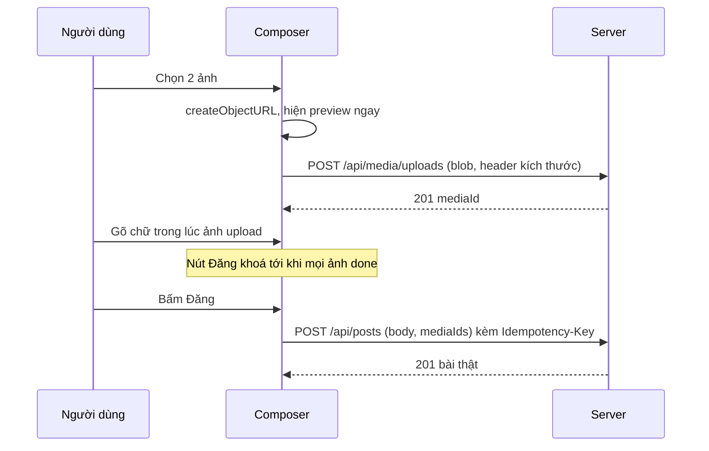
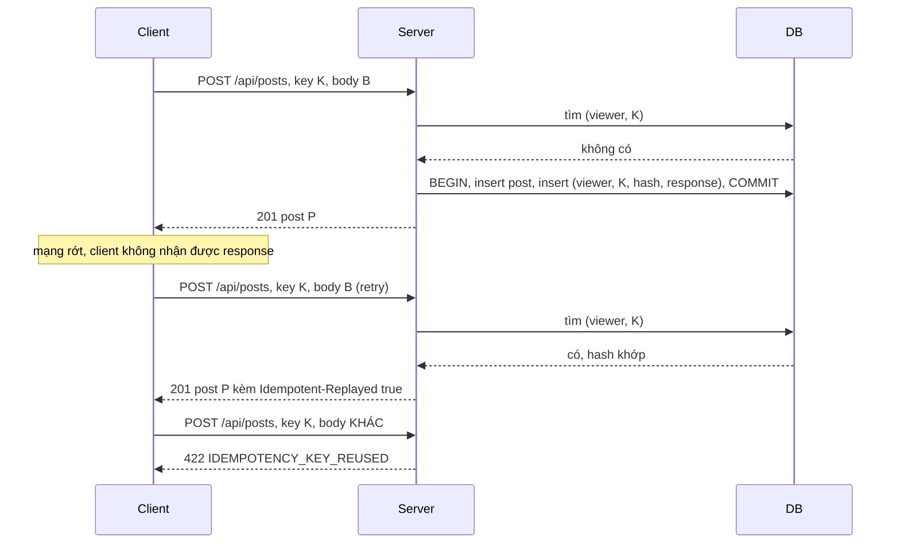

# Lesson 06 – Composer và upload ảnh

> **Mục tiêu:** học xong lesson này bạn giải thích được vì sao upload ảnh tách khỏi bước tạo bài, vì sao đăng bài phải kèm idempotency key và key đó sống bao lâu, và tự cài được: (1) composer upload ảnh ngay khi chọn, (2) draft reducer giữ key đúng cách, (3) endpoint tạo bài idempotent trong một transaction, (4) chèn bài tạm (optimistic insert), (5) body bài viết dạng entity ranges được validate và render an toàn.
>
> **Cần biết trước:** lesson 03 (store, `postPrepended`, `postReplaced`), lesson 05 (optimistic update và rollback). Biết `useReducer`, `fetch`, transaction trong SQL và khác biệt giữa `POST` và `PUT`.

| File | Vai trò |
|---|---|
| `src/lessons/06-composer-upload/lesson-06-composer-upload.tsx` | Màn demo: chèn bài tạm, log, thí nghiệm gửi lại cùng key |
| `src/lessons/06-composer-upload/composer.tsx` | Form soạn bài: chọn ảnh, upload, alt text, nút Đăng |
| `src/lessons/06-composer-upload/composer-draft-reducer.ts` | State của draft và quy tắc idempotency key |
| `src/lessons/06-composer-upload/prepare-image-for-upload.ts` | Thu nhỏ ảnh, bỏ EXIF bằng canvas trước khi upload |
| `src/shared/api/feed-api.ts` | `uploadMedia`, `createPost` |
| `src/shared/api/http-client.ts` | `createIdempotencyKey`, chính sách retry |
| `server/src/routes/media-routes.ts` | `POST /api/media/uploads` |
| `server/src/routes/post-routes.ts` | `POST /api/posts`: validate, idempotency, transaction |
| `server/src/services/idempotency-store.ts` | Băm request, nhận diện lỗi trùng khoá |
| `server/src/data/feed-repository.ts` | Chèn bài, lưu và tìm response idempotent |
| `shared-contracts/feed-api-contracts.ts` | Kiểu `TextEntity`, `CreatePostRequest` |
| `src/shared/post-rendering/render-post-body-with-entities.tsx` | Render body từ entity ranges, không dùng `innerHTML` |

## 1. Upload ảnh trước, tạo bài sau

### Trong bài viết
Bài viết tách đăng bài thành hai bước: chọn ảnh thì upload ngay và nhận về `mediaId`, còn nút Đăng chỉ gửi `{ body, mediaIds }`. Lý do: upload lâu và có thể lỗi riêng, người dùng vừa gõ chữ vừa chờ được, và bài chỉ tạo khi ảnh đã sẵn sàng. Bài cũng nói tới xử lý phía client trước khi upload (thu nhỏ, bỏ metadata riêng tư). Xem phần về composer trong [bài gốc](https://www.greatfrontend.com/questions/system-design/news-feed-facebook?format=system-design).

### Code thật

```learn
src/lessons/06-composer-upload/composer.tsx#start-upload-flow
```

1. `crypto.randomUUID()` tạo `localId` để theo dõi từng ảnh trước khi server cấp `mediaId`. `URL.createObjectURL(file)` cho phép xem trước **ngay**, không chờ upload.
2. `preparingCountRef` đếm số file đang được xử lý nhưng chưa vào state, để không vượt giới hạn ảnh khi người dùng chọn nhanh nhiều lần.
3. `prepareImageForUpload` thu nhỏ ảnh và đọc kích thước thật (xem đoạn code ngay dưới).
4. `dispatch uploadStarted`: ảnh xuất hiện trong danh sách với trạng thái "Đang upload…".
5. `uploadMedia` chạy nền. Xong thì `onMediaUploaded` báo cho store để bài optimistic sau này có ảnh, và `uploadSucceeded` ghi `mediaId`.
6. `catch`: nếu lỗi xảy ra ngay ở bước đọc ảnh thì chưa có mục nào trong danh sách, nên thêm một mục rồi đánh dấu `uploadFailed` để người dùng thấy lỗi.

```learn
src/lessons/06-composer-upload/prepare-image-for-upload.ts#prepare-image-for-upload
```

1. `createImageBitmap(..., { imageOrientation: 'from-image' })` đọc ảnh và áp dụng xoay theo EXIF.
2. `computeScaledSize` thu nhỏ để cạnh dài nhất không quá 1600px; `Math.min(1, ...)` đảm bảo không phóng to ảnh nhỏ.
3. GIF giữ nguyên file vì vẽ lại bằng canvas sẽ mất hoạt ảnh. Kích thước báo lên là kích thước **thật** của file.
4. Ảnh khác được vẽ lại lên `canvas`: việc này đồng thời **loại bỏ EXIF** (có thể chứa toạ độ GPS) và nén lại.
5. PNG/WebP giữ định dạng để không mất nền trong suốt; còn lại nén JPEG chất lượng 0.85.
6. Trả `width`/`height` đã thu nhỏ để server lưu và feed giữ chỗ đúng tỉ lệ (không CLS).

```learn
src/lessons/06-composer-upload/composer.tsx#file-input-slot-limit
```

1. `accept` chỉ cho 4 định dạng ảnh; đây chỉ là gợi ý cho trình duyệt, server vẫn phải kiểm tra lại.
2. `slots` = số ảnh còn được thêm = giới hạn trừ ảnh đã có trừ ảnh đang xử lý. Dùng `uploadsRef` và `preparingCountRef` (không dùng state) để đọc giá trị mới nhất ngay cả khi người dùng mở hộp thoại hai lần.
3. `event.target.value = ''` cho phép chọn lại cùng một file lần sau.

```learn
src/lessons/06-composer-upload/composer-draft-reducer.ts#can-submit-draft
```

1. Chỉ đăng được khi mọi ảnh đã `done` (có `mediaId`).
2. Phải có chữ hoặc ít nhất một ảnh, và không đang gửi. Đây là lý do nút **Đăng** bị khoá khi ảnh còn upload.

```learn
src/shared/api/feed-api.ts#feed-api-upload-media
```

1. Body là `Blob` thô, không bọc FormData hay base64 (nhỏ hơn khoảng 33% so với base64).
2. Kích thước và alt text đi qua header `X-Image-Width`, `X-Image-Height`, `X-Image-Alt`. Alt phải `encodeURIComponent` vì header chỉ chứa ASCII.
3. `uploadMedia` không có idempotency key nên `http-client` không tự retry POST này (xem `isSafeToRetry` ở khái niệm 2).

```learn
server/src/routes/media-routes.ts#media-upload
```

1. `express.raw` nhận body nhị phân, giới hạn 5MB.
2. Kiểm tra `Content-Type` nằm trong danh sách cho phép (jpeg, png, webp, gif); sai trả `415`. Hệ thống thật còn đọc magic bytes, re-encode, quét malware.
3. `readPositiveIntHeader` kiểm tra kích thước header là số nguyên dương hợp lý, không tin mù quáng.
4. Lưu bytes cùng `req.viewerId` làm chủ sở hữu rồi trả `{ mediaId, media }` với `201`. Bản production thường trả presigned URL để client upload thẳng lên object storage.

```learn
server/src/data/feed-repository.ts#media-ownership-check
```

1. Truy vấn các `mediaId` do chính người này upload.
2. Trả về những id **không** thuộc về họ (không tồn tại hoặc của người khác). Ai gắn ảnh của người khác vào bài của mình sẽ bị từ chối.

```learn
server/src/routes/post-routes.ts#create-post-validate-media
```

1. Body bắt buộc qua `validatePostBody` (xem khái niệm 5).
2. `mediaIds` phải là mảng chuỗi, tối đa 10; không thì `400 INVALID_MEDIA`.
3. `findMediaNotOwnedBy` chặn ảnh của người khác (`400 MEDIA_NOT_FOUND`).
4. Bài rỗng (không chữ, không ảnh) bị từ chối với `EMPTY_POST`.
5. Alt text được chuẩn hoá một lần: chỉ lấy alt của ảnh thuộc bài này, đã `trim` và cắt tối đa 300 ký tự.



### Vì sao làm vậy

| Cách | Ưu | Nhược | Khi nào chọn |
|---|---|---|---|
| Upload ngay khi chọn, tạo bài sau (project dùng) | Người dùng gõ chữ trong lúc chờ; lỗi upload tách riêng; nút Đăng nhanh | Có thể có ảnh mồ côi nếu người dùng bỏ bài; cần dọn dẹp | Composer có ảnh, ảnh lớn |
| Gửi ảnh cùng request tạo bài (multipart) | Một request, không ảnh mồ côi | Bấm Đăng chờ lâu; lỗi mạng thì mất cả bài lẫn ảnh | Ảnh nhỏ, form đơn giản |
| Presigned URL, upload thẳng lên S3/GCS | Server API không gánh băng thông; mở rộng tốt | Thêm một vòng xin URL, thêm hạ tầng | Production |
| Base64 trong JSON | Dễ cài | Phình khoảng 33%, tốn bộ nhớ ở cả hai phía | Ảnh rất nhỏ (avatar tí hon) |
| Xử lý ảnh chỉ ở client | Nhẹ cho server | Client không đáng tin | Chỉ làm tối ưu; server **vẫn** phải kiểm tra |

### Lỗi hay gặp
- **Chọn nhanh nhiều lần vượt quá giới hạn 4 ảnh (từ review):** số ảnh còn lại lấy từ state, mà `uploadStarted` chỉ dispatch sau khi `prepareImageForUpload` (bất đồng bộ) xong. Project thêm `preparingCountRef` để đếm cả ảnh đang xử lý.
- **Ô alt text không có (từ review):** reducer có `altChanged` nhưng UI không có ô nhập, nên ảnh có alt kiểu "IMG_1234.jpg". Giờ mỗi ảnh có ô "Mô tả ảnh (alt)…" và alt gửi kèm khi tạo bài.
- **Cho gắn ảnh của người khác vào bài của mình:** thiếu kiểm tra sở hữu. Project có `uploadedBy` và `findMediaNotOwnedBy`.
- **GIF lớn báo kích thước đã thu nhỏ nhưng gửi blob gốc:** tỉ lệ vẫn đúng nhưng metadata sai. Project giữ nguyên file GIF và báo kích thước thật của file đó.
- **Quên `URL.revokeObjectURL`:** rò bộ nhớ. Project revoke khi bỏ ảnh, đăng thành công và khi rời trang.

### Tự thử
1. Chạy `npm run dev`, mở `#/lesson-06`, tab **Demo**. Bấm **🖼️ Thêm ảnh (0/4)** rồi chọn 1–2 ảnh.
2. Kết quả mong đợi: preview hiện **ngay**; dòng trạng thái đổi từ "Đang upload…" sang "✓ upload-…". Nút **Đăng** bị khoá cho tới khi upload xong. Mở DevTools → Network thấy `POST /api/media/uploads` trả `201`.
3. Chọn một ảnh lớn hơn 1600px. Request upload sẽ có header `X-Image-Width`/`X-Image-Height` ≤ 1600.
4. Thử upload sai loại bằng curl:

```bash
curl -s -X POST "http://localhost:3001/api/media/uploads" -H "Content-Type: text/html" --data-binary "<script>alert(1)</script>"
```

   Kết quả mong đợi: `415 UNSUPPORTED_MEDIA_TYPE`.

### Câu hỏi phỏng vấn
1. Vì sao upload ảnh tách khỏi bước tạo bài?
   > Upload lâu và có thể lỗi riêng; người dùng vừa gõ vừa chờ được; bài chỉ được tạo khi ảnh đã sẵn sàng. Production thường dùng presigned URL để upload thẳng lên storage.
2. Vì sao client xử lý ảnh trước khi upload mà server vẫn phải kiểm tra lại?
   > Client thu nhỏ để tiết kiệm băng thông và bỏ EXIF để bảo vệ quyền riêng tư, nhưng client không đáng tin. Server vẫn kiểm tra MIME/magic bytes, re-encode, strip metadata, quét malware và kiểm tra quyền sở hữu.

## 2. Draft state và idempotency key ở client

### Trong bài viết
Bài viết nói thao tác đăng bài có thể bị gửi lặp (mạng chập chờn, bấm đúp) nên cần idempotency key để server không tạo bài trùng. Key được sinh ở client và gửi kèm mọi lần thử. Xem phần về composer và retry trong [bài gốc](https://www.greatfrontend.com/questions/system-design/news-feed-facebook?format=system-design).

### Code thật

```learn
src/shared/api/http-client.ts#http-idempotency-key
```

1. `crypto.randomUUID()` đủ ngẫu nhiên để hai bài khác nhau không bao giờ trùng key.
2. Quan trọng nhất là **khi nào** gọi hàm này: đúng **một lần** khi người dùng bấm gửi, rồi giữ qua mọi lần retry.

```learn
src/lessons/06-composer-upload/composer-draft-reducer.ts#draft-content-change-clears-key
```

1. `contentChanged` đặt `idempotencyKey: null` và đưa `submitState` về `idle`: nội dung đã khác nghĩa là **một bài viết khác**, nên không được dùng lại key cũ.
2. `CONTENT_EDIT_ACTIONS` liệt kê các action sửa nội dung: gõ chữ, thêm ảnh, xoá ảnh, sửa alt.

```learn
src/lessons/06-composer-upload/composer-draft-reducer.ts#draft-lock-while-submitting
```

1. Đang `submitting` mà nhận action sửa nội dung thì **trả nguyên state**, bỏ qua action.
2. Lý do: nếu cho sửa, `contentChanged` xoá mất key; bấm lại sẽ tạo bài **trùng** với request đầu (vì request đầu có thể vẫn thành công). Ngoài ra chữ vừa gõ sẽ mất khi request đầu thành công và draft bị reset.

```learn
src/lessons/06-composer-upload/composer-draft-reducer.ts#draft-submit-lifecycle
```

1. `submitStarted`: `state.idempotencyKey ?? action.newKey`. Có key rồi (lần thử lại) thì giữ nguyên; chưa có (lần đầu) mới dùng key mới.
2. `submitFailed`: chuyển `submitState` sang `error` và **giữ key**, để nút "Thử lại" gửi cùng key.
3. `submitSucceeded`: reset toàn bộ về `INITIAL_COMPOSER_STATE`, nên bài sau có key mới.

```learn
src/lessons/06-composer-upload/composer.tsx#submit-with-key
```

1. `canSubmitDraft` chặn gửi khi chưa đủ điều kiện (ảnh chưa xong, đang gửi, rỗng).
2. `state.idempotencyKey ?? createIdempotencyKey()`: sinh key ở lần đầu, dùng lại ở các lần sau.
3. `onSubmit` ném lỗi khi thất bại, nên `catch` dispatch `submitFailed` và composer **giữ nguyên draft cùng key**.
4. Thành công thì revoke các blob URL rồi `submitSucceeded`.

```learn
src/shared/api/feed-api.ts#feed-api-create-post
```

1. Hàm nhận `idempotencyKey` là **tham số bắt buộc**, nên không thể quên gửi nó khi tạo bài.
2. `http-client` đặt header `Idempotency-Key` và cho phép retry POST chỉ vì có key.

```learn
src/shared/api/http-client.ts#http-retry-policy
```

1. Mã `0` (mất mạng), `408`, `429` và `5xx` là lỗi tạm thời, đáng thử lại.
2. `isSafeToRetry`: `GET` luôn an toàn; các method khác **chỉ** an toàn khi có idempotency key. Đây là lý do upload ảnh (không có key) không tự retry còn tạo bài thì có.

### Vì sao làm vậy

| Cách | Ưu | Nhược | Khi nào chọn |
|---|---|---|---|
| Key sinh ở lần bấm đầu, giữ qua retry, bỏ khi sửa nội dung (project dùng) | Retry an toàn; sửa nội dung thì thành bài mới đúng ý | Phải khoá chỉnh sửa khi đang gửi, quản lý thêm state | Form tạo tài nguyên |
| Sinh key mới mỗi lần gửi | Đơn giản | Mất ý nghĩa; mạng rớt rồi retry tạo bài trùng | Không nên |
| Key băm từ nội dung | Không cần lưu key | Hai bài giống hệt nhau cố ý đăng liên tiếp bị coi là một | Khi trùng nội dung chắc chắn là lỗi |
| Chỉ khoá nút Đăng khi đang gửi | Chặn bấm đúp | Không cứu được retry sau khi mất mạng hoặc F5 | Không đủ một mình |
| Khoá chỉnh sửa khi đang gửi (project dùng thêm) | Không mất key giữa chừng | Người dùng chờ mới sửa tiếp được | Luôn nên đi kèm |

### Lỗi hay gặp
- **Sửa chữ lúc đang gửi gây bài trùng (lỗi thật, từ review):** `contentChanged` từng reset `submitState` và `idempotencyKey` ngay cả khi đang `submitting`, trong khi textarea và nút thêm ảnh không bị khoá. Người dùng gõ thêm một chữ thì key bị xoá; request đầu vẫn thành công ở server, rồi bấm "Thử lại" sinh key mới và tạo bài thứ hai. Project sửa bằng cách chặn các action sửa nội dung khi đang gửi (reducer) **và** đặt `readOnly`/`disabled` cho textarea, ô alt, nút thêm/bỏ ảnh.
- **Giữ key sau khi đã sửa nội dung:** server sẽ trả `422 IDEMPOTENCY_KEY_REUSED` vì cùng key khác body (xem khái niệm 3).
- **Không reset key sau khi đăng thành công:** bài kế tiếp dùng lại key, server trả lại bài cũ. Project reset toàn bộ draft ở `submitSucceeded`.

### Tự thử
1. Mở `#/lesson-06`, tab **Demo**. Trong panel **Mô phỏng mạng (backend)** đặt **Tỉ lệ lỗi** 100%. Gõ vài chữ vào ô **Bạn đang nghĩ gì?** rồi bấm **Đăng**.
2. Kết quả mong đợi: nút đổi thành **Thử lại**, dòng trạng thái hiện `Đăng thất bại: … Bấm "Thử lại" – sẽ dùng LẠI cùng key.` và `Idempotency-Key: xxxxxxxx…` giữ nguyên chữ số đầu sau mỗi lần bấm Thử lại.
3. Đặt **Tỉ lệ lỗi** 50% rồi đăng. Cột **Submit log** hiện `🔁 retry lần N sau …ms – CÙNG key xxxxxxxx…`; terminal server in `key=…` giống nhau ở các lần thử.
4. Thử sửa chữ trong lúc đang gửi (đặt **Độ trễ** 3000ms): ô textarea ở chế độ chỉ đọc, bạn không sửa được.

### Câu hỏi phỏng vấn
1. Idempotency key sinh khi nào và giữ đến khi nào?
   > Sinh ở lần bấm gửi đầu tiên, giữ nguyên qua mọi lần retry hoặc bấm lại, bỏ khi nội dung thay đổi (thành bài khác) hoặc khi đăng thành công.
2. Vì sao phải khoá chỉnh sửa khi đang gửi?
   > Nếu cho sửa thì key bị xoá, bấm lại sẽ tạo bài mới trong khi request đầu có thể đã thành công ở server, dẫn đến bài trùng. Đồng thời chữ vừa gõ có thể bị mất khi draft bị reset.
3. Vì sao `http-client` chỉ retry POST khi có idempotency key?
   > POST không idempotent theo mặc định: retry có thể tạo tài nguyên thứ hai. Có key thì server nhận diện và trả lại kết quả cũ, nên retry an toàn.

## 3. Idempotency ở server

### Trong bài viết
Bài viết nhấn mạnh server phải chịu được request lặp: cùng một key thì trả cùng một kết quả, không tạo bài thứ hai. Xem [bài gốc](https://www.greatfrontend.com/questions/system-design/news-feed-facebook?format=system-design).

### Code thật

```learn
server/src/data/database-schema.ts#idempotency-keys-table
```

1. Khoá chính `(viewer_id, key)`: key chỉ cần duy nhất **trong phạm vi một người**, và là lưới an toàn cuối cùng khi hai request cùng key chạy song song.
2. Lưu `status`, `requestHash` và `response` (JSON) của lần xử lý đầu để phát lại nguyên vẹn.
3. `createdAt` để hệ thống thật đặt TTL (ví dụ xoá key cũ hơn 24 giờ).

```learn
server/src/routes/post-routes.ts#idempotency-key-and-replay
```

1. Bắt buộc có header `Idempotency-Key` và không dài quá 200 ký tự; thiếu thì `400`.
2. `hashRequestBody(req.body)` băm nội dung request.
3. `replay()` tra bảng: nếu key đã có và `requestHash` **khác** thì ném `422 IDEMPOTENCY_KEY_REUSED` (client dùng sai key); nếu giống thì trả đúng response cũ kèm header `Idempotent-Replayed: true`.
4. Có replay rồi thì `return`, **không** tạo bài mới.

```learn
server/src/services/idempotency-store.ts#request-hash
```

1. SHA-256 của `JSON.stringify(body)`. Hai request cùng nội dung cho cùng hash.
2. Cùng key nhưng khác nội dung nghĩa là client có bug; trả `422` tốt hơn là âm thầm trả bài cũ (cách Stripe làm).

```learn
server/src/routes/post-routes.ts#create-post-transaction
```

1. Mở transaction: tạo bài và lưu key phải **cùng thành công hoặc cùng thất bại**.
2. Bên trong chỉ có một kết nối nên các query chạy lần lượt; response được dựng bằng chính `tx` để đọc được dữ liệu chưa commit.
3. `saveIdempotentResponse` dùng `INSERT`. Nếu một request khác đã lưu cùng `(viewer, key)` trước, khoá chính ném lỗi `23505` và **toàn bộ transaction rollback**, nên bài của request thua không được tạo.
4. `catch`: nhận `23505` thì gọi lại `replay()` để trả kết quả của request thắng.

```learn
server/src/services/idempotency-store.ts#unique-violation-in-cause
```

1. Mã `23505` là lỗi vi phạm UNIQUE/PRIMARY KEY của PostgreSQL.
2. Drizzle **bọc** lỗi của driver, nên mã nằm ở `error.cause`, không phải `error.code`. Hàm đệ quy xuống `cause` để tìm.

```learn
server/src/data/feed-repository.ts#idempotency-find-and-save
```

1. `findIdempotentResponse` tìm theo `(viewerId, key)` và trả `status`, `requestHash`, `response`.
2. `saveIdempotentResponse` nhận `executor` (transaction) nên chạy chung transaction với bài viết.

```learn
server/src/data/feed-repository.ts#insert-post-generation
```

1. Chèn bài rồi tăng `feed_state.generation` trong **cùng executor**, nên bài mới và số "generation" của feed luôn nhất quán.
2. Trả về `generation` mới để các lesson sau (banner "có bài mới") dùng.

```learn
src/lessons/06-composer-upload/lesson-06-composer-upload.tsx#replay-same-key
```

1. Giả lập tình huống "server đã tạo bài nhưng mạng rớt trước khi client nhận response": gửi lại **cùng payload và cùng key**.
2. Nếu server idempotent thì trả lại đúng `post.id` cũ. Màn demo so hai id và hiện "✅ cùng một bài, server không tạo trùng".



### Vì sao làm vậy

| Cách | Ưu | Nhược | Khi nào chọn |
|---|---|---|---|
| Bảng key + transaction chung với bài + khoá chính (project dùng) | Đúng cả khi hai request chạy song song; không bài ma | Thêm bảng, cần TTL | Tạo tài nguyên từ client có retry |
| Kiểm tra key rồi chèn, không transaction | Ít code | Hai request song song cùng qua bước kiểm tra, cùng tạo bài | Không nên |
| Lock ứng dụng (mutex trong memory) | Nhanh | Không chạy được khi có nhiều instance server | Một process duy nhất |
| Chỉ dựa vào unique constraint trên nội dung | Không cần header | Không phân biệt "cố ý đăng hai bài giống nhau" với retry | Dữ liệu tự nhiên đã có khoá duy nhất |
| Trả `409` khi key đang xử lý | Rõ ràng cho client | Client phải tự poll lại | Thao tác dài, cần trạng thái "đang xử lý" |

### Lỗi hay gặp
- **Cùng key khác nội dung vẫn trả bài cũ (từ review):** ban đầu key không gắn với fingerprint của request, nên bug phía client bị che giấu. Project thêm `request_hash` và trả `422`.
- **Hai request cùng key chạy song song:** nếu chỉ "kiểm tra trước rồi chèn" thì cả hai cùng thấy chưa có key và cùng tạo bài. Project dựa vào khoá chính và transaction; sau khi chuyển sang Drizzle đã kiểm chứng: 5 vòng × 15 POST song song cùng key cho đúng 1 bài mỗi vòng, 1 `201` thật và 14 `201` kèm `Idempotent-Replayed`, cùng một post id.
- **`isUniqueViolation` luôn trả `false` sau khi chuyển sang Drizzle:** Drizzle bọc lỗi driver trong `DrizzleQueryError`, mã `23505` nằm ở `error.cause`. Nếu chỉ đọc `error.code` thì nhánh replay không bao giờ chạy và client nhận `500`. Project đệ quy xuống `cause`.
- **Idempotency không có TTL:** bảng phình mãi. Comment trong code nhắc hệ thống thật cần xoá key cũ.

### Tự thử
1. Mở `#/lesson-06`, tab **Demo**. Đăng một bài có chữ. Khi bài xuất hiện, panel **Thí nghiệm idempotency** hiện ra.
2. Bấm **Gửi lại bài vừa đăng với CÙNG key**. Kết quả mong đợi: dòng "✅ cùng một bài, server không tạo trùng"; terminal server in `(replayed)`; số bài trong feed không tăng thêm.
3. Dùng curl để thấy 422 (mỗi lệnh cùng key `demo-key-1`):

```bash
curl -s -i -X POST "http://localhost:3001/api/posts" -H "Content-Type: application/json" -H "Idempotency-Key: demo-key-1" -d '{"body":{"text":"Xin chào","entities":[]},"mediaIds":[]}'
curl -s -i -X POST "http://localhost:3001/api/posts" -H "Content-Type: application/json" -H "Idempotency-Key: demo-key-1" -d '{"body":{"text":"Xin chào","entities":[]},"mediaIds":[]}'
curl -s -i -X POST "http://localhost:3001/api/posts" -H "Content-Type: application/json" -H "Idempotency-Key: demo-key-1" -d '{"body":{"text":"Nội dung khác","entities":[]},"mediaIds":[]}'
```

4. Kết quả mong đợi: lần 1 `201`; lần 2 `201` kèm header `Idempotent-Replayed: true` và cùng `post.id`; lần 3 `422` với `IDEMPOTENCY_KEY_REUSED`. (Lệnh này tạo một bài thật trong DB của bạn; không cần reset.)

### Câu hỏi phỏng vấn
1. Làm sao server chống hai request cùng key chạy song song?
   > Tạo bài và lưu key nằm trong cùng một transaction, và bảng key có khoá chính `(viewer_id, key)`. Request nào ghi sau gặp lỗi `23505`, transaction của nó rollback (bài không được tạo), rồi nó trả lại response của request thắng.
2. Vì sao cùng key mà khác nội dung phải trả lỗi?
   > Đó là dấu hiệu client dùng sai key (bug). Trả bài cũ sẽ che giấu lỗi và người dùng tưởng bài mới đã đăng. Lưu hash nội dung và trả `422`, giống Stripe.
3. Vì sao `isUniqueViolation` phải đệ quy xuống `cause`?
   > Drizzle bọc lỗi của driver, mã PostgreSQL `23505` nằm ở `error.cause`. Chỉ đọc `error.code` sẽ không bao giờ khớp.

## 4. Bài tạm (optimistic insert)

### Trong bài viết
Bài viết gợi ý khi đăng bài, UI nên hiện ngay bài của người dùng trên đầu feed (trạng thái đang đăng), rồi thay bằng bài thật khi server trả về; nếu lỗi thì gỡ đi và giữ nội dung để thử lại. Xem [bài gốc](https://www.greatfrontend.com/questions/system-design/news-feed-facebook?format=system-design).

### Code thật

```learn
src/lessons/06-composer-upload/lesson-06-composer-upload.tsx#build-temp-post
```

1. Id bài tạm là `temp-<idempotencyKey>`: duy nhất và có tiền tố để nhận ra là bài chưa có trên server.
2. Bài tạm có `viewerReaction: null`, số liệu rỗng, `createdAt` là giờ hiện tại, `mediaIds` là các ảnh đã upload.
3. `normalizeComposerText` để bài tạm khớp với bài thật server sẽ lưu (xem khái niệm 5).

```learn
src/lessons/06-composer-upload/lesson-06-composer-upload.tsx#optimistic-insert-temp-post
```

1. `postPrepended`: chèn bài tạm lên đầu feed trước khi gọi mạng. Bài hiện mờ kèm dòng "⏳ Đang đăng…".
2. Gọi `submitComposerPayload`; `onRetry` ghi vào Submit log để thấy retry dùng **cùng key**.
3. Thành công: `entitiesMerged` đưa users và media mới vào store, rồi `postReplaced` đổi bài tạm thành bài thật tại **cùng vị trí**.
4. Thất bại: `postRemoved` gỡ bài tạm, rồi `throw error` để composer giữ draft và key.

### Vì sao làm vậy

| Cách | Ưu | Nhược | Khi nào chọn |
|---|---|---|---|
| Chèn bài tạm rồi thay (project dùng) | Người dùng thấy bài ngay; thay đúng chỗ | Phải xử lý bài tạm trong mọi nơi (reaction, sửa, xoá) | Đăng bài, bình luận |
| Chờ response rồi mới chèn | Đơn giản, không có bài tạm | Mạng chậm thì cảm giác không có gì xảy ra | Thao tác hiếm, rủi ro cao |
| Refetch feed sau khi đăng | Luôn khớp server | Giật, mất chỗ đọc, tốn băng thông | Khi không có đủ dữ liệu để dựng bài |

### Lỗi hay gặp
- **Bài trùng trong feed khi gửi lại cùng key:** thí nghiệm replay dispatch lại bài server trả về. Server không tạo bài mới và reducer gộp theo id (`mergeUniqueIds`) nên feed không nhân đôi; điểm cần quan sát là hai `post.id` giống nhau.
- **Bài tạm không phân biệt được với bài thật:** reaction hay thao tác khác trên bài tạm sẽ gọi API với id không tồn tại. Project đánh dấu qua tiền tố `temp-` và `aria-busy`.
- **Quên gỡ bài tạm khi lỗi:** feed hiện bài ma. Project luôn `postRemoved` trước khi ném lỗi.
- **Banner "bài mới" đếm bài của chính mình (rủi ro tiềm ẩn từ review):** `postPrepended` không dời cursor `newer`; nếu ghép banner với composer thì bài của chính mình sẽ hiện thành "1 bài mới".

### Tự thử
1. Mở `#/lesson-06`, tab **Demo**, đặt **Độ trễ** 2000ms. Gõ chữ rồi bấm **Đăng**.
2. Kết quả mong đợi: bài tạm mờ với dòng "⏳ Đang đăng (bài tạm, chưa có trên server)…" xuất hiện ngay trên đầu feed; cột **Submit log** hiện `⚡ chèn bài tạm temp-…`. Sau 2 giây bài được thay bằng bài thật và log hiện `✅ server tạo post-user-… → thay bài tạm`.
3. Đặt **Tỉ lệ lỗi** 100% rồi đăng. Kết quả mong đợi: bài tạm biến mất, log hiện `↩️ lỗi → gỡ bài tạm. Draft vẫn giữ để thử lại.`, chữ vẫn còn trong ô soạn, nút là **Thử lại**.

### Câu hỏi phỏng vấn
1. Optimistic insert khác optimistic update (lesson 05) ở điểm nào?
   > Optimistic update đổi một giá trị trên bài đã có, rollback bằng mốc cũ. Optimistic insert tạo một phần tử chưa có id thật: cần id tạm, thay bằng id thật khi server trả về, và gỡ nếu lỗi. Idempotency key còn dùng để định danh bài tạm (`temp-<idempotencyKey>`).
2. Lỗi khi đăng thì UI nên làm gì?
   > Gỡ bài tạm, giữ nguyên nội dung draft và key, báo lỗi rõ ràng, và cho phép "Thử lại" với cùng key.

## 5. Body dạng entity ranges: validate, NFC và render an toàn

### Trong bài viết
Bài viết khuyên lưu mention, hashtag, link dưới dạng **entity ranges** (offset trong text) thay vì HTML, để client tự quyết cách hiển thị và tránh XSS. Xem phần về data model của bài viết trong [bài gốc](https://www.greatfrontend.com/questions/system-design/news-feed-facebook?format=system-design).

### Code thật

```learn
shared-contracts/feed-api-contracts.ts#contract-text-entity
```

1. Mỗi entity có `type`, `start`, `end` và dữ liệu riêng (`userId`, `tag`, `url`).
2. `start`/`end` là offset **UTF-16** trên `text`, giống `String.prototype.slice` của JS. Server và client phải dùng chung quy ước này.
3. Lưu dạng này nghĩa là server không bao giờ lưu hay gửi HTML.

```learn
shared-contracts/feed-api-contracts.ts#contract-create-post
```

1. `CreatePostRequest` có `body` (chữ và entities), `mediaIds`, và `altTexts` (mediaId → mô tả).
2. Response dùng lại kiểu bài đơn lẻ, kèm users và media đã chuẩn hoá để store gộp vào.

```learn
src/lessons/06-composer-upload/lesson-06-composer-upload.tsx#normalize-nfc-client
```

1. Text dán từ tên file macOS, PDF hay một số bộ gõ có thể ở dạng NFD ("ệ" thành chữ "e" cộng hai dấu rời). `normalize('NFC')` gộp về dạng chuẩn.
2. Gửi NFC cũng giúp bài tạm khớp đúng với bài thật server lưu.
3. Quan trọng hơn: khi có entity, offset được tính trên dạng **NFC**; gửi NFD sẽ làm offset lệch.

```learn
server/src/routes/post-routes.ts#validate-post-body-nfc
```

1. Kiểm tra kiểu và độ dài (`BODY_TOO_LONG`), `entities` phải là mảng tối đa 100.
2. Nếu text không phải NFC: có entity thì từ chối (`TEXT_NOT_NFC`) vì không thể đoán lại offset; không có entity thì server **tự chuẩn hoá** rồi lưu.
3. Mỗi entity qua `sanitizeEntity`; sắp theo `start` và từ chối entity **chồng lấn**.
4. Mention phải trỏ tới user có thật (`getUsersByIds` so với số id đã gửi).

```learn
server/src/routes/post-routes.ts#entity-sanitize
```

1. Chỉ chấp nhận object; `start`/`end` phải là số nguyên, `0 ≤ start < end ≤ textLength`.
2. `switch (type)` là **allowlist**: chỉ `mention`, `hashtag`, `link`; type lạ bị `INVALID_ENTITY`.
3. Link chỉ nhận `http` hoặc `https`.
4. **Tạo lại** một object sạch (`{ type, ...range, userId }`) chứ không lưu nguyên object client gửi, nên field lạ không lọt vào DB.

```learn
src/shared/post-rendering/render-post-body-with-entities.tsx#split-text-by-entities
```

1. Sắp entity theo `start` rồi duyệt với một `cursor` trong text.
2. Entity sai (chồng lấn, vượt biên, rỗng) bị **bỏ qua**, nhưng chữ vẫn hiện, nên dữ liệu xấu không làm biến mất nội dung.
3. Kết quả là danh sách đoạn `text` hoặc `entity`, cắt bằng `slice` (cùng quy ước UTF-16 với server).

```learn
src/shared/post-rendering/render-post-body-with-entities.tsx#render-entity
```

1. Mỗi entity thành một phần tử React (`<a>`), nên React **tự escape** nội dung; không có `innerHTML`.
2. Mention và hashtag dùng `encodeURIComponent` khi dựng href.
3. Link đi qua `toSafeHref`; nếu `null` thì chỉ hiện chữ, không thành link.
4. `default`: loại entity client chưa biết (server mới hơn client) vẫn hiện chữ, không làm mất nội dung.

```learn
src/shared/post-rendering/render-post-body-with-entities.tsx#safe-href
```

1. `new URL(url)` phân tích; chỉ cho phép `http:`, `https:`, `mailto:`.
2. `javascript:alert(1)` và `data:` bị chặn (trả `null`). URL không hợp lệ cũng trả `null` thay vì ném lỗi.

```learn
src/shared/post-rendering/render-post-body-with-entities.tsx#post-body-text
```

1. Ghép các đoạn thành một dãy phần tử React: đoạn text là `<span>`, đoạn entity là phần tử đã dựng ở trên.
2. Không có `dangerouslySetInnerHTML` ở bất cứ đâu.

### Vì sao làm vậy

| Cách | Ưu | Nhược | Khi nào chọn |
|---|---|---|---|
| Entity ranges `{ text, entities }` (project dùng) | Không có HTML từ server (chống XSS); client tự render; dùng được trên nhiều nền tảng | Phải giữ offset đúng (UTF-16, NFC) | Văn bản có mention, hashtag, link |
| Lưu HTML | Render đơn giản | Phải sanitize cực kỳ cẩn thận; mỗi nền tảng một kiểu | Khi dùng editor rich-text và thư viện sanitize đáng tin |
| Markdown | Đọc được bằng mắt, gọn | Cần parser ở mọi client; khó gắn mention theo user id | Nội dung kiểu wiki, ghi chú |
| Server từ chối text NFD | Đơn giản | Làm vỡ client cũ và người dùng dán text NFD | Chỉ khi có entity (project dùng) |

### Lỗi hay gặp
- **Server không validate entity (từ review):** `{"type":"bogus","start":6,"end":12}` được lưu nguyên; khi render, `renderEntity` không có nhánh `default` nên trả `undefined` và đoạn chữ "secret" **biến mất** khỏi bài. Project thêm allowlist, kiểm tra kiểu từng field, tạo lại object sạch, và thêm nhánh `default` ở client.
- **Từ chối mọi text không phải NFC làm vỡ lesson 06 (từ review lesson 09–12):** kiểm tra NFC ban đầu chặn cả bài không có entity, nên text NFD (dán từ tên file macOS, PDF) trả `400 TEXT_NOT_NFC`, trong khi client lesson 06 không chuẩn hoá. Project sửa: chỉ từ chối khi **có entity** (lúc đó offset mới có nghĩa); không entity thì server tự `normalize('NFC')`; client lesson 06 cũng chuẩn hoá trước khi gửi.
- **Chấp nhận `javascript:` URL:** link thành vector XSS khi người dùng bấm. Cả server (chỉ http/https) và client (`toSafeHref`) đều chặn.
- **Đếm offset theo code point hay byte thay vì UTF-16:** emoji ngoài BMP như "😀" (1 code point nhưng 2 đơn vị UTF-16) hay chữ có dấu (nhiều byte UTF-8) làm mention cắt sai chỗ. Hai phía phải thống nhất UTF-16.

### Tự thử
1. Thử bài có entity hợp lệ bằng curl (mention tới `user-2`, offset `start 0 end 5` phủ đúng 5 ký tự "@Minh"): 

```bash
curl -s -i -X POST "http://localhost:3001/api/posts" -H "Content-Type: application/json" -H "Idempotency-Key: entity-demo-1" -d '{"body":{"text":"@Minh chào bạn","entities":[{"type":"mention","start":0,"end":5,"userId":"user-2"}]},"mediaIds":[]}'
```

   Kết quả mong đợi: `201`. Nếu user không tồn tại: `400 INVALID_ENTITY`.
2. Thử type lạ (key khác):

```bash
curl -s -X POST "http://localhost:3001/api/posts" -H "Content-Type: application/json" -H "Idempotency-Key: entity-demo-2" -d '{"body":{"text":"Hello world","entities":[{"type":"bogus","start":0,"end":5}]},"mediaIds":[]}'
```

   Kết quả mong đợi: `400` với `INVALID_ENTITY`.
3. Trong tab **Demo**, đăng chữ có dấu tiếng Việt (ví dụ "Việt Nam") rồi tải lại: bài hiện đúng, không báo lỗi NFC. Mở `#/lesson-07` để thấy mention, hashtag, link render từ entity.

### Câu hỏi phỏng vấn
1. Vì sao lưu mention dưới dạng entity ranges thay vì HTML?
   > Không phải chèn HTML từ server (chống XSS), client tự quyết cách hiển thị, và dùng được cho nhiều nền tảng. Mỗi entity thành phần tử React nên React tự escape.
2. Vì sao offset của entity phải thống nhất là UTF-16 và text phải NFC?
   > Emoji ngoài BMP (ví dụ "😀") chiếm 2 đơn vị UTF-16 và một chữ có dấu có thể là 1 ký tự (NFC) hoặc nhiều ký tự (NFD). Nếu client và server đếm khác nhau, mention bị cắt sai chỗ.
3. Server nên làm gì với dữ liệu entity từ client?
   > Không tin: kiểm tra kiểu, phạm vi, chồng lấn, loại entity theo allowlist, mention phải trỏ tới user có thật, và **tạo lại** object sạch thay vì lưu nguyên object client gửi.

## Tóm tắt
- Upload ảnh tách khỏi bước tạo bài: ảnh lên ngay khi chọn, bài chỉ gửi `mediaIds`; client thu nhỏ ảnh và bỏ EXIF nhưng server vẫn kiểm tra lại và kiểm tra quyền sở hữu.
- Idempotency key sinh một lần ở lần bấm Đăng đầu tiên, giữ qua mọi lần retry, bỏ khi nội dung đổi hoặc khi đăng thành công; vì vậy phải khoá chỉnh sửa trong lúc đang gửi.
- Server lưu `(viewer_id, key)` cùng hash request và response trong cùng transaction với bài; trùng khoá song song thì request thua rollback rồi phát lại kết quả, cùng key khác nội dung thì `422`.
- Bài tạm `temp-…` được chèn ngay, thay bằng bài thật khi thành công và gỡ khi lỗi, trong khi draft và key được giữ để thử lại.
- Body lưu dạng `{ text, entities }` với offset UTF-16 trên text NFC; server validate allowlist rồi tạo lại entity sạch, client render bằng phần tử React và chặn `javascript:`.
