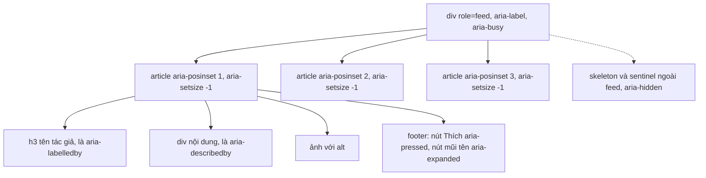
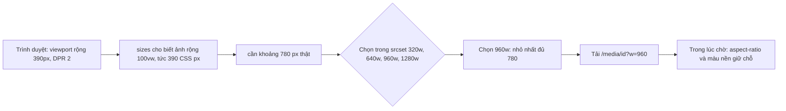

# Lesson 07 – Hiệu năng ảnh, a11y và i18n

> **Mục tiêu:** học xong lesson này bạn giải thích được feed theo WAI-ARIA feed pattern hoạt động ra sao, vì sao ảnh trong feed không gây nhảy layout (CLS) và chỉ tải đúng kích thước cần, và vì sao thời gian, số đếm, danh sách tên đều nên dùng `Intl` thay vì tự ghép chuỗi. Bạn tự cài được: container `role="feed"`, `<article>` có `aria-posinset`/`aria-setsize`, `` có `srcset` + `aspect-ratio`, và các formatter `Intl` được cache.
>
> **Cần biết trước:** lesson 03 (store chuẩn hoá), lesson 05 (`ReactionPicker`, store có reaction), lesson 06 (entity ranges, render an toàn). Biết HTML cơ bản về ``, thuộc tính `aria-*` và CSS `aspect-ratio`.

| File | Vai trò |
|---|---|
| `src/lessons/07-perf-a11y-images/lesson-07-perf-a11y-images.tsx` | Màn demo: feed `role="feed"`, chọn locale, checklist DevTools |
| `src/shared/post-rendering/feed-post-article.tsx` | Một bài viết `<article>` đầy đủ ARIA, ảnh, reaction, thời gian |
| `src/shared/post-rendering/expandable-post-text.tsx` | "Xem thêm" bằng CSS line-clamp, `aria-expanded` |
| `src/shared/post-rendering/responsive-post-image.tsx` | `` có `srcset`, giữ chỗ, lazy loading; lưới 1 đến 4 ảnh |
| `src/shared/post-rendering/format-relative-time.ts` | Thời gian tương đối bằng `Intl.RelativeTimeFormat`, đồng hồ chung `useNow` |
| `src/shared/post-rendering/format-compact-count.ts` | Số gọn và chuỗi số nhiều (`Intl.NumberFormat`, `Intl.PluralRules`) |
| `src/shared/post-rendering/format-reactor-list.ts` | "An, Bình và 3 người khác" bằng `Intl.ListFormat` |
| `server/src/routes/media-routes.ts` | Phục vụ ảnh: `nosniff`, CSP sandbox, cache theo loại ảnh |
| `server/src/data/feed-repository.ts` | Truy vấn lấy vài người react mẫu (window function) |

## 1. Feed truy cập được (WAI-ARIA feed pattern)

### Trong bài viết
Bài viết coi accessibility là một yêu cầu phi chức năng: screen reader phải hiểu được cấu trúc feed, người dùng bàn phím phải dùng được mọi nút, và nội dung dài không được làm hỏng điều đó. Với infinite scroll, vì chưa biết tổng số bài nên cần cách báo cho công nghệ hỗ trợ. Xem phần về accessibility trong [bài gốc](https://www.greatfrontend.com/questions/system-design/news-feed-facebook?format=system-design).

### Code thật

```learn
src/lessons/07-perf-a11y-images/lesson-07-perf-a11y-images.tsx#accessible-feed-container
```

1. `role="feed"` kèm `aria-label="Bảng tin"`: báo cho screen reader đây là một danh sách bài tải dần, và đặt tên cho nó.
2. `aria-busy={isLoading}`: khi đang tải thêm, screen reader chờ nội dung ổn định rồi mới đọc, thay vì đọc từng phần tử vừa chèn vào.
3. `posInSet={index + 1}`: vị trí 1-based của bài trong feed.
4. `setSize={hasOlder ? -1 : state.feed.postIds.length}`: còn bài cũ hơn (infinite scroll chưa tới đáy) thì **chưa biết tổng** nên dùng `-1`; hết bài thì tổng là số bài đã tải.
5. `priority={index === 0}`: bài đầu tiên được ưu tiên tải ảnh (xem khái niệm 2).
6. Skeleton và lỗi nằm **ngoài** `role="feed"`, vì chúng không phải bài viết.
7. Sentinel của infinite scroll có `aria-hidden="true"` để screen reader bỏ qua.

```learn
src/shared/post-rendering/feed-post-article.tsx#feed-post-article
```

1. `usePostView(postId)` lấy bài, tác giả, ảnh đã chuẩn hoá từ store; chưa có bài thì `return null`.
2. `reactorNames` chỉ lấy những người **đã có trong store**; ai chưa có tên thì tự rơi vào "N người khác" thay vì hiện raw id.
3. `totalOtherReactors` trừ 1 khi viewer đã react, vì server không đưa viewer vào danh sách mẫu và "người khác" không được tính chính mình.
4. `role="article"` cho mỗi bài; `aria-labelledby` trỏ tới tên tác giả (đặt tên cho bài) và `aria-describedby` trỏ tới nội dung.
5. `aria-posinset` / `aria-setsize` nhận từ props, đúng theo mẫu feed của WAI-ARIA.
6. `tabIndex={-1}` cho phép chuyển focus vào bài bằng code (dùng ở lesson 08/09) mà không thêm tab stop của chính bài.
7. `useId()` sinh id ổn định cho `headingId` và `bodyId`, an toàn khi có nhiều bài trên trang.

```learn
src/shared/post-rendering/expandable-post-text.tsx#expandable-post-text
```

1. Bài dài hơn 280 ký tự mới có nút; ngắn thì không hiện gì thêm.
2. Cắt bằng CSS (`post-text--clamped`, line-clamp) chứ **không cắt chuỗi**: toàn bộ chữ vẫn có trong DOM cho Ctrl+F và screen reader.
3. Nút "Xem thêm" / "Thu gọn" là `<button>` thật với `aria-expanded` và `aria-controls` trỏ tới đoạn chữ.
4. `dir="auto"` để trình duyệt tự chọn hướng chữ theo nội dung: một bài tiếng Ả Rập trong feed tiếng Việt vẫn hiện đúng chiều.



### Vì sao làm vậy

| Cách | Ưu | Nhược | Khi nào chọn |
|---|---|---|---|
| `role="feed"` + `role="article"` + `aria-posinset`/`aria-setsize` (project dùng) | Screen reader hiểu cấu trúc và vị trí; theo mẫu chuẩn | Phải duy trì `posinset`; cần `aria-setsize="-1"` khi chưa biết tổng | Feed vô hạn |
| Chỉ dùng `<div>`/`<li>` | Đơn giản | Screen reader không biết đây là feed, không có điều hướng giữa các bài | Danh sách tĩnh ngắn |
| Cắt chữ bằng JS (`slice`) rồi "Xem thêm" | Dễ cài | Mất chữ khỏi DOM: Ctrl+F và screen reader không thấy phần bị cắt | Không nên |
| Cắt bằng CSS line-clamp (project dùng) | Chữ đầy đủ vẫn trong DOM; không tốn JS | Cần đoán ngưỡng "dài" (280 ký tự) | Mọi nội dung dài cần thu gọn |
| `aria-live` cho số đếm | Thông báo thay đổi | Mỗi lần đổi bị đọc to, rất phiền | Chỉ cho thông báo quan trọng |

### Lỗi hay gặp
- **`memo` không có tác dụng như tưởng (từ review):** `FeedPostArticle` bọc `memo` nhưng gọi `useFeedState()` đọc cả context, nên **mọi** bài render lại mỗi lần store đổi (kể cả một reaction). `memo` chỉ chặn render do component cha. Production dùng store có selector (Redux, Zustand, Relay). Project ghi rõ trong comment để người học không hiểu nhầm.
- **`aria-label` đặt trên `<span>` không có role (từ review):** screen reader bỏ qua. Project dùng một phần tử `visually-hidden` chứa chữ "N cảm xúc".
- **Tự nhận theo feed pattern nhưng chưa có Page Up/Page Down (từ review):** WAI-ARIA yêu cầu phím này để nhảy giữa các bài, và `tabIndex={-1}` lúc đó chưa có code nào dùng. Lesson 09 bổ sung bằng `keyboardNav` của `VirtualizedFeedList`.
- **Thêm tab stop ở tên tác giả (từ review lesson 09–12):** mỗi bài có một tab stop vì cần mở hover card bằng bàn phím. Đây là đánh đổi có chủ ý: người dùng bàn phím mất thêm một lần Tab mỗi bài, đổi lại không bị bỏ khỏi tính năng mà người dùng chuột có.
- **`aria-live` trên panel số liệu (từ review lesson 08):** số đổi ở mỗi lần cuộn nên screen reader bị spam. Project bỏ `aria-live` ở đó.

### Tự thử
1. Chạy `npm run dev`, mở `#/lesson-07`, tab **Demo**. Mở DevTools → **Elements** → panel **Accessibility**.
2. Chọn phần tử `div[role=feed]`: tên là "Bảng tin". Chọn một `<article>`: thấy `aria-posinset` tăng dần và `aria-setsize="-1"` khi còn bài cũ hơn.
3. Kéo xuống cuối cho tới khi hết bài: `aria-setsize` đổi từ `-1` sang tổng số bài. (Mỗi lesson có store riêng nên nút **Tải nhanh thêm 150 bài** ở lesson 08 không đổi được feed của lesson 07; muốn thấy nhanh thì mở `#/lesson-08`, bấm nút đó vài lần và kiểm tra `<article>` ở đó, vì lesson 08 dùng cùng `FeedPostArticle` với cùng cách tính `setSize`.)
4. Bấm **Tab** qua một bài: tên tác giả, nút **Thích**, nút **▾**, và **Xem thêm** (ở bài dài) đều tới được bằng bàn phím. Bấm **Xem thêm** rồi nhìn thuộc tính `aria-expanded` đổi từ `false` sang `true`.
5. Bật Ctrl+F và tìm một từ nằm ở cuối bài dài chưa mở rộng: vẫn tìm thấy, vì chữ chưa bị cắt khỏi DOM.

### Câu hỏi phỏng vấn
1. `aria-setsize="-1"` nghĩa là gì?
   > Chưa biết tổng số bài vì đang dùng infinite scroll. Khi tải hết thì thay bằng tổng thật.
2. Vì sao dùng CSS line-clamp thay vì cắt chuỗi cho "Xem thêm"?
   > Chữ đầy đủ vẫn nằm trong DOM, nên Ctrl+F và screen reader vẫn thấy; không cần xử lý lại khi mở rộng; thêm `aria-expanded` cho nút.
3. Để một feed vô hạn dùng được với screen reader, bạn cần những gì?
   > `role="feed"` và `aria-busy` khi tải; mỗi bài là `article` có tên và mô tả; `aria-posinset`/`aria-setsize`; mọi điều khiển là phần tử thật có thể focus; phím điều hướng giữa các bài; không dùng `aria-live` cho nội dung đổi liên tục.

## 2. Ảnh nhanh và không nhảy layout

### Trong bài viết
Bài viết liệt kê các tối ưu ảnh: tải đúng kích thước theo màn hình, tải lười ảnh ngoài màn hình, giữ chỗ để không dịch layout, ưu tiên ảnh đầu tiên (thường là LCP), và dùng CDN với định dạng hiện đại. Xem phần về hiệu năng trong [bài gốc](https://www.greatfrontend.com/questions/system-design/news-feed-facebook?format=system-design).

### Code thật

```learn
src/shared/post-rendering/responsive-post-image.tsx#responsive-post-image
```

1. `SRCSET_WIDTHS` là các bề rộng có sẵn trên "CDN" (server trả SVG theo `?w=`).
2. Ảnh người dùng upload chỉ có một kích thước gốc nên chỉ có `src`. Ảnh seed (giả lập CDN) có `srcSet` dạng `…?w=320 320w, …?w=640 640w, …` kèm `sizes`.
3. `sizes='(max-width: 680px) 100vw, 600px'` nói cho trình duyệt biết ảnh sẽ chiếm bao nhiêu bề rộng; kết hợp với DPR, trình duyệt tự chọn file phù hợp.
4. `width` và `height` kèm `style.aspectRatio` **giữ chỗ trước khi ảnh tải**, nên layout không nhảy (CLS ≈ 0). `backgroundColor` là màu placeholder trong lúc chờ.
5. `loading` là `lazy` cho ảnh ngoài màn hình và `eager` khi `priority` (ảnh đầu tiên, ứng viên LCP).
6. `decoding="async"` cho giải mã ảnh không chặn main thread.
7. `alt` luôn có giá trị từ dữ liệu media (bắt buộc cho screen reader).

```learn
src/shared/post-rendering/responsive-post-image.tsx#post-media-grid
```

1. Chỉ hiển thị tối đa 4 ảnh (`slice(0, 4)`); lớp CSS `post-media-grid--N` quyết định bố cục 1, 2, 3 hoặc 4 ô.
2. Còn ảnh thừa thì gộp thành nhãn `+N` đặt trên ô cuối.
3. `priority` chỉ áp dụng cho ảnh đầu của bài đầu tiên (`priority && index === 0`).
4. Khi có nhiều ảnh, `sizes` giảm còn `50vw` hoặc `300px` vì mỗi ảnh nhỏ hơn.

```learn
server/src/routes/media-routes.ts#media-serve-nosniff
```

1. Không tìm thấy ảnh thì `404`.
2. `X-Content-Type-Options: nosniff` buộc trình duyệt tin `Content-Type`, không "đoán" file thành HTML hay script.
3. `Content-Security-Policy: default-src 'none'; ... sandbox` khiến kể cả mở file trực tiếp cũng không chạy được script.
4. Ảnh người dùng upload: `Cache-Control: private, max-age=3600` (chỉ cache riêng, 1 giờ).
5. Ảnh seed: `public, max-age=31536000, immutable`, vì nội dung không đổi theo `id` và `width`, giống CDN với URL có version. `snapRequestedWidth` làm tròn **lên** `?w=` về bề rộng được hỗ trợ gần nhất, giống CDN chỉ cache vài kích thước cố định.



### Vì sao làm vậy

| Cách | Ưu | Nhược | Khi nào chọn |
|---|---|---|---|
| `srcset` + `sizes` (project dùng) | Màn nhỏ không tải ảnh lớn; trình duyệt tự tính DPR | Cần nhiều kích thước ở CDN; viết `sizes` đúng | Ảnh nội dung có thể thay đổi kích thước |
| Một ảnh lớn duy nhất | Đơn giản | Lãng phí băng thông trên mobile | Ảnh nhỏ, cố định |
| `<picture>` + AVIF/WebP | Giảm dung lượng nhiều | Cần CDN biến đổi định dạng | Production có CDN |
| `width`/`height` + `aspect-ratio` | Không CLS; không cần JS | Cần biết kích thước ảnh từ server | Luôn nên có |
| Placeholder màu | Rất nhẹ | Kém hấp dẫn hơn blur | Khi cần đơn giản |
| LQIP / BlurHash | Đẹp hơn trong lúc chờ | Thêm dữ liệu và code giải mã | Khi chất lượng cảm nhận quan trọng |
| `loading="lazy"` mọi ảnh | Tiết kiệm băng thông | Ảnh đầu (LCP) bị trễ nếu lazy | Chỉ lazy ảnh ngoài màn hình đầu |

### Lỗi hay gặp
- **Thiếu `width`/`height` hoặc `aspect-ratio`:** ảnh tải xong đẩy nội dung bên dưới xuống, CLS xấu và còn làm hỏng virtualization ở lesson 08 (chiều cao đo được thay đổi). Server lưu `width`/`height` lúc upload (lesson 06) chính là để tránh lỗi này.
- **Đặt `loading="lazy"` cho ảnh LCP:** trang chậm vì ảnh quan trọng nhất tải trễ. Project dùng `priority` cho bài đầu tiên.
- **Phục vụ ảnh người dùng upload mà không có `nosniff` (từ review):** HTML gửi kèm `image/png` vẫn được nhận. Rủi ro thấp vì Chrome không sniff `image/*` thành HTML, nhưng project thêm `nosniff` và CSP sandbox cho đúng phần dạy.
- **SVG từ người dùng:** có thể chứa script. Allowlist upload không có SVG; SVG chỉ do server tự sinh cho ảnh seed.

### Tự thử
1. Mở `#/lesson-07`, tab **Demo**. Mở DevTools → **Network**, lọc **Img** hoặc gõ `media`. Tải lại trang.
2. Kết quả mong đợi: chỉ các ảnh gần màn hình được tải; cột **Name** có `?w=…` là giá trị nhỏ nhất trong `320/640/960/1280` đủ cho **bề rộng hiển thị × DPR** (màn retina rộng thì thường là `1280`). Ở chế độ thiết bị, chỉnh DPR về 1 rồi thu viewport xuống 390px và tải lại (tắt cache): URL đổi sang `?w=640` (390 × 1). Lưu ý trình duyệt có thể dùng lại ảnh lớn đã có trong cache.
3. Mở **Lighthouse** hoặc tab **Performance**: CLS gần 0. Trong **Elements**, chọn một `` để thấy `width`, `height`, `loading="lazy"` (hoặc `eager` ở ảnh đầu tiên), `decoding="async"`, và `style="aspect-ratio: …"`.
4. Kiểm tra header an toàn của ảnh bằng curl (thay `<mediaId>` bằng id trong URL ảnh ở Network):

```bash
curl -s -I "http://localhost:3001/media/<mediaId>?w=640"
```

   Kết quả mong đợi: có `X-Content-Type-Options: nosniff`, `Content-Security-Policy: … sandbox`, và `Cache-Control: public, max-age=31536000, immutable` cho ảnh seed.

### Câu hỏi phỏng vấn
1. Làm sao để ảnh không gây CLS?
   > Đặt sẵn `width`/`height` hoặc `aspect-ratio` để giữ chỗ trước khi ảnh tải xong, thêm màu nền làm placeholder. Server cần lưu kích thước ảnh.
2. `srcset` và `sizes` phối hợp thế nào?
   > `srcset` liệt kê các file và bề rộng của chúng; `sizes` cho biết ảnh sẽ chiếm bao nhiêu bề rộng trên màn hình. Trình duyệt nhân với DPR rồi chọn file nhỏ nhất đủ dùng.
3. Vì sao ảnh đầu tiên không nên `loading="lazy"`?
   > Đó thường là phần tử LCP; lazy làm trình duyệt trì hoãn tải, tăng LCP. Chỉ lazy các ảnh nằm ngoài màn hình đầu.

## 3. Thời gian và số đếm theo ngôn ngữ

### Trong bài viết
Bài viết nhắc tới quốc tế hoá: hiển thị thời gian, số theo ngôn ngữ và múi giờ của người xem, hỗ trợ ngôn ngữ viết từ phải sang trái. Cách đơn giản và đúng là server trả dữ liệu thô (ISO timestamp, số), client định dạng. Xem phần về i18n trong [bài gốc](https://www.greatfrontend.com/questions/system-design/news-feed-facebook?format=system-design).

### Code thật

```learn
src/shared/post-rendering/format-relative-time.ts#intl-formatter-cache
```

1. Tạo `Intl.RelativeTimeFormat` hay `Intl.DateTimeFormat` tốn kém, mà mỗi bài gọi mỗi lần render. Nên cache theo khoá gồm locale và tuỳ chọn.
2. `cached(key, create)` tra `Map`; chưa có thì tạo, lưu, rồi dùng lại.
3. `relativeFormatter(locale)` dùng `numeric: 'auto'` để có chữ "hôm qua", "yesterday" thay vì "1 ngày trước" khi hợp lý.

```learn
src/shared/post-rendering/format-relative-time.ts#format-relative-time
```

1. `diffSeconds` âm là quá khứ, dương là tương lai.
2. Dưới 45 giây: hiện "bây giờ" (`format(0, 'second')`).
3. Từ 7 ngày trở lên: chuyển sang ngày tháng cụ thể; bỏ năm nếu cùng năm với hiện tại.
4. Còn lại: duyệt ngày → giờ → phút, chọn đơn vị lớn nhất mà khoảng cách đạt tới, rồi format. Kết quả tự đổi theo locale ("5 phút trước" / "5 minutes ago").

```learn
src/shared/post-rendering/format-relative-time.ts#use-now-clock
```

1. Một state `now` duy nhất, một `setInterval` duy nhất (mặc định mỗi 60 giây).
2. Màn hình cha gọi `useNow()` rồi truyền `now` xuống mọi bài, nên toàn bộ timestamp cập nhật cùng lúc mà không có mỗi bài một timer.
3. `return () => clearInterval(timer)` dọn timer khi unmount.

```learn
src/shared/post-rendering/format-compact-count.ts#compact-count
```

1. Cache `Intl.NumberFormat` theo locale trong `Map`.
2. `notation: 'compact'` cho 12.345 thành "12.3K" (en) hoặc "12,3 N" (vi); `maximumFractionDigits: 1` giữ một chữ số thập phân.

```learn
src/shared/post-rendering/format-compact-count.ts#plural-rules-comment-count
```

1. Mỗi ngôn ngữ có bộ chuỗi theo "plural category": tiếng Anh chỉ có `one` và `other`; tiếng Việt chỉ `other` (không chia số ít/nhiều); tiếng Ả Rập có tới sáu dạng (`zero`, `one`, `two`, `few`, `many`, `other`).
2. `Intl.PluralRules.select(value)` trả về category phù hợp của locale; chọn chuỗi tương ứng, dự phòng bằng `other`.
3. Số được format gọn rồi thay vào `{n}`. Đây là bản rút gọn của ICU MessageFormat.

### Vì sao làm vậy

| Cách | Ưu | Nhược | Khi nào chọn |
|---|---|---|---|
| `Intl.*` có cache (project dùng) | Không thêm thư viện; đúng theo locale; nhanh nhờ cache | Cần hiểu API; một số trình duyệt cũ thiếu tính năng | Hầu hết ứng dụng web hiện đại |
| Tự ghép chuỗi ("5 phút trước") | Dễ hiểu | Sai ở ngôn ngữ khác, sai số nhiều, sai định dạng số | Ứng dụng một ngôn ngữ, rất nhỏ |
| Thư viện (date-fns, dayjs, FormatJS) | Nhiều tính năng, định dạng phức tạp | Tăng bundle | Cần lịch phức tạp, MessageFormat đầy đủ |
| Server format sẵn chuỗi | Client đơn giản | Server phải biết locale và múi giờ; không cập nhật theo thời gian | Email, thông báo đẩy |
| Mỗi bài một `setInterval` | Tách biệt | Hàng trăm timer, tốn pin | Không nên |
| Một đồng hồ chung (project dùng) | Một timer; render đồng bộ | Phải truyền `now` xuống | Danh sách dài có timestamp |

### Lỗi hay gặp
- **Tạo `Intl.*` mới mỗi lần render:** chậm khi có hàng trăm bài. Project cache theo locale.
- **Server trả chuỗi đã format ("5 phút trước"):** không cập nhật theo thời gian và sai locale. Project để server trả ISO timestamp, client format.
- **Giả định chỉ có số ít/số nhiều:** tiếng Ả Rập có 6 dạng. `Intl.PluralRules` xử lý đúng.
- **Quên `dateTime` trên `<time>`:** máy đọc không hiểu thời gian. `FeedPostArticle` đặt `dateTime={post.createdAt}` và `title` là dạng đầy đủ từ `formatFullDateTime`.

### Tự thử
1. Mở `#/lesson-07`, tab **Demo**. Trong panel **Ngôn ngữ (i18n)**, chọn **Locale** là **English**.
2. Kết quả mong đợi: thời gian đổi từ "5 phút trước" sang "5 minutes ago"; số đếm gọn đổi từ "12,3 N" sang "12.3K"; chữ "bình luận" đổi sang "1 comment" / "2 comments".
3. Chọn lại **Tiếng Việt** và để tab mở hơn một phút: mọi thời gian tương đối cập nhật **cùng lúc** vì chỉ có một đồng hồ `useNow` chung (60 giây một lần), không phải mỗi bài một timer.
4. Rê chuột vào thời gian của một bài: tooltip hiện ngày giờ đầy đủ theo locale.

### Câu hỏi phỏng vấn
1. Vì sao dùng `Intl` thay vì tự ghép chuỗi hoặc thư viện nặng?
   > `Intl` có sẵn trong trình duyệt, tự đúng theo locale (thời gian, số, số nhiều, danh sách) mà không tăng bundle. Chỉ cần cache formatter vì tạo mới tốn kém.
2. Vì sao dùng một đồng hồ chung thay vì mỗi bài một `setInterval`?
   > Một timer duy nhất cho mọi timestamp, render cùng lúc, tiết kiệm CPU và pin; dọn timer đơn giản.
3. `Intl.PluralRules` giải quyết vấn đề gì?
   > Chọn đúng dạng số nhiều theo locale: tiếng Anh có 2 dạng, tiếng Việt 1, tiếng Ả Rập 6. Không thể suy ra từ `n === 1`.

## 4. Danh sách người react, locale và RTL

### Trong bài viết
Bài viết gợi ý hiển thị "An, Bình và 3 người khác" thay vì gửi cả danh sách người react (payload nhỏ), và ưu tiên bạn bè. Các ngôn ngữ viết phải sang trái (Ả Rập, Do Thái) cần layout đảo chiều. Xem [bài gốc](https://www.greatfrontend.com/questions/system-design/news-feed-facebook?format=system-design).

### Code thật

```learn
server/src/data/feed-repository.ts#sample-reactors-query
```

1. Truy vấn **một lần** cho cả danh sách bài, không phải mỗi bài một query.
2. `row_number() OVER (PARTITION BY post_id ORDER BY ...)` đánh số thứ tự trong từng bài theo ưu tiên: bạn bè (theo dõi lẫn nhau) trước, rồi người viewer theo dõi, rồi còn lại.
3. Hai `LEFT JOIN follows` kiểm tra quan hệ theo dõi hai chiều.
4. `r.user_id <> viewerId` loại chính viewer, vì viewer luôn biết mình đã react.
5. `WHERE rank <= SAMPLE_REACTORS_PER_POST` giữ tối đa vài người mỗi bài. Drizzle không có builder cho window function nên dùng `sql` thô.

```learn
src/shared/post-rendering/format-reactor-list.ts#reactor-list-format
```

1. `Intl.ListFormat(locale, { style: 'long', type: 'conjunction' })` lo dấu phẩy và chữ "và" / "and" / "و" theo locale.
2. `others = totalOthers - names.length`: số người còn lại sau khi trừ những người đã có tên.
3. `OTHERS_LABEL` ghép nhãn "N người khác" cho từng ngôn ngữ; tiếng Anh cần `1 other` / `2 others` nên dùng `Intl.PluralRules`.
4. Có `others > 0` thì thêm nhãn vào cuối danh sách; không thì chỉ liệt kê tên.

```learn
src/lessons/07-perf-a11y-images/lesson-07-perf-a11y-images.tsx#locale-state-and-dir
```

1. `locale` là state; `dir` suy ra từ locale: bắt đầu bằng `ar` thì `rtl`, còn lại `ltr`.

```learn
src/lessons/07-perf-a11y-images/lesson-07-perf-a11y-images.tsx#locale-dir-wrapper
```

1. Bọc feed trong `div` có `lang` và `dir`. `lang` giúp screen reader và trình duyệt chọn giọng đọc, ngắt từ, font phù hợp; `dir` đảo chiều bố cục.
2. CSS của project dùng **logical properties** (`margin-inline`, `padding-inline`, `inline-size`) nên layout tự đảo khi `dir="rtl"`, không cần stylesheet riêng.

### Vì sao làm vậy

| Cách | Ưu | Nhược | Khi nào chọn |
|---|---|---|---|
| Server gửi vài id mẫu + tổng (project dùng) | Payload nhỏ; ưu tiên bạn bè ở server | Client phải có tên trong store (nếu chưa có thì rơi vào "N người khác") | Danh sách có thể rất lớn |
| Gửi cả danh sách người react | Client tự làm mọi thứ | Payload khổng lồ với bài nổi tiếng | Không nên |
| `Intl.ListFormat` (project dùng) | Đúng dấu và liên từ theo locale | Cần fallback ở trình duyệt rất cũ | Hầu hết trường hợp |
| Tự `join(', ')` + " và " | Dễ | Sai ở ngôn ngữ khác (tiếng Anh cần dấu phẩy Oxford, v.v.) | Một ngôn ngữ |
| CSS logical properties (project dùng) | Một stylesheet cho cả LTR và RTL | Phải kiên trì không dùng `left`/`right` | Mọi dự án muốn hỗ trợ RTL |
| Tách stylesheet RTL | Kiểm soát chi tiết | Nhân đôi CSS, dễ lệch | Dự án cũ đã dùng `left`/`right` |

### Lỗi hay gặp
- **Hiện raw id khi chưa có tên (từ review lesson 09–12):** response `PUT` reaction không kèm users nên tên có thể thiếu. Project chỉ lấy người đã có trong store; người thiếu tên tự rơi vào "N người khác".
- **Đếm "người khác" gồm cả chính mình:** viewer đã react sẽ thấy "An, Bình và 1 người khác" mà người đó chính là mình. Project truyền `totalOthers` đã trừ viewer (xem `totalOtherReactors`) vì server không đưa viewer vào danh sách mẫu.
- **Truy vấn người react mẫu làm tăng số round-trip DB (từ review lesson 09–12):** thêm 2 lần round-trip cho mỗi trang feed. Project chạy hai query song song khi không ở trong transaction (xem lesson 05).
- **Dùng `left`/`right` trong CSS:** RTL vỡ layout. Project dùng `margin-inline`, `padding-inline`.

### Tự thử
1. Mở `#/lesson-07`, tab **Demo**, đặt **Locale** là **English**. Ở một bài có người react khác, dòng phụ liệt kê tên (tuỳ dữ liệu seed) với liên từ tiếng Anh, ví dụ "… and 3 others".
2. Chọn **Tiếng Việt**: cùng dòng đó đổi thành "… và 3 người khác".
3. Chọn **العربية (RTL)**. Kết quả mong đợi: toàn bộ feed đảo chiều, mép trái và phải đổi chỗ; mở **Elements** thấy `div[lang="ar-EG"][dir="rtl"]`.
4. Bên cạnh có panel **Kiểm tra bằng DevTools** gồm checklist: làm theo từng mục (Network, Lighthouse, Accessibility tree, Tab qua bài, đổi ngôn ngữ, RTL, `prefers-reduced-motion`).

### Câu hỏi phỏng vấn
1. Vì sao server chỉ gửi vài id người react thay vì cả danh sách?
   > Một bài có thể có hàng triệu reaction. Chỉ cần vài tên để hiển thị, kèm tổng số. Giảm payload, và ưu tiên bạn bè ở server.
2. Làm sao hỗ trợ ngôn ngữ RTL?
   > Đặt `dir="rtl"` và `lang` cho vùng nội dung, dùng CSS logical properties thay vì `left`/`right`, và `dir="auto"` cho nội dung người dùng nhập có thể khác chiều.
3. Vì sao `Intl.ListFormat` tốt hơn `join`?
   > Liên từ và dấu phân cách khác nhau theo ngôn ngữ ("và", "and", dấu phẩy Oxford, "و"); trình duyệt biết các quy tắc đó.

## Tóm tắt
- Feed dùng `role="feed"`, `aria-busy` khi tải; mỗi bài là `article` có tên, mô tả, `aria-posinset` và `aria-setsize` (bằng `-1` khi chưa biết tổng).
- Nội dung dài thu gọn bằng CSS line-clamp để chữ vẫn nằm trong DOM; nút "Xem thêm" là `<button>` thật với `aria-expanded`.
- Ảnh dùng `srcset` + `sizes`, `width`/`height` + `aspect-ratio` giữ chỗ (CLS ≈ 0), `loading="lazy"` trừ ảnh đầu tiên (LCP), `decoding="async"`; server phục vụ ảnh với `nosniff` và CSP sandbox.
- Thời gian, số gọn, số nhiều và danh sách tên đều dùng `Intl` với formatter được cache; một đồng hồ `useNow` chung tick mỗi phút.
- Server chỉ gửi vài người react mẫu (ưu tiên bạn bè) kèm tổng; locale quyết định `lang` và `dir`, layout dùng CSS logical properties để hỗ trợ RTL.
