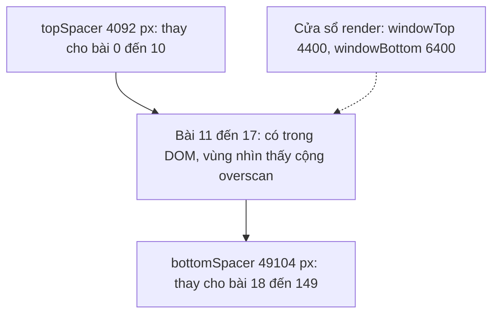
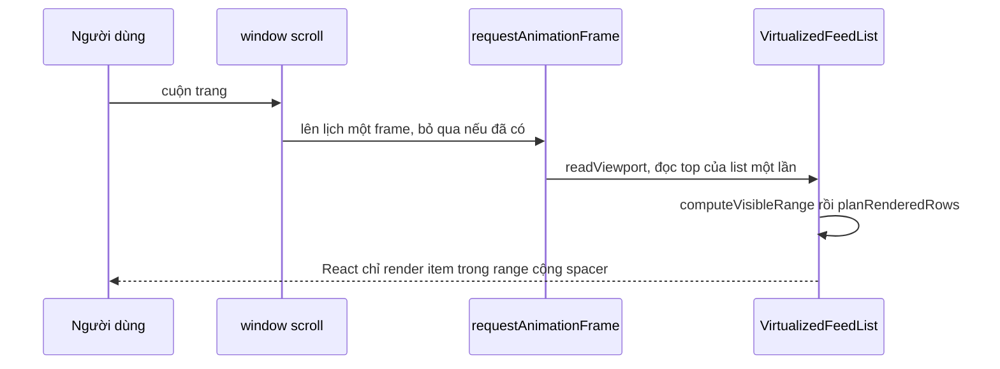

# Lesson 08 – Virtualization (windowing)

> **Mục tiêu:** học xong lesson này bạn giải thích được vì sao feed vài trăm bài làm DOM phình to và cuộn giật, virtualization giải quyết thế nào, và đánh đổi của nó là gì. Bạn tự cài được: hàm thuần tính "bài nào cần render và hai spacer cao bao nhiêu", đo chiều cao thật bằng `ResizeObserver`, bù scroll khi bài phía trên đổi chiều cao, và so sánh với `content-visibility: auto`.
>
> **Cần biết trước:** lesson 04 (infinite scroll, `useFeedLoader`), lesson 05 và 07 (`FeedPostArticle`, store có reaction). Biết `ref`, `useEffect`/`useLayoutEffect`, `requestAnimationFrame` và `ResizeObserver` ở mức cơ bản.

| File | Vai trò |
|---|---|
| `src/lessons/08-virtualization/lesson-08-virtualization.tsx` | Màn demo: ba chế độ render, bộ đếm DOM, nút "Tải nhanh thêm 150 bài" |
| `src/lessons/08-virtualization/compute-visible-range.ts` | Hàm thuần: tính range cần render và hai spacer |
| `src/lessons/08-virtualization/virtualized-feed-list.tsx` | Component danh sách ảo hoá theo window scroll |
| `src/lessons/08-virtualization/use-measured-item-heights.ts` | Đo chiều cao thật, cache theo id, bù scroll |
| `src/shared/hooks/use-feed-loader.ts` | `loadMany` tải nhanh nhiều trang, dùng chung cờ `inFlight` |
| `src/shared/styles/global.css` | Lớp `.feed--content-visibility` cho chế độ `content-visibility: auto` |

## 1. Lõi của windowing: range và hai spacer

### Trong bài viết
Bài viết chỉ ra rằng feed vô hạn sẽ có hàng nghìn node DOM sau một lúc: tốn bộ nhớ, layout và paint chậm, cuộn giật, INP kém. Giải pháp là **virtualization**: chỉ giữ trong DOM các bài đang hoặc sắp nhìn thấy, phần còn lại thay bằng khoảng trống để thanh cuộn vẫn đúng. Xem phần về hiệu năng danh sách trong [bài gốc](https://www.greatfrontend.com/questions/system-design/news-feed-facebook?format=system-design).

### Code thật

```learn
src/lessons/08-virtualization/compute-visible-range.ts#visible-range-types
```

1. `heights[i]` là chiều cao **đã đo** của bài `i`; `undefined` nghĩa là chưa đo và sẽ dùng `estimatedHeight`.
2. `scrollOffset` là số px đã cuộn tính từ **đầu list** (có thể âm nếu list còn nằm dưới màn hình). `viewportHeight` là chiều cao cửa sổ.
3. `overscanPx` là phần render thêm phía trên và dưới viewport để cuộn nhanh không thấy khoảng trắng.
4. Kết quả: `startIndex`, `endIndex` (không gồm), `topSpacer`, `bottomSpacer`, `totalHeight`.

```learn
src/lessons/08-virtualization/compute-visible-range.ts#compute-visible-range
```

1. `windowTop`/`windowBottom` là cửa sổ cần render: viewport mở rộng thêm overscan ở hai đầu.
2. Duyệt các bài theo thứ tự và cộng dồn `offset` (đỉnh của bài hiện tại). Bài chưa đo dùng `estimatedHeight`.
3. Bài đầu tiên có đáy lớn hơn `windowTop` là `startIndex`; lúc đó `topSpacer = itemTop` (tổng chiều cao các bài đứng trước).
4. Gặp bài đầu tiên có đỉnh `>= windowBottom` thì `endIndex = index` và **dừng sớm**, không duyệt hết.
5. `totalHeight` cộng tiếp chiều cao các bài còn lại sau `endIndex`.
6. `bottomSpacer = totalHeight - topSpacer - renderedHeight`, tức khoảng trống thay cho các bài phía dưới. Tổng `topSpacer + bài render + bottomSpacer` luôn bằng `totalHeight`, nên thanh cuộn không đổi.

Ví dụ với số thật của project, giả sử 150 bài đều chưa đo: ước lượng mỗi bài là `360 + 12 = 372px`, viewport 800px, overscan 600px, đã cuộn 5000px. Cửa sổ là từ 4400 đến 6400px. Bài 11 là bài đầu có đáy (4464) vượt 4400, nên `startIndex = 11`, `topSpacer = 4092`. Bài 18 là bài đầu có đỉnh (6696) từ 6400 trở đi, nên `endIndex = 18`. Chỉ 7 bài (11 đến 17) nằm trong DOM. `totalHeight = 150 × 372 = 55800`, `bottomSpacer = 55800 - 4092 - 2604 = 49104`.



### Vì sao làm vậy

| Cách | Ưu | Nhược | Khi nào chọn |
|---|---|---|---|
| Hàm thuần `computeVisibleRange` + spacer (project dùng) | Dễ test; không phụ thuộc DOM; thanh cuộn đúng | Phải tự lo đo chiều cao và bù scroll | Học và kiểm soát hoàn toàn; list có chiều cao thay đổi |
| Thư viện (react-window, TanStack Virtual) | Đã xử lý nhiều trường hợp biên | Thêm phụ thuộc; ít thấy bên trong | Production |
| Render tất cả bài | Không phải xử lý gì | DOM hàng chục nghìn node, RAM và INP kém | Dưới vài chục bài |
| Phân trang truyền thống | Dễ | Mất cảm giác feed liền mạch | Bảng dữ liệu |
| Chiều cao cố định mỗi item | Công thức đơn giản (`index × height`) | Feed có ảnh, "Xem thêm" thì không cố định | Danh sách đồng nhất |

### Lỗi hay gặp
- **Ghi chiều cao 0 làm sụp virtualization (lỗi thật):** xem khái niệm 3, phần `ResizeObserver` ghi `0` cho bài đã gỡ khỏi DOM. Hậu quả là mỗi bài đã cuộn qua chỉ còn chiếm 12px, `totalHeight` co từ 57k xuống 5.8k px và cuộn ngược không bao giờ quay lại được các bài đó.
- **Gap bị cộng hai lần (lỗi thật):** xem khái niệm 2.
- **`endIndex` không giới hạn:** nếu quên `break` thì duyệt hết mọi bài ở mỗi frame. Hàm dừng ngay khi gặp bài ở dưới cửa sổ.
- **Quên các trường hợp biên:** list rỗng, list còn nằm dưới màn hình (`scrollOffset` âm) hay bài chưa đo. `compute-visible-range.test.ts` bao các trường hợp này (đầu list, giữa list, overscan, chiều cao khác nhau, list rỗng).

### Tự thử
1. Chạy `npm run dev`, mở `#/lesson-08`, tab **Demo**. Bấm **Tải nhanh thêm 150 bài** (trong panel **DOM hiện tại**). Chọn chế độ **Virtualized (windowing)** (mặc định).
2. Kết quả mong đợi: dòng **Đã tải** tăng lên hơn 150, nhưng **&lt;article&gt; trong DOM** chỉ khoảng 5 đến 15.
3. Mở DevTools → **Elements**, chọn thẻ `div` bao danh sách: thuộc tính `data-rendered-range="11-18"` (ví dụ) cho biết đang render bài nào. Hai `div` có `aria-hidden="true"` và `style="height: …px"` là spacer; cuộn trang thì chiều cao hai spacer đổi còn tổng không đổi.
4. Trong **Console** chạy `document.querySelectorAll('article').length` và `document.querySelector('[data-rendered-range]').dataset.renderedRange` ở các vị trí cuộn khác nhau.

### Câu hỏi phỏng vấn
1. Virtualization hoạt động thế nào?
   > Chỉ render các item trong cửa sổ nhìn thấy cộng overscan. Hai spacer có chiều cao bằng tổng các item bị bỏ ở trên và dưới, nên thanh cuộn và vị trí cuộn vẫn đúng.
2. Vì sao phải có overscan?
   > Cuộn nhanh thì item mới cần được render trước khi vào màn hình; nếu không sẽ thấy khoảng trắng trước khi React kịp render.

## 2. Render theo frame và kế hoạch render

### Trong bài viết
Bài viết lưu ý rằng tính toán nặng trong lúc cuộn làm giật; cần tránh làm việc không cần thiết trong handler scroll. Xem [bài gốc](https://www.greatfrontend.com/questions/system-design/news-feed-facebook?format=system-design).

### Code thật

```learn
src/lessons/08-virtualization/virtualized-feed-list.tsx#scroll-raf-viewport
```

1. `readViewport` đọc `getBoundingClientRect().top` của list **một lần** và suy ra `scrollOffset = -listTop`. Feed thường cuộn cả trang (window scroll) nên đầu list có thể ở dưới màn hình.
2. `setViewport` chỉ tạo state mới khi giá trị thật sự đổi, để React không render thừa.
3. `schedule` chỉ lên lịch **một** `requestAnimationFrame` cho mỗi frame; nhiều sự kiện `scroll` trong cùng frame chỉ tốn một lần đọc.
4. Listener `scroll` dùng `passive: true` để trình duyệt không phải chờ handler mới cuộn.
5. Cleanup gỡ listener và huỷ frame đang chờ.

```learn
src/lessons/08-virtualization/virtualized-feed-list.tsx#range-and-gap
```

1. `heights = itemIds.map(getHeight)`: lấy chiều cao đã đo từ cache, `undefined` nếu chưa đo.
2. `estimatedHeight = 360 + 12`: ước lượng cho bài chưa đo **đã gồm khoảng cách giữa các bài**.
3. Chiều cao đo được là `borderBox` và đã có `paddingBlockEnd = ITEM_GAP`, nên **không cộng thêm gap** lần nữa.
4. `computeVisibleRange` trả `range`; `planRenderedRows` biến nó thành danh sách các hàng cần render.

```learn
src/lessons/08-virtualization/virtualized-feed-list.tsx#plan-rendered-rows
```

1. Hàm thuần nhận `range` và trả về danh sách hàng: `spacer` hoặc `item`.
2. Trường hợp thường (không ghim): `spacer-top`, các item trong range, `spacer-bottom`.
3. Có `pinnedIndex` (bài đang giữ focus, lesson 09) nằm ngoài range thì ghim thêm bài đó và **chia spacer thành hai** (`spacer-mid`), để tổng chiều cao không đổi và bài ghim vẫn ở đúng vị trí.
4. Tách thành hàm thuần giúp test mà không cần DOM.

```learn
src/lessons/08-virtualization/virtualized-feed-list.tsx#render-spacers-and-items
```

1. `overflowAnchor: 'none'` tắt scroll anchoring của trình duyệt vì ta tự bù scroll (khái niệm 3); nếu để cả hai, nội dung bị bù hai lần.
2. `data-rendered-range` giúp quan sát bằng DevTools.
3. Spacer là `div` có `aria-hidden="true"` vì chúng không phải nội dung.
4. Mỗi item bọc trong `div` có `ref={measureRef(id)}` (để đo) và `paddingBlockEnd` làm khoảng cách. `key={id}` giữ phần tử ổn định khi range dịch chuyển.
5. `footer` (sentinel của infinite scroll) nằm sau cùng.



### Vì sao làm vậy

| Cách | Ưu | Nhược | Khi nào chọn |
|---|---|---|---|
| Đọc vị trí trong `requestAnimationFrame` (project dùng) | Tối đa một lần đọc mỗi frame; không chặn scroll | Trễ tối đa một frame | Cuộn mượt với window scroll |
| Tính toán trực tiếp trong handler `scroll` | Cập nhật tức thì | Gọi dày, dễ gây layout thrash | Không nên |
| `IntersectionObserver` theo từng bài | Không cần listener scroll | Khó tính spacer theo chiều cao; nhiều observer | Tải lười, không phải windowing đầy đủ |
| Container cuộn riêng (div `overflow: auto`) | Dễ biết `scrollTop` | Feed thật thường cuộn cả trang; mất cuộn tự nhiên trên mobile | Widget trong trang |
| Tắt scroll anchoring và tự bù (project dùng) | Một cơ chế duy nhất, dễ dự đoán | Phải tự cài (khái niệm 3) | Khi đã có logic bù riêng |

### Lỗi hay gặp
- **Gap bị cộng hai lần (lỗi thật):** `paddingBlockEnd: ITEM_GAP` đã nằm trong chiều cao đo (`borderBox`), nhưng `computeVisibleRange` từng cộng thêm `gap`. Mỗi lần một bài rời DOM, nội dung giật 12px. Sửa: không cộng gap vào chiều cao đã đo, và ước lượng cho bài chưa đo phải gồm gap (`360 + 12`).
- **Callback ref tạo mới mỗi lần render (từ review):** `measureRef(id)` trả một hàm mới mỗi render nên React gỡ và gắn ref cho mọi item **mỗi frame cuộn**. Sửa: cache callback theo id (khái niệm 3).
- **Tính toán trong handler scroll:** gây giật. Project chỉ đọc một lần mỗi frame.
- **`aria-live` trên panel thống kê (từ review):** số `<article>` đổi ở mỗi lần cuộn nên screen reader bị spam. Project bỏ `aria-live` ở panel này.
- **Quên huỷ `requestAnimationFrame` khi unmount:** callback chạy sau khi component đã gỡ. Cleanup gọi `cancelAnimationFrame`.

### Tự thử
1. Mở `#/lesson-08`, tab **Demo**, đã tải vài trăm bài. Cuộn từ từ và nhìn `data-rendered-range` thay đổi trong **Elements**.
2. Mở **Performance**, bật **CPU throttling 4× slowdown**, bấm ghi rồi cuộn nhanh trong vài giây. Kết quả mong đợi: khung hình ổn định, không có Long Task kéo dài; thử lại ở chế độ **Render tất cả** để thấy sự khác biệt.
3. Cuộn nhanh xuống cuối rồi lên đầu: không thấy khoảng trắng lâu nhờ overscan 600px.

### Câu hỏi phỏng vấn
1. Vì sao đọc vị trí trong `requestAnimationFrame` thay vì trong handler `scroll`?
   > Handler `scroll` bắn rất dày; gom vào một lần mỗi frame tránh tính toán và đọc layout lặp lại. Cũng nên dùng listener `passive`.
2. Vì sao cần `spacer-mid` khi có bài được ghim?
   > Bài ghim nằm ngoài range nên phải ở đúng vị trí của nó. Chia spacer làm hai giữ tổng chiều cao không đổi, nên thanh cuộn không nhảy.

## 3. Đo chiều cao thật và bù scroll

### Trong bài viết
Bài viết lưu ý rằng chiều cao các bài trong feed không cố định (ảnh, "Xem thêm", chữ dài), nên virtualization cần ước lượng rồi đo lại và giữ vị trí cuộn ổn định. Xem [bài gốc](https://www.greatfrontend.com/questions/system-design/news-feed-facebook?format=system-design).

### Code thật

```learn
src/lessons/08-virtualization/use-measured-item-heights.ts#resize-observer-measure
```

1. Observer được tạo **trong effect** (không trong lúc render) và quan sát lại các phần tử đang mount.
2. Mỗi `entry` có `target`; `idByElementRef` (WeakMap) cho biết đó là bài nào. Không biết id thì bỏ qua.
3. `if (!entry.target.isConnected)`: phần tử vừa bị gỡ khỏi DOM vẫn có thể nhận callback với chiều cao **0**. Bỏ qua và `unobserve`, **tuyệt đối không ghi số 0 vào cache**.
4. `borderBoxSize[0].blockSize` là chiều cao gồm cả padding (gồm gap), nên đồng nhất với ước lượng.
5. Chiều cao đổi thì ghi vào `heightsRef` (cache theo id) và đánh dấu `changed`.
6. Nếu bài đó **đã được đo trước** (`previous !== undefined`) và nằm hẳn phía trên mép trên màn hình (`bottom < 0`), nội dung bên dưới bị đẩy xuống. Gọi `shiftRef.current(height - previous)` để bù scroll.
7. `setVersion` chỉ gọi một lần sau vòng lặp để React tính lại range với chiều cao mới.

```learn
src/lessons/08-virtualization/use-measured-item-heights.ts#measure-ref-cache
```

1. `refCallbacksRef` cache callback theo `id`, nên React **không** gỡ và gắn lại ref ở mỗi lần render.
2. Khi phần tử đổi (hoặc bị gỡ), `unobserve` phần tử trước đó. Lưu phần tử theo id (`elementByIdRef`) để unobserve chắc chắn mà không dựa vào `isConnected`.
3. Có phần tử mới thì ghi vào hai bảng tra rồi `observe`.

```learn
src/lessons/08-virtualization/virtualized-feed-list.tsx#scroll-compensation-hook
```

1. `onShiftAboveViewport` bù bằng `window.scrollBy(0, delta)`: nếu một bài phía trên cao thêm 100px thì cuộn xuống thêm 100px, để thứ người dùng đang đọc đứng yên.
2. Bài đã rời DOM vẫn giữ chiều cao đã đo trong cache, nên cuộn ngược lại không bị nhảy.

### Vì sao làm vậy

| Cách | Ưu | Nhược | Khi nào chọn |
|---|---|---|---|
| Ước lượng + đo bằng `ResizeObserver` + cache theo id (project dùng) | Chính xác dần; bắt cả thay đổi sau render (ảnh, "Xem thêm") | Phức tạp hơn; phải bù scroll | Chiều cao thay đổi động |
| Chiều cao cố định | Rất đơn giản | Không đúng với feed thực | Danh sách đồng nhất |
| Đo bằng `getBoundingClientRect` mỗi frame | Dễ hiểu | Buộc layout (reflow) ở mỗi lần đo | Ít item, không quan tâm hiệu năng |
| Dựa vào scroll anchoring của trình duyệt | Không tốn code | Không nhất quán giữa trình duyệt; phá khi item bị gỡ khỏi DOM | Khi không virtualize |
| Tự bù scroll (project dùng) | Hành vi dự đoán được | Phải tắt `overflow-anchor` để tránh bù hai lần | Virtualization với chiều cao động |

### Lỗi hay gặp
- **ResizeObserver ghi chiều cao 0 cho item đã unmount (lỗi thật, nặng nhất của lesson):** React gọi `ref(null)` **trước** khi gỡ node khỏi DOM, nên lúc đó `isConnected` vẫn là `true` và node không bao giờ được `unobserve`. Sau khi node bị gỡ, Chrome vẫn bắn callback với `blockSize = 0` (đã kiểm chứng: `conn=false bb=0 cr=0`). Callback không kiểm tra `isConnected` nên ghi `heights[id] = 0`. Hậu quả: bài đã cuộn qua chỉ còn 12px (đúng bằng gap), document co từ 57k xuống 5.8k px, người dùng bỏ qua hàng trăm bài. Ngoài ra map giữ node đã tách khỏi DOM mãi mãi gây rò bộ nhớ. Project sửa bằng hai việc: (1) bỏ qua và `unobserve` mọi phần tử không còn `isConnected`; (2) lưu phần tử theo id để unobserve chắc chắn khi `ref(null)`.
- **Observer tạo trong lúc render (từ review):** StrictMode chạy cleanup giả lập và `disconnect()` observer, nên nó chỉ hoạt động lại nhờ việc gắn lại ref liên tục. Project tạo observer trong effect.
- **Bù scroll cho bài đang nằm trong viewport:** làm nội dung nhảy. Project chỉ bù khi bài nằm hẳn phía trên mép màn hình (`bottom < 0`) và đã từng được đo.
- **Bấm "Tải nhanh" chạy đua với sentinel (từ review):** hai luồng tải cùng đọc một cursor cũ, nối trang sai thứ tự. Project cho `loadMany` dùng chung cờ `inFlight` với infinite scroll (xem khái niệm 4).

### Tự thử
1. Mở `#/lesson-08`, tab **Demo**, chọn **Virtualized (windowing)** và tải vài trăm bài.
2. Bấm **Xem thêm** ở một bài dài rồi cuộn xuống vài màn hình. Kết quả mong đợi: bài đó cao hơn, nhưng cuộn ngược lại không bị nhảy nhờ chiều cao đã đo được giữ trong cache.
3. Cuộn xuống 20 đến 30 bài rồi cuộn lên đầu từ từ. Kết quả mong đợi: thanh cuộn không co lại và không bị "bay" qua hàng trăm bài (nếu `ResizeObserver` ghi 0 thì sẽ xảy ra đúng như vậy). Kiểm tra bằng Console:

```js
document.documentElement.scrollHeight
```

   Giá trị này phải ổn định (xấp xỉ tổng chiều cao thật), không giảm đột ngột khi cuộn qua nhiều bài.

### Câu hỏi phỏng vấn
1. Vì sao phải bù scroll khi item phía trên đổi chiều cao?
   > Nội dung bên dưới bị đẩy xuống, nên thứ người dùng đang xem trôi đi. Phải `scrollBy` đúng bằng độ chênh để giữ nguyên vị trí nhìn thấy.
2. Vì sao phải kiểm tra `isConnected` trong callback `ResizeObserver`?
   > Phần tử vừa gỡ khỏi DOM có thể vẫn nhận callback với kích thước 0. Ghi giá trị 0 vào cache làm virtualization nghĩ các bài đó cao 0px và nhảy loạn.
3. Vì sao tắt `overflow-anchor` khi tự bù scroll?
   > Trình duyệt cũng có scroll anchoring; để cả hai cùng chạy sẽ bù hai lần và nội dung trôi.

## 4. So sánh ba chế độ render và các đánh đổi

### Trong bài viết
Bài viết nhắc rằng virtualization có cái giá: Ctrl+F không tìm được thứ đã gỡ khỏi DOM, focus có thể mất, và screen reader không biết tổng số bài. Cần cân nhắc phương án nhẹ hơn như `content-visibility`. Xem [bài gốc](https://www.greatfrontend.com/questions/system-design/news-feed-facebook?format=system-design).

### Code thật

```learn
src/lessons/08-virtualization/lesson-08-virtualization.tsx#render-mode-switch
```

1. `role="feed"` và `aria-busy` giữ cấu trúc truy cập được ở **cả ba chế độ**.
2. `virtualized`: dùng `VirtualizedFeedList` với `itemIds`, `renderItem` và `footer` (sentinel).
3. `content-visibility`: vẫn render **tất cả** bài nhưng gắn lớp `feed--content-visibility`; CSS `content-visibility: auto` cho phép trình duyệt bỏ qua layout và paint các bài ngoài màn hình.
4. `plain`: render tất cả như lesson 07.
5. Sentinel đổi chỗ khi đổi chế độ, nên `useFeedLoader({ observeKey: mode })` observe lại.

```learn
src/lessons/08-virtualization/lesson-08-virtualization.tsx#render-post-with-setsize
```

1. `setSize = hasOlder ? -1 : tổng số bài`: khi virtualize, screen reader **không thể đếm** các bài đã gỡ khỏi DOM, nên `aria-setsize` và `aria-posinset` mang thông tin thay thế.
2. `renderPost` truyền `index + 1` làm `posInSet`, dựa vào chỉ số trong danh sách đầy đủ chứ không phải chỉ số trong DOM.
3. Bài đầu tiên có `priority` để tải ảnh ngay (LCP).

```learn
src/lessons/08-virtualization/lesson-08-virtualization.tsx#use-dom-stats
```

1. Đếm `<article>` và tổng số node (`getElementsByTagName('*')`) trong feed.
2. `MutationObserver` quan sát thay đổi `childList` và `subtree`; `requestAnimationFrame` gom nhiều thay đổi thành một lần đếm.
3. `setStats` chỉ đổi khi số thật sự đổi, tránh render thừa.

```learn
src/shared/hooks/use-feed-loader.ts#feed-loader-load-pages
```

1. `inFlightRef` là cờ chung: đang có một lần tải thì mọi lần gọi khác trả `skipped`.
2. Với `loadMany(3)` mỗi trang 50 bài, vòng lặp tải 3 trang liên tiếp theo cursor (tổng 150 bài); dừng sớm nếu hết bài.
3. Mỗi trang `dispatch feedPageReceived`; trang đầu theo `direction`, các trang sau luôn là `older`.
4. `finally` luôn xoá cờ, kể cả khi lỗi.

### Vì sao làm vậy

| Cách | Ưu | Nhược | Khi nào chọn |
|---|---|---|---|
| Virtualization (project dùng làm mặc định) | DOM nhỏ nhất (5 đến 15 bài); bộ nhớ và INP tốt | Ctrl+F không tìm được bài đã gỡ; focus mất khi bài bị unmount; phải đo và bù scroll | Hàng trăm đến hàng nghìn bài |
| `content-visibility: auto` | Rất ít code; Ctrl+F vẫn tìm được; giữ focus | DOM vẫn đầy đủ nên tốn bộ nhớ; cần `contain-intrinsic-size` để thanh cuộn ổn định | Vài chục đến vài trăm bài, ưu tiên đơn giản |
| Render tất cả | Đơn giản nhất | DOM phình, cuộn giật với CPU yếu | Rất ít bài |
| Phân trang/"Xem thêm" thủ công | Không cần virtualize | Mất trải nghiệm cuộn liền mạch | Danh sách hữu hạn |
| Kết hợp: virtualize + ghim bài đang focus (lesson 09) | Giảm bớt đánh đổi về focus | Thêm logic `pinnedIndex` | Feed cần hỗ trợ bàn phím tốt |

### Lỗi hay gặp
- **"Tải nhanh 150 bài" chạy đua với sentinel (từ review):** hai luồng cùng đọc cursor cũ nên trang `older` nối không theo thứ tự. Project dùng chung cờ `inFlight` cho cả hai và có `mergeUniqueIds` trong reducer để không nhân đôi id.
- **Quên `observeKey` khi đổi chế độ:** sentinel được render ở chỗ khác nhưng observer vẫn giữ phần tử cũ, nên infinite scroll ngừng chạy. Project truyền `observeKey: mode`.
- **Nghĩ rằng virtualization không có đánh đổi:** Ctrl+F không tìm được bài ngoài DOM; screen reader không biết tổng số bài (nên có `aria-setsize`); focus mất nếu bài đang focus bị gỡ (lesson 09 sửa bằng cách ghim).
- **Dùng `content-visibility: auto` mà không có `contain-intrinsic-size`:** thanh cuộn nhảy khi trình duyệt tính chiều cao thật của bài vừa vào màn hình. Project đặt `contain-intrinsic-size: auto 360px` trong `global.css`.

### Tự thử
1. Mở `#/lesson-08`, tab **Demo**. Bấm **Tải nhanh thêm 150 bài** vài lần. Ở panel **DOM hiện tại** ghi lại **&lt;article&gt; trong DOM** và **Tổng node trong feed** ở chế độ **Virtualized (windowing)**.
2. Chuyển sang **Render tất cả**: số `<article>` bằng đúng số bài đã tải, và tổng node tăng vọt (hàng chục nghìn). Thử cuộn khi bật CPU throttling 4× trong **Performance** để cảm nhận độ giật.
3. Chuyển sang **content-visibility: auto**: DOM vẫn đầy đủ, nhưng cuộn mượt hơn chế độ render tất cả. Nhấn **Ctrl+F** và tìm một từ nằm trong bài ở xa: tìm thấy (khác với chế độ virtualized, nơi bài đó chưa có trong DOM).
4. Quay lại **Virtualized (windowing)** và tìm cùng từ đó bằng **Ctrl+F**: không thấy kết quả khi bài nằm ngoài vùng đang render. Đó là đánh đổi.

### Câu hỏi phỏng vấn
1. Đánh đổi của virtualization là gì?
   > Ctrl+F không tìm được bài đã ra khỏi DOM; focus bị mất khi item bị unmount; screen reader không biết tổng số bài; phải đo chiều cao và bù scroll.
2. `content-visibility: auto` khác virtualization thế nào?
   > DOM vẫn đầy đủ (Ctrl+F vẫn tìm được), trình duyệt chỉ bỏ qua layout và paint phần ngoài màn hình. Rẻ hơn về code nhưng tốn bộ nhớ hơn và vẫn có DOM lớn.
3. Khi nào chọn cách nào?
   > Vài chục bài: render tất cả. Vài trăm bài và muốn đơn giản: `content-visibility`. Hàng nghìn bài hoặc thiết bị yếu: virtualization, kèm xử lý focus và `aria-setsize`.
4. Làm sao để screen reader vẫn hiểu feed khi đã virtualize?
   > Giữ `role="feed"`, dùng `aria-posinset` theo chỉ số đầy đủ và `aria-setsize` (bằng `-1` khi chưa biết tổng), `aria-busy` khi tải, và ghim bài đang focus để không mất focus.

## Tóm tắt
- Virtualization chỉ giữ trong DOM các bài trong cửa sổ nhìn thấy cộng overscan; hai spacer thay cho phần còn lại để thanh cuộn và tổng chiều cao luôn đúng.
- `computeVisibleRange` và `planRenderedRows` là hàm thuần dễ test; vị trí cuộn được đọc đúng một lần mỗi frame bằng `requestAnimationFrame` với listener `passive`.
- Chiều cao thật được đo bằng `ResizeObserver` và cache theo id: phải bỏ qua phần tử đã gỡ khỏi DOM (nếu không sẽ ghi 0 và làm sụp danh sách) và không cộng gap hai lần.
- Khi một bài phía trên đổi chiều cao thì tự bù `window.scrollBy` đúng bằng độ chênh, đồng thời tắt `overflow-anchor` để trình duyệt không bù thêm lần nữa.
- Đánh đổi: Ctrl+F không tìm được bài ngoài DOM, focus có thể mất, cần `aria-posinset`/`aria-setsize`; `content-visibility: auto` là lựa chọn rẻ hơn nhưng DOM vẫn lớn.
