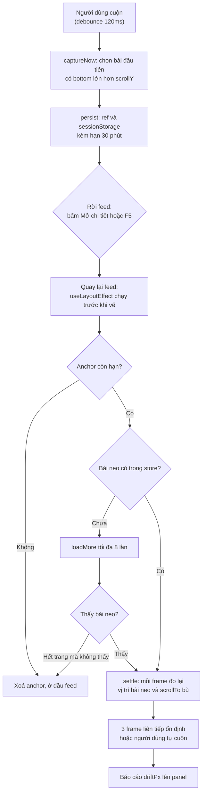
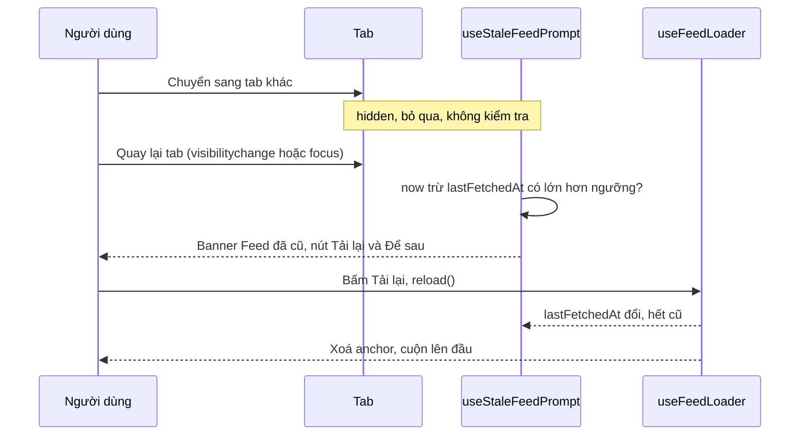
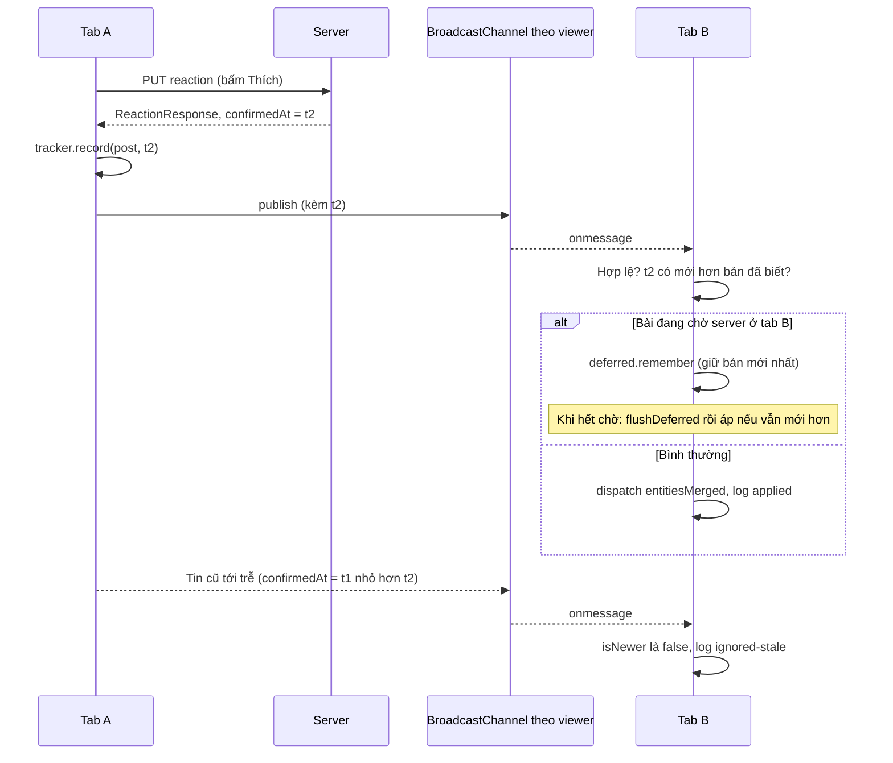

# Lesson 09 – Feed list nâng cao: anchor scroll, feed cũ, đồng bộ tab, gộp request

> **Mục tiêu:** học xong lesson này bạn giải thích được vì sao khôi phục vị trí cuộn bằng "bài + độ lệch" bền hơn số pixel, biết khi nào nên *hỏi* người dùng tải lại feed thay vì tự đổi, hiểu cách hai tab đồng bộ reaction qua `BroadcastChannel` mà không bị sai thứ tự, và tự cài được cơ chế gộp request trùng ở tầng data access.
>
> **Cần biết trước:** lesson 03 (normalized store), lesson 04 (infinite scroll và `useFeedLoader`), lesson 05 (reaction lạc quan, `confirmedAt`), lesson 08 (virtualization, `VirtualizedFeedList`).

| File | Vai trò |
|---|---|
| `src/lessons/09-advanced-feed-list/lesson-09-advanced-feed-list.tsx` | Ghép mọi thứ lại: feed ảo hoá, banner "Feed đã cũ", nút "Mở tab mới" |
| `src/lessons/09-advanced-feed-list/scroll-anchor.ts` | Logic **thuần**: chụp anchor, tính `scrollY` khôi phục, hạn dùng, đọc `sessionStorage` |
| `src/lessons/09-advanced-feed-list/use-scroll-restoration.ts` | Phần dính vào DOM/React: debounce chụp anchor, vòng bù vị trí từng frame |
| `src/lessons/09-advanced-feed-list/use-stale-feed-prompt.ts` | Phát hiện feed cũ khi người dùng quay lại tab |
| `src/lessons/09-advanced-feed-list/lesson-09-route.ts` | Route con `#/lesson-09` và `#/lesson-09/post/:id` mà không remount |
| `src/lessons/09-advanced-feed-list/post-detail-view.tsx` | Trang chi tiết: 3 component cùng `fetchPost`, chỉ 1 request mạng |
| `src/shared/sync/cross-tab-reaction-sync.ts` | `BroadcastChannel` + `confirmedAt` + bộ đệm tin bị hoãn (không phụ thuộc React) |
| `src/shared/sync/use-cross-tab-reaction-sync.ts` | Hook nối kênh vào feed store |
| `src/shared/api/http-client.ts` | Gộp GET trùng URL đang bay |
| `server/src/data/feed-repository.ts`, `server/src/data/database-schema.ts` | `feed_state.generation` |

## 1. Neo vị trí scroll theo bài (anchor)

### Trong bài viết
Bài GreatFrontEnd nhấn mạnh rằng feed là SPA: người dùng bấm vào một bài để xem chi tiết rồi quay lại thì **phải về đúng chỗ đang đọc**, không bị ném lên đầu feed. Bài cũng nhắc tới việc tránh tải lại danh sách khi quay lại. Xem phần về điều hướng và hiệu năng của feed trong [bài gốc](https://www.greatfrontend.com/questions/system-design/news-feed-facebook?format=system-design). Lesson này cài cách làm bền nhất mà không dùng thư viện: nhớ **bài đang ở đỉnh màn hình** và **nó cách mép trên bao nhiêu pixel**.

### Code thật

Bước 1: chụp anchor và tính toạ độ khôi phục (hàm thuần, test được không cần trình duyệt).

```learn
src/lessons/09-advanced-feed-list/scroll-anchor.ts#anchor-capture-and-restore-math
```

1. `itemRects` là danh sách `{ postId, top, bottom }` theo **toạ độ trang** (`rect.top + scrollY`), đã sắp từ trên xuống.
2. `captureScrollAnchor` chọn bài **đầu tiên có đáy nằm dưới mép trên viewport** (`rect.bottom > scrollY`). Bài đang bị cắt một nửa ở phía trên vẫn là thứ người dùng đang đọc, nên không dùng điều kiện "đỉnh bài ≥ scrollY".
3. `offsetPx = first.top - scrollY` có thể **âm**: nghĩa là bài bị cắt phía trên mép màn hình một đoạn.
4. `computeRestoreScrollTop` làm phép ngược: `scrollY` cần đặt = `top hiện tại của bài neo - offsetPx`. Nếu chưa biết vị trí bài (chưa render hoặc đã bị xoá) thì trả `null` để nơi gọi quyết định bước tiếp theo.
5. `Math.max(0, …)` chặn kết quả âm khi bài neo nằm sát đầu trang.

Bước 2: anchor có **hạn dùng** và được lưu bền.

```learn
src/lessons/09-advanced-feed-list/scroll-anchor.ts#anchor-stored-with-expiry
src/lessons/09-advanced-feed-list/scroll-anchor.ts#anchor-parse-stored
```

1. `withExpiry` gắn `savedAt` và `expiresAt = now + 30 phút`. Anchor hết hạn **theo thời gian**, không theo số bài mới của feed.
2. `parseStoredScrollAnchor` coi `sessionStorage` là đầu vào không tin được: JSON hỏng, thiếu trường hoặc `NaN` đều trả `null`, không ném lỗi. Bản code cũ hay người dùng nghịch DevTools có thể ghi gì đó vào đây.

Bước 3: chụp anchor từ DOM khi cuộn.

```learn
src/lessons/09-advanced-feed-list/use-scroll-restoration.ts#restore-capture-now
```

1. Điều kiện đầu hàm: không chụp khi feed không hiển thị (`!activeRef.current`), khi **đang chờ khôi phục** (`armedRef`), hoặc khi **đang bù vị trí** (`settlingRef`). Nếu chụp lúc đó, anchor mới sẽ **ghi đè** anchor mà ta sắp dùng.
2. Đọc mọi `article[data-post-id]` trong container, đổi sang toạ độ trang, rồi sắp theo `top`.
3. `persist(withExpiry(point, Date.now()))` ghi vào ref (SPA còn sống) và `sessionStorage` (tải lại trang vẫn còn).

Bước 4: tắt cơ chế khôi phục scroll của trình duyệt.

```learn
src/lessons/09-advanced-feed-list/use-scroll-restoration.ts#restore-manual-scroll-restoration
```

1. `history.scrollRestoration = 'manual'` báo trình duyệt đừng tự khôi phục. Nó chỉ biết `scrollY` thô và chạy **trước** khi feed render xong, nên sẽ tranh quyền với cơ chế anchor.
2. Cleanup trả lại giá trị cũ để các lesson khác không bị ảnh hưởng.

Bước 5: quyết định gì xảy ra khi quay lại feed.

```learn
src/lessons/09-advanced-feed-list/use-scroll-restoration.ts#restore-decision-effect
```

1. `useLayoutEffect` chạy **trước khi trình duyệt vẽ**, nên người dùng không thấy feed nhảy.
2. Rời feed (`!active`) thì "nạp đạn" lại (`armedRef = true`) và huỷ vòng bù đang dở.
3. Không có anchor thì không làm gì. Feed chưa có dữ liệu (`lastFetchedAt === null`, vừa F5) thì đợi.
4. Anchor quá hạn thì xoá.
5. Bài neo đã có trong store thì vào vòng bù `settle`.
6. Chưa có (vừa F5, store rỗng) thì gọi `loadMore` để tải thêm trang, tối đa `MAX_LOAD_ATTEMPTS = 8` lần. Hết trang mà vẫn không thấy bài neo thì **bỏ anchor**.

Bước 6: vòng bù vị trí vì feed ảo hoá chỉ biết chiều cao **ước lượng**.

```learn
src/lessons/09-advanced-feed-list/use-scroll-restoration.ts#restore-settle-loop
```

1. Đăng ký lắng `wheel`, `touchstart`, `pointerdown`, `keydown`: người dùng tự cuộn là **dừng ngay**, không giành quyền điều khiển.
2. Mỗi frame `tick()` tìm bài neo trong DOM. Thấy thì tính `scrollTop` đúng và `scrollTo` nếu lệch từ 1px trở lên.
3. Không thấy (bài đang bị ảo hoá ra khỏi DOM) thì nhảy theo chiều cao ước lượng bằng `scrollToItem`. Frame sau sẽ tinh chỉnh.
4. Sau khi nhảy, các bài phía trên bài neo được render và **đo thật**, nên bài neo "trôi" vài chục px. Vì vậy phải lặp, không thể `scrollTo` một lần.
5. Kết thúc khi `STABLE_FRAMES_REQUIRED = 3` frame liên tiếp không phải sửa, hoặc quá `MAX_SETTLE_FRAMES = 90` frame. Kết quả (`driftPx`, số frame, có bị ngắt không) được ghi vào panel.

Bước 7: `generation` của feed trên server **không** tham gia vào việc giữ anchor.

```learn
server/src/data/database-schema.ts#feed-state-single-row
server/src/data/feed-repository.ts#feed-generation-read
```

1. Bảng `feed_state` chỉ có đúng một dòng (ràng buộc `id = 1`), `generation` tăng mỗi khi có bài mới chèn lên đầu feed.
2. `getFeedGeneration` đọc giá trị đó. Panel Anchor chỉ **hiển thị** nó cho bạn thấy, chữ "anchor không phụ thuộc generation".



### Vì sao làm vậy

| Cách | Ưu | Nhược | Khi nào chọn |
|---|---|---|---|
| Anchor: id bài + độ lệch (project dùng) | Đúng kể cả khi bài mới chèn lên đầu, ảnh tải xong làm đổi chiều cao, virtualization ước lượng sai | Phải tìm lại bài neo; cần vòng bù khi dùng virtualization | Feed động, có virtualization |
| Lưu `scrollY` thô | Một dòng code | Chỉ đúng khi mọi thứ phía trên không đổi; sau khi có bài mới thì trỏ sang **bài khác** | Trang tĩnh, nội dung cố định |
| `history.scrollRestoration = 'auto'` của trình duyệt | Không tốn code | Chạy trước khi feed render nên thường sai; không hiểu virtualization | Trang nhiều nội dung render sẵn phía server |
| Không lưu, luôn về đầu | Đơn giản, dễ đoán | Người dùng mất chỗ đang đọc, rất khó chịu trên mobile | Trang ngắn |

Tại sao neo theo id lại "sống sót" qua bài mới? Vì id không đổi khi có bài chèn lên đầu, còn pixel thì đổi.

### Lỗi hay gặp
- **Vứt anchor mỗi khi có bài mới:** bản đầu gắn anchor với `generation` của feed, mà `generation` tăng ở **mọi** lần chèn bài. Kết quả: cuộn tới bài 20, có người đăng bài, F5 là về đầu feed. Code review chỉ ra điều này **mâu thuẫn với lý do tồn tại của anchor** (neo theo id sinh ra để sống sót qua bài mới). Project sửa bằng cách bỏ kiểm tra generation: anchor chỉ hết hạn theo thời gian, còn việc bài neo có tồn tại không được xử lý ở luồng tải thêm.
- **Chụp anchor đè anchor cần dùng:** nếu cho phép chụp trong lúc đang chờ hoặc đang bù, sự kiện scroll do chính `scrollTo` sinh ra sẽ ghi đè anchor. `armedRef` và `settlingRef` chặn việc đó.
- **`scrollTo` một lần:** với feed ảo hoá, các bài phía trên bài neo đo xong mới biết chiều cao thật, bài neo trôi đi. Cần vòng bù theo frame (`settle`).
- **Giành quyền với người dùng:** nếu vòng bù cứ chạy khi người dùng đã cuộn, màn hình giật. Vòng bù lắng nghe `wheel`, `touchstart`, `pointerdown`, `keydown` và dừng ngay.

### Tự thử
1. Mở `#/lesson-09`, tab **🧪 Demo**. Cuộn xuống khoảng bài thứ 20. Nhìn panel **Anchor scroll đang lưu**: mục "Bài neo" và "Lệch mép trên" cập nhật sau khi bạn dừng cuộn khoảng 120ms.
2. Bấm vào thời gian của một bài (hoặc link **Mở chi tiết bài**), rồi bấm **← Về feed** hoặc nút Back của trình duyệt.
3. Kết quả mong đợi: bài đó về lại cùng chỗ. Dòng "Khôi phục gần nhất" ghi `lệch Xpx sau N frame` với X nhỏ, mục tiêu không quá 5px.
4. Mở DevTools → Application → Session Storage, xem khoá `lesson-09:scroll-anchor` có `postId`, `offsetPx`, `savedAt`, `expiresAt`.
5. Bấm F5 khi đang ở giữa feed. Kết quả: feed tải thêm trang cho tới khi có bài neo rồi cuộn lại đúng chỗ; trạng thái panel đổi qua "đang tải thêm bài để tìm bài neo" rồi "đang bù vị trí".
6. Bấm **Xoá anchor** rồi F5: feed ở đầu trang.

### Câu hỏi phỏng vấn
1. Vì sao lưu vị trí scroll bằng "id bài + độ lệch" thay vì số pixel?
   > Chiều cao các bài thay đổi (ảnh tải xong, bấm "Xem thêm", virtualization chỉ ước lượng) và bài mới có thể chèn lên đầu, nên một số pixel cũ không còn trỏ đúng bài. Neo theo bài thì tìm lại được đúng bài và đặt về cùng chỗ.

## 2. Feed đã cũ: hỏi, đừng âm thầm đổi

### Trong bài viết
Bài đề cập tới việc feed có thể trở nên cũ khi người dùng để tab mở hàng giờ, và gợi ý nhiều cách làm mới. Lesson chọn cách thận trọng nhất: **chỉ hỏi** người dùng, không tự thay bài. Xem phần về dữ liệu cũ trong [bài gốc](https://www.greatfrontend.com/questions/system-design/news-feed-facebook?format=system-design).

### Code thật

```learn
src/lessons/09-advanced-feed-list/use-stale-feed-prompt.ts#stale-feed-prompt
```

1. `isFeedStale` là hàm thuần: feed chưa từng tải (`lastFetchedAt === null`) thì không có gì để gọi là cũ.
2. Hook giữ `lastFetchedAt` và ngưỡng trong **ref** để handler sự kiện (sống lâu) luôn đọc giá trị mới nhất mà không cần đăng ký lại.
3. `useEffect(() => setIsStale(false), [lastFetchedAt])`: vừa tải lại xong thì hết cũ.
4. Kiểm tra bằng sự kiện `visibilitychange` và `focus`, **không dùng `setInterval`**: tab ẩn thì trình duyệt giảm tốc timer, và chẳng ai nhìn để mà kiểm tra.
5. Khi tab đang ẩn (`document.visibilityState === 'hidden'`) thì bỏ qua. Chỉ đánh giá lúc người dùng quay lại.

Khi bấm **Tải lại**, lesson đi qua `reload()` của `useFeedLoader`:

```learn
src/shared/hooks/use-feed-loader.ts#feed-loader-reload
src/lessons/09-advanced-feed-list/lesson-09-advanced-feed-list.tsx#reload-feed-through-loader
```

1. `reload` chính là `loadPages('initial', 1, pageSize)`: nó dùng **chung cờ `inFlightRef`** với mọi kiểu tải khác.
2. Nếu đang có lần tải khác, `reload` trả `{ kind: 'skipped' }` thay vì chạy chồng.
3. `reloadFeed` chỉ khi `outcome.kind === 'ok'` mới xoá anchor và cuộn lên đầu (`scrollTo` với `behavior: 'instant'`). Lỗi thì hiện toast, giữ nguyên chỗ đang đọc.



### Vì sao làm vậy

| Cách | Ưu | Nhược | Khi nào chọn |
|---|---|---|---|
| Hỏi bằng banner (project dùng) | Không mất chỗ đang đọc, người dùng chủ động | Thêm một thao tác | Feed cá nhân hoá, đọc dài |
| Tự tải lại và thay list | Luôn mới | Bài đang đọc biến mất, giật | Dashboard theo dõi, không ai "đọc dở" |
| `setInterval` kiểm tra | Dễ viết | Tab ẩn bị giảm tốc timer, tốn pin, kiểm tra khi không ai nhìn | Hiếm khi hợp lý cho việc này |
| Không làm gì | Không tốn code | Người dùng đọc dữ liệu quá cũ | Dữ liệu ít thay đổi |

### Lỗi hay gặp
- **`reloadFeed` tự dựng request riêng:** bản đầu gọi thẳng API rồi dispatch. Trong lúc reload đang bay, người dùng cuộn làm sentinel gọi `loadPages('older')` với `olderCursor` **cũ** (ở sâu). Trang đầu về và thay list, rồi trang older cũ về và nối vào: list thành 10 bài đầu cộng bài 41–50, **mất bài 11–40** và `olderCursor` trỏ sai. Project sửa bằng cách thêm `reload()` vào loader để dùng chung `inFlightRef`.
- **Banner tắt dù feed chưa mới:** nếu lấy `Date.now()` làm "lần tải gần nhất" khi nhận lại bản cũ từ cache, UI sẽ nói dối là feed mới. Vì vậy Service Worker của lesson 12 dùng network-first (xem lesson 12).

### Tự thử
1. Ở `#/lesson-09`, đổi ô **Cũ sau (giây)** thành `5`.
2. Đợi hơn 5 giây (panel **Tuổi của feed** chạy từng giây), mở tab khác rồi quay lại.
3. Kết quả mong đợi: hiện banner "Feed đã cũ (quá 5 giây kể từ lần tải gần nhất)." cùng hai nút **Tải lại** và **Để sau**.
4. Bấm **Tải lại**: feed về trang đầu mới, anchor bị xoá, tuổi feed về 0s. Bấm **Để sau**: banner biến mất, feed giữ nguyên.

### Câu hỏi phỏng vấn
1. Khi nào nên nhắc người dùng tải lại feed, và vì sao không tự tải?
   > Khi họ quay lại tab sau một khoảng dài (so `lastFetchedAt` với ngưỡng). Không tự tải để bài họ đang đọc không biến mất; chỉ hỏi và để họ quyết định.

## 3. Đồng bộ reaction giữa các tab bằng BroadcastChannel

### Trong bài viết
Người dùng thường mở nhiều tab của cùng một app. Bài gợi ý cân nhắc đồng bộ trạng thái giữa các tab để không hiển thị dữ liệu lệch nhau. Xem phần về đồng bộ và real-time trong [bài gốc](https://www.greatfrontend.com/questions/system-design/news-feed-facebook?format=system-design). Lesson dùng `BroadcastChannel`: cùng origin, không cần server push cho chuyện "chính mình mở nhiều tab".

### Code thật

Bước 1: dạng tin nhắn và kênh tách theo viewer.

```learn
src/shared/sync/cross-tab-reaction-sync.ts#sync-message-types
shared-contracts/feed-api-contracts.ts#contract-reaction-response
```

1. `ReactionSyncMessage` mang `postId`, `engagementSummary`, `viewerReaction` và **`confirmedAt`**: thời điểm **server** ghi xong, lấy từ `ReactionResponse`.
2. Tên kênh là `newsfeed:<viewerId>`. Nếu trình duyệt đổi tài khoản, tab của người khác không nhận reaction của mình.
3. `ReactionSyncLogEntry` mô tả mọi chuyện có thể xảy ra với một tin (đã phát, nhận, áp dụng, bỏ qua vì cũ, bỏ qua vì chưa áp được, sai định dạng). Panel "Đồng bộ giữa các tab" in chính các dòng này.

Bước 2: dữ liệu từ kênh là đầu vào bên ngoài.

```learn
src/shared/sync/cross-tab-reaction-sync.ts#sync-message-validate
```

1. Tab khác có thể là bản code cũ hoặc bị can thiệp, nên `isReactionSyncMessage` kiểm từng trường: `type`, `postId`, `confirmedAt` phải là chuỗi ngày hợp lệ, `engagementSummary` là object, `viewerReaction` là `null` hoặc chuỗi.
2. Là type guard (`data is ReactionSyncMessage`), nên sau khi qua hàm này TypeScript tin kiểu một cách có cơ sở.

Bước 3: chỉ áp bản **mới hơn**.

```learn
src/shared/sync/cross-tab-reaction-sync.ts#confirmed-at-tracker
```

1. `ConfirmedAtTracker` nhớ `confirmedAt` mới nhất đã biết **theo từng bài**, cả do chính tab ghi lẫn nhận từ tab khác.
2. `isNewer` chỉ kiểm tra, **không ghi**. Lý do: tab nhận có thể từ chối áp (ví dụ bài đang chờ server) và khi đó không được coi là "đã biết".
3. `record` dùng `Math.max` nên giá trị chỉ tăng.

Bước 4: tin chưa áp được thì **giữ lại**, không vứt.

```learn
src/shared/sync/cross-tab-reaction-sync.ts#deferred-patch-buffer
```

1. `remember` giữ **bản mới nhất theo từng bài** (so `confirmedAt`).
2. Xoá rồi `set` lại để bài đó thành "mới thêm nhất" trong thứ tự của `Map`. Quá `maxEntries = 100` thì bỏ bài thêm sớm nhất, để bộ nhớ không phình.
3. Comment trong code mô tả đúng kịch bản mất dữ liệu nếu vứt tin (xem phần Lỗi hay gặp).

Bước 5: xử lý tin nhận được, phát tin, áp lại, đóng kênh.

```learn
src/shared/sync/cross-tab-reaction-sync.ts#sync-channel-on-message
src/shared/sync/cross-tab-reaction-sync.ts#sync-channel-publish-flush-close
```

1. `onmessage`: sai định dạng thì log `ignored-invalid` và dừng.
2. Có `received` thì kiểm `tracker.isNewer`. Không mới hơn thì log `ignored-stale`.
3. Gọi `onPatch(data)`. Áp được thì `tracker.record`, `deferred.forget`, log `applied`. Không áp được thì `deferred.remember` và log `skipped`.
4. `publish` ghi nhận bản của chính mình **trước** khi `postMessage`, để bản cũ hơn từ tab khác tới trễ không ghi đè lên.
5. `flushDeferred` duyệt các tin bị hoãn: nếu tab đã biết bản mới hơn thì bỏ, còn áp được thì áp, vẫn chưa được thì giữ cho lần sau.
6. `close` đặt `onmessage = null` rồi đóng kênh.

Bước 6: phía React.

```learn
src/shared/sync/use-cross-tab-reaction-sync.ts#cross-tab-open-channel
src/shared/sync/use-cross-tab-reaction-sync.ts#cross-tab-apply-patch
src/shared/sync/use-cross-tab-reaction-sync.ts#cross-tab-flush-deferred
```

1. Mở kênh sau khi `getSession()` trả `viewerId`. Lỗi (không có session) thì **tắt đồng bộ** thay vì dùng một kênh chung, vì kênh chung làm lộ dữ liệu giữa người dùng.
2. `applyPatch` bỏ qua bài **đang chờ server** (`pendingReactions`): bài đó sẽ được cập nhật bằng response của chính request, nếu ghi đè giữa chừng UI nhảy qua lại. Hàm trả `false` để tin được đưa vào bộ đệm.
3. Khi `pendingReactions` đổi (bài hết chờ), gọi `flushDeferred()` để áp lại các tin đã hoãn.



### Vì sao làm vậy

| Cách | Ưu | Nhược | Khi nào chọn |
|---|---|---|---|
| `BroadcastChannel` + `confirmedAt` (project dùng) | Không cần server; chỉ gửi tin nhắn, mỗi tab tự áp; bỏ qua bản cũ | Chỉ cùng origin, cùng trình duyệt; không có trong trình duyệt rất cũ (app vẫn chạy, chỉ tắt đồng bộ) | Nhiều tab cùng một người dùng |
| Sự kiện `storage` của `localStorage` | Hỗ trợ rộng | Phải serialize vào storage; ồn ào, không có kênh riêng | Môi trường không có `BroadcastChannel` |
| Service Worker làm trung tâm | Điều phối được cả khi tab đóng | Phức tạp, SW là thứ khó debug | Đồng bộ nền, offline |
| WebSocket hoặc SSE từ server | Đồng bộ cả giữa **thiết bị** khác nhau | Cần hạ tầng server, tốn kết nối | Cập nhật thời gian thực giữa người dùng |

Điểm mấu chốt: `BroadcastChannel` **không chia sẻ bộ nhớ**. Nó chỉ chuyển tin nhắn, nên mỗi tab phải tự quyết định có áp hay không. Và tin có thể tới **sai thứ tự**, nên server là nguồn sự thật cho "cái nào mới hơn" thông qua `confirmedAt`.

### Lỗi hay gặp
- **Vứt tin bị bỏ qua:** bản đầu bỏ luôn tin khi bài đang chờ server. Kịch bản mất dữ liệu: tab B ghi lúc t1 (đang chờ), tab A ghi lúc t2 sau đó và tin của A tới B giữa chừng nên bị bỏ; rồi response t1 của B được áp. B lệch so với server (t2 mới hơn) cho tới khi tải lại. Project sửa bằng `DeferredPatchBuffer` và `flushDeferred`.
- **So sánh `>=` thay vì `>`:** hai lần ghi trùng cùng mili giây thì bản sau bị coi là cũ. Code dùng `>` ở `isNewer` với ý thức rằng đây là giới hạn đã biết, và `DeferredPatchBuffer.remember` dùng `>=` để không thay bản cùng thời điểm.
- **Dùng một kênh chung cho mọi người dùng:** tab đăng nhập tài khoản khác sẽ nhận reaction của bạn. Tên kênh có `viewerId`.
- **Ghi đè bài đang chờ server:** UI nhảy qua lại. `applyPatch` kiểm `pendingReactions`.
- **Tin sai định dạng làm app lỗi:** luôn validate dữ liệu từ kênh trước khi dùng.

### Tự thử
1. Ở `#/lesson-09`, bấm **Mở tab mới** (ở panel "Đồng bộ giữa các tab"). Sắp hai cửa sổ cạnh nhau.
2. Ở tab này bấm **Thích** trên một bài.
3. Kết quả mong đợi: tab kia đổi theo trong chưa tới một giây. Log ở tab này có `Đã phát <id>`, log ở tab kia có `Nhận`, rồi `Đã áp dụng vào store`.
4. Giả lập tin cũ: ở tab thứ hai mở Console, dán đoạn sau. Thay `<id>` bằng **đúng id bài vừa Thích ở bước 2** (lấy từ dòng `Nhận …` trong log), và thay `user-1` nếu viewer khác. Đừng dùng bài chưa từng đồng bộ: tab chưa biết `confirmedAt` nào của bài đó nên sẽ **áp** tin này, và `engagementSummary: {}` rỗng làm card của bài đó lỗi khi render.
   ```js
   const id = '<id>';
   new BroadcastChannel('newsfeed:user-1').postMessage({ type: 'reaction', postId: id, engagementSummary: {}, viewerReaction: null, confirmedAt: '2000-01-01T00:00:00.000Z' });
   ```
5. Kết quả mong đợi: log ghi `Bỏ qua bản cũ hơn: <id>` vì tab đã biết một `confirmedAt` mới hơn của bài đó. Gửi `postMessage('rác')` thì log ghi `Bỏ qua tin nhắn sai định dạng`.
6. Chạy `npx vitest run src/shared/sync` để xem các test cho tin trễ và hàng đợi hoãn.

### Câu hỏi phỏng vấn
1. `BroadcastChannel` có chia sẻ bộ nhớ giữa các tab không?
   > Không. Nó chỉ gửi tin nhắn; mỗi tab tự áp bản vá vào store của mình, và bỏ qua bản cũ hơn dựa trên `confirmedAt`.
2. Hai tab bấm reaction liên tiếp nhanh, tin nhắn tới sai thứ tự. Làm sao để các tab hội tụ về cùng một trạng thái?
   > Server gắn `confirmedAt` cho mỗi lần ghi; tab nhận chỉ áp bản có `confirmedAt` mới hơn bản nó đã biết. Tin chưa áp được (bài đang chờ server) được giữ bản mới nhất theo từng bài rồi áp lại khi hết chờ, nếu vẫn mới hơn.

## 4. Route con trong SPA mà không remount

### Trong bài viết
Bài chọn SPA cho feed để chuyển giữa feed và trang chi tiết mà **không mất state**, không tải lại danh sách. Xem phần kiến trúc client trong [bài gốc](https://www.greatfrontend.com/questions/system-design/news-feed-facebook?format=system-design).

### Code thật

```learn
src/lessons/09-advanced-feed-list/lesson-09-route.ts#route-before-change
```

1. Lesson tự đọc `window.location.hash` thay vì có router: app chỉ khớp tiền tố `lesson-09` nên **giữ nguyên component**. Store, cache chiều cao... không bị mất khi đổi giữa `#/lesson-09` và `#/lesson-09/post/:id`.
2. Hash của lesson khác (đang rời lesson này) thì **không đổi route ở đây**, để app tháo lesson.
3. `onBeforeChange()` chạy **đồng bộ trước** `setRoute`. Lúc đó DOM vẫn là view cũ, nên kịp chụp anchor của feed (`captureNow`). Nếu chụp sau khi React đổi view thì feed đã bị gỡ khỏi DOM.
4. `parseLesson09Route` (ngay phía trên hàm này trong file) bắt `decodeURIComponent` lỗi và rơi về feed, thay vì ném lỗi khi gặp id hỏng như `%E0%A4%A`.

### Vì sao làm vậy

| Cách | Ưu | Nhược | Khi nào chọn |
|---|---|---|---|
| Component giữ sống, route con đọc từ hash (project dùng) | Store và dữ liệu đã tải còn nguyên; quay lại không cần tải lại | Phải tự xử lý chụp anchor trước khi view đổi | Feed và chi tiết trong cùng một SPA |
| Router thư viện, mỗi route một trang | Chuẩn, nhiều tính năng | Remount làm mất state nếu không cẩn thận cache | Ứng dụng lớn nhiều trang |
| Mở chi tiết bằng modal | Feed vẫn nằm phía sau | Khó chia sẻ link, nút Back khó đúng | Xem nhanh, không cần URL riêng |
| Trang chi tiết là trang riêng, tải lại toàn bộ | Đơn giản | Mất store, mất vị trí, phải tải feed lại | Site nội dung tĩnh |

### Lỗi hay gặp
- **Chụp anchor sau khi đổi route:** DOM đã đổi, `article[data-post-id]` không còn, anchor chụp được sai hoặc trống. Phải chụp ở `onBeforeChange`, đồng bộ.
- **Bắt `hashchange` của lesson khác:** nếu hash đã sang `#/lesson-10` mà code vẫn `setRoute`, route bị đặt sai khi lesson này đang được tháo. Dòng kiểm tra tiền tố chặn điều đó.
- **`decodeURIComponent` ném lỗi với id hỏng:** gõ tay một URL sai làm cả trang trắng. Bắt lỗi và về feed.

### Tự thử
1. Ở `#/lesson-09`, cuộn xuống rồi bấm link **Mở chi tiết bài** của một bài. URL đổi thành `#/lesson-09/post/<id>` và không có request `/api/feed` nào mới ở tab Network.
2. Bấm **← Về feed** (hoặc Back). Kết quả mong đợi: feed hiện ngay, không skeleton, đúng vị trí cũ.
3. Sửa URL tay thành `#/lesson-09/post/%E0%A4%A`. Kết quả mong đợi: về feed, không lỗi trắng trang.

### Câu hỏi phỏng vấn
1. Vì sao quay lại feed từ trang chi tiết nên không remount component?
   > Để store và các bài đã tải vẫn còn, quay lại không cần gọi lại mạng, và có thể khôi phục đúng vị trí đọc. Đây chính là lý do bài chọn SPA cho feed.

## 5. Gộp request trùng (request deduplication)

### Trong bài viết
Bài nói tới việc tối ưu số request mạng và dùng chung dữ liệu giữa các phần của giao diện. Xem phần về hiệu năng mạng trong [bài gốc](https://www.greatfrontend.com/questions/system-design/news-feed-facebook?format=system-design). Ở trang chi tiết, ba component độc lập cùng cần một bài; không ai muốn "nâng" việc fetch lên component cha chỉ để tránh trùng.

### Code thật

```learn
src/shared/api/http-client.ts#http-dedupe-get
```

1. `canDedupe` chỉ đúng khi: là `GET`, **không có `signal`**, và caller không truyền `dedupe: false`.
2. `inFlightGets` là `Map<url, Promise>`. Có sẵn request cùng URL đang bay thì phát sự kiện `request-deduped` rồi trả **cùng Promise**.
3. Chưa có thì gửi, và `.finally` xoá khỏi map dù thành công hay lỗi, để lần sau gọi lại không nhận kết quả cũ.
4. Khoá chỉ là URL nên có hai giới hạn: caller thứ hai **không nhận `onRetry` và `maxAttempts` của mình**, và GET bắt đầu **trước** khi một ghi xong có thể trả dữ liệu cũ cho caller gọi sau lúc ghi (đọc-sau-ghi, cần `dedupe: false`).

```learn
src/lessons/09-advanced-feed-list/post-detail-view.tsx#detail-fetch-with-ignore-flag
src/lessons/09-advanced-feed-list/post-detail-view.tsx#detail-dedup-counter
```

1. `useFetchedPost` mỗi component gọi `fetchPost(postId)` **không truyền `signal`**. Có `signal` riêng thì GET sẽ không được gộp, và huỷ của component này sẽ huỷ luôn request của component kia.
2. Thay vì huỷ, dùng cờ `ignore` trong cleanup: component đã unmount thì bỏ qua kết quả.
3. Component cha dùng `useLayoutEffect` để lắng sự kiện `request-deduped` và đếm. Effect của component **con chạy trước** effect của cha, nên cha phải đăng ký ở pha layout (chạy trước mọi effect thường), nếu không sẽ bỏ sót lần gộp đầu tiên.
4. Request mạng thực = số lần gọi trừ số lần được gộp.

### Vì sao làm vậy

| Cách | Ưu | Nhược | Khi nào chọn |
|---|---|---|---|
| Gộp ở tầng data access (project dùng) | Component không biết nhau vẫn dùng chung; một nơi duy nhất | Khoá chỉ là URL; cần hiểu giới hạn đọc-sau-ghi | Nhiều component cùng cần một GET |
| Nâng fetch lên component cha rồi truyền xuống | Rõ ràng, không cần cơ chế ẩn | Cha phải biết mọi thứ con cần; coupling | Cây component nhỏ |
| Thư viện cache (React Query, SWR...) | Cache, revalidate, dedupe có sẵn | Thêm phụ thuộc | App lớn có nhiều trạng thái server |
| Không gộp | Đơn giản nhất | Nhiều request giống hệt, tốn mạng và server | Hiếm khi chấp nhận được |

### Lỗi hay gặp
- **Truyền `signal` cho GET được gộp:** tưởng là cách dọn dẹp tốt, nhưng làm request bị huỷ lan sang caller khác. Có `signal` thì bỏ gộp.
- **Đọc-sau-ghi nhận dữ liệu cũ:** nếu `PUT` đang bay và một GET cùng URL đã bắt đầu từ trước, GET gọi sau lúc ghi xong vẫn nhận kết quả cũ. Đường đọc ngay sau khi ghi nên đặt `dedupe: false`.
- **Đếm sai ở StrictMode:** dev chạy effect hai lần nên số lần gọi có thể gấp đôi; số request mạng vẫn là một.
- **Đăng ký listener bằng `useEffect` ở cha:** bỏ sót lần gộp đầu. Phải dùng `useLayoutEffect`.

### Tự thử
1. Mở DevTools → Network, lọc `/api/posts/`. Ở `#/lesson-09`, bấm **Mở chi tiết bài**.
2. Kết quả mong đợi: chỉ **một** request `/api/posts/<id>`, dù ba component cùng gọi. Panel **Gộp request trùng** ghi `3 lần gọi, 2 lần được gộp → request mạng thực = 1` (dev StrictMode có thể gấp đôi số lần gọi, nhưng vẫn một request).
3. Kéo **Độ trễ** ở panel "Mô phỏng mạng (backend)" lên khoảng 2000ms để thấy ba component cùng chờ một request rồi cùng hiện.

### Câu hỏi phỏng vấn
1. Gộp request trùng giải quyết vấn đề gì, và giới hạn của nó là gì?
   > Nhiều component cùng cần một dữ liệu cùng lúc thì chỉ có một request mạng, mọi nơi nhận cùng kết quả. Giới hạn: khoá chỉ là URL nên caller sau không nhận cấu hình retry riêng; GET bắt đầu trước một thao tác ghi có thể trả dữ liệu cũ nếu gộp; và GET có `signal` thì không gộp.

## Tóm tắt
- Neo vị trí scroll bằng `{ postId, offsetPx }` thay vì pixel thô: bền qua bài mới và thay đổi chiều cao; anchor chỉ hết hạn theo thời gian (30 phút), không gắn với `generation`.
- Với feed ảo hoá phải có vòng bù từng frame (`settle`) và dừng ngay khi người dùng tự cuộn; tắt `history.scrollRestoration` của trình duyệt.
- Feed cũ thì **hỏi** (banner "Tải lại") khi người dùng quay lại tab, không tự thay bài; tải lại luôn đi qua `reload()` của loader để dùng chung cờ `inFlight`.
- `BroadcastChannel` chỉ chuyển tin nhắn: kênh tách theo viewer, validate tin, chỉ áp bản có `confirmedAt` mới hơn, giữ bản mới nhất của tin chưa áp được rồi áp lại khi bài hết chờ server.
- Route con đọc từ hash để không remount và chụp anchor đồng bộ trước khi đổi view; request GET trùng URL được gộp ở tầng data access (không `signal`, chú ý đọc-sau-ghi).
