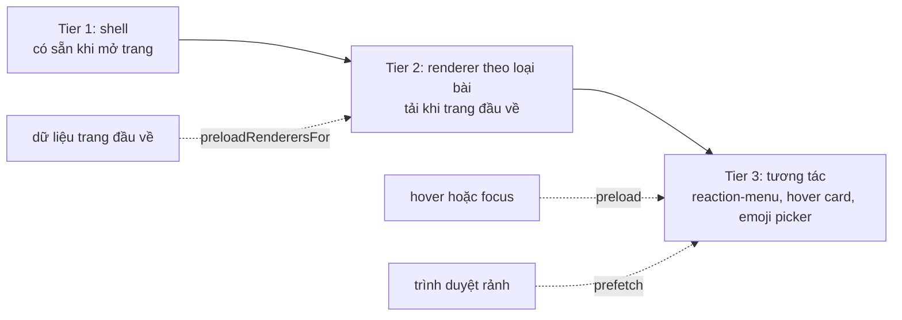
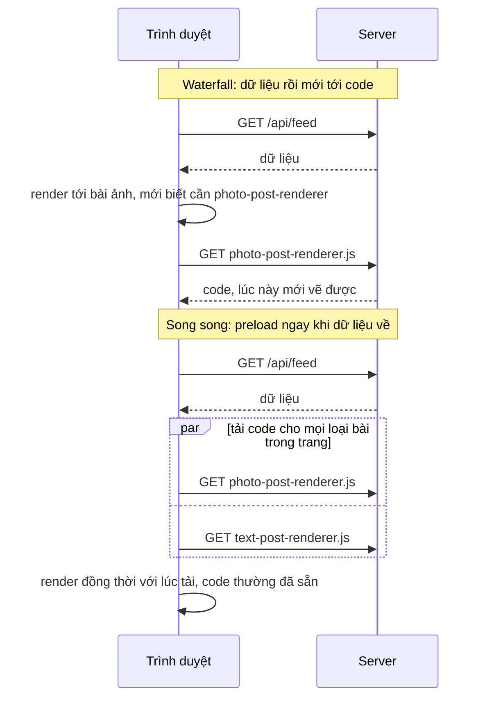

# Lesson 10 – Lazy-load code, JS tiers và composer sinh entity

> **Mục tiêu:** học xong lesson này bạn giải thích được vì sao chia JS thành các tầng (tier) và tải trước đúng lúc, tự cài được `lazyWithPreload` dùng chung một Promise cho `React.lazy` và `preload()`, phân biệt waterfall "dữ liệu rồi mới tới code" với tải song song, và hiểu vì sao composer phải chuẩn hoá NFC trước khi tính offset UTF-16 của entity.
>
> **Cần biết trước:** lesson 01 (các layer), lesson 04 (`useFeedLoader`), lesson 05 (reaction picker), lesson 06 (composer, idempotency key, entity trong `PostBody`), khái niệm `import()` động và `React.Suspense`.

| File | Vai trò |
|---|---|
| `src/lessons/10-lazy-loading/lesson-10-lazy-loading.tsx` | Ghép lesson: prefetch theo dữ liệu, prefetch lúc rảnh, composer |
| `src/shared/lazy/lazy-with-preload.ts` | `lazyWithPreload` và `preloadOnIdle` |
| `src/shared/lazy/chunk-error-boundary.tsx` | Chunk phụ hỏng không làm sập cây React |
| `src/lessons/10-lazy-loading/post-renderer-registry.ts` | Loại bài → renderer, mỗi loại một chunk |
| `src/lessons/10-lazy-loading/lazy-post-card.tsx` | Thẻ bài: Suspense và khung giữ chỗ cùng kích thước |
| `src/lessons/10-lazy-loading/author-name-with-hover-card.tsx` | Tên tác giả và hover card tải lười |
| `src/lessons/10-lazy-loading/entity-aware-composer.tsx` | Composer: preview, paste, emoji picker tải lười |
| `src/lessons/10-lazy-loading/composer-entity-parser.ts` | Text → `{ text, entities }` |
| `src/lessons/10-lazy-loading/composer-text-utils.ts` | Lọc text dán vào, chèn text không cắt đôi emoji |
| `src/lessons/10-lazy-loading/js-tiers-and-chunks-panel.tsx`, `use-loaded-js-chunks.ts` | Bảng quan sát tier và chunk đã tải |
| `server/src/routes/post-routes.ts` | Validate body và NFC ở server |

## 1. React.lazy và preload dùng chung một Promise

### Trong bài viết
Bài GreatFrontEnd đề cập tới việc giảm lượng JavaScript tải lúc đầu bằng cách tách code (code splitting) và chỉ tải phần cần thiết khi cần. Xem phần về hiệu năng trong [bài gốc](https://www.greatfrontend.com/questions/system-design/news-feed-facebook?format=system-design). Vấn đề: "tải lúc bấm" làm giao diện khựng một nhịp chờ mạng. Lời giải: **dự đoán ý định** và gọi `preload()` sớm để lúc cần, chunk đã nằm sẵn.

### Code thật

```learn
src/shared/lazy/lazy-with-preload.ts#lazy-with-preload
```

1. `factory` là hàm trả `import('./...')`. `promise` giữ kết quả ở biến đóng gói (closure).
2. `load()` chỉ gọi `factory()` **một lần**. Mọi lần gọi sau (từ `React.lazy`, từ `preload()` ở hover, từ prefetch lúc rảnh) nhận lại **cùng một Promise**.
3. `React.lazy(load)` và `Component.preload = load` dùng **chung** `load`. Đây là điều quan trọng nhất của file.
4. Nếu tải lỗi (mất mạng giữa chừng), `promise.catch` đặt `promise = null` để lần `preload()` sau **thử lại**, thay vì kẹt vĩnh viễn với Promise đã reject. (`React.lazy` tự nó vẫn nhớ lỗi, nên mới cần boundary và tải lại trang.)

```learn
src/shared/lazy/chunk-error-boundary.tsx#chunk-error-boundary
```

1. `getDerivedStateFromError` chuyển sang trạng thái `failed` ngay khi một con ném lỗi (ở đây là `React.lazy` reject vì không tải được chunk).
2. `componentDidCatch` ghi log tên chunk để biết chunk nào hỏng.
3. `render` trả `fallback` nếu có (có thể là `null`), mặc định là dòng chữ nhỏ "Không tải được ... Tải lại trang để thử lại". Chunk phụ (menu, hover card) hỏng chỉ nên làm mất tính năng phụ, còn feed vẫn dùng được.

```learn
src/lessons/10-lazy-loading/lazy-post-card.tsx#card-fallback-same-size
src/lessons/10-lazy-loading/lazy-post-card.tsx#card-suspense-boundary
```

1. `getPostKind` quyết định loại bài, `POST_RENDERERS[kind]` là component tải lười tương ứng.
2. Khung giữ chỗ (`fallbackStyle`) dùng `aspect-ratio` lấy từ metadata ảnh đã có sẵn trong feed response. Nhờ vậy renderer tải xong không làm layout nhảy (CLS).
3. `ChunkErrorBoundary` bọc ngoài, `Suspense` bọc trong: đang tải thì hiện khung giữ chỗ, lỗi thì hiện thông báo gọn.

### Vì sao làm vậy

| Cách | Ưu | Nhược | Khi nào chọn |
|---|---|---|---|
| `lazyWithPreload` chung một Promise (project dùng) | Gọi `factory` đúng một lần; test và đo dễ; preload và render không tải hai lần | Cần một hàm bọc nhỏ | Code tương tác (menu, picker, hover card) |
| `React.lazy` trần, không preload | Ít code nhất | Lần dùng đầu khựng chờ mạng | Trang ít dùng, chấp nhận chờ |
| Mỗi nơi tự gọi `import()` riêng | Không cần bọc | Trình duyệt vẫn dedupe module nhưng bạn mất kiểm soát, khó đo, khó test | Không khuyến nghị |
| Nhét hết vào bundle đầu | Không bao giờ chờ | Bundle đầu to, trang đầu chậm | App rất nhỏ |

### Lỗi hay gặp
- **Promise reject kẹt vĩnh viễn:** nếu giữ `promise` đã lỗi thì mọi lần `preload()` sau đều nhận lại lỗi. Project đặt lại `promise = null` khi lỗi.
- **Không có error boundary:** một chunk lỗi làm **sập cả cây React** (màn hình trắng). Mọi component tải lười nên có `ChunkErrorBoundary`.
- **Khung giữ chỗ khác kích thước thật:** layout nhảy khi chunk về. Ảnh dùng `aspect-ratio` đã biết trước từ metadata.
- **`preload()` không xoá hẳn thời gian chờ:** chỉ rút ngắn. Lần hover đầu tiên mạng chậm vẫn có thể thấy khung giữ chỗ.

### Tự thử
1. Mở `#/lesson-10`, tab **🧪 Demo**. Mở DevTools → Network, lọc JS, tải lại trang.
2. Quan sát bảng **JS tiers** và **Chunk JS đã tải**: lúc đầu chưa có `reaction-menu`, `author-hover-card`, `emoji-picker`.
3. Trong DevTools chọn throttling **Slow 4G**, di chuột vào thanh reaction của một bài: thấy khung giữ chỗ cùng kích thước rồi menu hiện đúng chỗ đó, bố cục xung quanh không nhảy.
4. Chặn một chunk để mô phỏng lỗi: Network → chuột phải request `reaction-menu...` → Block request URL, tải lại và hover. Kết quả mong đợi: chỉ chỗ đó hiện thông báo "Không tải được ...", phần còn lại của feed vẫn dùng được; Console có dòng `[lazy] không tải được chunk`.

### Câu hỏi phỏng vấn
1. Vì sao `React.lazy` và `preload()` phải dùng chung một Promise, và nếu tải lỗi thì xử lý ra sao?
   > Dùng chung thì `import()` chỉ bị gọi một lần dù có nhiều nơi kích hoạt, và render dùng đúng kết quả mà preload đã tải. Nếu lỗi thì đặt lại biến Promise để lần preload sau thử lại; còn `React.lazy` nhớ lỗi nên cần error boundary và tải lại trang.

## 2. JS tiers và preload theo dữ liệu (tránh waterfall)

### Trong bài viết
Bài nói tới việc chia JavaScript theo mức độ cần thiết và, với feed nhiều loại bài (chữ, ảnh, link...), mỗi loại có renderer riêng. Câu hỏi hay: làm sao biết cần tải renderer nào mà không phải chờ? Bài nhắc tới ý tưởng gửi **thông tin về renderer cùng với dữ liệu** (kiểu `@match` của Relay) để client tải code song song với dữ liệu. Xem phần về hiệu năng trong [bài gốc](https://www.greatfrontend.com/questions/system-design/news-feed-facebook?format=system-design). Lesson này mô phỏng ý tưởng đó ở phía client.

### Code thật

```learn
src/lessons/10-lazy-loading/js-tiers-and-chunks-panel.tsx#tiers-definition
```

1. **Tier 1 (shell):** router, layout, khung bài, store. Có ngay khi mở trang.
2. **Tier 2 (renderer theo loại bài):** `photo`, `link`, `text`. Tải ngay khi trang đầu về.
3. **Tier 3 (tương tác):** `reaction-menu`, `author-hover-card`, `emoji-picker`. Tải khi người dùng có ý định (hover/focus/bấm) hoặc lúc trình duyệt rảnh.
4. Trường `match` là từ khoá trong tên file để bảng biết chunk nào đã tải thật.

```learn
src/lessons/10-lazy-loading/post-renderer-registry.ts#post-kind-and-renderers
src/lessons/10-lazy-loading/post-renderer-registry.ts#preload-renderers-for
```

1. `getPostKind`: có ảnh thì `photo`; không ảnh nhưng có entity `link` thì `link`; còn lại là `text`. Ảnh được ưu tiên hơn link.
2. `POST_RENDERERS` map từng loại tới một `lazyWithPreload(() => import(...))`, tức mỗi loại là **một chunk riêng**. Feed toàn bài chữ thì không bao giờ tải renderer ảnh hoặc link.
3. `preloadRenderersFor(posts)` gom các loại bài **khác nhau** bằng `Set`, rồi `Promise.allSettled` để tải **song song**. Một chunk lỗi không làm hỏng các chunk còn lại.

```learn
src/lessons/10-lazy-loading/lesson-10-lazy-loading.tsx#prefetch-renderers-by-data
```

1. Effect chạy mỗi khi danh sách `postIds` đổi (trang mới về store).
2. Lấy các bài từ store, tính `getPostKind`, lọc các loại **chưa log** để panel nhật ký không lặp.
3. `preloadRenderersFor(posts)` được gọi ngay lúc dữ liệu về, chứ không chờ tới lúc render từng bài.
4. Chỉ phụ thuộc `postIds`, vì `postsById` đổi theo reaction nhưng **loại bài thì không đổi**.

```learn
src/lessons/10-lazy-loading/use-loaded-js-chunks.ts#observe-loaded-chunks
```

1. `PerformanceObserver` với `type: 'resource'` và `buffered: true` nhận cả entry **đã có** lẫn entry **mới**, không cần polling.
2. `toLoadedChunk` chỉ giữ file JS của app (`/src/` khi dev, `/assets/` khi build).
3. Chuẩn hoá khoá `path + startTime` để không thêm trùng, rồi sắp theo `startTime`. Đây là cách bạn **thấy bằng mắt** chunk nào tải lúc nào.





### Vì sao làm vậy

| Cách | Ưu | Nhược | Khi nào chọn |
|---|---|---|---|
| Preload theo dữ liệu trang đầu (project dùng) | Code tải song song với render; loại bài ở trang sau cũng đã có code | Chỉ biết loại khi dữ liệu về, vẫn sau một RTT | Có nhiều loại renderer, loại phụ thuộc dữ liệu |
| Server gửi kèm tên renderer (Relay `@match`, data-driven dependencies) | Có thể bắt đầu tải code ngay cùng lúc với dữ liệu | Cần hợp đồng server–client và bundler hỗ trợ | Hệ thống lớn, có GraphQL/Relay |
| Chỉ tải khi render tới bài (waterfall) | Đơn giản | Thời gian = (tải dữ liệu) + (tải code) | Không khuyến nghị cho đường đầu |
| Gom mọi renderer vào bundle đầu | Không có chunk phụ | Feed toàn chữ vẫn phải tải code ảnh và link | App rất nhỏ, ít loại |

### Lỗi hay gặp
- **Waterfall dữ liệu rồi mới tới code:** chỉ tải renderer khi render tới bài thuộc loại đó nghĩa là thêm một vòng mạng nữa. `preloadRenderersFor` chạy ngay lúc store nhận trang.
- **Effect chạy lại vô ích:** phụ thuộc `postsById` làm effect chạy mỗi lần có reaction. Phụ thuộc `postIds` thôi, kèm comment giải thích vì sao. Repo không dùng ESLint nên không có quy tắc nhắc nhở.
- **`Promise.all` làm một chunk lỗi chặn tất cả:** dùng `allSettled` để chunk khác vẫn tải.
- **Bảng chunk "tràn" trong dev:** buffer resource timing mặc định chỉ chứa 250 entry, dev tải hàng trăm module nên bảng chỉ mang tính minh hoạ.

### Tự thử
1. Mở `#/lesson-10`, DevTools → Network lọc JS, bấm **Disable cache** rồi tải lại trang.
2. Nhìn bảng **JS tiers**: cột **Đã tải** của Tier 2 hiện `n/3` (chỉ các loại bài thật sự **có** trong trang đầu); Tier 3 là `0/3`.
3. Xem log: có dòng `📦 dữ liệu về → preloadRenderersFor: ...` liệt kê loại bài.
4. So thời gian: trong Network, các request renderer bắt đầu **gần như cùng lúc** ngay sau `/api/feed`, không nối đuôi nhau theo từng bài.
5. Ghi chú môi trường: ở `npm run dev` chunk là module `/src/...tsx`; ở bản build là `/assets/<tên>-<hash>.js`.

### Câu hỏi phỏng vấn
1. Code nào nên tải lười, và "waterfall dữ liệu rồi mới tới code" là gì, tránh thế nào?
   > Code không cần cho lần vẽ đầu tiên: menu, hover card, picker, renderer của loại bài hiếm. Waterfall là tải dữ liệu xong mới biết cần renderer nào rồi mới tải code, tổng thời gian cộng dồn. Tránh bằng cách preload ngay khi dữ liệu về (hoặc gửi kèm thông tin renderer trong response, kiểu Relay `@match`) để code tải song song với render.

## 3. Prefetch theo ý định: hover, focus và lúc rảnh

### Trong bài viết
Bài nêu các chiến lược prefetch: tải trước khi người dùng có dấu hiệu sắp dùng, và tận dụng thời gian rảnh của trình duyệt cho việc ưu tiên thấp. Xem phần về tối ưu tải trong [bài gốc](https://www.greatfrontend.com/questions/system-design/news-feed-facebook?format=system-design). Lesson cài ba kiểu: **hover/focus**, **idle** và **theo dữ liệu** (khái niệm 2).

### Code thật

```learn
src/lessons/10-lazy-loading/author-name-with-hover-card.tsx#hover-card-trigger-preload
```

1. `onPointerEnter` gọi `preloadAuthorHoverCard()` rồi hẹn `openNow` sau **300ms**. Trong 300ms chờ đó mạng đã bắt đầu làm việc rồi.
2. Độ trễ 300ms tránh bật card khi chuột chỉ lướt qua.
3. `onFocus` cũng preload và mở **ngay**: người dùng bàn phím không bị bỏ lại. Ghi chú trong file: nút tên là một tab stop mỗi bài, giữ lại cố ý.
4. `onPointerLeave` hẹn đóng sau 150ms để có thời gian di chuột vào chính card.
5. `onClick={openNow}` vì Safari không focus `<button>` khi click chuột; `openNow` idempotent nên không đóng nhầm.

```learn
src/lessons/10-lazy-loading/author-name-with-hover-card.tsx#hover-card-lazy-portal
```

1. Card chỉ render khi có `anchor` (đang mở).
2. `createPortal(..., document.body)` để card không bị `overflow` của feed cắt, và không lọt vào tên accessible của `<h3>` (vì `aria-labelledby` của bài trỏ vào heading chứa tên).
3. Trong portal vẫn có `ChunkErrorBoundary` (với `fallback={null}`, tức lỗi chunk thì card đơn giản không hiện) và `Suspense` với khung giữ chỗ.

Dữ liệu hover card hiển thị đã có sẵn trong feed, nên chỉ cần tải **code**, không cần gọi thêm API:

```learn
shared-contracts/feed-api-contracts.ts#contract-user-relationship
```

1. `RelationshipToViewer` (`isSelf`, `isFriend`, `isFollowing`) do server tính theo session, nên cùng một user nhưng mỗi người xem thấy khác nhau.
2. Trường này là optional: chỉ có khi response được cá nhân hoá (feed, chi tiết bài). Component phải xử lý trường hợp thiếu.
3. Vì feed trả kèm sẵn, hover card mở xong là hiện ngay "Bạn bè" / "Đang theo dõi", không có thêm một vòng request (tránh waterfall dữ liệu sau waterfall code).

```learn
src/lessons/10-lazy-loading/entity-aware-composer.tsx#emoji-toggle-preload
```

1. Nút 😊 preload ở `onPointerEnter` và `onFocus`, vẫn chỉ mở picker khi `onClick`.
2. `aria-expanded` và `aria-controls` cho trình đọc màn hình.

```learn
src/shared/lazy/lazy-with-preload.ts#preload-on-idle
src/lessons/10-lazy-loading/lesson-10-lazy-loading.tsx#prefetch-tier-3-on-idle
```

1. `preloadOnIdle` dùng `requestIdleCallback` (có `timeout: 2000` để không chờ vô hạn), trả về hàm huỷ để dùng trong cleanup của `useEffect`.
2. Safari chưa có `requestIdleCallback` nên rơi về `setTimeout(task, 200)`.
3. Trong lesson, hộp kiểm **Prefetch Tier 3 khi trình duyệt rảnh** bật effect này: ba chunk Tier 3 được tải mà không cần hover.
4. Đây là prefetch **ưu tiên thấp**: không tranh băng thông và CPU với việc render nội dung chính.

### Vì sao làm vậy

| Cách | Ưu | Nhược | Khi nào chọn |
|---|---|---|---|
| Hover/focus preload (project dùng cho Tier 3) | Chỉ tải thứ có khả năng dùng; có cả đường bàn phím | Chỉ rút ngắn chờ, không xoá | Menu, hover card, picker |
| Idle prefetch | Tận dụng thời gian rảnh; lần dùng đầu không khựng | Tốn dữ liệu cho thứ có thể không dùng (cân nhắc trên mạng di động) | Thứ chắc chắn sẽ dùng |
| Tải khi bấm | Không tốn gì thừa | Khựng một nhịp chờ mạng | Tính năng rất ít dùng |
| Preload tất cả ngay từ đầu | Không bao giờ chờ | Quay lại vấn đề bundle to và tranh băng thông | Không khuyến nghị |

### Lỗi hay gặp
- **Lời dạy lệch với hành vi thật (từ code review):** thanh reaction có sẵn `onMouseEnter` mở menu ngay, nên chunk bắt đầu tải do **render** menu, trước cả khi `pointerenter` của nút ▾ chạy. Lời dạy cũ "preload khi hover ▾" không đúng cơ chế. Project chỉnh lại lời dạy cho khớp: `pointerenter` của **cả thanh** kích hoạt preload, và preload chỉ rút ngắn thời gian chờ chứ không xoá nó (khung giữ chỗ cùng kích thước che khoảng chờ).
- **Chỉ có đường chuột:** hover card phải mở được bằng focus bàn phím, nếu không người dùng bàn phím không bao giờ thấy.
- **Card bật khi chuột lướt qua:** cần độ trễ mở (300ms).
- **Quên dọn timer:** virtualization gỡ bài khỏi DOM bất kỳ lúc nào; `useEffect(() => clearTimer, [])` dọn khi unmount.
- **Toạ độ `fixed` lệch khi cuộn:** card đóng khi cuộn hoặc đổi kích thước.

### Tự thử
1. Tải lại `#/lesson-10`. Di chuột vào **thanh reaction** của một bài (không cần tới nút ▾). Kết quả mong đợi: menu mở ngay, và chunk `reaction-menu` xuất hiện trong bảng **Chunk JS đã tải** ngay lúc đó.
2. Di chuột vào tên tác giả và giữ khoảng 300ms (hoặc nhấn Tab tới tên). Kết quả mong đợi: hover card hiện tên, handle, trạng thái "Bạn bè/Đang theo dõi" (dữ liệu có sẵn trong feed, chỉ tải code). Nhấn **Esc** để đóng.
3. Bấm 😊 ở composer: chunk `emoji-picker` tải lười; thử Tab tới nút để thấy preload bằng focus.
4. Bật **Prefetch Tier 3 khi trình duyệt rảnh** rồi tải lại trang. Kết quả mong đợi: log có `💤 trình duyệt rảnh → prefetch reaction-menu, author-hover-card, emoji-picker` và cột Tier 3 lên `3/3` mà không cần hover.

### Câu hỏi phỏng vấn
1. Có những cách prefetch nào, và chọn cách nào cho thứ gì?
   > Theo ý định (hover/focus) cho tương tác có thể không dùng, theo dữ liệu (ngay khi biết loại) cho thứ chắc chắn cần cho trang hiện tại, và lúc rảnh (`requestIdleCallback`) cho thứ ưu tiên thấp. Cân nhắc dữ liệu di động khi prefetch thứ có thể không dùng.

## 4. Composer sinh entity: NFC trước, offset UTF-16 sau

### Trong bài viết
Bài nói tới composer: văn bản bài đăng có thể chứa mention, hashtag và link, và server lưu chúng dưới dạng **entity** (đoạn `[start, end)` kèm loại) thay vì HTML. Xem phần về đăng bài trong [bài gốc](https://www.greatfrontend.com/questions/system-design/news-feed-facebook?format=system-design). Khó ở chỗ offset phụ thuộc cách đếm ký tự, nên client và server phải thống nhất cùng một dạng chuỗi.

### Code thật

```learn
src/lessons/10-lazy-loading/composer-entity-parser.ts#entity-pattern-single-regex
```

1. `WORD` là các ký tự "thuộc về từ" (`\p{L}\p{N}_`) dùng cho lookbehind, để không bắt nhầm `mail@host` hay `abc#def`.
2. **Một regex duy nhất** có ba nhóm: link, hashtag, mention, quét từ trái sang phải. Mỗi match tiêu thụ đoạn của nó nên **không thể có hai entity giao nhau** (ví dụ `#tag` nằm trong URL chỉ thuộc về link).
3. Cờ `u` bật chế độ Unicode (cho `\p{L}`), cờ `g` để `matchAll`.

```learn
src/lessons/10-lazy-loading/composer-entity-parser.ts#parse-composer-text
```

1. `rawText.normalize('NFC')` **trước tiên**. "ệ" có thể là một ký tự (NFC) hoặc `e` cộng hai dấu kết hợp (NFD, macOS/IME hay sinh ra). Offset tính trên NFD sẽ lệch so với NFC.
2. Với mỗi match, `start = match.index` đã đúng đơn vị **UTF-16 code unit** (giống `String.slice`). Emoji (2 code unit) đứng trước entity vẫn cho offset đúng.
3. Link: cắt dấu câu cuối (`TRAILING_URL_PUNCTUATION`) và chỉ nhận `http` hoặc `https`.
4. Hashtag: phải có ít nhất một chữ cái (`#123` không phải hashtag), lưu dạng **thường** bằng `toLowerCase()`, không phải `toLocaleLowerCase()` vì kết quả không được phụ thuộc locale máy (locale Thổ Nhĩ Kỳ biến `I` thành `ı`).
5. Mention: chỉ thành entity khi `@handle` khớp một user **đã biết**; không thì chỉ là chữ thường (server từ chối `userId` không tồn tại).
6. Trả về **text đã chuẩn hoá** để gửi đi, vì chính chuỗi đó mới khớp với offset.

Phía server phải khớp:

```learn
server/src/routes/post-routes.ts#validate-post-body-nfc
```

1. Kiểm kiểu, độ dài, số entity tối đa.
2. Nếu `text !== text.normalize('NFC')`: có entity thì **từ chối 400** `TEXT_NOT_NFC` (không thể đoán lại offset); không có entity thì **tự chuẩn hoá** rồi lưu.
3. Sắp entity theo `start`, rồi kiểm không chồng lấn.
4. Mention phải trỏ tới user có thật (`getUsersByIds`).

### Vì sao làm vậy

| Cách | Ưu | Nhược | Khi nào chọn |
|---|---|---|---|
| Suy ra entity từ text thuần bằng parser thuần (project dùng) | Preview và dữ liệu gửi cùng một parser, không lệch; dễ test | Phải chạy parser mỗi lần render preview | Composer đơn giản dùng `<textarea>` |
| `contenteditable` giữ entity trong DOM | Giữ được chip mention | Phức tạp, dễ lỗi con trỏ, IME | Editor giàu tính năng |
| Lưu HTML | Dễ hiển thị | Rủi ro XSS, khó ràng buộc | Không khuyến nghị |
| Đếm theo code point thay vì UTF-16 | Gần với "ký tự" người dùng thấy | Lệch với `String.slice`/`substring` trong JS | Nếu cả hai đầu đều đếm code point |

### Lỗi hay gặp
- **Server từ chối mọi text không phải NFC làm vỡ lesson 06:** bản đầu trả 400 `TEXT_NOT_NFC` cho **mọi** text NFD (dán từ tên file macOS, PDF, vài bộ gõ) kể cả khi không có entity, trong khi lesson 06 không chuẩn hoá. Code review phát hiện đây là phá hợp đồng cũ. Project nới lại: chỉ từ chối khi **có entity** (lúc đó offset mới có nghĩa), còn không thì server tự chuẩn hoá.
- **Chuẩn hoá NFC lúc đang gõ:** phá việc ghép chữ của IME. Composer chỉ chuẩn hoá khi **parse và gửi**.
- **Hashtag lưu `toLocaleLowerCase`:** kết quả khác nhau theo locale máy. Dùng `toLowerCase`.
- **Entity chồng lấn:** nếu dùng nhiều regex riêng cho link, hashtag, mention thì `#tag` trong URL bị tính hai lần.

### Tự thử
1. Ở `#/lesson-10`, gõ vào composer: `Chào @<handle> #frontend https://example.com`, trong đó `<handle>` là một handle **có thật trong feed đang tải** (nhãn phía trên ô soạn gợi ý sẵn một handle, hoặc bấm một nút trong hàng "Chèn nhanh @handle"). `@an1` chỉ là chữ mẫu khi feed chưa có user nào; với dữ liệu seed hiện tại không có ai mang handle đó, nên nó không thành mention.
2. Kết quả mong đợi: **Preview** hiện đúng định dạng, danh sách entity bên dưới ghi `link`, `hashtag`, `mention` kèm `[start, end)` và chữ thật.
3. Gõ `@khongcoai`: không thành entity (chỉ là chữ thường). Gõ `😊 @<handle>` (cùng handle ở bước 1): offset của mention tăng thêm 3 so với khi không có emoji (emoji chiếm 2 code unit, cộng một dấu cách).
4. Thử server trực tiếp (không ghi dữ liệu vì bị từ chối), dùng `Việt` là "Việt" dạng NFD:
   ```bash
   curl -i -X POST http://localhost:3001/api/posts \
     -H 'Content-Type: application/json' -H 'Idempotency-Key: thu-nfd-1' \
     -d '{"body":{"text":"Việt #a","entities":[{"type":"hashtag","start":7,"end":9,"tag":"a"}]},"mediaIds":[]}'
   ```
   Kết quả mong đợi: `400` với mã `TEXT_NOT_NFC`.
5. Chạy `npx vitest run src/lessons/10-lazy-loading` để xem test của parser.

### Câu hỏi phỏng vấn
1. Vì sao phải chuẩn hoá NFC trước khi tính offset của entity?
   > Cùng một chữ có dấu có thể được biểu diễn bằng số code unit khác nhau (một ký tự NFC hoặc ký tự gốc cộng dấu kết hợp NFD), nên offset tính trên hai dạng sẽ khác. Client và server phải thống nhất cùng một dạng (NFC) trước khi tính và kiểm offset.

## 5. Paste an toàn và chèn text không cắt đôi emoji

### Trong bài viết
Bài nói tới việc composer nhận nội dung do người dùng nhập, trong đó dán từ nơi khác là cửa ngõ rủi ro. Xem phần về soạn bài trong [bài gốc](https://www.greatfrontend.com/questions/system-design/news-feed-facebook?format=system-design). Chiến lược của lesson: **không tin định dạng từ ngoài**, chỉ lấy text thuần rồi lọc.

### Code thật

```learn
src/lessons/10-lazy-loading/entity-aware-composer.tsx#composer-paste-handler
```

1. `event.preventDefault()` chặn hành vi dán mặc định (có thể kéo theo HTML, style, script rác).
2. Chỉ lấy `text/plain`. Ghi nhận lượng `text/html` bị **bỏ** vào log.
3. `sanitizePastedText` lọc, tính số ký tự bị loại để hiển thị trong log.
4. `insertText(clean)` chèn vào đúng vị trí con trỏ.

```learn
src/lessons/10-lazy-loading/composer-text-utils.ts#sanitize-pasted-text
```

1. Chuẩn hoá xuống dòng `\r\n` thành `\n` và dấu phân cách dòng Unicode (U+2028, U+2029).
2. Loại ký tự điều khiển C0/C1 (trừ tab và xuống dòng), ký tự vô hình (zero-width space, word joiner, BOM) và các ký tự điều khiển hướng chữ (bidi override, embedding, isolate) dùng để giả mạo hiển thị hoặc đảo thứ tự.
3. Cố ý **giữ ZWJ** (U+200D, ghép emoji gia đình), **ZWNJ** (U+200C, chữ Ba Tư) và dấu hướng LRM/RLM (chữ RTL hợp lệ dùng chúng).
4. Regex được dựng từ mã số bằng `String.fromCodePoint` thay vì gõ ký tự vô hình vào regex literal: đọc được, và editor không làm mất ký tự.

```learn
src/lessons/10-lazy-loading/composer-text-utils.ts#splice-without-cutting-surrogate
```

1. Chuẩn hoá khoảng chọn `[start, end)` trong `[0, value.length]`.
2. `room` là chỗ còn lại dưới `maxLength` sau khi bỏ đoạn đang chọn.
3. Nếu điểm cắt rơi **giữa một cặp surrogate** (emoji), lùi một đơn vị để không để lại nửa emoji.
4. Trả `caret` mới để đặt lại con trỏ sau khi React cập nhật giá trị.

### Vì sao làm vậy

| Cách | Ưu | Nhược | Khi nào chọn |
|---|---|---|---|
| Chặn paste, lấy `text/plain` rồi lọc (project dùng) | Không nhận HTML hay ký tự giả mạo; kiểm soát hoàn toàn | Mất định dạng người dùng muốn giữ (nếu có) | Composer văn bản thuần |
| Để paste mặc định | Không tốn code | HTML, style, ký tự vô hình lọt vào | Không khuyến nghị |
| Làm sạch HTML bằng thư viện | Giữ được định dạng an toàn | Thêm phụ thuộc, bề mặt tấn công lớn hơn | Editor giàu định dạng |
| Chỉ lọc ở server | Một chỗ | Offset đã tính trên text chưa lọc → lệch | Chỉ làm thêm, không thay thế lọc ở client |

### Lỗi hay gặp
- **Xoá nhầm ZWJ:** emoji ghép (👨‍👩‍👧) vỡ thành ba emoji rời. Danh sách loại có chủ đích **không** gồm U+200D.
- **Cắt `slice` giữa surrogate:** để lại ký tự hỏng `�`. Dùng `spliceAtSelection` thay vì cắt thô.
- **Ký tự bidi đảo thứ tự hiển thị:** một link trông như `example.com` nhưng thật ra trỏ nơi khác. Bị lọc.
- **Chỉ tin lọc ở server:** vì offset entity tính ở client, text phải được làm sạch **trước** khi tính offset.

### Tự thử
1. Ở `#/lesson-10`, mở một trang web có chữ định dạng, copy một đoạn có chữ đậm/màu rồi dán (Cmd hoặc Ctrl cộng V) vào composer.
2. Kết quả mong đợi: chỉ còn **text thuần**. Log ghi `📋 paste: lấy text/plain (N ký tự), BỎ text/html (M ký tự)`.
3. Dán chuỗi có ký tự vô hình: trong Console chạy `copy('a​b‮c')` rồi dán. Kết quả mong đợi: log ghi `loại 2 ký tự điều khiển/zero-width` (hoặc con số tương ứng).
4. Bấm 😊 rồi chọn emoji: emoji chèn đúng chỗ con trỏ, con trỏ đứng sau emoji, picker đóng và focus về ô soạn.

### Câu hỏi phỏng vấn
1. Vì sao composer chặn paste mặc định và chỉ lấy `text/plain`?
   > Clipboard có thể chứa HTML với style hoặc script rác, ký tự điều khiển và ký tự vô hình dùng để giả mạo hoặc làm lệch offset của entity. Không tin định dạng từ ngoài: lấy text thuần rồi lọc, giữ lại các ký tự hợp lệ như ZWJ của emoji ghép.

## Tóm tắt
- Chia JS thành tier: shell có ngay, renderer theo loại bài tải khi dữ liệu về, tương tác tải theo ý định hoặc lúc rảnh.
- `lazyWithPreload` cho `React.lazy` và `preload()` dùng chung một Promise của `import()`; bọc bằng `Suspense` (khung giữ chỗ cùng kích thước để không nhảy layout) và `ChunkErrorBoundary` (chunk phụ lỗi không sập cả cây).
- Tránh waterfall dữ liệu rồi mới tới code bằng cách `preloadRenderersFor` ngay khi trang đầu về; preload chỉ rút ngắn thời gian chờ chứ không xoá nó.
- Entity của composer: chuẩn hoá NFC trước, rồi tính offset theo UTF-16 bằng một regex duy nhất để không chồng lấn; server chỉ từ chối non-NFC khi có entity, nếu không thì tự chuẩn hoá.
- Paste: chặn mặc định, chỉ lấy `text/plain`, lọc ký tự điều khiển, zero-width và bidi (giữ ZWJ/ZWNJ), và chèn text không cắt đôi cặp surrogate.
