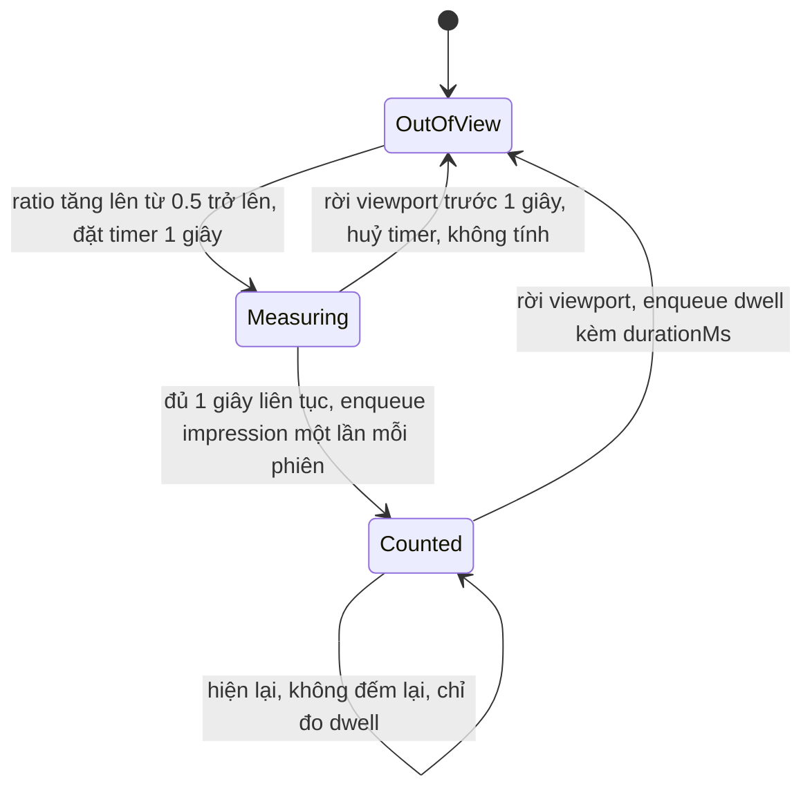
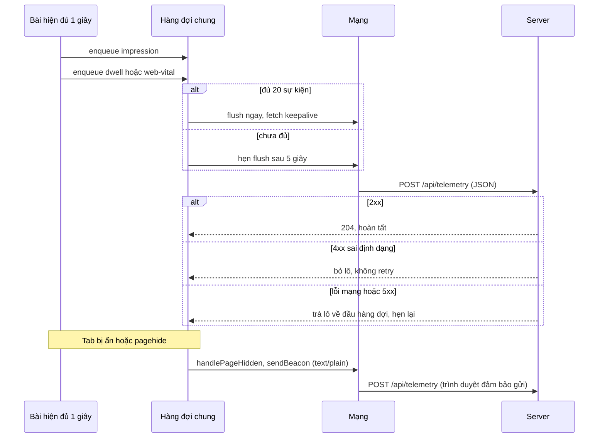

# Lesson 11 – Đo lường và telemetry: impression, Web Vitals, beacon

> **Mục tiêu:** học xong lesson này bạn giải thích được vì sao "nhanh" phải là con số đo trên người dùng thật, định nghĩa được một lượt hiển thị (impression) chặt chẽ, tự cài được hàng đợi gửi theo lô có beacon khi rời trang, và hiểu server tổng hợp p75 ra sao.
>
> **Cần biết trước:** lesson 04 (IntersectionObserver trong `useIntersectionSentinel`), lesson 05 (store có reaction), khái niệm `visibilitychange` và `fetch`.

| File | Vai trò |
|---|---|
| `src/lessons/11-metrics-telemetry/impression-tracker.ts` | Lớp `ImpressionTracker`: đếm impression và dwell, hàng đợi, gửi lô. Mọi phụ thuộc môi trường được truyền vào để test bằng fake timer |
| `src/lessons/11-metrics-telemetry/use-impression-tracking.ts` | Hook nối tracker và Web Vitals vào React |
| `src/lessons/11-metrics-telemetry/web-vitals-observer.ts` | LCP, CLS, INP (gần đúng) và long task bằng `PerformanceObserver` |
| `src/lessons/11-metrics-telemetry/web-vitals-rating.ts` | Budget và xếp hạng tốt, cần cải thiện, kém |
| `src/lessons/11-metrics-telemetry/changed-final-vitals.ts` | Chỉ gửi vital chốt khi giá trị đổi |
| `src/lessons/11-metrics-telemetry/lesson-11-metrics-telemetry.tsx`, `telemetry-panels.tsx` | UI và các panel quan sát |
| `src/shared/api/feed-api.ts` | `sendTelemetry` (fetch keepalive) |
| `shared-contracts/feed-api-contracts.ts` | Kiểu `TelemetryEvent` |
| `server/src/routes/telemetry-routes.ts` | Validate và nhận lô sự kiện |
| `server/src/data/feed-repository.ts`, `server/src/data/database-schema.ts` | Lưu sự kiện và tổng hợp |

## 1. Định nghĩa một lượt hiển thị (impression) và thời gian xem (dwell)

### Trong bài viết
Bài GreatFrontEnd nói tới việc đo lường: biết bài nào được người dùng thực sự nhìn thấy để phục vụ xếp hạng và phân tích. Xem phần về analytics và đo lường trong [bài gốc](https://www.greatfrontend.com/questions/system-design/news-feed-facebook?format=system-design). Điều quan trọng là phải **định nghĩa chặt** "đã xem" trước khi đếm, vì cuộn lướt qua một bài không phải là đã xem nó.

### Code thật

```learn
src/lessons/11-metrics-telemetry/impression-tracker.ts#impression-visibility-spans
```

1. `handleEntries` nhận các entry từ `IntersectionObserver`. `visible` chỉ đúng khi `isIntersecting` **và** `intersectionRatio >= 0.5`. Cần kiểm tra cả ratio vì ở ratio 0.3 thì `isIntersecting` vẫn là `true`.
2. Chỉ xử lý khi trạng thái đổi (`visible === post.inViewport`): tránh khởi động đoạn đo hai lần.
3. `startVisibleSpan` ghi `visibleSince` rồi đặt **timer 1 giây**. Hết giờ mà bài vẫn hiện liên tục thì `countedPostIds.add(postId)` và `enqueue` sự kiện `impression`.
4. Bài đã tính rồi thì **không** đặt timer nữa: mỗi bài chỉ tính một lần mỗi phiên, kể cả cuộn đi cuộn lại. `countedPostIds` theo `postId` chứ không theo element, nên bài bị gỡ khỏi DOM rồi gắn lại cũng không đếm lại.
5. `endVisibleSpan` huỷ timer nếu bài rời viewport trước 1 giây (cuộn lướt: **không** tính). Nếu bài đã được tính, đoạn vừa kết thúc được gửi dưới dạng sự kiện `dwell` với `durationMs`, server cộng dồn theo bài.
6. Khi trang bị ẩn (`pageHidden`), `startVisibleSpan` không đo. Trang hiện lại thì các bài vẫn trong viewport bắt đầu đoạn đo mới.

Một wrapper nhỏ để gắn ref và hiển thị trạng thái:

```learn
src/lessons/11-metrics-telemetry/lesson-11-metrics-telemetry.tsx#tracked-post-wrapper
```

1. Wrapper `<div>` giữ `ref` của tracker và `data-impressed`, nên **không phải sửa** `FeedPostArticle` dùng chung.
2. `memo` để chỉ bài vừa đổi trạng thái mới render lại, không phải cả feed mỗi lần có thêm một impression.



### Vì sao làm vậy

| Cách | Ưu | Nhược | Khi nào chọn |
|---|---|---|---|
| ≥ 50% hiện liên tục ≥ 1 giây, mỗi bài một lần mỗi phiên (project dùng) | Gần với "người dùng đã thấy"; không bị phình số khi cuộn qua lại | Bài cao hơn 2 lần viewport không bao giờ đạt 50% | Feed thông thường |
| Đếm ngay khi bài vào viewport | Đơn giản | Cuộn lướt cũng tính; số liệu phình | Ước lượng thô |
| Đếm mỗi lần hiện | Thấy được số lần quay lại | Một bài bị tính nhiều lần, khó so sánh | Khi cần "số lần xem" thay vì "đã xem hay chưa" |
| Chiếm ≥ 50% **viewport** (kiểu production) | Đúng cho bài rất cao | Phức tạp hơn một ngưỡng ratio | Có bài dài hơn màn hình |

### Lỗi hay gặp
- **Chỉ kiểm `isIntersecting`:** `true` ngay cả khi mới thấy một mẩu. Phải xét `intersectionRatio >= 0.5`.
- **Không huỷ timer khi bài rời viewport:** bài cuộn lướt vẫn bị tính sau 1 giây. `endVisibleSpan` huỷ timer.
- **Đếm theo element thay vì `postId`:** virtualization gỡ và gắn lại element nên bài bị đếm lại. Tập `countedPostIds` theo `postId`.
- **Đo khi tab ẩn:** thời gian dwell phình lên khi người dùng đi nơi khác. Ẩn trang thì chốt và dừng đo.
- **Giới hạn đã biết:** ngưỡng `ratio >= 0.5` nghĩa là bài cao hơn 2 lần viewport không bao giờ đạt. Code ghi rõ giới hạn này thay vì giấu.

### Tự thử
1. Mở `#/lesson-11`, tab **🧪 Demo**. Cuộn feed và **dừng khoảng 1 giây** ở mỗi bài.
2. Kết quả mong đợi: bài được viền xanh (`data-impressed="true"`), dòng "Đã tính N lượt hiển thị trong phiên này." tăng.
3. Cuộn lướt nhanh qua vài bài (dưới 1 giây mỗi bài): các bài đó **không** viền xanh.
4. Cuộn đi rồi quay lại bài đã viền xanh: bộ đếm **không** tăng thêm.
5. Chạy `npx vitest run src/lessons/11-metrics-telemetry` để xem các test dùng fake timer và fake observer cho tracker.

### Câu hỏi phỏng vấn
1. Một lượt hiển thị (impression) được định nghĩa thế nào, và vì sao?
   > Bài hiện ít nhất 50% diện tích trong ít nhất 1 giây liên tục, chỉ tính một lần mỗi phiên. Điều kiện chặt để cuộn lướt qua không bị tính là đã xem, và một lần mỗi phiên để số liệu không bị phình khi cuộn qua lại.

## 2. Gom lô và gửi bằng beacon khi rời trang

### Trong bài viết
Bài đề cập tới việc gửi dữ liệu phân tích mà không làm chậm ứng dụng. Xem phần về analytics trong [bài gốc](https://www.greatfrontend.com/questions/system-design/news-feed-facebook?format=system-design). Telemetry là việc **phụ**, nên: gom vào hàng đợi, gửi theo lô, và dùng cơ chế được trình duyệt đảm bảo khi trang đóng.

### Code thật

```learn
src/lessons/11-metrics-telemetry/impression-tracker.ts#tracker-enqueue-and-flush
```

1. `enqueue` đẩy sự kiện vào **một hàng đợi chung** (impression, dwell và web vital cùng đi một lô). Đủ `BATCH_SIZE = 20` thì `flush` ngay; chưa đủ thì `scheduleFlush` hẹn 5 giây (`FLUSH_INTERVAL_MS`).
2. `flush` xoá timer, `drain` tối đa 200 sự kiện (giới hạn của server), rồi `sendBatch`.
3. Thành công thì báo `onBatchSent({ method: 'fetch', ok: true })`.
4. Thất bại: hỏi `shouldRetry(error)`. Nếu **không** đáng gửi lại (4xx kiểu sai định dạng, quá lớn) thì **bỏ lô** và gọi `onBatchDropped`.
5. Còn lỗi mạng hoặc 5xx: trả lô về **đầu** hàng đợi (giữ thứ tự), cắt ở 1000 sự kiện để không phình vô hạn, rồi hẹn flush lại.

```learn
src/lessons/11-metrics-telemetry/impression-tracker.ts#tracker-page-hidden
src/lessons/11-metrics-telemetry/impression-tracker.ts#tracker-flush-with-beacon
```

1. `handlePageHidden` (gọi khi `visibilitychange` sang hidden hoặc `pagehide`) chốt đoạn đo của **mọi** bài đang xem (`endVisibleSpan`) để dwell không bị mất.
2. Rồi `flushWithBeacon`: lấy hàng đợi và gọi `sendBeacon`.
3. `sendBeacon` trả `false` nếu trình duyệt từ chối xếp hàng (ví dụ payload quá lớn). Khi đó thử `sendBatch` (fetch keepalive) như phương án dự phòng.
4. Cờ `pageHidden` chặn gọi hai lần liên tiếp (`visibilitychange` và `pagehide` thường bắn gần nhau).

```learn
src/lessons/11-metrics-telemetry/use-impression-tracking.ts#send-beacon-and-retry-policy
src/shared/api/feed-api.ts#feed-api-send-telemetry
```

1. `sendWithBeacon` đóng gói `{ events }` vào `Blob` kiểu **`text/plain`**. Đây là loại "CORS-safelisted": không gây preflight. Server đọc được cả JSON lẫn `text/plain`.
2. `isRetryableTelemetryError`: lỗi không phải `ApiError` (mất mạng) hoặc status 5xx/408/429 thì đáng gửi lại. 4xx còn lại nghĩa là lô bị từ chối vĩnh viễn.
3. `sendTelemetry` dùng `fetch` với **`keepalive: true`** (request vẫn đi dù trang đang đóng) và `credentials: 'same-origin'`.
4. Quan trọng: nếu `!response.ok` thì **ném `ApiError` mang status**, để hàng đợi phân loại được. Nuốt lỗi thì hàng đợi tưởng đã gửi xong.



### Vì sao làm vậy

| Cách | Ưu | Nhược | Khi nào chọn |
|---|---|---|---|
| Hàng đợi + lô + `sendBeacon` khi ẩn (project dùng) | Ít request; không làm chậm UI; lô cuối không bị mất khi đóng tab | Dữ liệu tới server trễ tối đa 5 giây; `sendBeacon` không đọc được response | Telemetry, analytics |
| Một request cho mỗi sự kiện | Đơn giản, không trễ | Hàng trăm request, tốn pin và băng thông | Không khuyến nghị |
| `fetch` thường khi đóng tab | Dùng quen | Có thể bị huỷ giữa chừng | Chỉ dùng khi trang còn sống |
| Sự kiện `unload` | Có từ lâu | Không đáng tin trên mobile và **làm hỏng bfcache** | Không dùng |
| `fetch` với `keepalive` | Đọc được response, đặt header tuỳ ý | Giới hạn kích thước tổng; hỗ trợ không đồng đều ở trình duyệt cũ | Phương án dự phòng khi beacon từ chối |

### Lỗi hay gặp
- **`sendTelemetry` nuốt lỗi HTTP:** bản đầu không kiểm `response.ok`, nên server trả 400/401/413 mà hàng đợi vẫn coi là gửi thành công, dữ liệu mất lặng lẽ. Sửa: ném `ApiError` mang status.
- **Lô bị 4xx kẹt hàng đợi mãi:** sau đó, mọi `!ok` (kể cả 400, 401, 413) đều được xếp lại **đầu** hàng đợi, nên một lô bị từ chối chặn mọi lô phía sau và retry mỗi 5 giây vô hạn (phát hiện ở code review). Sửa: `shouldRetry` chỉ giữ lỗi mạng, 5xx, 408, 429; còn lại bỏ lô và ghi `dropped: true` (panel hiện "đã bỏ lô, không gửi lại").
- **Dùng `unload`:** không đáng tin và làm hỏng bfcache. Dùng `visibilitychange` và `pagehide`.
- **Gửi bằng `application/json` qua beacon:** gây preflight CORS nếu khác origin. Dùng `text/plain` (server tự parse).
- **Hàng đợi phình vô hạn khi offline kéo dài:** cắt lại ở 1000 sự kiện.

### Tự thử
1. Ở `#/lesson-11`, cuộn dừng vài bài. Nhìn panel **Lô telemetry đã gửi**: sau khoảng 5 giây hoặc khi bấm **Gửi ngay** xuất hiện dòng `fetch · N sự kiện`. Terminal backend in dòng `📊 telemetry từ user-1: impression=...`.
2. Cuộn tiếp, rồi chuyển sang tab khác. Quay lại: panel có dòng `beacon · N sự kiện`. Trong Network (bật **Preserve log**) thấy request `telemetry` loại `ping`/beacon.
3. Mô phỏng lỗi mạng: Network → **Offline**, cuộn dừng vài bài rồi bấm **Gửi ngay**. Kết quả mong đợi: dòng báo `lỗi mạng/5xx (sẽ gửi lại)`. Bỏ Offline: lô tự gửi lại sau tối đa 5 giây.
4. Lô bị server từ chối (4xx) thì client bỏ lô thay vì retry mãi: xem test `impression-tracker.test.ts` (chạy `npx vitest run src/lessons/11-metrics-telemetry`) và mục Tự thử của khái niệm 4 để tạo lô sai bằng curl.

### Câu hỏi phỏng vấn
1. Vì sao dùng `sendBeacon` khi trang bị ẩn?
   > Trình duyệt đảm bảo vẫn gửi request kể cả khi trang đang đóng, còn `fetch` thường có thể bị huỷ giữa chừng. Dùng `visibilitychange` và `pagehide` thay cho `unload` vì `unload` không đáng tin và làm hỏng bfcache.

## 3. Core Web Vitals đo trên người dùng thật

### Trong bài viết
Bài nhấn mạnh hiệu năng của feed và các chỉ số trải nghiệm. Xem phần về hiệu năng trong [bài gốc](https://www.greatfrontend.com/questions/system-design/news-feed-facebook?format=system-design). Lighthouse trong lab chỉ cho **một điểm trên máy của bạn**; số liệu thật phải đo ở người dùng thật (RUM, real user monitoring) rồi gửi về server để tính p75.

### Code thật

```learn
src/lessons/11-metrics-telemetry/web-vitals-rating.ts#vital-budgets-and-rating
```

1. `VITAL_BUDGETS` định nghĩa hai ngưỡng cho mỗi chỉ số: LCP 2500/4000ms, INP 200/500ms, CLS 0.1/0.25, long task 50/200ms.
2. `rateVital` so sánh với biên **bao gồm**: đúng bằng ngưỡng vẫn thuộc nhóm tốt hơn (LCP = 2500 là `good`).
3. Cùng một bảng ngưỡng dùng cho UI (tô màu) lẫn cảnh báo. "Nhanh" là một con số có ngưỡng, không phải cảm giác.

```learn
src/lessons/11-metrics-telemetry/web-vitals-observer.ts#observe-lcp-and-cls
```

1. LCP: trình duyệt báo nhiều lần khi có phần tử lớn hơn xuất hiện, nên lấy entry **cuối cùng** (`entries[entries.length - 1]`).
2. Sau tương tác đầu tiên (`keydown` hoặc `pointerdown`) thì **đóng băng** LCP (`lcpFrozen`), vì từ lúc đó LCP "chốt".
3. Listener đóng băng đăng ký bằng `{ once: true, capture: true }` và có hàm dọn trong `cleanups`.
4. CLS: với mỗi `layout-shift` gọi `accumulateLayoutShift` rồi báo `cls.worst`.
5. `observe(...)` dùng `buffered: true` (ở phần định nghĩa hàm trong file) để nhận cả entry đã xảy ra **trước** khi observer được tạo, vì LCP thường xong trước khi React kịp mount.

```learn
src/lessons/11-metrics-telemetry/web-vitals-observer.ts#cls-session-window
```

1. CLS tính theo **cửa sổ phiên**: nghỉ hơn 1 giây thì mở cửa sổ mới, mỗi cửa sổ tối đa 5 giây.
2. `hadRecentInput` (dịch chuyển ngay sau input của người dùng) bị bỏ qua, vì đó là dịch chuyển có chủ ý.
3. CLS cuối cùng là cửa sổ **tệ nhất** từng thấy (`worst`).
4. Là hàm thuần (`state, shift => state`) nên test được không cần trình duyệt.

```learn
src/lessons/11-metrics-telemetry/web-vitals-observer.ts#observe-inp-by-interaction
```

1. Một click sinh nhiều event (pointerdown, pointerup, click), nên gom `entry` theo `interactionId` và mỗi tương tác lấy `duration` **lớn nhất**.
2. Entry không có `interactionId` (như `mousemove`) bị bỏ qua.
3. INP gần đúng = tương tác chậm nhất. `durationThreshold: 16` thấp để thấy cả tương tác vừa phải. Bản chính thức của thư viện `web-vitals` lấy gần p98, nên đây chỉ là bản học tập.

```learn
src/lessons/11-metrics-telemetry/lesson-11-metrics-telemetry.tsx#block-main-thread-demo
```

1. Vòng lặp bận chặn main thread trong `durationMs`, cố ý tạo long task và INP xấu để bạn thấy chỉ số đổi màu.

### Vì sao làm vậy

| Cách | Ưu | Nhược | Khi nào chọn |
|---|---|---|---|
| RUM bằng `PerformanceObserver` rồi tính p75 ở server (project dùng) | Số liệu của người dùng thật, nhiều thiết bị và mạng | Phải tự lo gửi, lưu, tổng hợp | Muốn biết trải nghiệm thật |
| Lighthouse trong lab | Dễ chạy, lặp lại được | Một điểm trên máy dev, không đại diện | Kiểm tra hồi quy trong CI |
| Thư viện `web-vitals` | Xử lý bfcache, tab ẩn, attribution | Thêm một phụ thuộc | **Production** (lesson này tự viết để dạy) |
| Chỉ dùng trung bình | Đơn giản | Che mất phần người dùng bị chậm | Không khuyến nghị |

### Lỗi hay gặp
- **Quên `buffered: true`:** bỏ lỡ LCP vì nó xảy ra trước khi observer tồn tại.
- **Không đóng băng LCP sau tương tác:** giá trị tăng lên theo nội dung tải sau, không còn là LCP của lần tải đầu.
- **Tính CLS bằng tổng mọi dịch chuyển:** sai định nghĩa hiện tại. Phải theo cửa sổ phiên và loại dịch chuyển do input.
- **Giả định trình duyệt nào cũng có:** Safari không có `longtask` hay `event`. `isSupported` kiểm `supportedEntryTypes` và UI báo rõ chỉ số nào không có.
- **Coi INP gần đúng là INP thật:** khác định nghĩa ở phần percentile, cần nhớ khi so với báo cáo CrUX.

### Tự thử
1. Ở `#/lesson-11`, nhìn panel **Web Vitals (đo trên trình duyệt này)**: LCP, CLS, INP có giá trị và màu theo budget.
2. Bấm **Làm chậm main thread 300ms**. Kết quả mong đợi: dòng "Long task: N lần (dài nhất ...ms)" tăng, INP vượt 300ms và chuyển sang màu vàng hoặc đỏ.
3. Mở DevTools → Performance, ghi lại rồi bấm nút: thấy một Long Task màu đỏ khoảng 300ms.
4. Trong Safari hoặc Firefox (nếu có): panel hiện dòng "Trình duyệt không hỗ trợ: ..." cho chỉ số thiếu.

### Câu hỏi phỏng vấn
1. Vì sao đo Web Vitals trên người dùng thật thay vì chỉ chạy Lighthouse?
   > Lighthouse chỉ là một điểm trong lab trên một máy. Người dùng thật có thiết bị, mạng và hành vi khác nhau; đo ở họ (RUM) và tổng hợp theo percentile mới phản ánh trải nghiệm thật.

## 4. Server: nhận, kiểm tra, lưu và tổng hợp p75

### Trong bài viết
Bài nói tới việc server lưu và dùng dữ liệu đo lường. Xem phần về analytics trong [bài gốc](https://www.greatfrontend.com/questions/system-design/news-feed-facebook?format=system-design). Ở đây server nhận lô sự kiện, **không tin** dữ liệu từ client, lưu và tính p75 để đánh giá.

### Code thật

```learn
shared-contracts/feed-api-contracts.ts#contract-telemetry-event
```

1. `TelemetryEvent` là union có phân biệt bằng `type`: `impression` (postId), `dwell` (postId và `durationMs`), `web-vital` (name và value).
2. Client và server dùng **cùng** kiểu này từ `shared-contracts`, nên lệch hợp đồng bị `tsc` bắt.

```learn
server/src/routes/telemetry-routes.ts#telemetry-validate-batch
```

1. `isBoundedNumber` kiểm `Number.isFinite` và khoảng `[0, max]`. JSON `1e309` được `JSON.parse` thành `Infinity`, vượt qua `>= 0`, nên **phải** kiểm hữu hạn.
2. `isValidPostId` giới hạn độ dài (1 đến 100 ký tự).
3. `isValidEvent` kiểm `at` là ngày hợp lệ, rồi `switch` theo `type`. Loại lạ trả `false`. `durationMs` bị chặn trên 24 giờ, `value` của web vital bị chặn ở 1e7.
4. `parseBatch` chấp nhận body là chuỗi (từ `text/plain` của beacon) và tự `JSON.parse`. Số sự kiện phải từ 1 đến 200. Một sự kiện sai là **cả lô bị từ chối 400**.

```learn
server/src/routes/telemetry-routes.ts#telemetry-post-route
```

1. Route có **hai parser ngay trong đó**: `express.text({ type: 'text/plain' })` cho beacon và `express.json` cho fetch, đều giới hạn 64kb.
2. Validate, lưu bằng `insertTelemetryEvents`, log số lượng theo loại ra terminal, trả **204** (không có body, `sendBeacon` cũng không đọc).

```learn
server/src/create-express-app.ts#middleware-pipeline
```

1. Thứ tự middleware chính là đường đi của request. `createTelemetryRoutes` được gắn **trước** `express.json({ limit: '100kb' })` toàn cục (vì cần nhận cả `text/plain`), nên route phải tự mang parser của mình.

```learn
server/src/data/database-schema.ts#telemetry-events-table
server/src/data/feed-repository.ts#telemetry-insert-batch
```

1. Bảng `telemetry_events` gom cả ba loại sự kiện: `viewerId`, `type`, `postId` hoặc `name`, `valueMs`, `createdAt`.
2. Index `(type, created_at)` phục vụ truy vấn tổng hợp theo loại và thời gian.
3. `insertTelemetryEvents` lưu **cả lô trong một câu INSERT** (`values(events.map(...))`), không phải một INSERT mỗi sự kiện.

```learn
server/src/data/feed-repository.ts#telemetry-summary
```

1. `totalEvents` đếm toàn bảng.
2. `topImpressions`: `count(*) FILTER (WHERE type = 'impression')` và `sum(valueMs) FILTER (WHERE type = 'dwell')` theo `postId`, sắp theo số impression giảm dần, lấy 5.
3. `percentile_cont(0.75) WITHIN GROUP (ORDER BY value_ms)` tính **p75** của từng chỉ số web vital. "75% lượt xem tốt hơn giá trị này".
4. Làm tròn tới 3 chữ số thập phân để CLS không bị cắt thành 0.

### Vì sao làm vậy

| Cách | Ưu | Nhược | Khi nào chọn |
|---|---|---|---|
| Validate chặt rồi lưu bảng SQL, tổng hợp bằng SQL (project dùng) | Đơn giản, xem được bằng Adminer, đủ để dạy | Không scale cho lượng lớn | Học tập, hệ thống nhỏ |
| Đẩy vào pipeline (Kafka, BigQuery...) | Scale, phân tích mạnh | Hạ tầng phức tạp | Production có lưu lượng lớn |
| Chấp nhận mọi dữ liệu từ client | Ít code | Số hữu hạn, độ dài, cận trên không kiểm → làm lệch tổng và p75, gây lỗi lưu | Không khuyến nghị |
| Tính trung bình thay vì p75 | Đơn giản | Che mất phần người dùng chậm | Không khuyến nghị cho Web Vitals |

### Lỗi hay gặp
- **Route telemetry trả 400 với mọi request:** bản đầu gắn `createTelemetryRoutes` **trước** `express.json()` toàn cục nhưng route không tự parse, nên `req.body` rỗng và `parseBatch` báo lỗi. Sửa: route tự mang `express.text` và `express.json` (giới hạn 64kb).
- **`1e309` lọt qua kiểm tra `>= 0`:** `JSON.parse` biến thành `Infinity`, vào cột `double precision`, tổng dwell thành `Infinity` và ra JSON thành `null`. Sửa: `Number.isFinite` và cận trên (24 giờ, 1e7), kèm giới hạn độ dài `postId`.
- **Web vital "chốt" bị gửi lại mỗi lần ẩn tab:** p75 phía server bị lệch theo số lần đổi tab (xem khái niệm 5).
- **Không có rate limit và `/telemetry/summary` công khai:** ghi chú trong code review. Production cần rate limit và xác thực; đây là project học tập nên chỉ ghi chú.
- **Beacon cross-site không mang cookie:** (do `SameSite=Lax`) nên bị gán cho viewer mặc định `user-1`. Chấp nhận được trong bối cảnh học tập.

### Tự thử
1. Ở `#/lesson-11`, nhìn panel **Server summary (poll 5s)**: "Tổng sự kiện trong DB" tăng sau mỗi lô, có "p75 phía server" và top bài theo lượt hiển thị.
2. Gửi một lô **sai** (không ghi gì vào DB):
   ```bash
   curl -i -X POST http://localhost:3001/api/telemetry \
     -H 'Content-Type: application/json' \
     -d '{"events":[{"type":"dwell","postId":"p","durationMs":1e309,"at":"2026-10-27T00:00:00.000Z"}]}'
   ```
   Kết quả mong đợi: `400` với mã `INVALID_TELEMETRY` ("Có sự kiện sai định dạng").
3. Gửi một lô **hợp lệ** dạng `text/plain` như beacon (thêm đúng 1 dòng vào bảng):
   ```bash
   curl -i -X POST http://localhost:3001/api/telemetry \
     -H 'Content-Type: text/plain;charset=UTF-8' \
     -d '{"events":[{"type":"impression","postId":"thu-curl","at":"2026-10-27T00:00:00.000Z"}]}'
   ```
   Kết quả mong đợi: `204`. Terminal in `📊 telemetry từ user-1: impression=1`.
4. Xem tổng hợp: `curl -s http://localhost:3001/api/telemetry/summary` trả `totalEvents`, `topImpressions`, `webVitalsP75`.
5. Mở Adminer để đọc bảng `telemetry_events`.

### Câu hỏi phỏng vấn
1. Vì sao dùng p75 thay vì trung bình?
   > Trung bình che mất phần người dùng bị chậm (một vài giá trị rất lớn hay rất nhỏ kéo lệch). p75 nghĩa là 75% lượt xem tốt hơn giá trị đó, nên phản ánh trải nghiệm của đa số và là cách Core Web Vitals đánh giá.

## 5. Nối tracker vào React: callback ref, effect và vital chốt

### Trong bài viết
Bài không đi sâu vào phần này; đây là phần **hiện thực** để tracker chạy đúng với vòng đời của React. Nó liên quan tới mục đo lường và tối ưu hiệu năng trong [bài gốc](https://www.greatfrontend.com/questions/system-design/news-feed-facebook?format=system-design).

### Code thật

```learn
src/lessons/11-metrics-telemetry/use-impression-tracking.ts#track-ref-stable-callback
```

1. `trackRef(postId)` trả về **callback ref ổn định**, cache theo `postId` trong `refCache`. Nếu tạo hàm mới mỗi lần render, React gỡ rồi gắn ref liên tục và observer bị observe lại vô ích.
2. Khi element đổi hoặc gỡ: `unobserve` cái cũ và xoá khỏi `elementsRef`.
3. Khi có element mới: ghi vào `elementsRef` và `observe`. Tracker có thể **chưa tồn tại** (ref chạy trước effect), nên `trackerRef.current?.`; effect sẽ observe sau.
4. Element về `null` (bài unmount) thì xoá entry khỏi `refCache`, để cache không phình mãi.

```learn
src/lessons/11-metrics-telemetry/use-impression-tracking.ts#tracker-created-in-effect
```

1. Tracker (cùng `IntersectionObserver` và timer) được **tạo trong effect** và dọn ở cleanup, nên không rò observer hay timer khi rời lesson.
2. `threshold: [0.5]` cho observer; mọi phụ thuộc (`now`, `setTimeout`, `sendBatch`, `sendBeacon`...) được **truyền vào**, nên test thay bằng bản giả.
3. Trước kia tracker không dọn khi unmount vì comment lý do StrictMode. Hiện tại: effect chạy, cleanup, rồi chạy lại. Callback ref **không bắn lại** sau lần đầu, nên ta nhớ mọi element trong `elementsRef` và `observe` lại chúng cho tracker mới.

```learn
src/lessons/11-metrics-telemetry/changed-final-vitals.ts#pick-changed-final-vitals
src/lessons/11-metrics-telemetry/use-impression-tracking.ts#hidden-handler-final-vitals
```

1. LCP, CLS, INP thay đổi **dần theo thời gian**, nên chỉ gửi giá trị chốt khi trang ẩn.
2. `pickChangedFinalVitals(current, lastSent)` chỉ chọn chỉ số **có giá trị khác lần gửi trước** và đã đo được (không `undefined`).
3. `lastSentFinalVitalsRef` nằm ở **ref** nên sống qua việc effect chạy lại (StrictMode).
4. `hiddenHandled` chặn `visibilitychange` và `pagehide` bắn liên tiếp làm gửi hai lần; `handleVisible` đặt lại cờ.
5. Sau khi enqueue các vital đã đổi, `tracker.handlePageHidden()` chốt dwell và beacon cả hàng đợi.
6. Cleanup cũng gọi `handleHidden()` rồi `tracker.dispose()`: rời lesson cũng là "rời trang" với tracker.

### Vì sao làm vậy

| Cách | Ưu | Nhược | Khi nào chọn |
|---|---|---|---|
| Tracker là lớp thuần + hook mỏng (project dùng) | Test trong Node bằng fake; tách logic khỏi React | Cần hook nối | Logic có timer, observer, mạng |
| Viết toàn bộ logic trong hook | Một file | Khó test, dễ lệch vòng đời | Logic rất ngắn |
| Tạo tracker ở module scope | Không phải lo vòng đời | Rò observer/timer, khó test | Không khuyến nghị |
| Gửi mọi lần ẩn tab | Đơn giản | Một page view thành nhiều dòng giống hệt, p75 lệch | Không khuyến nghị |

### Lỗi hay gặp
- **Gửi lại vital mỗi lần đổi tab (từ code review):** `hiddenHandled` đặt lại khi tab hiện lại, nên mỗi lần ẩn lại enqueue LCP/CLS/INP không đổi. Đổi tab 5 lần thành 5 dòng LCP cho cùng một page view, làm p75 server lệch. Sửa: nhớ giá trị đã gửi và chỉ gửi khi đổi (thư viện `web-vitals` chính thức làm tương tự với `delta`).
- **Rò observer và timer khi rời lesson:** bản đầu không `disconnect` và `dispose`. Sửa: tracker tạo trong effect, cleanup chốt dwell, beacon, rồi `dispose()`.
- **Ref không ổn định:** hàm ref mới mỗi render làm React gỡ gắn liên tục; cache theo `postId`.
- **StrictMode làm mất element đang gắn:** callback ref không bắn lại sau lần đầu, nên phải có `elementsRef`.

### Tự thử
1. Ở `#/lesson-11`, cuộn dừng vài bài để có LCP, CLS đo được. Chuyển tab đi rồi quay lại 3 lần.
2. Mở Adminer, lọc `telemetry_events` theo `type = 'web-vital'`: mỗi chỉ số LCP chỉ có **một** dòng cho phiên đó (không nhân lên 3 lần), trừ khi giá trị thực sự đổi.
3. Rời sang `#/lesson-10` rồi quay lại `#/lesson-11`: Console không báo lỗi, impression vẫn được đếm bình thường (tracker mới được tạo và observe lại các bài đang hiện).
4. Chạy `npx vitest run src/lessons/11-metrics-telemetry` để xem test `changed-final-vitals`, `impression-tracker` (gồm `dispose` và lô bị 4xx).

### Câu hỏi phỏng vấn
1. Vì sao `trackRef` trả về callback ref ổn định, và tracker được tạo ở đâu?
   > Hàm ref mới mỗi render khiến React gỡ rồi gắn ref liên tục và observer bị observe lại vô ích, nên cache theo `postId`. Tracker tạo trong effect và dọn ở cleanup để không rò tài nguyên; vì callback ref không bắn lại sau lần đầu, hook nhớ các element đang gắn để observe lại khi effect chạy lại (StrictMode).

## Tóm tắt
- Impression chặt: bài hiện ≥ 50% liên tục ≥ 1 giây, mỗi bài một lần mỗi phiên; dwell cộng dồn theo từng đoạn hiển thị.
- Telemetry là việc phụ: gom vào một hàng đợi, gửi theo lô (đủ 20 sự kiện hoặc 5 giây), phân loại lỗi (mạng/5xx giữ lại, 4xx bỏ lô) và dùng `sendBeacon` khi trang ẩn.
- Web Vitals đo bằng `PerformanceObserver` trên người dùng thật (RUM): LCP lấy entry cuối và đóng băng sau tương tác, CLS theo cửa sổ phiên, INP gom theo tương tác, so với budget có ngưỡng.
- Server không tin client: kiểm hữu hạn, cận trên, độ dài; nhận cả `text/plain` của beacon; lưu cả lô trong một INSERT và tính p75 bằng `percentile_cont`.
- Nối vào React bằng callback ref ổn định, tracker tạo trong effect (an toàn StrictMode), chỉ gửi vital chốt khi giá trị đổi và dọn sạch khi unmount.
