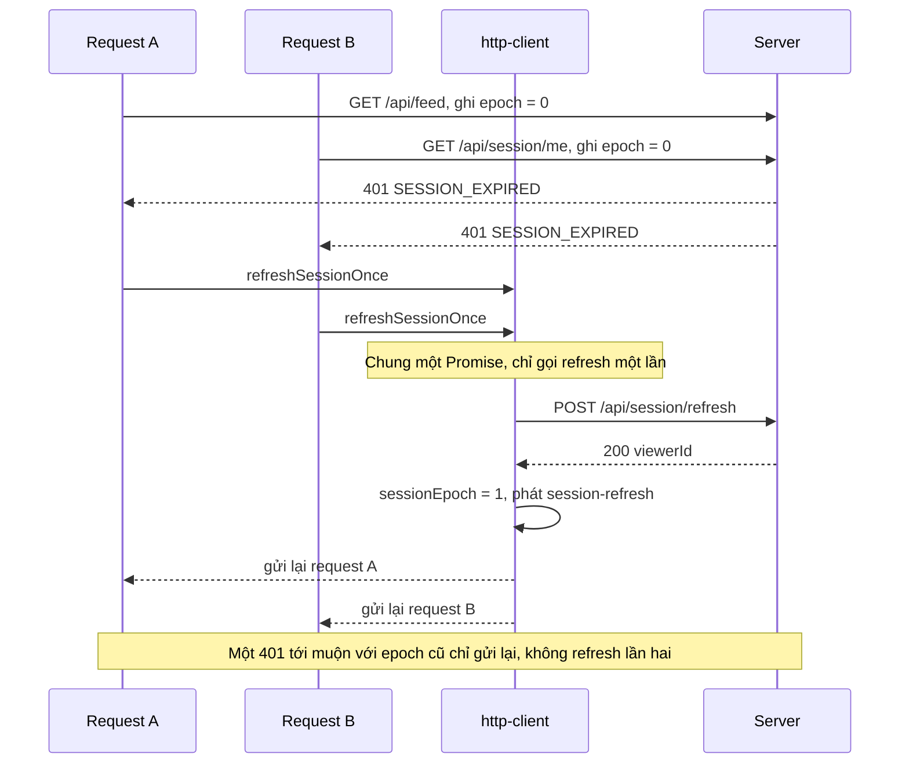
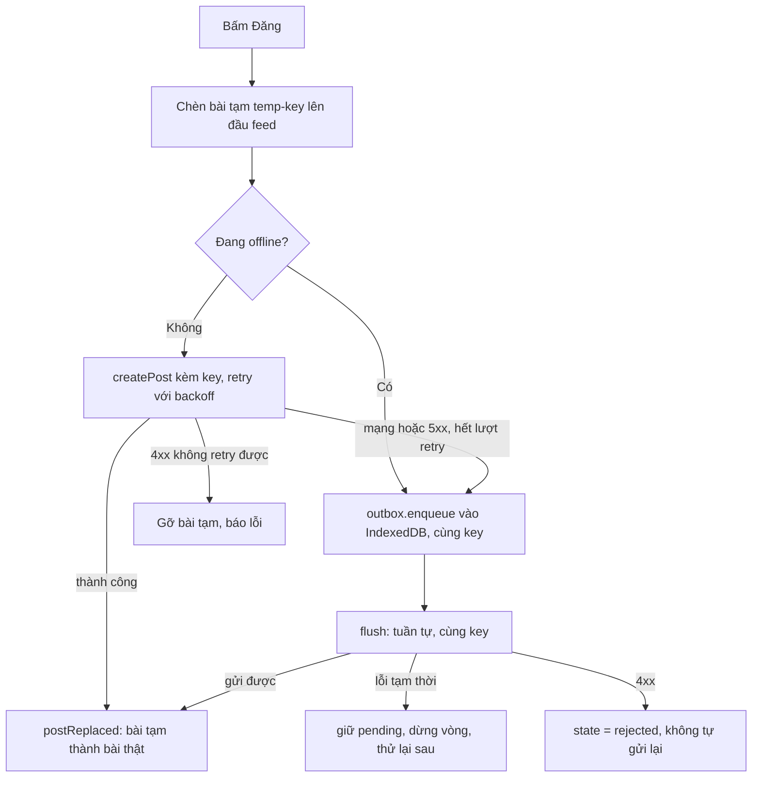
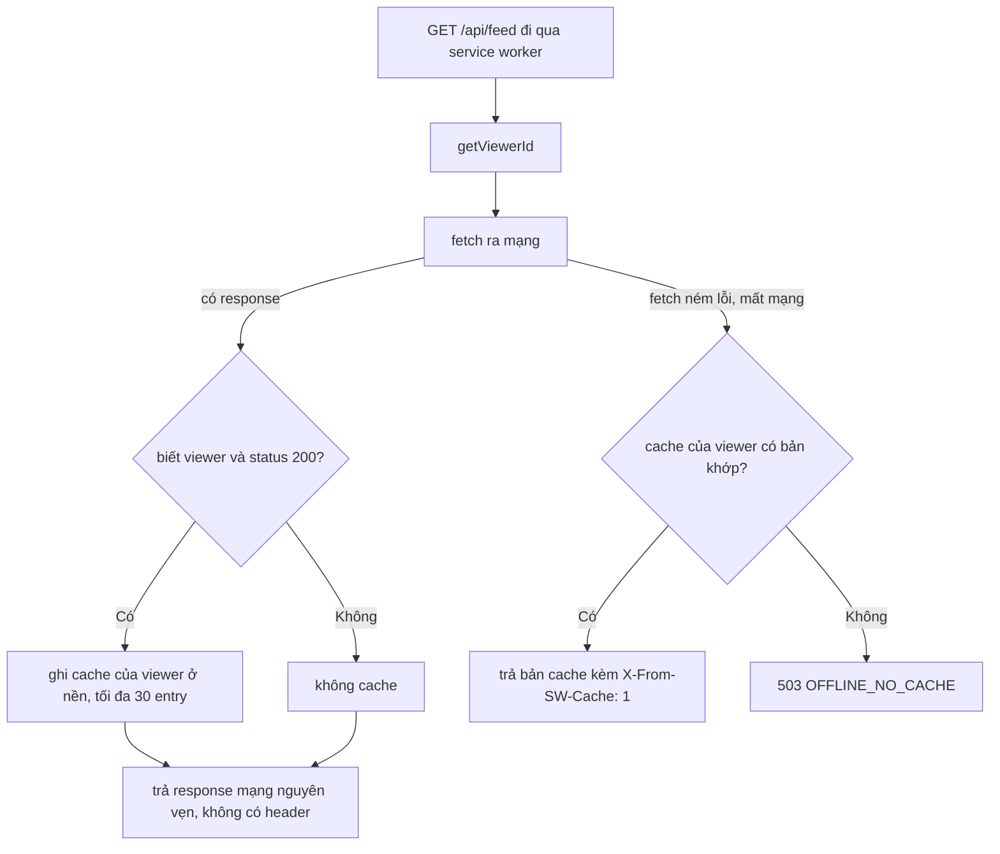

# Lesson 12 – Resilience và offline: refresh 401, outbox, Service Worker

> **Mục tiêu:** học xong lesson này bạn giải thích được app xử lý thế nào khi session hết hạn, bài đăng khi mất mạng, và đọc feed khi offline. Cụ thể: làm mới session đúng một lần cho nhiều request cùng gặp 401, lưu bài chờ đăng vào IndexedDB với idempotency key để không mất và không đăng trùng, và dùng Service Worker network-first để feed vẫn đọc được khi offline mà không hiện dữ liệu cũ lúc online.
>
> **Cần biết trước:** lesson 06 (composer, idempotency key, retry với backoff), lesson 09 (`httpClientEvents`, gộp GET trùng), khái niệm `Promise`, Cache API, `IndexedDB` ở mức cơ bản.

| File | Vai trò |
|---|---|
| `src/lessons/12-resilience-offline/lesson-12-resilience-offline.tsx` | Ghép lesson: banner mạng, nguồn feed, nút "Tải lại feed" |
| `src/lessons/12-resilience-offline/session-and-server-controls.tsx` | Nút "Hết hạn session", "Gọi 3 API song song", "Xoá bài đầu tiên ở server" |
| `src/lessons/12-resilience-offline/handle-not-found.ts` | 404 mang nghĩa khác nhau theo endpoint |
| `src/lessons/12-resilience-offline/resilience-feed.tsx` | Feed, composer outbox, xử lý reaction lỗi |
| `src/lessons/12-resilience-offline/use-offline-outbox.ts` | Gắn outbox vào feed store |
| `src/lessons/12-resilience-offline/outbox-panel.tsx` | Soạn bài, danh sách outbox |
| `src/lessons/12-resilience-offline/register-background-sync.ts` | Đăng ký Background Sync (best-effort) |
| `src/lessons/12-resilience-offline/service-worker-controls.tsx`, `use-cache-source-probe.ts` | Đăng ký SW, báo viewer, hỏi nguồn feed |
| `src/shared/api/http-client.ts` | Retry, 401, refresh một lần, epoch |
| `src/shared/offline/post-outbox.ts` | Outbox thuần (inject `store` và `send`) |
| `src/shared/offline/indexed-db-store.ts`, `use-online-status.ts` | Lưu bền theo viewer, trạng thái mạng |
| `public/sw.js` | Service Worker |
| `server/src/middleware/fake-session-middleware.ts`, `server/src/routes/session-routes.ts` | Giả lập session hết hạn và refresh |

## 1. Session hết hạn (401): làm mới đúng một lần

### Trong bài viết
Bài GreatFrontEnd nói tới việc client phải xử lý lỗi và các tình huống mạng không ổn định. Xem phần về xử lý lỗi và độ tin cậy trong [bài gốc](https://www.greatfrontend.com/questions/system-design/news-feed-facebook?format=system-design). Khi session hết hạn, mọi request `/api` nhận 401. Nếu mỗi request tự gọi refresh thì có thể gọi ba lần cùng lúc; nếu refresh lỗi mà cứ retry thì lặp vô hạn. Lesson xử lý gọn **trong tầng data access**, UI chỉ quan sát.

### Code thật

Phía server giả lập hết hạn và cho phép làm mới:

```learn
server/src/middleware/fake-session-middleware.ts#session-middleware
server/src/routes/session-routes.ts#session-refresh-route
```

1. Danh tính lấy từ cookie `sid` ở **phía server**; không hợp lệ thì cấp session mặc định, không tin giá trị client gửi.
2. Viewer nằm trong tập `expiredSessions` thì mọi `/api/*` (trừ `/api/session/refresh`) trả `401 SESSION_EXPIRED`.
3. `POST /session/refresh` xoá viewer khỏi tập hết hạn và trả `{ viewerId }`.

Phía client, vòng gửi request:

```learn
src/shared/api/http-client.ts#http-retry-loop
```

1. Mỗi vòng ghi `epochAtSend = sessionEpoch` **trước khi gửi**.
2. Lỗi mạng đổi thành `ApiError(0, 'NETWORK_ERROR')`; lỗi HTTP đổi thành `ApiError` có status.
3. Gặp `401` với mã `SESSION_EXPIRED` (và URL không phải chính `/session/refresh`, tránh lặp) thì làm mới. Nếu `sessionEpoch` vẫn bằng `epochAtSend` thì gọi `refreshSessionOnce()`; nếu epoch đã tăng (có ai đó đã làm mới sau khi request này rời đi) thì **chỉ gửi lại**.
4. `attempt -= 1; continue` để lần gửi lại **không tốn lượt retry** (401 không phải lỗi tạm thời), và `sessionRefreshed` đảm bảo mỗi request chỉ làm mới tối đa một lần.
5. Lỗi khác: hết lượt hoặc status không retry được thì ném; còn lượt thì chờ backoff (có `Retry-After`) rồi lặp.

```learn
src/shared/api/http-client.ts#http-refresh-single-flight
src/shared/api/http-client.ts#http-session-epoch
```

1. `refreshInFlight ??= refreshWithRetry()...`: nếu đang có refresh thì mọi request nhận 401 **cùng chờ một Promise**. Đây là **single-flight**.
2. Refresh xong thì `sessionEpoch += 1` và phát sự kiện `session-refresh` (panel của lesson nghe sự kiện này). `.finally` đặt `refreshInFlight = null`.
3. Single-flight một mình chỉ đúng trong **cửa sổ các request trùng nhau**. Request gửi trước refresh nhưng nhận 401 **sau** khi refresh xong sẽ gọi refresh lần hai. `sessionEpoch` xử lý trường hợp "401 tới muộn" này.
4. Với refresh-token rotation thật, lần refresh thứ hai dùng token đã bị thu hồi và đăng xuất oan. Epoch tránh điều đó.

```learn
src/shared/api/http-client.ts#http-refresh-with-retry
```

1. Refresh nằm sau middleware mô phỏng lỗi nên có thể nhận 503 hoặc mất mạng. Đó **không** có nghĩa phiên hết hạn.
2. Chỉ **4xx** (server từ chối) mới là `REAUTH_REQUIRED`: ném ngay, không retry.
3. Lỗi tạm thời được thử tối đa `REFRESH_MAX_ATTEMPTS = 3` lần với backoff. Hết lượt thì ném lỗi mang status thật (0 là mạng) để nơi gọi coi như lỗi tạm, không bắt người dùng đăng nhập lại.

Phía UI của lesson chỉ **quan sát**:

```learn
src/lessons/12-resilience-offline/session-and-server-controls.tsx#observe-session-refresh-event
src/lessons/12-resilience-offline/session-and-server-controls.tsx#parallel-calls-three-urls
```

1. Lắng sự kiện `session-refresh` của `httpClientEvents`, đếm và ghi `POST /api/session/refresh (lần thứ N)`.
2. "Gọi 3 API song song" dùng **ba URL khác nhau** (`getSession`, `fetchFeedPage` count 1 và count 2). GET cùng URL sẽ bị gộp dedupe (lesson 09) nên không thấy được single-flight.



### Vì sao làm vậy

| Cách | Ưu | Nhược | Khi nào chọn |
|---|---|---|---|
| Refresh trong data access, single-flight + epoch (project dùng) | UI không phải biết; một lần refresh cho cả loạt request; an toàn với token rotation | Cần hiểu giới hạn của single-flight | App có nhiều request song song |
| Mỗi request tự refresh | Đơn giản | N request gọi N lần refresh; rotation làm đăng xuất oan | Không khuyến nghị |
| Chuyển hướng ngay trang đăng nhập khi 401 | Rất đơn giản | Mất công việc đang làm, trải nghiệm tệ | Session không thể làm mới được |
| Refresh định kỳ theo timer | Chủ động | Tốn request, không xử lý được hết hạn đột ngột | Bổ sung, không thay thế |

### Lỗi hay gặp
- **Coi mọi lỗi refresh là "phải đăng nhập lại" (từ code review):** refresh bị middleware mô phỏng trả 503, mà client ném `REAUTH_REQUIRED` mà không retry, trái với chính sách "5xx là lỗi tạm". Project sửa: chỉ 4xx mới `REAUTH_REQUIRED`, lỗi tạm thì retry có backoff.
- **401 tới muộn gọi refresh lần hai:** single-flight chỉ gộp request nhận 401 **trong lúc** refresh đang bay. Project thêm `sessionEpoch`: request ghi epoch lúc gửi, và 401 mà epoch đã tăng thì chỉ gửi lại.
- **Vòng lặp vô hạn:** `/api/session/refresh` cũng có thể nhận 401. Điều kiện `url !== SESSION_REFRESH_URL` và việc middleware cho riêng đường dẫn này đi qua chặn lặp. Thêm nữa, `refreshWithRetry` gọi `fetch` trực tiếp (không qua `request`), nên lời gọi refresh không bao giờ tự đi vào nhánh 401, và có trần `REFRESH_MAX_ATTEMPTS = 3` cho lỗi tạm. (Hàm `refreshSession` trong `feed-api.ts` với `maxAttempts: 1` không nằm trên đường refresh tự động này.)
- **Test single-flight bằng cùng một URL:** bị dedupe gộp mất nên tưởng single-flight chạy, thực ra chưa thử gì. Dùng ba URL khác nhau.

### Tự thử
1. Mở `#/lesson-12`, tab **🧪 Demo**. Ở panel **Server đổi ý giữa chừng** bấm **Hết hạn session**.
2. React (bấm **Thích**) vào một bài. Kết quả mong đợi: reaction **vẫn thành công**; session-log có đúng một dòng `POST /api/session/refresh (lần thứ 1) → request gốc được gửi lại`; terminal backend in `🔑 làm mới session cho user-1`.
3. Bấm **Hết hạn session** lần nữa rồi **Gọi 3 API song song**. Kết quả mong đợi: nhật ký ghi 3 request xong và session-log chỉ thêm **một** dòng refresh.
4. Trong Network thấy chuỗi `401 → POST /api/session/refresh → request gốc gửi lại 200`.
5. Chạy `npx vitest run src/shared/api` để xem test refresh một lần, 401 tới muộn và refresh lỗi tạm.

### Câu hỏi phỏng vấn
1. Vì sao chỉ làm mới token đúng một lần và gộp các request lại?
   > Nhiều request cùng nhận 401 mà mỗi cái tự refresh thì gọi N lần (và với token rotation, lần sau dùng token đã bị thu hồi gây đăng xuất oan). Dùng một Promise chung (single-flight) và `sessionEpoch` để 401 tới muộn chỉ gửi lại. Refresh mà bị server từ chối (4xx) thì phải đăng nhập lại, không retry vô hạn; lỗi tạm thời thì retry có backoff.

## 2. 404 mang nghĩa khác nhau theo từng endpoint

### Trong bài viết
Bài nhắc tới việc xử lý lỗi và trạng thái không mong đợi (ví dụ bài bị xoá khi người dùng đang xem). Xem phần về xử lý lỗi trong [bài gốc](https://www.greatfrontend.com/questions/system-design/news-feed-facebook?format=system-design). Cùng một mã 404 nhưng ý nghĩa và cách UI phản ứng khác nhau, nên gom quyết định vào một chỗ.

### Code thật

```learn
src/lessons/12-resilience-offline/handle-not-found.ts#not-found-by-endpoint
```

1. `PUT/DELETE reaction` trả 404 nghĩa là "bài đã bị xoá khi bạn đang xem": gỡ bài khỏi feed và toast `Bài viết không còn tồn tại`. Không retry (vô ích).
2. `GET /api/posts/:id` 404 là **trạng thái hợp lệ** của trang chi tiết: hiện "đã bị xoá".
3. `GET /api/feed` 404 **không có** nghĩa nghiệp vụ (feed luôn tồn tại): đó là lỗi thường (sai route, deploy lỗi...), đi đường lỗi chung.
4. `loadPostDetail` đổi 404 thành `{ kind: 'gone' }` (trạng thái bình thường), lỗi khác thành `{ kind: 'error' }`. Không rải `if (status === 404)` khắp component.

```learn
src/lessons/12-resilience-offline/resilience-feed.tsx#reaction-rolled-back-check-404
```

1. Khi reaction lỗi và đã rollback, hook reaction chỉ cho ta **message**, không cho status.
2. Nên ta hỏi thẳng endpoint chi tiết bằng `loadPostDetail`. Nếu `gone` thì `postRemoved` và toast, ghi log.
3. Lỗi khác (mạng, 5xx) thì giữ nguyên: reaction đã rollback, bài vẫn còn.

### Vì sao làm vậy

| Cách | Ưu | Nhược | Khi nào chọn |
|---|---|---|---|
| Quyết định theo endpoint, gom một chỗ (project dùng) | Đúng nghĩa nghiệp vụ; dễ đọc, dễ test | Thêm một request hỏi chi tiết sau khi reaction lỗi | Cùng mã lỗi nhưng nghĩa khác nhau |
| Xử lý 404 giống nhau ở mọi nơi | Ít code | Feed lỗi mà tưởng "bài bị xoá", hoặc ngược lại | Không khuyến nghị |
| Server trả mã lỗi nghiệp vụ riêng (`POST_NOT_FOUND`) | Không phải hỏi thêm | Phải sửa hợp đồng server | Khi kiểm soát được server |

### Lỗi hay gặp
- **Coi mọi lỗi reaction là "bài đã xoá":** gỡ bài khỏi feed oan khi chỉ là rớt mạng. Phải xác nhận bằng GET chi tiết mới gỡ.
- **Hiện 404 của feed như "không tìm thấy":** feed lúc nào cũng tồn tại, 404 ở đó là bug.
- **Retry 404:** không bao giờ thành công, chỉ tốn request.

### Tự thử
1. Ở `#/lesson-12`, bấm **Xoá bài đầu tiên ở server**. Panel ghi nhắc "react vào bài đó".
2. Bấm **Thích** vào bài đầu tiên. Kết quả mong đợi: reaction rollback, bài biến khỏi feed, toast "Bài viết không còn tồn tại", log có `🗑 ... đã bị xoá ở server → gỡ khỏi feed`.
3. Kiểm tra bằng curl: `curl -i http://localhost:3001/api/posts/khong-ton-tai` trả `404` mã `POST_NOT_FOUND`. Đây là trạng thái hợp lệ của trang chi tiết.
4. Chạy `npx vitest run src/lessons/12-resilience-offline` để xem test `handle-not-found`.

### Câu hỏi phỏng vấn
1. Vì sao cùng mã 404 mà xử lý khác nhau theo endpoint?
   > Ý nghĩa nghiệp vụ khác nhau: 404 của reaction là "bài đã bị xoá" (gỡ khỏi feed), 404 của trang chi tiết là một trạng thái hợp lệ để hiện, còn 404 của `/api/feed` là lỗi thật (sai route). Gom quyết định vào một chỗ để không rải kiểm tra status khắp component.

## 3. Outbox: ghi khi offline mà không mất, không trùng

### Trong bài viết
Bài nói tới việc app phải dùng được khi mạng chập chờn và không mất bài người dùng đã soạn. Xem phần về offline và độ tin cậy trong [bài gốc](https://www.greatfrontend.com/questions/system-design/news-feed-facebook?format=system-design). Mẫu thiết kế ở đây là **outbox**: bài chờ đăng được lưu bền cùng một **idempotency key**, rồi gửi lại cho tới khi server nhận. Idempotency key bảo đảm gửi lại không tạo bài trùng.

### Code thật

```learn
src/shared/api/http-client.ts#http-idempotency-key
shared-contracts/feed-api-contracts.ts#contract-simulation-and-headers
```

1. `createIdempotencyKey` sinh UUID **một lần** khi người dùng bấm gửi và giữ qua mọi lần retry.
2. Header `Idempotency-Key` do client và server cùng dùng (hằng ở `shared-contracts`). `Idempotent-Replayed` cho biết server trả lại response cũ.

```learn
src/shared/offline/post-outbox.ts#outbox-item-and-events
src/shared/offline/post-outbox.ts#outbox-enqueue
```

1. `OutboxItem` giữ `idempotencyKey`, `payload`, số lần thử, lỗi gần nhất và `state`: `pending` (sẽ được gửi) hoặc `rejected` (server từ chối vĩnh viễn, chờ người dùng xử lý).
2. `OutboxEvent` mô tả mọi kết quả: `sent`, `retry-later`, `rejected`, `removed-while-sending`.
3. `enqueue` ghi mục với key **do nơi gọi truyền vào** (sinh một lần) bằng `store.put`.

```learn
src/shared/offline/post-outbox.ts#outbox-transient-error
```

1. Lỗi **tạm thời**: không phải `ApiError` (mất mạng, `fetch` ném `TypeError`), status 5xx, 408, 429, và cả **401** (session có thể được làm mới hoặc đăng nhập lại).
2. Còn lại (ví dụ 400) là lỗi **vĩnh viễn**: gửi lại cũng vô ích.

```learn
src/shared/offline/post-outbox.ts#outbox-run-flush
```

1. Duyệt các mục theo thứ tự tạo. Mục `rejected` thì **bỏ qua**, không tự gửi lại.
2. Mục có thể đã bị người dùng bỏ trong lúc ta gửi các mục trước, nên kiểm `store.get` trước khi gửi.
3. `send(item.payload, item.idempotencyKey)`: **cùng key ở mọi lần gửi**.
4. Gửi xong mà mục đã bị bỏ giữa chừng: báo `removed-while-sending` với `delivered: true` (server đã tạo bài, không thu hồi được), UI chỉ gỡ bài tạm và **không** hiện bài thật.
5. Thành công thì `store.delete` rồi báo `sent`.
6. Lỗi: nếu mục đã bị bỏ thì **không `put` lại** (sẽ làm mục sống lại). Lỗi tạm thì `put` với số lần thử tăng, báo `retry-later` rồi **`break`**: vẫn offline hoặc server đang lỗi thì dừng, giữ thứ tự, không dồn request vào mục sau.
7. Lỗi vĩnh viễn: đổi `state` thành `rejected`, giữ lại để người dùng thấy, và **tiếp tục** mục sau.

```learn
src/shared/offline/post-outbox.ts#outbox-flush-single-flight
```

1. Đang có `activeFlush` thì mọi lời gọi `flush()` nhận lại **đúng Promise đó**, nên không bao giờ có hai vòng flush chồng nhau trong một instance.
2. Hạn chế: guard này chỉ nằm trong **một instance** (một tab, một lần mount). Hai tab hoặc remount có thể gửi cùng một mục song song; idempotency key giúp server trả lại bài cũ, chỉ tốn request.

```learn
src/lessons/12-resilience-offline/use-offline-outbox.ts#outbox-submit-flow
```

1. Chuẩn hoá NFC và `trim`, rồi sinh key **một lần**.
2. **Chèn ngay bài tạm** `temp-<key>` lên đầu feed (lạc quan như lesson 06).
3. Đang offline thì vào outbox luôn. Online thì gửi bằng `createPost` kèm key (có retry với backoff).
4. Thành công: `postReplaced` thay bài tạm bằng bài thật.
5. Lỗi `ApiError` **không retry được** (ví dụ 400): gỡ bài tạm, toast, **không** vào outbox.
6. Lỗi tạm thời (mạng rớt giữa chừng, 5xx hết retry): vào outbox. An toàn vì đã có key.

```learn
src/lessons/12-resilience-offline/use-offline-outbox.ts#outbox-hook-enqueue
src/lessons/12-resilience-offline/use-offline-outbox.ts#outbox-event-handler
```

1. `enqueue` ghi vào outbox, làm mới danh sách, đăng ký Background Sync (xem khái niệm 6) rồi ghi log. Lỗi lưu thì **gỡ bài tạm** và toast, trả `false` để composer không xoá trắng.
2. `handleOutboxEvent` phản ứng từng loại sự kiện: `sent` thay bài tạm (hoặc chèn bài thật lên đầu nếu bài tạm đã mất sau reload, reducer khử trùng theo id), `removed-while-sending` gỡ bài tạm và không chèn bài thật, `retry-later` ghi log "CÙNG key", `rejected` toast và giữ trong outbox.



### Vì sao làm vậy

| Cách | Ưu | Nhược | Khi nào chọn |
|---|---|---|---|
| Outbox bền + idempotency key + gửi tuần tự (project dùng) | Không mất bài, không đăng trùng, giữ thứ tự | Phải tự lo lưu bền, phân loại lỗi | Ghi dữ liệu người dùng cần chắc chắn |
| Retry trong bộ nhớ | Đơn giản | Mất khi tải lại hoặc đóng tab | Thao tác nhẹ, mất cũng được |
| Báo lỗi và bắt người dùng gửi lại | Dễ làm | Người dùng mất nội dung vừa soạn | Hiếm khi chấp nhận được |
| Gửi song song mọi mục | Nhanh hơn | Sai thứ tự; dồn request khi vẫn offline | Mục độc lập, không cần thứ tự |
| Background Sync làm cơ chế chính | Gửi được cả khi tab đóng | Không có trên Safari, Firefox; chỉ best-effort | Chỉ như phần **thêm** |

### Lỗi hay gặp
- **Bỏ mục khi đang gửi làm mục sống lại (từ code review):** flush đang `await send` mục X, người dùng bấm **Bỏ mục này** nên `store.delete`; gửi lỗi tạm thì `store.put` lại X, mục quay lại outbox. Hoặc gửi thành công thì bài thật hiện lại ngay sau khi người dùng vừa bỏ. Project sửa: kiểm `store.get` trước khi `put`, và có sự kiện `removed-while-sending`.
- **Retry lỗi vĩnh viễn:** một bài 5001 ký tự bị 400 mãi mãi. Mục chuyển `rejected` và **không** tự gửi lại.
- **Gửi lại với key mới:** đăng trùng. Key sinh một lần và đi cùng mục.
- **Dồn request vào mục sau khi vẫn lỗi:** `break` giữ thứ tự và tránh bão request.
- **Flush chồng nhau giữa hai tab hoặc remount (từ code review):** idempotency cứu được nhưng tốn request. Có thể dùng Web Locks (`navigator.locks`) nếu cần chặt hơn; project chọn ghi rõ giới hạn.

### Tự thử
1. Mở `#/lesson-12`. DevTools → Network → chọn **Offline**. Gõ chữ vào ô **Nội dung** rồi bấm **Đăng**.
2. Kết quả mong đợi: bài tạm hiện ngay với nhãn "⏳ chờ mạng – đã lưu trong outbox, sẽ tự đăng khi có mạng"; mục **Outbox (1)** có `⏳ chờ mạng · lần thử: 0` kèm key rút gọn. DevTools → Application → IndexedDB → `newsfeed-outbox:user-1` → `kv` có đúng một mục.
3. Bỏ **Offline**. Kết quả mong đợi: mục tự gửi, bài tạm thành bài thật, Outbox về trống; DB chỉ có đúng **một** bài. Bấm **Flush outbox ngay** để gửi tay.
4. Bấm **Điền 5001 ký tự (→ 400)** rồi **Đăng** khi đang offline, sau đó bật mạng. Kết quả mong đợi: mục chuyển `⛔ bị từ chối`, giữ lại kèm "Lỗi gần nhất" và **không** bị gửi lại. Bấm **Bỏ mục này** để gỡ.
5. Ở panel mô phỏng mạng, tăng **tỉ lệ lỗi** rồi đăng khi online: log `🔁 retry lần N sau ...ms – CÙNG key ...`; hết lượt retry mà vẫn lỗi thì bài vào outbox.
6. Chạy `npx vitest run src/shared/offline` để xem test outbox với store in-memory.

### Câu hỏi phỏng vấn
1. Outbox cần gì để gửi lại an toàn?
   > Giữ nguyên idempotency key qua mọi lần gửi lại; gửi tuần tự và dừng khi gặp lỗi tạm để giữ thứ tự; lưu bền (IndexedDB) để sống qua tải lại; tách theo tài khoản; phân loại lỗi tạm thời và vĩnh viễn; chỉ một vòng flush chạy tại một thời điểm.

## 4. Outbox trong tab: lưu bền theo viewer, nhớ viewer khi offline, khi nào flush

### Trong bài viết
Bài nhắc tới việc lưu dữ liệu phía client để dùng khi offline. Xem phần về lưu trữ phía client trong [bài gốc](https://www.greatfrontend.com/questions/system-design/news-feed-facebook?format=system-design). Phần này nối outbox thuần ở khái niệm 3 với IndexedDB, trạng thái mạng và vòng đời của feed.

### Code thật

```learn
src/shared/offline/indexed-db-store.ts#key-value-store-and-viewer-db
src/shared/offline/indexed-db-store.ts#indexed-db-open-store
```

1. Interface `KeyValueStore` tách logic outbox khỏi IndexedDB: test dùng store in-memory (Node không có IndexedDB).
2. `outboxDatabaseName(viewerId)` cho tên DB **tách theo viewer**: hai người dùng chung một trình duyệt không thấy hoặc lỡ gửi bài chờ đăng của nhau. Đổi tài khoản là DB khác.
3. `openIndexedDbStore` mở một store `kv`; **mỗi thao tác chạy trong một transaction riêng**.
4. Với ghi (`readwrite`) chỉ coi là xong khi `transaction.oncomplete`, tức dữ liệu đã **bền**, chứ không chỉ khi request thành công.

```learn
src/shared/offline/use-online-status.ts#use-online-status
```

1. `useSyncExternalStore` đăng ký sự kiện `online` và `offline` của `window`, `getOnlineStatus` đọc `navigator.onLine`. Snapshot phía server mặc định `true`.
2. Cảnh báo trong file: `navigator.onLine` **không đảm bảo** tới được server (captive portal, server sập). Online là **gợi ý** để thử flush sớm; "đã gửi được chưa" luôn do kết quả request thật quyết định.

```learn
src/lessons/12-resilience-offline/use-offline-outbox.ts#resolve-viewer-remembered
```

1. Online: hỏi `getSession()` (nguồn sự thật) rồi **nhớ viewer** vào `localStorage`.
2. Offline (ví dụ vừa tải lại trang khi mất mạng): `/api/session/me` không gọi được, nên dùng viewer đã nhớ. Không có thì mới ném lỗi.
3. Không có bước này thì outbox, thứ sinh ra để dùng khi offline, lại **không mở được đúng lúc cần**. Server vẫn xác thực lại bằng session khi bài thật được gửi.
4. `localStorage` bị chặn thì chỉ mất khả năng mở outbox khi offline lần sau, không hỏng gì khác.

```learn
src/lessons/12-resilience-offline/use-offline-outbox.ts#outbox-init-effect
src/lessons/12-resilience-offline/resilience-feed.tsx#feed-ready-per-mount
```

1. Khởi tạo **một lần** khi feed sẵn sàng: lấy viewer, mở DB riêng của viewer, tạo outbox, đọc các mục đã lưu.
2. **Dựng lại bài tạm** cho mục còn chờ (cũ đến mới, mỗi bài chèn lên đầu nên bài mới nhất nằm trên cùng), rồi `flushNow()`.
3. Lỗi khởi tạo thì hiện `setupError` ở panel.
4. Vì sao phải chờ feed sẵn sàng: trang đầu (`initial`) **thay cả danh sách**, nên nếu dựng bài tạm trước thì chúng bị nuốt mất.
5. `feedReady` được tính theo `status` của loader **của lần mount hiện tại** (phải đi qua `loading-initial` rồi rời nó), không dùng `lastFetchedAt`.

```learn
src/lessons/12-resilience-offline/use-offline-outbox.ts#outbox-flush-triggers
```

1. Flush khi `online` đổi sang true (có mạng lại).
2. Flush khi SW nhắn `flush-outbox` (Background Sync).
3. Flush **định kỳ** mỗi 8 giây nếu còn mục `pending` và đang online: phòng khi mạng "có" nhưng server lỗi.
4. Đây mới là đường **đúng**; Background Sync chỉ là phần thêm.

### Vì sao làm vậy

| Cách | Ưu | Nhược | Khi nào chọn |
|---|---|---|---|
| IndexedDB, DB tách theo viewer (project dùng) | Bền, dung lượng lớn, không lộ dữ liệu giữa tài khoản | API khó dùng, cần bọc | Dữ liệu cần sống qua tải lại |
| `localStorage` | Đơn giản | Đồng bộ (chặn main thread), nhỏ, chỉ chuỗi | Cờ nhỏ (như viewer đã nhớ) |
| Một DB chung cho mọi viewer | Ít DB | Hai người dùng chung máy thấy bài của nhau | Không khuyến nghị |
| Chỉ tin `navigator.onLine` | Dễ | Báo online nhưng không tới được server | Chỉ làm gợi ý |

### Lỗi hay gặp
- **Outbox không dùng được sau khi reload lúc offline (từ code review):** `getSession` lỗi nên không biết viewer, không mở được DB. Project sửa bằng viewer nhớ trong `localStorage`.
- **Bài tạm biến mất sau "Tải lại feed" (từ code review):** `feedReady` ban đầu dựa trên `lastFetchedAt`. Store nằm ở provider phía trên nên `lastFetchedAt` còn sót từ lần mount trước, bài tạm được dựng **trước** khi trang `initial` mới về, rồi bị thay cả danh sách. Sửa: `feedReady` theo `status` của loader của lần mount hiện tại.
- **Tưởng khởi tạo lỗi sẽ tự thử lại:** cờ `started` vẫn true sau lỗi và effect chỉ chạy lại khi deps đổi, nên render tiếp không giúp gì. Người dùng thấy `setupError` ở panel và phải mount lại feed (nút **Tải lại feed**). Một comment cũ trong file từng viết ngược lại ("hạ cờ") dù code không hạ cờ; comment đã được sửa cho khớp.
- **Coi `ready` của request IndexedDB là đã bền:** phải chờ transaction `complete` với thao tác ghi.

### Tự thử
1. Ở `#/lesson-12` đang online, đăng một bài thường để viewer được nhớ. DevTools → Application → Local Storage có khoá `newsfeed:last-viewer` giá trị `user-1`.
2. Chọn **Offline**, đăng hai bài, rồi **tải lại cả trang** (nếu đang chạy bản preview đã đăng ký SW) hoặc bấm **Tải lại feed**. Kết quả mong đợi: hai bài tạm được dựng lại trên đầu feed từ IndexedDB, log `📥 khôi phục 2 mục từ IndexedDB (DB riêng của user-1)`.
3. Bỏ **Offline**: hai bài lần lượt được gửi theo đúng thứ tự, thành bài thật; Outbox trống.
4. Mở Application → IndexedDB → `newsfeed-outbox:user-1`: xoá DB này bằng DevTools rồi thử lại để thấy outbox tạo mới.

### Câu hỏi phỏng vấn
1. Tải lại trang khi đang offline, outbox còn dùng được không, và vì sao outbox phải tách theo tài khoản?
   > Còn, nhờ viewer được nhớ trong `localStorage` (không cần gọi `/session/me`) và dữ liệu nằm trong IndexedDB sống qua tải lại. Tách theo tài khoản (mỗi viewer một DB) để người dùng chung máy không thấy hay lỡ gửi bài của nhau.

## 5. Service Worker: chiến lược cache theo loại request

### Trong bài viết
Bài đề cập tới việc dùng cache và Service Worker để cải thiện hiệu năng và hỗ trợ offline. Xem phần về caching trong [bài gốc](https://www.greatfrontend.com/questions/system-design/news-feed-facebook?format=system-design). Không có một chiến lược cache đúng cho mọi thứ: ảnh và asset bất biến hợp cache-first, feed cá nhân hoá hợp network-first.

### Code thật

```learn
public/sw.js#sw-cache-names
public/sw.js#sw-install-activate
```

1. Tên cache có **version** trong tiền tố (`newsfeed-v2-`). Đổi tiền tố khi đổi định dạng cache; `activate` xoá cache version cũ (nhưng không xoá cache feed theo viewer, phần đó do `setViewerId` quản).
2. `skipWaiting` và `clients.claim`: bản SW mới có hiệu lực ngay và điều khiển luôn tab đang mở, không phải tải lại thêm một lần.
3. `VITE_DEV_PREFIXES` liệt kê đường dẫn của Vite dev (`/src/`, `/@vite/`...) để SW **không đụng vào**, nên không cản HMR.

```learn
public/sw.js#sw-cache-first
public/sw.js#sw-mark-from-cache
```

1. `cacheFirst` mở cache, có bản khớp thì trả luôn, không thì `fetch` rồi `put` **bản sao** (`response.clone()`).
2. `isCacheable` chỉ chấp nhận `status === 200`: không cache 206 partial, 4xx, 5xx.
3. `markAsFromCache` tạo `Response` **mới** (response từ cache là bất biến) với header `X-From-SW-Cache: 1`, để trang biết dữ liệu đến từ cache.

```learn
public/sw.js#sw-network-first-feed
```

1. Lấy `viewerId`. Gọi `fetch(request)` trước.
2. Có response (kể cả 4xx hoặc 5xx, đó vẫn là response bình thường của server) thì: nếu biết viewer và `isCacheable` thì **ghi cache ở nền** bằng `event.waitUntil` (không làm chậm response), lỗi ghi cache (hết quota) thì bỏ qua. Trả response mạng **nguyên vẹn, không gắn header**.
3. Chỉ khi `fetch` **ném lỗi** (mất mạng) mới đọc cache của viewer: có thì `markAsFromCache`, không thì `503 OFFLINE_NO_CACHE`.
4. Chưa biết viewer thì **không cache**: thà không có cache còn hơn lộ feed người khác.

```learn
public/sw.js#sw-network-first-navigation
public/sw.js#sw-fetch-router
```

1. Điều hướng (`navigate`) ưu tiên mạng; online thì cập nhật app shell `/` trong cache, offline rơi về app shell đó.
2. Chỉ lưu response có `Content-Type: text/html`: điều hướng tới URL trả JSON (ví dụ `/__mock/config` qua proxy) mà ghi đè app shell thì offline sẽ hiện JSON.
3. `fetch` handler chỉ xử lý **GET cùng origin**, bỏ qua đường dẫn của Vite dev. Request không `respondWith` thì trình duyệt xử lý như bình thường (network-only), áp cho mọi thứ SW không quản, trong đó có mọi POST, PUT, DELETE.
4. Định tuyến: `/media/*` cache-first; `/api/feed` network-first; điều hướng network-first; `/assets/*` cache-first.

```learn
src/lessons/12-resilience-offline/use-cache-source-probe.ts#probe-cache-source
```

1. `http-client` chỉ trả JSON nên không thấy header. Hook gửi **một fetch riêng** tới `/api/feed?count=1&direction=older` (cùng đường đi qua SW) rồi đọc header `X-From-SW-Cache`.
2. `X-From-SW-Cache: 1` là `sw-cache`; còn lại là `network`; lỗi hoặc `!ok` là `unreachable`.
3. Thăm dò lại khi trạng thái mạng đổi và khi SW bắt đầu hoặc ngừng điều khiển trang (`controllerchange`).



### Vì sao làm vậy

| Cách | Ưu | Nhược | Khi nào chọn |
|---|---|---|---|
| Feed network-first, cache chỉ khi mất mạng (project dùng) | Online luôn thấy dữ liệu mới; offline vẫn đọc được | Chờ mạng trước, offline thì mất một nhịp timeout | Feed cá nhân hoá, các lesson khác cần dữ liệu mới |
| Stale-while-revalidate | Hiện tức thì, cập nhật nền | Online vẫn có thể hiện dữ liệu **cũ**; cần nhãn "dữ liệu cũ" ở tầng ứng dụng | Feed production có nhãn dữ liệu cũ |
| Cache-first cho feed | Nhanh nhất | Dữ liệu cũ kéo dài | Không dùng cho feed |
| Không dùng SW | Đơn giản | Offline là màn hình lỗi | Không cần offline |
| Cache-first cho ảnh và asset bất biến (project dùng) | Nhanh, tiết kiệm băng thông | Phải quản lý version khi đổi | Tệp có hash hoặc không đổi |

### Lỗi hay gặp
- **SWR làm mọi lesson nhận dữ liệu cũ (từ code review, mức High):** bản đầu dùng stale-while-revalidate cho `/api/feed` ở scope `/`, trả bản cache **cả khi online**, cho **mọi lesson**. Hậu quả: react xong F5 thấy reaction "mất"; banner "Feed đã cũ" của lesson 09 tải lại nhận bản cũ rồi nói dối là đã mới (vì `lastFetchedAt = Date.now()`); poll bài mới của lesson 04 nhận kết quả của lần trước. Project **đổi sang network-first**: online luôn là mạng, header `X-From-SW-Cache` chỉ xuất hiện khi mạng lỗi.
- **`Cache-Control: private, no-store` không giúp:** Cache API bỏ qua header này. Vì vậy cache cá nhân hoá phải tách theo viewer (khái niệm 6).
- **Cache phình mãi:** cache theo cả `cursor` nên mỗi trang là một entry; giới hạn 30 entry mỗi viewer.
- **Ghi đè app shell bằng JSON:** chỉ lưu `text/html`.
- **Quên `clone()`:** `Response` chỉ đọc được một lần; không clone thì hoặc trang hoặc cache nhận body rỗng.
- **SW đứng giữa mọi lesson:** học xong nhớ bấm **Gỡ đăng ký** (và tải lại trang, vì tab vẫn bị SW cũ điều khiển cho tới lần tải sau).

### Tự thử
1. Ở `#/lesson-12`, bấm **Đăng ký SW**, rồi tải lại trang. DevTools → Network: các request hiện `(ServiceWorker)` ở cột Size. Application → Service Workers có `sw.js` trạng thái activated; **Cache Storage** có `newsfeed-v2-media`, `newsfeed-v2-pages`, `newsfeed-v2-meta` và `newsfeed-v2-api:user-1`; `newsfeed-v2-assets` chỉ xuất hiện ở bản preview đã build, vì `npm run dev` không có request `/assets/*` nào.
2. Cuộn, tải vài trang feed cho SW kịp cache. Khi **online**, dòng "Nguồn dữ liệu feed:" hiện **mạng**; response `/api/feed` **không** có header `X-From-SW-Cache`.
3. Chọn **Offline** rồi bấm **Tải lại feed**. Kết quả mong đợi: feed vẫn hiện, nguồn chuyển thành **cache của service worker** và có banner `📦 Đang offline: feed lấy từ cache ...`; response `/api/feed` có `X-From-SW-Cache: 1`.
4. Xoá cache (nút **Xoá cache**) rồi bấm **Kiểm tra lại** khi vẫn offline: nguồn thành **không tới được (offline, chưa có cache)**.
5. Lưu ý dev: ở `npm run dev` module Vite cố ý không được cache nên tải lại **cả trang** khi offline không chạy; để thử trọn vẹn hãy chạy bản preview đã build (`npx vite preview` sau khi build).
6. Xong thì bấm **Gỡ đăng ký**.

### Câu hỏi phỏng vấn
1. Feed nên dùng network-first hay stale-while-revalidate, và vì sao project chọn network-first?
   > SWR hiện ngay nhưng online vẫn có thể hiển thị dữ liệu cũ; production hay dùng SWR kèm nhãn "dữ liệu cũ" ở tầng ứng dụng. Ở đây SW nằm giữa mọi lesson nên SWR làm các lesson khác (banner feed cũ, poll bài mới, reaction) nhận bản cũ mà tưởng mới. Network-first thì online luôn mới, chỉ khi `fetch` ném lỗi mới trả cache kèm header đánh dấu.

## 6. Cache theo viewer, tin nhắn tab–SW và Background Sync

### Trong bài viết
Bài nhắc tới việc đồng bộ dữ liệu khi mạng trở lại. Xem phần về offline trong [bài gốc](https://www.greatfrontend.com/questions/system-design/news-feed-facebook?format=system-design). Hai việc còn lại của SW: **không để cache lộ dữ liệu giữa người dùng**, và **nhờ trình duyệt đánh thức** để đồng bộ khi có mạng lại.

### Code thật

```learn
public/sw.js#sw-viewer-scoped-cache
```

1. Tên cache feed gồm `viewerId`: `newsfeed-v2-api:<viewerId>`.
2. `getViewerId` ưu tiên bộ nhớ, rơi về **meta cache** (`/__sw-meta/viewer`) vì SW có thể bị trình duyệt tắt rồi bật lại và biến trong bộ nhớ sẽ mất.
3. `setViewerId` ghi viewer mới, rồi **xoá cache feed của mọi viewer khác**: máy dùng chung không được lộ dữ liệu cho nhau.
4. `putFeedResponse` ghi rồi cắt các entry cũ nhất cho đủ `MAX_FEED_ENTRIES = 30` (`cache.keys()` trả theo thứ tự ghi).

```learn
public/sw.js#sw-message-handler
src/lessons/12-resilience-offline/service-worker-controls.tsx#announce-viewer-to-sw
```

1. SW không có cookie hay `getSession`, nên **tab báo viewer** bằng `postMessage({ type: 'set-viewer', viewerId })`. Tab gọi lại mỗi khi SW vừa active hoặc giành quyền điều khiển (`controllerchange`), và khi mount nếu đã được điều khiển.
2. SW coi dữ liệu từ tab là **đầu vào ngoài**: `viewerId` phải là chuỗi, dài 1 đến 100 ký tự, vì nó thành **tên cache**.
3. Lỗi (chưa có session, mạng rớt) thì bỏ qua: hậu quả chỉ là feed chưa được cache, không phải dữ liệu sai.
4. `clear-caches` xoá các cache `newsfeed-v2-*` trừ meta (xoá meta thì SW "quên" viewer và không cache cho tới khi tab nhắn lại), rồi trả lời qua `MessagePort` để tab biết khi nào xong.

```learn
src/lessons/12-resilience-offline/register-background-sync.ts#register-background-sync
public/sw.js#sw-background-sync
```

1. Tab gọi `registration.sync.register('flush-outbox')` **sau khi** đưa mục vào outbox. Trình duyệt không có API này (Safari, Firefox) thì trả `false`; lỗi quyền hay SW chưa active cũng trả `false` **im lặng**.
2. Khi có mạng lại (kể cả lúc tab đã đóng), trình duyệt đánh thức SW và bắn sự kiện `sync` với tag đó.
3. SW **không tự gửi bài**: outbox nằm ở tab. SW chỉ `postMessage({ type: 'flush-outbox' })` cho các tab, và tab flush bằng cùng logic và idempotency key.
4. Không có tab nào thì **ném lỗi** để trình duyệt hẹn đồng bộ lại; lần mở tab sau, tab cũng tự flush khi load.

### Vì sao làm vậy

| Cách | Ưu | Nhược | Khi nào chọn |
|---|---|---|---|
| Cache tách theo viewer, tab báo viewer cho SW (project dùng) | Không lộ feed giữa người dùng; sống qua việc SW khởi động lại | Phải có kênh tab–SW và meta cache | Dữ liệu cá nhân hoá, máy dùng chung |
| Một cache chung | Đơn giản | Người dùng sau thấy feed của người trước | Không khuyến nghị |
| Background Sync để SW tự gửi bài | Chạy cả khi tab đóng | SW không có outbox và logic của tab, Safari/Firefox không có | Phần thêm, không phải đường chính |
| Flush trong tab (`online`, lúc load, interval) | Mọi trình duyệt đều chạy | Cần tab đang mở | **Đường chính, đúng** |

### Lỗi hay gặp
- **Cache feed không tách theo viewer (từ code review):** hai bài dạy mâu thuẫn nhau, vì outbox tách theo viewer còn cache feed thì không. Project tách cache theo `viewerId` và đổi viewer thì xoá cache của viewer khác.
- **Tin viewer từ tab vô điều kiện:** nếu không kiểm kiểu và độ dài thì tab có thể tạo tên cache bất kỳ. SW kiểm trước khi dùng.
- **Xoá meta khi dọn cache:** SW quên viewer và ngừng cache. `clearAllCaches` cố ý giữ meta.
- **Phụ thuộc Background Sync để đảm bảo gửi:** Safari và Firefox không có, và nó chỉ là best-effort. Phải có vòng flush trong tab.
- **SW tự gửi bài:** logic trùng lặp, key khó đồng bộ. SW chỉ nhắn tab.

### Tự thử
1. Ở `#/lesson-12` (bản dev hay preview đều được), đăng ký SW. Mở Application → Cache Storage: có `newsfeed-v2-meta` chứa `/__sw-meta/viewer` giá trị `user-1`, và `newsfeed-v2-api:user-1`. Xem `Cache Storage → newsfeed-v2-api:user-1` có không quá 30 entry dù bạn cuộn thật nhiều.
2. Thử Background Sync (Chromium): Application → Service Workers, ô **Sync** nhập `flush-outbox` rồi bấm **Sync**. Kết quả mong đợi: log ở trang có `📨 SW báo Background Sync → flush outbox`.
3. Đăng khi **Offline**: log có `📤 đang offline → vào outbox ... Background Sync: đã đăng ký` (Chromium) hoặc `không hỗ trợ/không có SW – dựa vào flush trong tab` (khi chưa đăng ký SW hoặc trình duyệt không có).
4. Gửi kiểm tra tên viewer quá dài: trong Console của trang `navigator.serviceWorker.controller.postMessage({ type: 'set-viewer', viewerId: 'x'.repeat(200) })`; Cache Storage **không** có cache `newsfeed-v2-api:xxxx...` mới (bị từ chối vì quá 100 ký tự).

### Câu hỏi phỏng vấn
1. Background Sync có đủ để đảm bảo bài được gửi không?
   > Không. Nó chỉ là hỗ trợ thêm (Chromium, best-effort, Safari và Firefox không có). Vòng gửi lại ngay trong tab (sự kiện `online`, lúc load trang, interval) mới là cách đảm bảo đúng. SW chỉ nhắn tab flush chứ không tự gửi.

## Tóm tắt
- Gặp 401 thì làm mới session **đúng một lần**: single-flight cho request nhận 401 cùng lúc, `sessionEpoch` cho 401 tới muộn, retry có backoff cho lỗi tạm thời của refresh, và chỉ 4xx mới bắt đăng nhập lại.
- Cùng 404 nhưng nghĩa khác nhau theo endpoint (reaction là bài đã xoá, chi tiết là trạng thái hợp lệ, feed là lỗi thật); gom quyết định vào một chỗ.
- Outbox giữ idempotency key sinh một lần, lưu bền trong IndexedDB tách theo viewer, gửi tuần tự (dừng khi lỗi tạm, đánh dấu `rejected` khi 4xx), và đường flush đúng nằm trong tab (`online`, lúc load, interval).
- Viewer được nhớ trong `localStorage` để outbox mở được cả khi tải lại lúc offline; `feedReady` theo loader của lần mount hiện tại để bài tạm không bị trang đầu nuốt.
- Service Worker network-first cho feed (cache của viewer chỉ khi `fetch` ném lỗi, kèm `X-From-SW-Cache`), cache-first cho ảnh và asset, cache tách theo viewer và Background Sync chỉ là phần thêm nhắn tab flush.
