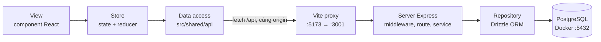
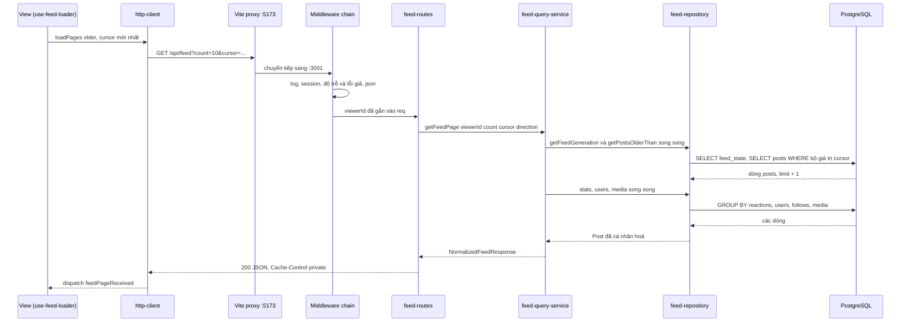

# Nền tảng dùng chung – kiến trúc, request, http-client, hợp đồng API, DB

> **Mục tiêu:** học xong bài này bạn vẽ lại được đường đi của một request feed từ component React tới PostgreSQL và ngược lại, giải thích được vì sao `http-client` retry như vậy, và đọc được cách server dùng Drizzle, index, migration và idempotency.
>
> **Cần biết trước:** React hooks cơ bản, HTTP (status code, header), SQL cơ bản (`SELECT`, `ORDER BY`, index). Bài này là bài đọc thêm, đọc trước hoặc song song với lesson 01–12; các lesson sẽ tham chiếu ngược về đây.

| File | Vai trò |
|---|---|
| `src/shared/api/http-client.ts` | Lớp duy nhất biết HTTP: retry, backoff, dedupe, refresh session |
| `src/shared/api/feed-api.ts` | Các hàm gọi API, trả đúng type của hợp đồng |
| `src/shared/hooks/use-feed-loader.ts` | Đứng giữa View và Data access, chặn tải chồng |
| `shared-contracts/feed-api-contracts.ts` | Hợp đồng API, được cả server và client import |
| `server/src/create-express-app.ts` | Lắp ráp middleware theo thứ tự đường đi của request |
| `server/src/routes/feed-routes.ts`, `post-routes.ts` | Route HTTP, validate và trả response |
| `server/src/services/feed-query-service.ts` | Cursor, direction, gom response chuẩn hoá |
| `server/src/data/feed-repository.ts` | Nơi duy nhất truy cập DB (Drizzle) |
| `server/src/data/database-schema.ts` | Schema, index; nguồn sự thật để sinh migration |
| `server/src/data/seed-database.ts` | Chạy migration khi khởi động, seed dữ liệu |
| `server/src/services/idempotency-store.ts` | Băm request, nhận diện lỗi trùng khoá |

## 1. Kiến trúc 4 layer và database

### Trong bài viết
Bài gốc chia frontend của news feed thành các khối có trách nhiệm riêng: phần hiển thị, phần giữ dữ liệu phía client, phần nói chuyện với server, và server là nguồn sự thật. Ý chính là mỗi khối chỉ biết khối kế bên nó, nhờ vậy đổi cách gọi API hay đổi cách lưu state không kéo theo sửa cả giao diện. Xem mục *Architecture* trong [bài gốc](https://www.greatfrontend.com/questions/system-design/news-feed-facebook?format=system-design). Project này thêm một lớp nữa phía sau server là PostgreSQL, để bạn thấy cả đường đi tới dữ liệu thật.



### Code thật

Layer View và cách app chuyển giữa các lesson. Mỗi lesson là một chunk tải lười, điều hướng bằng hash nên chuyển lesson không mất store hay vị trí cuộn.

```learn
src/app-lesson-picker.tsx#lesson-lazy-suspense
```

1. `findLessonByHash` tra lesson theo URL dạng `#/lesson-04`; không có router thư viện nào.
2. `Component` là `React.lazy`, nên trình duyệt chỉ tải JS của lesson đang xem.
3. `Suspense` hiện chữ chờ trong lúc chunk đang tải.
4. `key={lesson.id}` buộc React tạo lại cây component khi đổi lesson, không để state của lesson trước rò sang lesson sau.

Layer Data access. View không gọi `fetch`; nó gọi hàm có tên theo nghiệp vụ.

```learn
src/shared/api/feed-api.ts#feed-api-fetch-page
```

1. `FetchFeedPageParams` là hợp đồng phía client: `count`, `cursor`, `direction`, cộng `signal` để huỷ và `onRetry` để UI báo "đang thử lại".
2. `URLSearchParams` dựng query và tự mã hoá ký tự đặc biệt; cursor là chuỗi base64url nên an toàn.
3. Chỉ thêm `cursor` khi có, trang đầu không gửi cursor.
4. `request<NormalizedFeedResponse>` trả đúng type của hợp đồng. Server đổi hình dạng response thì TypeScript báo lỗi ngay ở đây.

Layer Server. Thứ tự `app.use` chính là thứ tự request đi qua.

```learn
server/src/create-express-app.ts#middleware-pipeline
```

1. `request-logger` đứng đầu để log được cả request bị chặn ở middleware sau.
2. `fake-session` xác định `req.viewerId` từ cookie; mọi route phía sau dùng giá trị này, không bao giờ tin `userId` client gửi.
3. `/__mock` đặt trước latency/failure nên điều khiển mô phỏng không bị chính độ trễ giả ảnh hưởng.
4. Ảnh `/media` cũng đặt trước: giả lập CDN nhanh.
5. Router `/api` có latency/failure trước, rồi route upload và telemetry (cần body thô hoặc text) đứng trước `express.json`, sau đó mới tới route JSON.
6. `NOT_FOUND` cho `/api` không khớp route nào, và `error-handler` cuối cùng gom mọi lỗi ném ra.

Layer Repository và DB được phân tích kỹ ở mục 6.

Điều hướng bằng hash.

```learn
src/app-lesson-picker.tsx#hash-router
```

1. `lessonKeyOf` cắt `#/lesson-09/post/1` thành `lesson-09`, tức phần định danh lesson.
2. `useLocationHash` lắng nghe `hashchange`; đổi trang con trong cùng lesson thì không cuộn lên đầu, lesson tự quản lý vị trí cuộn.
3. Chỉ khi sang lesson khác mới `window.scrollTo(0, 0)`.
4. Cleanup gỡ listener để không rò rỉ khi component bị huỷ.

### Vì sao làm vậy

| Cách | Ưu | Nhược | Khi nào chọn |
|---|---|---|---|
| 4 layer tách file (project dùng) | Đổi một layer không phải sửa layer khác; test từng lớp riêng | Nhiều file, người mới phải lần theo | Feed có nhiều lesson, nhiều tính năng dùng chung dữ liệu |
| Component gọi `fetch` trực tiếp | Ít file, đọc một chỗ là hiểu | Retry, dedupe, refresh session lặp ở mọi component | Prototype một màn hình |
| SSR hoặc framework full-stack | Có HTML sớm, SEO tốt | Phức tạp hơn; feed cá nhân hoá khó cache | Trang công khai cần SEO |

Project chọn CSR vì feed là nội dung cá nhân hoá và có nhiều tương tác, đúng như bài gốc cân nhắc.

### Lỗi hay gặp
- **Layer rò rỉ:** component gọi `fetch('/api/feed')` thẳng. Hậu quả là mất retry, mất dedupe và mất kiểu dữ liệu. Project tránh bằng quy ước "View chỉ gọi `feed-api.ts`".
- **Tưởng `memo` đủ để feed mượt:** `FeedPostArticle` bọc `memo`, nhưng `useFeedState()` đọc cả context nên mọi bài vẫn render lại khi store đổi (comment trong `feed-post-article.tsx`). Store có selector (Redux, Zustand) mới giải quyết được. Đây là giới hạn đã biết của project.
- **Quên proxy dev:** gọi thẳng `http://localhost:3001` từ `:5173` sẽ bị CORS. Project dùng proxy của Vite (`/api`, `/media`, `/__mock`) nên frontend và backend cùng origin.

### Tự thử
1. Chạy `npm run dev`, mở `http://localhost:5173/#/lesson-01`.
2. DevTools → Network, lọc `Fetch/XHR`: chỉ có `GET /api/feed?count=…&direction=older`. Request đi tới `:5173`, không phải `:3001`.
3. Mở terminal chạy backend, thấy dòng log `GET /api/feed?count=… 200 …ms`.
4. Gõ trong DevTools Console: `location.hash = '#/lesson-04'`. Network xuất hiện một chunk JS mới của lesson 04 và store của lesson 01 không còn.

### Câu hỏi phỏng vấn
1. Vì sao tách lớp Data access khỏi View?
   > Để một nơi lo các việc xuyên suốt (retry, dedupe, refresh session, gắn header) và trả về kiểu dữ liệu rõ ràng. View chỉ lo hiển thị nên dễ test và dễ thay cách gọi API.
2. Vì sao dùng proxy của Vite thay vì bật CORS?
   > Frontend và API cùng origin thì cookie session đi kèm tự nhiên (`credentials: 'same-origin'`), không có preflight, và cấu hình giống môi trường thật nơi API và web nằm sau cùng một domain.
3. Feed là CSR. Khi nào bạn cân nhắc SSR?
   > Khi cần HTML đầu tiên nhanh hoặc SEO. Với feed cá nhân hoá thì phần lớn nội dung phải gọi API theo người dùng nên lợi ích SSR ít hơn, và response `private` không cache chung được.
4. Vì sao `/__mock` đặt trước middleware độ trễ?
   > Để công cụ điều khiển mô phỏng luôn phản hồi được, kể cả khi bạn đang đặt `failRate = 1` (nếu không thì không còn cách nào tắt lỗi giả).

## 2. Vòng đời một request feed

### Trong bài viết
Bài gốc mô tả client xin một trang bài viết bằng cursor, server trả danh sách đã gom thông tin tác giả và media, client đưa vào store rồi render. Ở đây ta đi chi tiết hơn: mỗi chặng trong chuỗi View → http-client → proxy → middleware → route → service → repository → Postgres làm gì, và response quay về ra sao. Phần *Interface* và *Pagination* trong [bài gốc](https://www.greatfrontend.com/questions/system-design/news-feed-facebook?format=system-design) là nền của luồng này.



### Code thật

Chặng client: một cờ `inFlightRef` duy nhất cho mọi kiểu tải.

```learn
src/shared/hooks/use-feed-loader.ts#feed-loader-load-pages
```

1. `inFlightRef.current` đã bật thì trả `{ kind: 'skipped' }` ngay, không gửi request. Hai luồng tải cùng lúc sẽ đọc cùng một cursor.
2. `olderCursorRef.current` luôn là cursor mới nhất mà không buộc `loadPages` đổi identity mỗi lần render.
3. Vòng `for` tải `pages` trang liên tiếp; mỗi vòng lấy `response.feed.olderCursor` làm cursor tiếp theo.
4. `onRetry` biến lần retry của `http-client` thành dòng báo cho người dùng.
5. `dispatch(feedPageReceived)` đưa dữ liệu đã chuẩn hoá vào store; `break` khi `hasOlder` là false.
6. `finally` luôn xoá thông báo retry và hạ cờ `inFlightRef`, kể cả khi lỗi.

Chặng route: Express 5 tự chuyển lỗi của handler `async` sang `error-handler`.

```learn
server/src/routes/feed-routes.ts#feed-route-private-cache
```

1. `direction` mặc định `older`, giá trị lạ trả 400 `INVALID_DIRECTION`.
2. `cursor` rỗng hoặc không phải chuỗi thì coi như trang đầu.
3. `viewerId` lấy từ `req.viewerId` do session middleware gắn, không từ query.
4. `Cache-Control: private, no-store` vì response có `viewerReaction`, riêng cho từng người.

Chặng service: giải mã cursor, đọc trang, gom thực thể.

```learn
server/src/services/feed-query-service.ts#get-feed-page
```

1. `clampPageSize` kẹp `count` trong khoảng 1 đến 50.
2. `decodeCursor` trả vị trí `(createdAt, id)`; không có cursor thì `anchor = null`.
3. `Promise.all` đọc `generation` và trang bài song song vì hai truy vấn độc lập.
4. `hasOlder` và `hasNewer` suy ra từ việc có anchor hay không, hướng nào, và dòng dư thứ `limit + 1`.
5. `olderCursor` lấy từ bài cuối, `newerCursor` từ bài đầu; trang rỗng thì giữ cursor cũ để client không mất vị trí.
6. `buildNormalizedEntities` đóng gói user và media đi kèm.

```learn
server/src/services/feed-query-service.ts#build-normalized-entities
```

1. Duyệt các bài, gom id tác giả, id người được mention và id media vào `Set` để mỗi thứ chỉ tải một lần.
2. `loadStats`, `loadUsers`, `loadMedia` là ba việc độc lập. Có pool thì chạy `Promise.all` (một vòng DB); đang trong transaction chỉ có một kết nối nên phải chạy lần lượt.
3. Người react mẫu (`sampleReactorIds`) chỉ biết sau khi có số liệu reaction, nên tải bổ sung và chỉ những người chưa có.
4. Kết quả đổi thành ba map theo id: `posts`, `users`, `media`. Số query không phụ thuộc số bài trong trang, không N+1.

Chặng lỗi: cái gì được phép ra ngoài.

```learn
server/src/middleware/error-handler-middleware.ts#error-handler
```

1. `HttpError` là lỗi do mình chủ động ném, trả đúng status và `code`.
2. Lỗi có `status` 4xx từ Express (JSON hỏng, body quá lớn) được giữ nguyên status.
3. Còn lại là 500: chi tiết (stack, SQL) chỉ `console.error` ở server, client chỉ nhận `INTERNAL_ERROR` và câu "Lỗi máy chủ".

Log để nhìn thấy các chặng ở terminal.

```learn
server/src/middleware/request-logger-middleware.ts#request-logger
```

1. Ghi lại thời điểm bắt đầu bằng `performance.now()`, rồi chờ sự kiện `finish` của response mới in log.
2. Dòng log gồm giờ, method, URL, status có màu và thời gian xử lý (ms).
3. Nếu request có `Idempotency-Key` thì in 8 ký tự đầu, kèm `(replayed)` khi response là bản phát lại.
4. `shortenUrl` rút gọn cursor dài cho dễ đọc.

Lỗi do server chủ động ném.

```learn
server/src/services/http-error.ts#http-error-class
```

1. `HttpError` mang `status`, `code` và `headers` tuỳ chọn (ví dụ `Retry-After`).
2. Route chỉ cần `throw new HttpError(404, 'POST_NOT_FOUND', '…')`; `error-handler` đổi thành JSON `{ error: { code, message } }`.
3. Client đọc `code` (không đọc câu thông báo) để quyết định xử lý.

### Vì sao làm vậy

| Cách | Ưu | Nhược | Khi nào chọn |
|---|---|---|---|
| Response chuẩn hoá `{ feed, posts, users, media }` | Mỗi user, media gửi một lần; client merge theo id | Client phải biết ghép lại | Feed có nhiều bài chung tác giả |
| Response lồng (mỗi post chứa object user) | Dễ đọc, dùng ngay | Lặp dữ liệu, cập nhật một user phải sửa nhiều chỗ | Danh sách ngắn, ít dùng lại |
| Query song song bằng `Promise.all` | Giảm độ trễ còn một vòng DB | Không dùng được trong transaction một kết nối | Đọc độc lập qua pool |
| Một query lớn JOIN tất cả | Một round-trip | Dòng lặp, khó đọc, khó cache từng phần | Báo cáo, không phải feed |

### Lỗi hay gặp
- **Cursor giả làm server trả 500:** lúc review, cursor `["garbage","x",1]` qua được kiểm tra hình dạng nhưng Postgres ném lỗi `22007` (ngày sai), client thấy `INTERNAL_ERROR`. Project sửa bằng cách `decodeCursor` kiểm `Date.parse` và trả 400 `INVALID_CURSOR`.
- **Lộ lỗi nội bộ:** trả `error.message` của Postgres cho client sẽ lộ tên bảng và câu SQL. `error-handler` chỉ cho `HttpError` và 4xx có sẵn đi qua.
- **Truy vấn song song trong transaction:** gọi `Promise.all` với `tx` khiến `pg` cảnh báo vì một kết nối không chạy được hai câu cùng lúc. Vì vậy `buildNormalizedEntities` rẽ nhánh theo `executor`.
- **Hai luồng tải cùng cursor:** xem lesson 02 và 04. `inFlightRef` là cách chặn.

### Tự thử
1. Terminal: `curl -i "localhost:3001/api/feed?count=2"`. Kết quả mong đợi: `200`, header `Cache-Control: private, no-store`, body có `feed.olderCursor`, `posts`, `users`, `media`.
2. Lấy cursor rồi gọi tiếp:
   `CURSOR=$(curl -s "localhost:3001/api/feed?count=2" | node -pe 'JSON.parse(require("fs").readFileSync(0)).feed.olderCursor')` rồi `curl -s "localhost:3001/api/feed?count=2&cursor=$CURSOR" | head -c 300`. Hai bài mới không trùng hai bài đầu.
3. Giải mã cursor: `node -pe 'Buffer.from(process.argv[1],"base64url").toString()' "$CURSOR"` in ra mảng `["…","post-…",generation]`, tức `[createdAt, id, generation]`.
4. Cursor hỏng: `curl -i "localhost:3001/api/feed?cursor=garbage"` trả `400` với `INVALID_CURSOR`, không phải 500.
5. DevTools → Network → chọn request `feed` → tab Timing. Độ trễ gồm 300–500ms giả lập của middleware cộng thời gian DB rất nhỏ.

### Câu hỏi phỏng vấn
1. Request feed đi qua những chặng nào?
   > View gọi loader, loader gọi `feed-api`, `http-client` gửi `fetch` tới origin của Vite, proxy chuyển sang Express, middleware (log, session, độ trễ, JSON) rồi route, service, repository, Postgres, và response đi ngược lại, cuối cùng dispatch vào store.
2. Vì sao `Cache-Control` của feed là `private, no-store`?
   > Response chứa dữ liệu theo người xem (reaction của họ, quan hệ theo dõi). Nếu CDN hay proxy dùng chung cache lại thì người này có thể nhận feed của người khác.
3. Vì sao lấy `limit + 1` dòng?
   > Để biết còn trang sau mà không cần `COUNT(*)` (đắt trên bảng lớn). Dòng thừa chỉ dùng làm tín hiệu `hasMore` rồi bị bỏ.
4. Vì sao server không tin `userId` trong query?
   > Client có thể gửi tuỳ ý. Danh tính phải lấy từ session phía server để không giả mạo được người khác.
5. Khi nào `Promise.all` cho truy vấn DB là sai?
   > Khi cùng dùng một kết nối, ví dụ trong transaction. Các câu phải chạy tuần tự.

## 3. http-client: retry, backoff, jitter, Retry-After

### Trong bài viết
Bài gốc nói về mạng chập chờn: client nên thử lại các lỗi tạm thời, nhưng không gửi dồn dập cùng lúc làm server quá tải thêm. Ba ý cần nhớ: chỉ retry khi retry an toàn, chờ lâu dần giữa các lần, và thêm một chút ngẫu nhiên để các client không đồng loạt quay lại cùng giây. Xem phần về *networking và độ tin cậy* trong [bài gốc](https://www.greatfrontend.com/questions/system-design/news-feed-facebook?format=system-design). Diễn giải này là của project, không phải trích dẫn.

### Code thật

Quy tắc "khi nào được retry".

```learn
src/shared/api/http-client.ts#http-retry-policy
```

1. `isRetryableStatus` chỉ coi là lỗi tạm thời: `0` (mất mạng, status do client tự đặt), `408`, `429` và mọi `5xx`.
2. 400, 401 (ngoài luồng refresh), 403, 404, 422 là lỗi do request, gửi lại y hệt vẫn lỗi y hệt nên không retry.
3. `isSafeToRetry`: `GET` đọc không đổi dữ liệu nên an toàn; thao tác ghi chỉ an toàn khi có `Idempotency-Key`, vì server sẽ nhận diện bản gửi lặp.

Tính thời gian chờ.

```learn
src/shared/api/http-client.ts#http-backoff-jitter
```

1. Server gửi `Retry-After` thì dùng đúng giá trị đó. Header có hai dạng: số giây hoặc ngày giờ HTTP-date; hàm xử lý cả hai.
2. Mọi giá trị bị chặn trên bởi `MAX_DELAY_MS` (5 giây) để server lỗi cũng không bắt người dùng chờ quá lâu.
3. Không có `Retry-After`: `300ms × 2^(attempt-1)` rồi chặn trên 5 giây.
4. Jitter chọn ngẫu nhiên trong nửa trên của khoảng, từ `n/2` đến `n`. Nhờ vậy các client không đồng loạt retry cùng lúc ("thundering herd"). Theo cách gọi phổ biến (bài *Exponential Backoff And Jitter* của AWS), công thức `n/2 + random × n/2` là **equal jitter**; full jitter đúng nghĩa là `random × n` (từ 0 đến `n`), rải đều hơn nhưng có lúc gần như không chờ.
5. `random` là tham số có giá trị mặc định `Math.random`, nên test truyền hàm giả để có kết quả tất định.

Vòng gửi gắn mọi thứ lại.

```learn
src/shared/api/http-client.ts#http-retry-loop
```

1. Số lần thử tối đa mặc định là 3 nếu an toàn để retry, ngược lại 1.
2. Mỗi vòng ghi `epochAtSend` rồi gửi bằng `fetch`. `204` trả `undefined`; `ok` trả JSON.
3. Lỗi mạng của `fetch` (ném ngoại lệ) đổi thành `ApiError` status `0`; riêng khi chính mình huỷ bằng `AbortSignal` thì ném lại ngay, không retry.
4. Nhánh 401 `SESSION_EXPIRED` được giải thích ở mục 4.
5. Hết lượt hoặc lỗi không tạm thời thì ném `ApiError` để UI hiển thị.
6. Còn lượt thì tính `delayMs`, gọi `onRetry` cho UI, rồi chờ bằng `sleep` có thể huỷ.

Phía server tạo ra lỗi tạm thời để bạn thấy retry chạy.

```learn
server/src/middleware/simulated-latency-and-failure-middleware.ts#latency-and-failure
```

1. `latencyMs ± 20%` ngẫu nhiên: độ trễ có jitter, giống mạng thật.
2. Với xác suất `failRate`, trả `503` kèm header `Retry-After: 1`.
3. Body lỗi theo cùng định dạng `{ error: { code, message } }` nên `http-client` đọc được `code` `SIMULATED_FAILURE`.
4. `Retry-After: 1` là lý do mỗi lần retry trong demo chờ đúng 1000ms.

Lỗi và tuỳ chọn của một request.

```learn
src/shared/api/http-client.ts#http-api-error
```

1. `ApiError` mang `status` (0 nghĩa là không có phản hồi, tức lỗi mạng), `code` và `message`.
2. Mọi lớp phía trên quyết định dựa vào `status` và `code`, không dò nội dung câu thông báo.

```learn
src/shared/api/http-client.ts#http-request-options
```

1. `body` là object thì gửi JSON, là `Blob` hoặc `ArrayBuffer` thì gửi thô (upload ảnh).
2. `idempotencyKey` bật khả năng retry cho thao tác ghi.
3. `maxAttempts` cho phép tắt hoặc giới hạn retry (reaction dùng `1`).
4. `onRetry` cho UI hiển thị "đang thử lại lần N".
5. `dedupe` và `signal` điều khiển việc gộp GET (mục 4).

Dựng request.

```learn
src/shared/api/http-client.ts#http-request-body-and-headers
```

1. Phân biệt body thô (`Blob`, `ArrayBuffer`) với object cần `JSON.stringify` và đặt `Content-Type: application/json`.
2. Gắn `Idempotency-Key` bằng hằng số chung của hợp đồng.
3. Header và body dựng một lần, rồi dùng lại nguyên cho mọi lần retry: cùng key, cùng nội dung.

Chờ giữa hai lần thử, nhưng huỷ được ngay:

```learn
src/shared/api/http-client.ts#http-sleep-abortable
```

1. Nếu `signal` đã bị abort từ trước thì reject ngay, không đặt timer.
2. `setTimeout` resolve sau `ms`; khi xong thì gỡ listener `abort` để không rò rỉ.
3. Nếu abort xảy ra **trong lúc chờ** (người dùng rời trang, component unmount), `onAbort` huỷ timer và reject bằng `signal.reason`. Vòng retry dừng ngay thay vì đợi hết backoff rồi mới gửi một request không ai cần.
4. `{ once: true }` để listener tự gỡ sau lần gọi đầu tiên.

### Vì sao làm vậy

| Cách | Ưu | Nhược | Khi nào chọn |
|---|---|---|---|
| Backoff luỹ thừa + jitter nửa trên, tức equal jitter (project dùng) | Giãn tải server, tránh đồng loạt | Người dùng chờ lâu hơn một chút | Mọi client gọi chung một backend |
| Chờ cố định (ví dụ 1 giây) | Đơn giản, dễ dự đoán | Mọi client quay lại cùng lúc | Script nội bộ, ít client |
| Retry ngay lập tức | Nhanh nhất khi lỗi mạng thoáng qua | Làm server quá tải nặng hơn | Gần như không nên |
| Dùng `Retry-After` của server | Server tự điều tiết tải | Phụ thuộc server gửi đúng | Có 429/503 từ gateway |

### Lỗi hay gặp
- **Retry POST không có key:** tạo bài hai lần khi lần đầu đã thành công nhưng response bị mất. Project chỉ retry ghi khi có `Idempotency-Key` (mục 8). Test: "POST không có idempotency key → KHÔNG retry".
- **Tưởng backoff luôn luỹ thừa:** trong demo, middleware giả lập lỗi luôn gửi `Retry-After: 1`, nên mỗi lần chờ đúng 1000ms. Bạn chỉ thấy luỹ thừa khi không có header (ví dụ mất mạng).
- **Reaction không tự retry có chủ đích:** `setReaction` đặt `maxAttempts: 1` để lesson 05 thấy rõ rollback. PUT/DELETE vốn idempotent nên thực tế retry an toàn.
- **`Math.random` cứng trong hàm:** test không kiểm soát được kết quả. Project truyền `random` làm tham số.

### Tự thử
1. Mở `#/lesson-01`, kéo thanh "Tỉ lệ lỗi" lên 100% rồi tải lại trang.
2. Network hiện đúng 3 request `/api/feed`, cách nhau khoảng 1 giây (do `Retry-After: 1`), cả ba trả `503`.
3. Terminal backend in ba dòng `GET /api/feed … 503`. Sau lần thứ ba, UI báo lỗi.
4. Trả "Tỉ lệ lỗi" về 0 sau khi thử xong.
5. Chạy `npx vitest run src/shared/api/http-client.test.ts`: các test `computeBackoffDelayMs` mô tả chính xác các nhánh ở trên.

### Câu hỏi phỏng vấn
1. Vì sao cần jitter?
   > Nếu server lỗi làm hàng nghìn client thất bại cùng lúc, backoff cố định khiến tất cả quay lại cùng thời điểm và làm sập tiếp. Jitter rải thời điểm retry ra.
2. Request nào được retry an toàn?
   > `GET`, và thao tác ghi có idempotency key. Lỗi chỉ gồm mạng, 408, 429 và 5xx.
3. `Retry-After` quan trọng thế nào?
   > Server biết nó cần nghỉ bao lâu, tốt hơn việc client đoán. Client nên ưu tiên giá trị này, vẫn kèm mức chặn trên.
4. Khi người dùng rời trang giữa lúc đang chờ backoff thì sao?
   > `sleep` nhận `AbortSignal` nên huỷ được ngay, không để request thừa chạy tiếp.
5. Retry vô hạn có được không?
   > Không. Cần giới hạn số lần để lỗi thật được báo cho người dùng và không gây tải vô tận.

## 4. Dedupe GET và refresh 401 single-flight

### Trong bài viết
Bài gốc nhắc tới việc tránh gửi trùng cùng một request và giữ phiên đăng nhập sống khi đang dùng. Hai kỹ thuật ở đây đều xoay quanh việc "nhiều nơi cùng cần một việc": nhiều component cùng cần một dữ liệu, hoặc nhiều request cùng bị từ chối vì phiên hết hạn. Lời giải là cho họ chia sẻ chung một Promise đang chạy. Xem [bài gốc](https://www.greatfrontend.com/questions/system-design/news-feed-facebook?format=system-design), phần networking.

### Code thật

Gộp GET trùng.

```learn
src/shared/api/http-client.ts#http-dedupe-get
```

1. `inFlightGets` là `Map` từ URL tới Promise đang bay.
2. Chỉ gộp khi là `GET`, không có `signal` và không đặt `dedupe: false`. Có `signal` thì không gộp, vì huỷ của người này không được lan sang người kia.
3. Đã có Promise cho URL đó: phát sự kiện `request-deduped` (trang chi tiết của lesson 09 nghe sự kiện này để đếm số lần gộp) và trả lại chính Promise đó.
4. Chưa có: gửi thật, lưu vào map, và `.finally` xoá khỏi map khi xong dù thành công hay lỗi.
5. Comment nêu rõ ba giới hạn: khoá chỉ là URL (nên người gọi sau không nhận `onRetry`/`maxAttempts` của mình), đọc-sau-ghi có thể nhận dữ liệu cũ, và có `signal` thì không gộp.

Refresh session đúng một lần.

```learn
src/shared/api/http-client.ts#http-refresh-single-flight
```

1. `refreshInFlight` là biến cấp module giữ Promise refresh đang chạy.
2. `??=` chỉ khởi động refresh khi chưa có; request thứ hai, thứ ba cùng nhận 401 sẽ chờ chung Promise.
3. Refresh xong thì tăng `sessionEpoch` và phát sự kiện `session-refresh`.
4. `.finally` trả `refreshInFlight` về `null` để lần hết hạn sau có thể refresh tiếp.

Epoch cho 401 tới muộn.

```learn
src/shared/api/http-client.ts#http-session-epoch
```

1. `sessionEpoch` đếm số lần refresh đã hoàn tất.
2. Mỗi request ghi epoch lúc gửi. Nhận 401 mà epoch đã tăng nghĩa là session đã được làm mới sau khi request này rời đi, nên chỉ cần gửi lại.
3. Single-flight một mình chỉ đúng với các request chồng nhau theo thời gian. 401 tới sau khi refresh xong sẽ gọi refresh lần hai; với refresh token xoay vòng thật, token cũ đã bị thu hồi nên người dùng bị đăng xuất oan.

Refresh tự nó cũng có thể gặp lỗi tạm thời.

```learn
src/shared/api/http-client.ts#http-refresh-with-retry
```

1. Vòng lặp thử tối đa `REFRESH_MAX_ATTEMPTS` (3) lần, chờ bằng cùng `computeBackoffDelayMs`.
2. `response.ok` thì xong.
3. Status không retry được (4xx, server từ chối) nghĩa là phải đăng nhập lại: ném `REAUTH_REQUIRED`, không retry.
4. 5xx, 408, 429, mất mạng là lỗi tạm: thử lại; hết lượt thì ném `SESSION_REFRESH_UNAVAILABLE` mang status thật để nơi gọi không bắt người dùng đăng nhập lại oan.

Phía server của tình huống này.

```learn
server/src/middleware/fake-session-middleware.ts#session-middleware
```

1. `readCookie` lấy `sid`; chỉ tra DB một lần cho mỗi `sid` rồi nhớ trong `knownUsers`.
2. `sid` không hợp lệ thì cấp session mặc định thay vì tin giá trị client gửi.
3. Viewer nằm trong `expiredSessions` thì mọi `/api` trả 401 `SESSION_EXPIRED`, trừ `/api/session/refresh` để client làm mới được.

### Vì sao làm vậy

| Cách | Ưu | Nhược | Khi nào chọn |
|---|---|---|---|
| Dedupe theo URL ở http-client (project dùng) | Mọi caller được lợi, không phải sửa component | Khoá thô, có giới hạn đọc-sau-ghi | Nhiều component cùng cần một GET |
| Cache dữ liệu có khoá + invalidation (React Query, SWR) | Kiểm soát hạn dùng, làm mới nền | Thêm thư viện, thêm khái niệm | App lớn có nhiều loại dữ liệu |
| Mỗi request tự refresh khi 401 | Code đơn giản | Nhiều lần refresh, có thể đăng xuất oan | Không nên dùng |
| Single-flight + epoch | Đúng một refresh, chịu được 401 tới muộn | Thêm trạng thái cấp module | Có nhiều request song song và refresh token xoay vòng |

### Lỗi hay gặp
- **Refresh lỗi 5xx bị coi là phải đăng nhập lại:** bản đầu ném `REAUTH_REQUIRED` với mọi lỗi của refresh. Vì refresh đi qua middleware giả lập lỗi nên `failRate > 0` làm người dùng bị đăng xuất oan. Đã sửa bằng retry cho lỗi tạm và chỉ 4xx mới là `REAUTH_REQUIRED`.
- **401 tới muộn gọi refresh lần hai:** đã sửa bằng `sessionEpoch`. Test: "401 tới MUỘN … không refresh lần hai".
- **Dedupe làm mất dữ liệu mới:** GET bắt đầu trước khi một PUT xong, caller gọi GET sau khi ghi xong bị gộp vào request cũ và nhận dữ liệu cũ. Đường đọc ngay sau ghi nên đặt `dedupe: false`.
- **Refresh lặp vô hạn:** `url !== SESSION_REFRESH_URL` và việc middleware bỏ qua `/api/session/refresh` chặn vòng lặp tự gọi.

### Tự thử
1. Mở `#/lesson-12`, bấm "Hết hạn session", rồi react vào một bài.
2. Session-log có đúng một dòng `POST /api/session/refresh` và reaction vẫn thành công.
3. Bấm "Hết hạn session" lần nữa rồi "Gọi 3 API song song": vẫn chỉ một lần refresh, cả ba request thành công.
4. Terminal: `curl -i -X POST localhost:3001/api/session/refresh` trả `200 { viewerId }` kèm log `🔑 làm mới session`.
5. `npx vitest run src/shared/api/http-client.test.ts` chạy các kịch bản dedupe, 401 đồng thời, 401 muộn, refresh lỗi 503.

### Câu hỏi phỏng vấn
1. Single-flight là gì và vì sao dùng cho refresh?
   > Nhiều lời gọi cùng cần một việc đắt hoặc không an toàn chạy lặp thì chỉ chạy một lần và chia sẻ kết quả. Refresh token xoay vòng chỉ dùng được một lần nên chạy hai lần là hỏng phiên.
2. Single-flight có đủ không? Cần thêm gì?
   > Chưa đủ: chỉ gộp các request trong lúc refresh đang bay. Cần epoch để nhận ra 401 đến sau khi refresh đã xong.
3. Vì sao refresh thất bại 5xx không nên đăng xuất?
   > 5xx là lỗi tạm thời của server, không có nghĩa phiên hết hạn. Chỉ khi server từ chối rõ ràng (4xx) mới yêu cầu đăng nhập lại.
4. Dedupe GET có rủi ro gì?
   > Đọc-sau-ghi có thể nhận dữ liệu cũ, khoá chỉ theo URL, và callback của người gọi sau bị bỏ. Cần `dedupe: false` cho các trường hợp đó.
5. Vì sao request có `AbortSignal` không được gộp?
   > Nếu gộp, người này huỷ sẽ làm hỏng request của người kia.

## 5. Hợp đồng API dùng chung (shared-contracts)

### Trong bài viết
Bài gốc yêu cầu định nghĩa rõ API giữa client và server: hình dạng bài viết, cách phân trang, định dạng lỗi. Ý chính là hai phía phải thống nhất bằng một nguồn duy nhất thay vì mỗi bên tự đoán. Trong thực tế đó là OpenAPI hoặc GraphQL schema sinh ra type; project viết tay một file TypeScript để bạn nhìn thấy rõ ranh giới. Xem mục *Interface* trong [bài gốc](https://www.greatfrontend.com/questions/system-design/news-feed-facebook?format=system-design).

### Code thật

Cùng một file được cả hai phía import.

```learn
src/shared/types/feed-entities.ts#client-reexport-contract
```

1. Client re-export toàn bộ `shared-contracts/feed-api-contracts`, nên component chỉ import từ `types/feed-entities`.
2. Type chỉ client dùng (như `NormalizedEntities`) được khai báo thêm ngay bên dưới, không bơm vào hợp đồng.

Hình dạng của một bài viết.

```learn
shared-contracts/feed-api-contracts.ts#contract-post
```

1. `authorId` và `mediaIds` chỉ là id, không lồng object `User` hay `Media`. Nhờ vậy response chuẩn hoá được và cập nhật một user không phải sửa nhiều bài.
2. `viewerReaction` do server tính theo session, nên cùng một bài, mỗi người xem nhận một giá trị khác.
3. `createdAt` là chuỗi ISO; client tự format bằng `Intl`, hiểu đúng múi giờ người xem.

Nội dung bài viết: entity ranges thay cho HTML.

```learn
shared-contracts/feed-api-contracts.ts#contract-text-entity
```

1. `TextEntity` là union có tag `type`: mention, hashtag, link; mỗi loại mang thêm dữ liệu riêng.
2. `start` và `end` là offset UTF-16 trên `text`, giống `String.prototype.slice`.
3. Không có HTML từ server, client tự quyết cách render nên không có đường cho script độc chèn vào.

Trang feed và response chuẩn hoá.

```learn
shared-contracts/feed-api-contracts.ts#contract-feed-page
```

1. `olderCursor` và `newerCursor` là chuỗi mờ; client chỉ gửi lại, không parse.
2. `hasOlder` và `hasNewer` cho biết còn trang theo mỗi hướng.
3. `generation` tăng mỗi lần có bài mới chèn lên đầu.
4. `NormalizedFeedResponse` gom `posts`, `users`, `media` thành map theo id, đúng hình dạng store cần.

Phản hồi của reaction.

```learn
shared-contracts/feed-api-contracts.ts#contract-reaction-response
```

1. Server trả `engagementSummary` mới làm "sự thật" sau khi client đã cập nhật lạc quan.
2. `confirmedAt` là thời điểm server ghi xong; các tab dùng nó để bỏ qua bản cập nhật cũ hơn bản đã biết (lesson 09).

Hình dạng lỗi chung.

```learn
shared-contracts/feed-api-contracts.ts#contract-api-error
```

1. Mọi lỗi của server đều có dạng `{ error: { code, message } }`.
2. `code` là chuỗi ổn định để client rẽ nhánh (`INVALID_CURSOR`, `SESSION_EXPIRED`); `message` chỉ để hiển thị.
3. `http-client` tin vào hình dạng này khi tạo `ApiError`; không đọc được thì rơi về `HTTP_ERROR`.

### Vì sao làm vậy

| Cách | Ưu | Nhược | Khi nào chọn |
|---|---|---|---|
| File TypeScript dùng chung (project dùng) | Đơn giản, đổi một chỗ là hai phía báo lỗi biên dịch | Chỉ kiểm tra lúc biên dịch, cùng ngôn ngữ | Một repo, cùng TypeScript |
| OpenAPI + sinh type | Dùng được nhiều ngôn ngữ, có tài liệu và validate | Thêm bước sinh code | Nhiều team, nhiều client |
| GraphQL schema | Client chọn trường cần | Cần server GraphQL, cache phức tạp hơn | Nhiều loại client cần dữ liệu khác nhau |
| Mỗi bên tự khai báo type | Không phụ thuộc nhau | Dễ lệch, lỗi chỉ lộ ở runtime | Không nên dùng |

### Lỗi hay gặp
- **Offset entity lệch vì Unicode:** chữ "ệ" có thể là một ký tự (NFC) hoặc `e` cộng hai dấu (NFD). Offset tính trên dạng nào thì client và server phải dùng dạng đó. Server từ chối NFD khi có entities (400 `TEXT_NOT_NFC`) và tự chuẩn hoá NFC khi không có entity. Bản đầu từ chối mọi NFD làm vỡ client cũ nên đã sửa.
- **Tin hợp đồng khi chạy:** type chỉ tồn tại lúc biên dịch. Dữ liệu từ ngoài (client gửi lên, tab khác, localStorage) vẫn phải validate ở runtime; server `sanitizeEntity` tạo lại object sạch.
- **Hằng số header lệch nhau:** `IDEMPOTENCY_KEY_HEADER` và `IDEMPOTENT_REPLAYED_HEADER` nằm trong hợp đồng để cả hai bên dùng chung tên.
- **Quên đuôi `.js` bên server:** server chạy ESM nên import hợp đồng bằng `'…feed-api-contracts.js'`; client (Vite) không cần. Gõ sai đuôi thì server không khởi động.

### Tự thử
1. Mở `shared-contracts/feed-api-contracts.ts`, đổi tạm tên trường `olderCursor` thành `olderCursorX`.
2. Chạy `npx tsc --noEmit`: lỗi xuất hiện ở cả `server/src/services/feed-query-service.ts` lẫn code client dùng `feed.olderCursor`. Hoàn tác thay đổi.
3. Terminal: `curl -s "localhost:3001/api/feed?count=1" | node -pe 'Object.keys(JSON.parse(require("fs").readFileSync(0)))'` in ra `[ 'feed', 'posts', 'users', 'media' ]`.
4. Gửi entity sai: `curl -i -X POST localhost:3001/api/posts -H 'content-type: application/json' -H 'Idempotency-Key: t1' -d '{"body":{"text":"hi","entities":[{"type":"link","start":0,"end":2,"url":"javascript:alert(1)"}]},"mediaIds":[]}'` trả `400 INVALID_ENTITY`, không tạo bài.

### Câu hỏi phỏng vấn
1. Vì sao `Post` chỉ giữ `authorId` thay vì lồng `User`?
   > Để chuẩn hoá: mỗi user xuất hiện một lần trong response, client cập nhật một chỗ và mọi bài tự thấy đổi. Lồng object lặp dữ liệu và dễ lệch.
2. Vì sao dùng entity ranges thay vì HTML?
   > Server không phải gửi HTML, nên không có XSS từ nội dung người dùng. Client toàn quyền render, hỗ trợ nhiều nền tảng.
3. Hợp đồng dùng chung giải quyết được và không giải quyết được gì?
   > Giải quyết lệch type lúc biên dịch. Không thay thế validate runtime với dữ liệu từ bên ngoài.
4. Vì sao cursor là chuỗi mờ?
   > Client không phụ thuộc cấu trúc bên trong, nên server đổi format hay thêm trường lúc nào cũng được.
5. Khi API cần tương thích ngược, bạn làm gì?
   > Chỉ thêm trường tuỳ chọn, không đổi nghĩa trường cũ, và để client bỏ qua loại entity chưa biết (project render `default` thành văn bản thường).

## 6. Repository, Drizzle, cursor SQL và index

### Trong bài viết
Bài gốc so sánh phân trang theo offset với phân trang theo cursor: offset dễ trùng hoặc sót bài khi feed liên tục có bài mới, còn cursor trỏ vào "sau bài X" nên ổn định. Phía database, cursor chỉ hiệu quả khi có thứ tự xác định và index khớp thứ tự đó. Xem phần *Pagination* trong [bài gốc](https://www.greatfrontend.com/questions/system-design/news-feed-facebook?format=system-design). Mục này nối ý đó xuống tận câu SQL và kế hoạch thực thi.

### Code thật

Cursor bằng so sánh bộ giá trị.

```learn
server/src/data/feed-repository.ts#cursor-older
```

1. Thứ tự feed là `(created_at DESC, id DESC)`: mới nhất trước, trùng thời điểm thì so `id`, nên mọi bài có vị trí duy nhất.
2. Không có `anchor` thì bỏ điều kiện `WHERE`: đó là trang đầu.
3. Có `anchor` thì dùng `(created_at, id) < (anchorCreatedAt, anchorId)`. Drizzle chưa có toán tử so sánh bộ giá trị nên viết bằng `sql`; giá trị anchor vẫn là tham số được bind, không nối chuỗi nên an toàn trước SQL injection.
4. `::timestamptz` ép kiểu tham số chuỗi sang timestamp có múi giờ.
5. `.limit(limit + 1)` lấy dư một dòng để `toPage` biết còn trang sau không.

Cắt trang bằng dòng dư.

```learn
server/src/data/feed-repository.ts#limit-plus-one-page
```

1. `rows.slice(0, limit)` bỏ dòng dư, chỉ trả đúng `limit` bài.
2. `hasMore = rows.length > limit` là tín hiệu còn dữ liệu, không cần `COUNT(*)`.
3. `rowToPost` đổi dòng DB thành `Post` của hợp đồng (ví dụ `createdAt.toISOString()`).

Schema và index.

```learn
server/src/data/database-schema.ts#posts-table-feed-index
```

1. Schema viết bằng Drizzle; tên cột camelCase trong TypeScript, `casing: 'snake_case'` biến thành `created_at` trong DB.
2. `bodyEntities` là `jsonb` vì là cấu trúc lồng, luôn đọc và ghi cùng bài; `mediaIds` là mảng `text` để giữ thứ tự ảnh.
3. Index `posts_feed_order_idx` trên `(created_at DESC, id DESC)` đúng bằng thứ tự feed.
4. `nullsFirst()` làm cho khai báo index khớp `ORDER BY … DESC` mặc định của Postgres (`DESC` mặc định là `NULLS FIRST`). Cột có `NOT NULL` nhưng planner vẫn so sánh hướng null để quyết định dùng index.

Đọc theo lô, không N+1.

```learn
server/src/data/feed-repository.ts#batch-users-with-relationship
```

1. Nhận mảng `ids`, rỗng thì trả ngay mảng rỗng, không gửi query.
2. Một câu `inArray` lấy tất cả user, thay vì một câu cho mỗi tác giả.
3. Có `viewerId` thì thêm đúng một query lên bảng `follows` cho cả lô để tính `relationshipToViewer`.
4. "Bạn bè" là theo dõi lẫn nhau: `isFriend` cần cả hai chiều.
5. `executor` mặc định là `this.db`; truyền `tx` thì đọc nằm trong transaction.

### Vì sao làm vậy

| Cách | Ưu | Nhược | Khi nào chọn |
|---|---|---|---|
| Cursor `(created_at, id)` + index (project dùng) | Mọi trang nhanh như nhau, không trùng/sót khi có bài mới | Không nhảy tới "trang 7" | Feed, timeline |
| Offset | Đơn giản, nhảy trang tuỳ ý | Trùng hoặc sót khi dữ liệu đổi; OFFSET lớn phải đọc rồi bỏ N dòng | Bảng tĩnh có số trang |
| Chỉ cursor theo `created_at` | Ít cột | Hai bài cùng thời điểm bị sót hoặc trùng | Dữ liệu có khoá thời gian duy nhất |
| Drizzle query builder + `sql` khi cần | Có type, vẫn thấy SQL | Phải học thêm API Drizzle | Project TypeScript cần type an toàn |
| ORM che hết SQL | Ít code | Khó thấy và tối ưu câu SQL thật | Nghiệp vụ CRUD đơn giản |

### Lỗi hay gặp
- **`DESC NULLS LAST` lệch index:** index khai báo `DESC` (mặc định `NULLS FIRST`) nhưng truy vấn viết `DESC NULLS LAST` thì planner không dùng được index và phải thêm bước `Sort`. Project cố ý khai báo `nullsFirst()` để khớp. Xem mục Tự thử bên dưới để tự thấy sự khác nhau.
- **Drizzle bọc lỗi trong `cause`:** lỗi Postgres (như `23505`) không nằm ở `error.code` mà ở `error.cause.code`. Code cũ đọc `error.code` sẽ không bao giờ nhận ra lỗi trùng khoá. Hàm `isUniqueViolation` đọc đệ quy qua `cause` (mục 8).
- **Transaction một kết nối không chạy song song:** gọi `Promise.all` với `tx` làm `pg` cảnh báo. Vì thế `getReactionStats` rẽ nhánh theo `executor` (comment trong code).
- **Tưởng bảng nhỏ nên kế hoạch luôn đúng:** với hơn 300 bài, Postgres có thể chọn `Seq Scan` kể cả khi có index. Hãy nhìn `EXPLAIN` chứ không đoán.
- **Nối chuỗi vào SQL:** project truyền giá trị qua `${...}` của `sql` để Drizzle bind tham số. Review đã thử chuỗi `z') OR 1=1 --` và nó chỉ là một giá trị.

### Tự thử
1. Bật DB: `npm run db:up`, rồi `npm run db:psql`.
2. Cursor dùng index:
   `EXPLAIN ANALYZE SELECT * FROM posts WHERE (created_at, id) < (now(), 'z') ORDER BY created_at DESC, id DESC LIMIT 11;`
   Kết quả mong đợi: `Index Scan using posts_feed_order_idx`, `Index Cond: (ROW(created_at, id) < ROW(...))`, thời gian khoảng 0.05ms.
3. Offset phải đọc nhiều dòng:
   `EXPLAIN ANALYZE SELECT * FROM posts ORDER BY created_at DESC, id DESC OFFSET 250 LIMIT 11;`
   Kết quả mong đợi: có `Sort` và `Seq Scan`, dòng `actual … rows=261` nghĩa là DB đọc 261 dòng rồi bỏ 250.
4. Thử lệch hướng null: `EXPLAIN SELECT * FROM posts ORDER BY created_at DESC NULLS LAST, id DESC NULLS LAST LIMIT 11;`. Kết quả: `Sort Key: created_at DESC NULLS LAST …` trên `Seq Scan`; không còn `Index Scan`.
5. Hướng ngược lại vẫn dùng index: `EXPLAIN SELECT * FROM posts WHERE (created_at, id) > (now() - interval '1 day', 'a') ORDER BY created_at ASC, id ASC LIMIT 11;` cho `Index Scan Backward using posts_feed_order_idx`.
6. Xem index: `\d posts` hiện `posts_feed_order_idx btree (created_at DESC, id DESC)`.
7. Chạy `npx vitest run server/src/services/feed-query-service.test.ts` (cần `npm run db:up`): lật hết các trang không trùng, không sót bài kể cả khi có bài mới chèn vào.

### Câu hỏi phỏng vấn
1. Vì sao cursor dùng cả `created_at` và `id`?
   > `created_at` có thể trùng. Thêm `id` làm thứ tự toàn phần, nên "sau bài X" luôn xác định và không sót hay trùng bài cùng thời điểm.
2. Vì sao OFFSET chậm dần?
   > Postgres phải đọc và bỏ qua đủ N dòng mới tới dòng cần lấy, nên trang càng sâu càng tốn. Cursor nhảy thẳng tới vị trí bằng index.
3. `limit + 1` để làm gì?
   > Biết còn trang sau mà không phải `COUNT(*)`.
4. Index `(created_at DESC, id DESC)` có thể dùng cho `ORDER BY created_at ASC, id ASC` không?
   > Có, Postgres quét ngược index (backward scan), vì hai chiều cùng hướng đối xứng. Project dùng điều này cho `getPostsNewerThan`.
5. N+1 là gì và repository tránh bằng cách nào?
   > Một query cho danh sách rồi một query cho mỗi phần tử. Repository nhận mảng id và dùng `IN`/`GROUP BY` nên một trang feed chỉ tốn vài query cố định.
6. Vì sao truyền `executor` vào hàm repository?
   > Để dùng chung được cho `db` (pool) và `tx` (transaction). Truyền `tx` thì đọc ghi nằm trong transaction và thấy dữ liệu chưa commit của chính nó.

## 7. Migration với drizzle-kit và các script DB

### Trong bài viết
Bài gốc tập trung vào frontend nên không nói về migration. Phần này là kiến thức bổ sung để bạn hiểu dữ liệu mà bài viết giả định đến từ đâu: một schema có phiên bản, thay đổi theo từng bước nhỏ có thể lặp lại, thay vì sửa bảng bằng tay. Liên hệ với mục *Data model* trong [bài gốc](https://www.greatfrontend.com/questions/system-design/news-feed-facebook?format=system-design): hình dạng dữ liệu phải được định nghĩa rõ ở một nơi, và nơi đó là `database-schema.ts`.

### Code thật

Hạ tầng kết nối và kiểu dùng chung.

```learn
server/src/data/database-pool.ts#drizzle-setup
```

1. `Database` là kiểu `NodePgDatabase` mang theo toàn bộ schema, nên `db.select().from(posts)` có kiểu đúng.
2. `DatabaseTransaction` suy ra từ chữ ký của `db.transaction`; `QueryExecutor` là hợp của hai kiểu, nên hàm repository nhận được cả hai.
3. `createDatabase` bật `casing: 'snake_case'`: `avatarColor` trong code là `avatar_color` trong DB.
4. `assertDatabaseReachable` cho thông báo dễ hiểu ("Chạy `npm run db:up`") thay vì lỗi kết nối thô.

Áp migration khi khởi động.

```learn
server/src/data/seed-database.ts#run-migrations
```

1. Truy vấn `to_regclass` kiểm tra bảng `users` đã có chưa và bảng lịch sử migration của Drizzle (`drizzle.__drizzle_migrations`) đã có chưa.
2. Có bảng nhưng chưa có lịch sử nghĩa là DB được tạo bằng cách cũ, không phải bằng Drizzle. Ném lỗi có hướng dẫn thay vì để `migrate()` đổ lỗi `already exists`.
3. `migrate(db, { migrationsFolder })` đọc các file SQL trong `server/db/migrations`, chạy file nào chưa nằm trong lịch sử, theo thứ tự trong `meta/_journal.json`.
4. Restart server không xoá dữ liệu vì migration đã áp sẽ bị bỏ qua.

Reset về dữ liệu seed.

```learn
server/src/data/seed-database.ts#reset-and-seed
```

1. `TRUNCATE` cả tám bảng trong một câu: các bảng có khoá ngoại với nhau nên phải liệt kê đủ.
2. Chạy trong transaction nên hoặc xoá và seed xong cả, hoặc không đổi gì.
3. Không đụng bảng lịch sử migration, nên reset không làm DB tưởng cần migrate lại.

Quy trình đổi schema:

1. Sửa `server/src/data/database-schema.ts`.
2. `npm run db:generate` so schema với snapshot trước đó và sinh file SQL mới, ví dụ `0001_follows_and_telemetry.sql`, trong `server/db/migrations`.
3. Đọc file SQL vừa sinh. Nó chứa các câu như `CREATE INDEX "telemetry_events_type_created_idx" ON "telemetry_events" USING btree ("type","created_at");`.
4. Restart server (hoặc `tsx watch` tự restart): migration mới được áp.

### Vì sao làm vậy

| Cách | Ưu | Nhược | Khi nào chọn |
|---|---|---|---|
| drizzle-kit sinh SQL từ schema TS (project dùng) | Schema là nguồn sự thật, có lịch sử, đọc được SQL | Phải nhớ chạy `db:generate` | Project TypeScript dùng Drizzle |
| Viết `schema.sql` tay và chạy lại | Rất đơn giản | Không có lịch sử, nâng cấp DB đang chạy thì phải tự viết `ALTER` | Demo dùng một lần |
| Sửa bảng bằng tay trong Adminer | Nhanh | Không lặp lại được, mỗi máy một kiểu | Chỉ để khám phá, không để lưu |
| `drizzle-kit push` | Đồng bộ nhanh khi dev | Không có file migration để review và triển khai | Prototype cá nhân |

### Lỗi hay gặp
- **DB cũ làm server sập:** người dùng chạy bản trước (bảng tạo bằng `schema.sql`) rồi cập nhật code. `migrate()` chạy `CREATE TABLE` và gặp `relation "feed_state" already exists (42P07)`, server chết kèm stack khó hiểu. Review đã tái hiện lỗi này; project sửa bằng kiểm tra `to_regclass` ở trên và script `npm run db:recreate`.
- **Restore backup cũ vào DB mới:** `pg_dump --clean` đưa lại tên constraint kiểu cũ (`users_handle_key`) khác tên Drizzle sinh (`users_handle_unique`). Chỉ nên khôi phục dữ liệu, không khôi phục cả schema.
- **Sửa file migration đã áp dụng:** DB đã chạy rồi thì sửa file không có tác dụng, còn nhánh khác sẽ lệch. Muốn đổi thì sinh migration mới.
- **Sửa schema nhưng quên `db:generate`:** code dùng cột chưa tồn tại trong DB, lỗi chỉ lộ lúc chạy. Chạy `npm run db:generate` lần nữa mà báo "No schema changes" nghĩa là schema và migration đang khớp.
- **Test và dev chung DB:** project dùng DB riêng `newsfeed_test` (tạo bởi `server/db/init/01-create-test-database.sql`) để test không xoá dữ liệu bạn đang học.

### Tự thử
1. `npm run db:psql` rồi `SELECT id, created_at FROM drizzle.__drizzle_migrations;`. Kết quả: hai dòng, ứng với `0000_init` và `0001_follows_and_telemetry`.
2. Trong psql: `\dt` liệt kê các bảng; `\d posts` hiện cột và index.
3. `npm run db:generate` khi chưa sửa schema: in "No schema changes, nothing to migrate".
4. Mở `server/db/migrations/0000_init.sql` và `meta/_journal.json` để thấy SQL được sinh và thứ tự áp.
5. `npm run db:backup` tạo file trong `backups/`. `npm run db:reset` xoá dữ liệu về seed (nhớ backup trước nếu muốn giữ bài bạn đã đăng).
6. Mở Adminer ở `http://localhost:8080` (server `postgres`, user, mật khẩu và DB đều là `newsfeed`) để xem bảng bằng giao diện.

### Câu hỏi phỏng vấn
1. Migration là gì và vì sao cần?
   > Là các bước thay đổi schema có phiên bản, lưu thành file và áp theo thứ tự. Nhờ vậy mọi môi trường đạt cùng schema và có lịch sử để review, rollback bằng migration mới.
2. Server khởi động lại thì dữ liệu có mất không?
   > Không. `migrate()` bỏ qua migration đã áp, và seed chỉ chạy khi bảng `users` rỗng.
3. Vì sao không sửa migration đã áp dụng?
   > Các môi trường khác đã chạy bản cũ nên sẽ lệch nhau. Thay đổi mới phải là migration mới.
4. Đổi tên cột ở production thế nào cho an toàn?
   > Thêm cột mới, ghi đồng thời cả hai, chuyển dữ liệu, chuyển đọc sang cột mới rồi mới xoá cột cũ (expand rồi contract), thay vì `RENAME` một bước gây lỗi cho bản code đang chạy.
5. Vì sao test dùng DB riêng?
   > Test cần reset và ghi dữ liệu tuỳ ý; chung DB sẽ xoá dữ liệu đang dùng để học và làm test phụ thuộc trạng thái.

## 8. Idempotency phía server

### Trong bài viết
Bài gốc nói về việc gửi lại request khi mạng chập chờn: nếu lần đầu thực ra đã thành công nhưng response bị mất, gửi lại không được tạo bài thứ hai. Cách làm là client sinh một khoá cho mỗi lần bấm "Đăng" và server nhớ khoá đó. Xem phần *Networking* và *Posting* trong [bài gốc](https://www.greatfrontend.com/questions/system-design/news-feed-facebook?format=system-design). Mục này đi vào cách server nhớ khoá một cách đúng đắn, kể cả khi hai request cùng khoá đến cùng lúc.

### Code thật

Đọc khoá và phát lại.

```learn
server/src/routes/post-routes.ts#idempotency-key-and-replay
```

1. Header `Idempotency-Key` bắt buộc và không quá 200 ký tự, thiếu thì 400 `IDEMPOTENCY_KEY_REQUIRED`.
2. `hashRequestBody` băm nội dung request. Cùng khoá mà khác nội dung nghĩa là client dùng sai khoá.
3. `replay()` tra bảng `idempotency_keys` theo `(viewerId, key)`.
4. Hash khác thì 422 `IDEMPOTENCY_KEY_REUSED` thay vì lặng lẽ trả bài cũ (giống cách Stripe làm).
5. Hash khớp thì trả đúng status và response đã lưu, kèm header `Idempotent-Replayed: true`, và dừng, không tạo bài mới.

Tạo bài và lưu khoá trong cùng transaction.

```learn
server/src/routes/post-routes.ts#create-post-transaction
```

1. `context.db.transaction` mở transaction; bên trong chỉ có một kết nối nên các truy vấn chạy lần lượt.
2. `insertPost` chèn bài và tăng `feed_state.generation`; hàm alt cập nhật ảnh.
3. `buildNormalizedEntities(..., tx)` dựng response bằng `tx` để đọc được alt vừa cập nhật nhưng chưa commit.
4. `saveIdempotentResponse` lưu `(viewerId, key, status, requestHash, response)`. Hoặc cả bài lẫn khoá cùng được ghi, hoặc không có gì.
5. Hai request cùng khoá chạy song song: request thua bị khoá chính `(viewer_id, key)` chặn bằng lỗi `23505`, transaction của nó rollback nên bài của nó không được tạo.
6. `catch` nhận `23505` và `replay()` trả lại kết quả của request thắng. Lỗi khác thì ném tiếp để thành 500.

Nhận ra lỗi trùng khoá.

```learn
server/src/services/idempotency-store.ts#unique-violation-in-cause
```

1. `23505` là mã Postgres cho vi phạm `UNIQUE` hoặc `PRIMARY KEY`.
2. Drizzle bọc lỗi của driver trong `DrizzleQueryError`, nên `code` thật nằm ở `error.cause`.
3. Hàm đệ quy qua `cause` để dù lớp bọc nhiều tầng vẫn tìm ra mã.

Bảng lưu khoá.

```learn
server/src/data/database-schema.ts#idempotency-keys-table
```

1. Khoá chính `(viewer_id, key)`: hai người dùng khác nhau có thể dùng cùng một chuỗi key mà không đụng nhau.
2. `request_hash` để phát hiện dùng sai khoá; `response` là `jsonb` lưu nguyên response để phát lại.
3. `created_at` có mặc định `now()` để sau này xoá khoá cũ (hệ thống thật đặt TTL, ví dụ 24 giờ).

Đọc và lưu response theo khoá.

```learn
server/src/data/feed-repository.ts#idempotency-find-and-save
```

1. `findIdempotentResponse` chọn đúng ba cột cần (status, hash, response) theo `(viewerId, key)`.
2. `saveIdempotentResponse` nhận `executor`, nên được chạy bằng `tx` cùng transaction với việc tạo bài.
3. Câu `INSERT` không có `ON CONFLICT`: có chủ ý để request thua cuộc đua bị khoá chính từ chối bằng `23505`.

Băm nội dung request.

```learn
server/src/services/idempotency-store.ts#request-hash
```

1. `JSON.stringify` rồi SHA-256 ra chuỗi hex cố định độ dài.
2. Cùng nội dung thì cùng hash; hash chỉ để so sánh, không lưu lại thông tin nhạy cảm của bài.
3. Giới hạn: thứ tự khoá của object ảnh hưởng chuỗi JSON. Mọi lần retry gửi lại đúng cùng một payload nên hash khớp; client khác dựng body theo thứ tự khác sẽ bị coi là nội dung khác.

### Vì sao làm vậy

| Cách | Ưu | Nhược | Khi nào chọn |
|---|---|---|---|
| Khoá chính + transaction (project dùng) | Đúng kể cả khi chạy song song, không cần khoá ứng dụng | Phải xử lý lỗi `23505` | Có DB quan hệ |
| Kiểm tra "đã có chưa" rồi mới ghi | Dễ viết | Hai request cùng lúc đều thấy "chưa có" rồi cùng ghi (race) | Không nên dùng riêng |
| Khoá phân tán (Redis lock) | Dùng được khi không có transaction chung | Thêm hạ tầng, phải xử lý hết hạn khoá | Hệ thống nhiều dịch vụ |
| Không idempotent, chỉ phát hiện bài trùng nội dung | Không cần header | Người dùng thật có thể đăng hai bài giống nhau hợp lệ | Không nên dùng |

### Lỗi hay gặp
- **Đọc `error.code` thay vì `error.cause.code`:** sau khi chuyển sang Drizzle, lỗi trùng khoá không còn được nhận ra và request thua cuộc đua trả 500. Review đã kiểm chứng bằng 5 vòng × 15 request song song cùng key: mỗi vòng đúng một bài, một request `201` và 14 request `201` có `Idempotent-Replayed`.
- **Ghi khoá ngoài transaction:** crash giữa hai bước để lại bài không có khoá (gửi lại tạo bài thứ hai) hoặc khoá không có bài. Cả hai phải cùng một transaction.
- **Phát lại sai status hoặc quên header:** `replay()` trả đúng `previous.status` và gắn `Idempotent-Replayed` để client và log nhận ra bản phát lại.
- **Mọi `23505` đều là "trùng khoá":** nếu lỗi do trùng id bài (không phải khoá idempotency) thì `replay()` trả `false` và lỗi được ném tiếp thành 500; đây là hành vi mong muốn, không nuốt lỗi lạ.
- **Client sinh key mới mỗi lần retry:** khi đó idempotency vô nghĩa. Client phải sinh key một lần lúc bấm gửi và giữ qua mọi retry (`createIdempotencyKey`).

### Tự thử
1. Terminal (lưu ý: lệnh này thêm một bài vào DB của bạn):
   `curl -i -X POST localhost:3001/api/posts -H 'content-type: application/json' -H 'Idempotency-Key: demo-1' -d '{"body":{"text":"Xin chào","entities":[]},"mediaIds":[]}'`
   Kết quả: `201`, lần đầu không có header `Idempotent-Replayed`.
2. Chạy đúng lệnh đó lần hai: `201`, cùng `post.id`, có `Idempotent-Replayed: true`, và feed không có thêm bài.
3. Đổi nội dung nhưng giữ khoá: thêm `-d '{"body":{"text":"Khác","entities":[]},"mediaIds":[]}'` với `Idempotency-Key: demo-1`. Kết quả: `422 IDEMPOTENCY_KEY_REUSED`.
4. Không gửi header: trả `400 IDEMPOTENCY_KEY_REQUIRED`.
5. `npm run db:psql` rồi `SELECT viewer_id, key, status, left(request_hash, 8) FROM idempotency_keys;` thấy dòng `demo-1`.
6. Terminal backend in dòng `POST /api/posts 201 … key=demo-1…` và thêm `(replayed)` ở lần hai.
7. Dọn dẹp: bấm "Reset dữ liệu" trong panel mô phỏng hoặc chạy `npm run db:reset` (xoá cả dữ liệu khác của bạn, nên backup trước).

### Câu hỏi phỏng vấn
1. Idempotency key giải quyết vấn đề gì?
   > Gửi lại một thao tác ghi do lỗi mạng mà không tạo bản sao. Server nhớ kết quả theo khoá nên lần gửi lặp trả lại kết quả cũ.
2. Vì sao cần khoá chính chứ không chỉ "kiểm tra trước"?
   > Hai request đồng thời đều thấy "chưa có" và cùng ghi. Ràng buộc duy nhất của DB là nơi duy nhất đảm bảo đúng bất kể thứ tự.
3. Vì sao lưu cả hash của request?
   > Để phát hiện client dùng lại khoá cho nội dung khác (lỗi lập trình) và báo 422 thay vì trả nhầm bài.
4. Vì sao tạo bài và lưu khoá phải cùng transaction?
   > Để hai việc cùng thành công hoặc cùng không xảy ra. Nếu tách, lúc crash giữa chừng sẽ có bài mà không có khoá hoặc ngược lại.
5. PUT reaction có cần idempotency key không?
   > Không. PUT cùng giá trị hai lần cho cùng kết quả (UPSERT), nên bản thân đã idempotent.
6. Key nên được giữ bao lâu?
   > Đủ lâu hơn khoảng thời gian client có thể retry (ví dụ 24 giờ) rồi xoá để bảng không phình mãi. Project demo chưa cài TTL.

## Tóm tắt
- Bốn layer View, Store, Data access, Server cộng DB tách trách nhiệm; mỗi layer chỉ biết layer kế bên, và View không bao giờ gọi `fetch`.
- Request feed đi View → http-client → proxy → middleware (log, session, độ trễ) → route → service → repository → Postgres; response là bản chuẩn hoá, `private`, và lỗi 500 không lộ chi tiết.
- `http-client` chỉ retry khi an toàn (GET hoặc có key) và lỗi tạm thời, chờ theo `Retry-After` hoặc backoff có jitter; dedupe GET và refresh single-flight cộng epoch xử lý nhiều request cùng cần một việc.
- Hợp đồng dùng chung giữ hai phía khớp lúc biên dịch; cursor `(created_at, id)` cùng index khớp hướng sắp xếp làm mọi trang nhanh như nhau; migration sinh từ schema TypeScript.
- Idempotency dựa vào khoá chính và transaction: bài và khoá cùng được ghi, request thua cuộc đua phát lại kết quả của request thắng.
